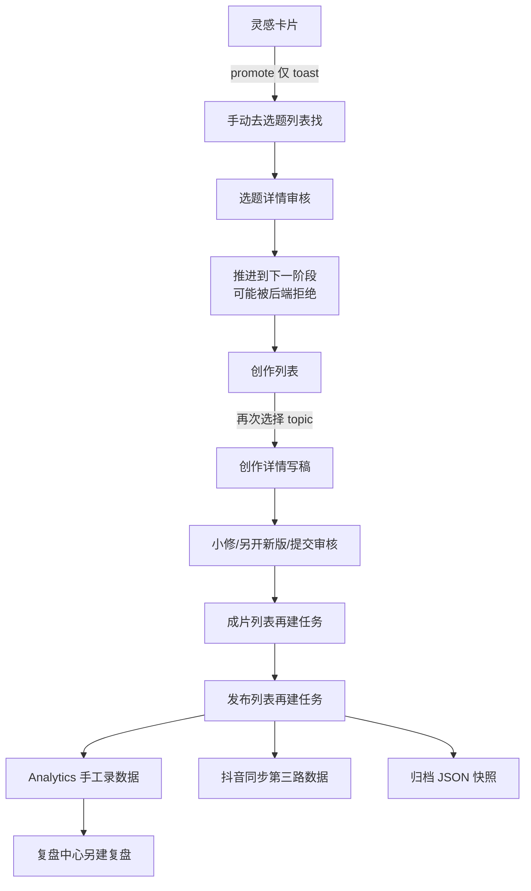
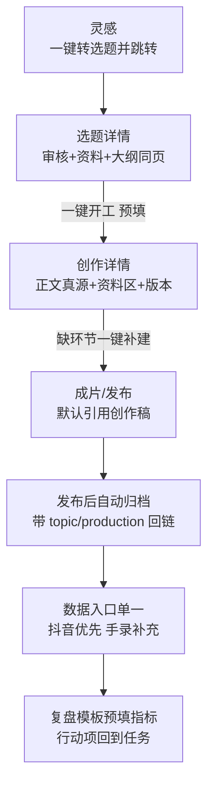

# XMT 产品改造清单（2026-09 · v3.1.2 审查）

【续进度 · v9.1.18】成批闭合 G 手机首页准确计数/账号归属与桌面入口，并推进 B8 复盘离页保护：现有摘要增加 active_topics，全可见范围准确计数与最多三条元数据预览，包含已通过、排除已完成/驳回；手机取消前 30 条分页推算，失败保持未知，团队/个人标记准确。账号/角色/凭证变化后手机旧摘要及共用权限立即失效，迟到请求不能恢复旧数据和创建入口；桌面新建与空态依实际 topic:create，灵感显示三条预览。复盘返回先确认未保存文字，取消保留，写入期间不可返回；刷新/关闭会提醒，保存成功解除，放弃不写服务器，只读文字同样保护。隔离 API/OpenAPI 与首页/选题、复盘行动项完整浏览器回归通过，包含 >30 条、稳定排序、无分页读取、390/1440px 不可取消旧响应及离页状态。无数据库或权限模型变更；Android 仅同步 90118，未构建 APK；仅本地修改，不提交、推送或部署。G 指派/自审规则与可信骤降阈值、B8 全站导航/其他详情读取归属、B4/B5 全站及外部验收继续开放。

【续进度 · v9.1.17】成批推进 B8/H 内容保护：桌面/移动网页提报期间锁定内容和草稿切换/删除，同步防重，失败恢复原稿；最后一份草稿删除失败返回真实结果并明确提示已提报。复盘结论以已保存基线/提交快照同步，快照/行动项/刷新及保存回执保留未保存/在途文字；发布前要求保存，转为只读时保留文字并经明确确认恢复本地已保存结论。行动项表格和详情新结果正确同步，真正未保存编辑保留；复盘筛选与账号/个人行动项忽略迟到响应。创作资料确认读取且编辑器就绪后开放添加，移除空基线回退，插入/引用期间保护搜索、选择和关闭，失败保留正文/草稿/选择。四个完整浏览器套件及安全草稿/多草稿合同通过，覆盖 320/390/1440px、亮暗主题、延迟/503、双击、内容保留和账号/筛选竞争；类型检查与定向/全仓 ESLint 通过。无 API、权限模型、数据库或真实数据变化；Android 仅同步 90117，未构建 APK；仅本地修改，不提交、推送或部署。G 手机首页精确计数/账号归属与桌面入口、B8 复盘离页保护、B4/B5 全站及产品决策/外部验收范围继续开放。

【续进度 · v9.1.16】成批推进 P0/B4/B8：日报可填写能力与实际提交权限对齐，未授权用户仍可只读查看本人已有日报；团队/归档及报告中心入口按实际权限展示，无角色名称旁路。月报/年报保存期间锁定正文和年月选择，并同步防止重复请求；失败后保留原文，确认内容后可重试。JSON 导出明确模块范围，不再称完整备份，反馈文件已生成并开始下载；CSV 状态/平台中文化，JSON 代码保持原格式。MiMo 完成只读复核，当前批注点击菜单经浏览器复现后迁到页面根层，按实际尺寸限制视口并支持外部滚动/视口变化/Escape 关闭；FloatingMenu 建议核查为未挂载代码，保留启用前事项。日报权限 API、日报/总结表单恢复、分析/报告中心、创作审阅浏览器及菜单几何合同通过，覆盖撤销权限的管理层、只读已有/空记录、授权团队入口、月报双击失败重试/输入保留、导出文件/失败重试、320px 批注操作及协作恢复。无权限模型/数据库/真实数据变化；Android 仅同步 90116，未构建 APK；仅本地修改，不提交、推送或部署。B4/B5 全站、B8 其余操作、G 未完规则/可信指标范围及 Android 专项仍开放。

【续进度 · v9.1.15】继续 J4/B4 全局层叠表：原有令牌尚未被消费者使用，共享弹窗的 `z-50` 实测覆盖了 modal 令牌。现统一 CSS/Tailwind 语义层级并接入壳层、当前根浮层、弹窗/抽屉、操作提示、命令面板和编辑器菜单；通知随弹窗层加 10，菜单关闭遮罩随菜单层减 1。编辑器浮动菜单迁到页面根层并使用视口约束与逐帧祖先滚动跟随，定位后重算颜色面板方向/高度。资源页实际验证令牌变化、提示/命令叠加可达，编辑器验证菜单/遮罩变化与滚动不越界；全局搜索、日报、移动工作台、登录和灵感浏览器回归通过。无 API、权限或数据库变化；v9.1.15，Android 仅同步元数据至 90115、未构建 APK；仅本地修改，不提交、推送或部署。B4/B5 全站审计、B8 其他操作、G 未完项及 Android 专项仍开放。

【补充验收 · v9.1.14】延迟写入实测确认桌面日报提交期间正文和刷新仍可操作，成功回执会重置正文。现锁定正文/刷新并增加同步防重复提交保护；失败解锁且保留草稿，双击仅执行一次保存和提交。总结 API 合同的弹窗静态渲染断言迁到真实浏览器，月报三段、年报四段及空字段、关闭和只读路径均通过。资料、创作、选题及日报的未知状态映射也排除对象继承属性，特殊未知值不导致界面渲染错误；语言合同通过。仍仅本地修改，不提交、推送或部署。

【续进度 · v9.1.14】继续 P0/B8 日报状态与结果反馈核查：日报归档此前把“已退回/已归档”等状态混成“已提交”，另一归档列表把非已提交状态都标为“草稿”，未知值也会被误判。现统一显示“草稿/已提交/已审核/已退回/已归档”，未知值提示“状态待确认”。此外，日报正式提交失败后原本已有页面内重试说明，却又叠加全局失败通知；重试成功后通知仍短暂残留。现仅保留页面内失败说明，成功后显示单一成功反馈。隔离 Playwright 覆盖失败→安全重试→成功、六类状态、桌面及 390px 无溢出和控制台错误。无 API、权限、数据库或日报数据变化；v9.1.14，Android 仅同步元数据至 90114、未构建 APK；仅本地修改，不提交、推送或部署。P0/B4/B5/B8 其余范围、G 未完项及 Android 专项仍开放。

【续进度 · v9.1.13】继续 P0 业务语言核查：Chrome DevTools MCP 实际资料详情快照发现“可见范围 team / 状态 active”原样呈现；代码巡检又发现创作详情及选题列表未知状态会回退显示服务端原始码。现将资料 `private/project/team/company`、`active/published/deleted`，创作审核 `draft/review/approved/rejected` 和选题七个既有阶段统一映射为中文业务用语；未知值统一显示待确认提示，不透出服务端枚举。隔离浏览器覆盖映射与回退、两类详情真实呈现、资料页亮暗主题/320/390/1440px及写入失败重试、创作协作审阅和选题列表响应式操作回归。无 API、权限、数据库或数据变化；版本 v9.1.13，Android 仅同步元数据至 90113、未构建 APK；仅本地修改，不提交、推送或部署。P0/B4/B5/B8 其余范围、G 未完项及 Android 专项仍开放。

【续进度 · v9.1.12】继续 B8/B4 弹窗内操作反馈：隔离删除失败路径复现全局错误提示被确认弹窗遮罩挡住、关闭按钮不可达；桌面/移动全局通知容器提升至遮罩层级之上，桌面增加礼貌播报。资料删除失败后提示可见可关闭，显式重试仅执行一次并在服务端确认后完成；列表/详情恢复合同通过。`npm run test:resource-hover-contrast-browser` 通过，并并行复核设置、选题批量反馈/响应式、发布、灵感、复盘列表/行动项、匿名意见管理亮暗主题与窄屏测试。无 API、权限、数据库或业务规则变化；版本 v9.1.12，Android 仅同步元数据至 90112、未构建 APK；仅本地修改，不提交、推送或部署。P0/B4/B5/B8 其余范围、G 未完项及 Android 专项仍开放。

【续进度 · v9.1.11】继续 P0/B4/B5 登录页审计：style1 曾展示微信、企微和邮箱三个没有提交处理器的按钮，当前也没有相应登录服务配置，点击无动作。现隐藏未接通入口，不改变认证方式或授权；将重复英文系统尾注统一为中文业务说明。隔离浏览器按前景透明度合成后计算文字对比度，覆盖 style1/style2/style3 × 亮/暗主题，并验证 320px/390px 账号、密码和主操作可见、无横向溢出及无占位登录按钮。Playwright MCP 与 Chrome DevTools MCP 实测页面快照/320px，测试夹具无异常浏览器错误。`npm run test:login-theme-contrast-browser`、类型检查、定向 ESLint、生产构建、版本/更新说明治理、测试入口、Studio 令牌门禁、Android runtime 契约和差异检查通过。无 API、权限、数据库或真实账号变化；版本 v9.1.11，Android 仅同步元数据 90111、未构建 APK；仅本地修改，不提交、推送或部署。P0/B4/B5/B8 其余范围、G 未完项及 Android 专项仍开放。

【续进度 · v9.1.10】继续 G 首页聚合：原首页分别读取 5 组阶段选题列表与 12 条生产记录，再在浏览器拼接计数/预览并筛本人草稿，分页会漏掉较早的本人稿件。现由 `/api/dashboard/home-attention` 按原列表权限一次返回 5 个阶段的精确总数和每阶段最多 3 条元数据预览；个人摘要仅取当前操作人的草稿/退回稿，上限 12、不含正文。首页移除逐阶段选题和分页生产稿件请求，失败时各阶段保持未知，由一个可重试提示恢复；阶段预览标题和停留时间改用 Studio 次级文字令牌，隔离浏览器实测亮/暗主题对比度均 ≥4.5:1。隔离 API 覆盖可见范围、预览上限、正文隔离、操作人草稿范围及大量新近他人稿件下本人稿件不遗漏；浏览器确认主页旧列表请求为零、失败/重试、桌面/390px 通过。另修成就无配置时隐藏无效“检查新成就”操作。`npm run test:home-dashboard`、`npm run test:api-contract`、`npm run test:topic-stage-record-repair-browser`、类型检查、定向 ESLint、生产构建通过；无数据库迁移、权限规则或真实数据变化。版本 v9.1.10；Android 仅同步元数据 90110，未构建 APK；仅本地修改，不提交、推送或部署。P0/B4/B5/B8 其余范围、G 余项及 Android 专项仍开放。

【续进度 · v9.1.9】继续 P0/B5：成就系统 `/achievements` 普通成员看见“暂无成就”时，原提示要求点击其不可见的管理员按钮；现按管理权限分别说明正确下一步，管理员操作按钮改为“启用预设成就”，并仅在已有成就可检查时显示“检查新成就”，避免空配置下出现无效操作。积分榜空列表也说明当前没有可排行成员，并告知启用成员后会显示排行；同页修复筛选器辅助名称及稳定字段标识、标题层级和计分文本对比度。Lighthouse 还发现根文档错误标为英文且缺少产品描述，现改为简体中文并补充准确描述；由于系统需登录、不面向公开搜索，添加禁止收录的 robots 规则（不替代认证/服务端授权）。隔离浏览器覆盖普通成员/管理员权限态、亮暗主题、无障碍名称和字段标识、至少 4.5:1 文本对比度、页面元数据、robots、390px 无溢出及零业务写入；Chrome DevTools Lighthouse 无障碍、最佳实践、SEO 均为 100。无 API、权限、数据库或真实数据变化；Android 仅同步元数据至 90109，未构建 APK；仅本地修改，不提交、推送或部署。P0 全站业务语言、B4/B5 其余页面、B8 全量操作反馈、G 未完项及 Android 专项仍开放。

【复核进度 · v9.1.9】B7 灵感转选题现状已对照代码与隔离合同确认：转化在事务内关联选题 ID，浏览器在桌面/移动可直达并回链；重复请求返回原选题，历史 `promoted` 但无可靠 ID 的旧记录明确提示核对，不猜测、不重复建题。`npm run test:inspiration-topic-link`、`npm run test:topic-title-similarity`、`npm run test:inspiration-theme-contrast-browser` 和 `npm run test:mobile-work-center-browser` 通过；移动流程覆盖 320px/390px。仅修正回归测试对重复“已完成”文本的定位范围，无产品状态/数据写入变化。

【续进度 · v9.1.8】继续 B5 全站主题/对比度审计：Chrome Lighthouse 在实际挂载的全局顶栏发现“Ctrl K”快捷键提示深色主题只有 3.82:1；设置页移动端壳层又发现标题为 4.11:1、未选中导航为 4.07:1。现统一改用 Studio 次级文字令牌，并添加桌面顶栏、移动标题和五个导航标签的亮/暗主题对比度回归；Chrome DevTools MCP 与 Lighthouse 桌面/移动复核通过，移动 390px 无溢出。无 API、权限、数据库或真实数据变化，Android 仅同步元数据至 90108，未构建 APK；仅本地修改，不提交、推送或部署。此项只关闭本轮实测的全局顶栏和移动壳层问题，P0 业务语言其他路径、B4/B5 其余页面、B8 全量写入反馈、G 未完项及 Android 专项仍开放。

【续进度 · v9.1.7】继续 P0/B8 选题保存闭环：仅编辑标题等非大纲字段时，使用页面聚合保存，不再要求一个未挂载的大纲编辑器句柄；编辑大纲时，保存与版本留档在运行时句柄就绪前锁定，并告知“编辑器正在准备”。逻辑合同覆盖 runtime/legacy 与句柄就绪边界；隔离浏览器确认标题单独修改成功，且大纲保存失败保留输入、可显式重试并能建立准确版本。无 API、权限、数据库或真实数据变化；Android 仅同步元数据至 90107，未构建 APK；仅本地修改，不提交、推送或部署。P0 业务语言其他路径、B4/B5 全站审计、B8 全量写入反馈、G 未完项及 Android 专项仍开放。

【复核进度 · v9.1.7】继续核验 P0 用户文案：Layout 当前实际挂载的版本提醒 `UpdateNotification` 已使用“版本更新”及“查看更新说明”等业务语言；未发现需要改动的英文 “System Update” 可见文案。旧版浏览器用例中的“系统更新”选择器与当前组件结构不一致，不作为产品界面证据；本轮没有为适配旧用例改写产品文案。

【复核进度 · v9.1.7】B2 提报草稿已满足清单允许的“本地草稿 + 续写列表”方案：桌面与移动网页按账号保存在本机，支持多份草稿自动保存、手工保存、新建、切换续写与删除；只有明确提交时才创建服务端选题，界面也明确告知草稿不会提交审核。草稿集合合同及桌面/移动浏览器回归通过，320px/390px 工作台与流程回归通过。草稿仍是设备本地内容，不跨设备同步；B2 的状态真源和其它流程缺口仍开放。

【续进度 · v9.1.6】继续 P0/B2：选题从创作或成片制作阶段推进前，在状态迁移事务内核验当前阶段记录；缺失时回滚状态、历史及目标阶段写入，并返回“请先补齐后再推进”的明确原因。桌面与移动端隐藏推进入口并将补齐作为前置处理；隔离 API 验证两阶段拒绝/事务不留痕和补齐后重试成功，浏览器验证桌面/移动流程；移动端在推进确认后同步目标阶段记录状态，不再误报缺失。另清理选题编辑器未就绪/已关闭时的开发术语，保留“当前修改未保存”的明确反馈。无数据库迁移、权限变化或历史回填；Android 仅同步元数据至 90106，未构建 APK；仅本地修改，不提交、推送或部署。P0 业务语言其他路径、B4/B5 全站审计、B8 全量写入反馈、G 未完项及 Android 专项仍开放。

【续进度 · v9.1.5】继续 B10 移动端语言统一：移动个人页改为复用统一角色显示函数，与数据库角色表的内置名称一致；自定义/未知角色显示“自定义角色”，未分配时显示“未分配角色”，不再错误显示为普通人员或暴露内部代码。角色契约测试覆盖全部内置角色和未知/缺失情形；隔离移动浏览器验证个人页 `member` 正确显示“普通人员”，移动工作台与流程页面继续覆盖 320px/390px。无 API、权限、数据库或业务规则变化；Android 仅同步元数据至 90105，未构建 APK；仅本地修改，不提交、推送或部署。B10 状态/角色其他路径、P0 全站业务语言、B4/B5 全站审计、B8 全量操作盘点、G 未完项及 Android 专项仍开放。

【续进度 · v9.1.4】继续 B4/B8 发布管理操作盘点：发布记录删除、抖音数据关联刷新与人工关联均加入同步单飞锁；写入等待时锁定相关操作入口，防止重复请求或切换关联弹窗。Chrome DevTools 发现发布列表搜索缺少辅助名称，现为列表与抖音候选搜索补充可访问名称和稳定标识。延迟 DELETE/POST/PUT 隔离浏览器验证快速重复触发只提交一次；另覆盖搜索名称、删除失败重试及写入确认后列表刷新失败只读恢复。`npm run test:publishing-hover-contrast-browser`、`npm run check`、目标 ESLint、生产构建、版本/更新说明治理、Android runtime 契约、测试入口检查和 `git diff --check` 通过，构建保留既有 >500kB 分包提示。无 API、权限、数据库或业务规则变化；Android 仅同步元数据至 90104，未构建 APK；仅本地修改，不提交、推送或部署。B8 其他路径、P0 全站业务语言、B4/B5 全站审计、G 未完项及 Android 专项继续。

【续进度 · v9.1.3】继续 P0/B8：编辑稿离开保护提示不再出现“保存协调”等内部术语，明确说明最后一处未确认的修改可能无法恢复；发布记录新增/更新期间锁定表单并加入同步单飞保护，快速连点只发出一次写入，失败保留输入，刷新失败仍只需只读重载。两组隔离浏览器覆盖离开提示、延迟 POST 双击、忙碌控件和已确认写入后的只读恢复；`npm run test:workflow-details-responsive-browser`、`npm run test:publishing-hover-contrast-browser`、`npm run check` 与定向 ESLint 通过；对话框文件保留 1 条既有 Fast Refresh warning。无 API、权限、数据库或业务规则变化；Android 仅同步版本元数据至 90103，未构建 APK；仅本地修改，不提交、推送或部署。P0 全站程序员语言、B4/B5 全站审计、B8 其他写入路径、G 未完项及 Android 专项继续。

【续进度 · v9.1.2】首页任务区按钮原名“查看全部任务”但只跳转选题列表，现更名“进入选题管理”；隔离浏览器验证实际路由为 `/topics`。同时为桌面列表/看板筛选及移动选题搜索补充稳定控件标识、可访问名称；用户菜单名称纳入可见账号/角色，动画标题保留静态读屏文本并隐藏装饰副本。无 API、权限、数据库或任务数据变化；未部署、提交或推送；Android 仅同步元数据至 90102，未构建 APK。G 的完整跨模块团队任务视图及依赖业务规则/可信数据的指标仍开放，B4/B5 全站审计、B8 全量操作反馈盘点、Android 专项和其余项目继续。

【续进度 · v9.1.1】继续 G 首页第三屏可选数据：仅对已有 `creator:data:view` 权限且返回可信数据的账号，显示“近 7 天播放变化”和“粉丝总数”，并注明统计窗口、粉丝累计含义与同步时间。无权限时不发起创作者数据请求；无账号或指标缺失时隐藏，读取失败可单独只读重试。浏览器验证桌面有权展示、无权隐藏、无数据不伪造 0、失败恢复；独立 `MobileHome` 保持现状。无新增接口、权限规则或数据库迁移；Android 仅同步元数据至 90101，未构建 APK；仅本地修改，不提交、推送或部署。播放骤降阈值、专属稿件审核责任/权限模型、完整跨模块团队概览仍未完成；B4/B5 全站审计、B8 全量操作盘点、Android 专项及清单余项继续。

【续进度 · v9.1.0】继续 G 首页第三屏“最近变化”：去掉从普通稿件/发布更新时间和选题当前状态拼出的伪事件，新增只读服务端摘要，来源限定为显式稿件版本、既有批注/回复和选题阶段历史，最多 12 条并支持直达。稿件及批注/回复正文、历史备注不进入响应；按现有内容可见范围过滤。首页错误状态和只读重试与其他模块隔离；不再额外读取发布记录列表。SQLite/API 覆盖个人和管理者范围、顺序/上限、字段白名单和敏感正文隔离；OpenAPI、首页桌面浏览器事件直达、隔离 503 重试、类型检查和定向 ESLint 通过。无数据库迁移或权限规则变化；Android 仅同步元数据至 90100，未构建 APK；未部署，仅本地修改，不提交或推送。G 中播放骤降可信阈值、专属稿件审核责任/权限模型、完整跨模块团队概览仍开放；B4/B5 全站审计、B8 全量操作盘点、Android 专项和清单余项继续。

【续进度 · v9.0.7】继续 B9 导航入口与页面授权一致性：复盘菜单此前使用较宽的 `analytics:view`，但 `/retrospectives` 页面由 `analytics:retro:view` 路由守卫保护，可能出现入口可见、进入后被拒的体验。现把菜单可见规则改为与路由一致；服务器端仍分别按现有复盘可见范围校验，不新增/放宽权限。前端挂载合同覆盖两个入口权限相同；无 API、数据库或授权规则变化。Android 仅同步元数据至 90007，未构建 APK；未部署，仅本地修改。其余 B4/B5 全站审计、B8 操作盘点、G 未完项、Android 专项和清单其余项目继续开放。

【续进度 · v9.0.6】继续 G 首页内容流真实性与权限边界：复盘阶段此前误用“已发布记录”汇总数，并显示固定占位文案。现改为复用复盘列表完全相同的可见规则（管理者/`analytics:retro:view` 可见全部；其他账号仅见已发布、本人负责/创建或本人行动项关联的复盘），返回准确总数和最多三条标题/周期/状态摘要，不包含复盘正文。摘要查询失败只将复盘阶段标为不可用，不影响首页其他数据；普通编辑更新时间不冒充阶段停留时长。隔离 SQLite/API 覆盖个人范围、权限、预览上限和错误隔离；桌面浏览器覆盖真实卡片、复盘中心跳转与摘要失败隔离，移动工作台在 320px/390px 回归确认接口兼容和无溢出。`npm run test:home-dashboard`、API 合同、首页浏览器回归、类型检查、版本治理、更新说明治理及 Android runtime 契约通过。无数据库迁移或权限规则变化；Android 仅同步元数据至 90006，未构建 APK；仅本地修改，不提交、推送或部署。G 中播放骤降的可信阈值/指标口径、专属稿件审核责任与权限模型、完整跨模块团队概览仍未完成；B4/B5 全站审计、B8 全量操作盘点、Android 专项及清单其他项目继续开放。

【续进度 · v9.0.5】继续 B6 归档来源闭环：发布归档详情可回到来源选题，并展现归档时记录的成片/发布剧本来源创作版本；来源明确且有 `production:view` 权限时可直达对应历史稿，还可展开查看归档保留的准确来源正文快照。隔离浏览器进一步实际点击成片 v2.0 与发布 v1.0 两条来源，确认各自打开准确历史正文且保持只读；并覆盖来源不可用、无原稿查看权限、跨选题来源、旧归档边界与 320px/390px 无横向溢出，不借用当前稿件补猜。Playwright MCP 与 Chrome DevTools MCP 独立复核 v2.0 直达、正文及移动只读状态，观测期间无控制台错误/警告。既有归档 API/权限规则/数据库结构不变，未部署。Android 仅同步元数据至 90005，未构建 APK；仅本地修改，不提交或推送。B6 其他跨模块历史关系、B4/B5 全站审计、B8 全量操作盘点、G 未完项及 Android 专项仍开放。

【续进度 · v9.0.4】继续 B6 来源谱系直达：创作初稿快照只有在已有明确大纲版本时显示“查看来源大纲版本”，跳回对应选题；桌面自动定位并展开准确大纲历史，移动网页展示同一版只读正文。大纲历史读取失败可重试；来源版本缺失或无法定位时明确说明，不以当前大纲替代，且历史查看路径不开放选题编辑、审核或阶段推进。隔离浏览器覆盖 1440px 桌面、320px/390px 移动端的直达、准确版本、可达性、无横向溢出和缺失边界；无数据库迁移、权限变化或真实数据写入，未部署。Android 仅同步元数据至 90004，未构建 APK；仅本地修改，不提交、推送。B6 其他跨模块历史关系、B4/B5 全站审计、B8 全量操作盘点、G 未完项及 Android 专项仍开放。

【续进度 · v9.0.3】继续 B6 历史来源保真：创作历史版本清理除检查拍摄/发布当前稿来源外，也检查 `workflow_document_versions` 中各历史剧本保存时的来源；被任一历史版本引用的创作历史稿不清理。删除创作记录同样检查逐版本历史来源，只有历史卡保留引用时也拒绝删除，避免来源直达失效。隔离 API/SQLite 覆盖版本来源字段回读、历史来源保留、精确版本可读取和仅由历史版本引用时拒绝删除；无数据库迁移、权限变化或真实数据写入，未部署。Android 仅同步元数据至 90003，未构建 APK；仅本地修改，不提交、推送。B6 其他跨模块历史关系、B4/B5 全站审计、B8 全量操作盘点、G 未完项及 Android 专项仍开放。

【续进度 · v9.0.2】继续 B6 跨模块历史流转：成片与发布剧本的每条历史记录都显示该版本保存时明确关联的创作稿 ID/版本，可直达对应当前稿或历史稿；没有 ID/版本的旧历史与基线明确显示来源未记录，不借用当前剧本来源补猜。成片跳转经过编辑器离开保护；发布编辑/保存期间禁用来源跳转。隔离浏览器覆盖来源随版本写入、卡片展示、来源直达和未记录边界；未部署。Android 仅同步元数据至 90002，未构建 APK；仅本地修改，不提交或推送。B6 其他跨模块历史流转、B4/B5 全站审计、B8 全量操作盘点、G 未完项及 Android 专项仍开放。

【续进度 · v9.0.1】B6 为创作初稿来源快照补上可验证的大纲版本关联：migration 030 SAFE_EXPAND 仅新增可空字段，不回填旧数据；创建初稿时，仅当快照文本精确匹配唯一一条非基线显式大纲版本才记录版本号。桌面/移动创作详情展示版本号；缺失、仅基线或多个版本正文相同则保留原始快照并明确不推断。隔离迁移/API/浏览器测试通过；未执行生产迁移、未部署。Android 仅同步元数据至 90001，未构建 APK；仅本地修改，不提交或推送。B6 其他跨模块历史流转、B4/B5 全站审计、B8 全量操作盘点、G 未完项及 Android 专项仍开放。

【续进度 · v9.0.0】继续 B6 稿件多处存放与发布侧改稿分叉治理：选题大纲、拍摄剧本、发布文稿现可由用户显式保存小/大版本并查看准确历史正文；普通保存不产生版本。首次显式建档时保留当前基线，但历史时间/操作者未知则保持未记录；migration 029 只新增 SAFE_EXPAND 快照表，不回填或改写旧稿，删除业务记录时同事务清理快照。另核实已发布归档仍是选题级可更新快照、不是逐版本历史；新增回归确认显式发布小版本写入后归档同步成功、归档正文与线上发布稿一致且漂移标记清除。隔离迁移/API/浏览器测试及 Chrome DevTools MCP 复核通过；未执行生产迁移、未部署。B6 其他跨模块历史流转、B4/B5 全站审计、B8 全量操作盘点、G 未完项及 Android 专项仍开放。

> 目标：让传媒公司的人每天愿意打开 XMT，并更快、更舒服地完成「灵感 → 资料 → 写稿 → 协作 → 审核 → 发布 → 数据复盘」。

【续进度 · v8.5.23】继续 B4/B5 桌面选题表格审查：1440px 截图发现流程进度区的中文阶段名称在原有窄列中逐字换行。现将共享流程组件收敛为横向单行节点，保留工作流颜色与 Studio 语义令牌；隔离浏览器在 1366px/1440px/1920px 与 80%–125% 缩放下验证六个阶段名称均为单行，Playwright MCP 复核 1440px 页面宽度与行操作正常。`npm run test:topics-responsive-browser`、`npm run check`、目标文件 ESLint、`npm run build`、版本一致性/治理、更新说明治理、测试入口、Studio 令牌门禁、Android runtime 契约和 `git diff --check` 通过；构建保留既有 >500kB 分包提示。无 API、权限或数据库变化；Android 仅同步元数据至 80523，未构建 APK；仅本地修改，不提交、推送或部署。此项完成选题列表桌面流程标签检查点；B4/B5 全站审计、B8 全量操作盘点及其余清单项仍开放。

【续进度 · v8.5.22】B4/B5/B10 移动选题路径截图审查发现：320px 下详情“保存修改/进入创作”固定操作栏与主导航重叠，两个界面把截止日期/更新时间显示为 ISO 字符串，更新时间还会被窄列截断。现操作栏固定在底部导航上方；列表截止日期及详情更新时间/截止日期统一按北京时间显示，更新时间取日期粒度。隔离浏览器以 320px 与 390px 覆盖选题列表→详情、北京时间日期、操作栏边界与页面溢出；移动工作台、拍摄和发布回归通过。`npm run test:mobile-work-center-browser`、`npm run check`、目标文件 ESLint、`npm run build`、`npm run version:check`、更新说明治理（286 个版本）、测试入口（209 个）、Studio 令牌门禁（37 类）、Android runtime 契约和 `git diff --check` 全部通过；构建保留既有 >500kB 分包提示。无 API、权限、数据库或业务数据变化；Android 仅同步元数据至 80522，未构建 APK；仅本地修改，不提交、推送或部署。移动选题该路径局部完成；B4/B5 全站审计、B8 全量操作盘点及其他清单项仍开放。

【续进度 · v8.5.21】继续 B8 移动创作写入反馈：延迟保存时正文原本仍可编辑，而创建/更新请求使用点击时捕获的正文；如果用户在请求返回前继续输入，旧正文可能先落库，再被成功回调清除本机草稿。现保存/提交期间锁定正文与关联选题，且审核提交按钮不能与保存并发；失败后解除锁定，原正文保留并可显式重试。`npm run test:mobile-work-center-browser` 在 390px 隔离浏览器注入延迟 503，确认写入在途期间正文只读、提交禁用、失败后内容仍在，重试成功；320/390px 工作台和拍摄/发布回归通过。`npm run check`、目标文件 ESLint（0 errors/0 warnings）、`npm run build`、`npm run version:check`、更新说明治理（285 个版本）、测试入口（209 个）、Studio 令牌门禁（37 类）、Android runtime 契约及 `git diff --check` 全部通过；构建保留既有 >500kB 分包提示。无 API、权限、数据库或真实数据变化；Android 仅同步版本元数据至 80521，未构建 APK；仅本地修改，不提交、推送或部署。移动创作写入等待反馈局部完成；B8 全量操作盘点、B4/B5 全站主题/响应式审计、B6/G 与其余清单项继续开放。

【续进度 · v8.5.20】继续 B8/B10 移动创作流程：隔离浏览器发现 `/production/content/new` 原先没有加载可关联选题，且新建页读取状态尚未完成时权限判断会把 `canEdit=false` 误显示成 403；这也遮蔽了列表读取失败和恢复操作。现新建路径读取允许进入创作/生产阶段的选题，读取失败展示准确错误和只读重试；路由访问判断仅看授权，编辑控件仍等待数据就绪。创作保存/提交增加同步单飞锁，延迟请求下快速双击不会重复创建/更新。隔离 390px 浏览器覆盖选题 GET 503→只读重试、双击保存仅一个 POST、失败后正文留存、显式重试成功；完整移动工作台 320/390px 回归通过。Playwright MCP 与 Chrome DevTools MCP 在 390px 隔离 mock 页面确认选题选择、正文编辑和稿件页跳转；实时同步离线提示是本地未启动 Socket.IO 服务的预期现象，不代表真实账号/API 验收。`npm run test:mobile-work-center-browser`、`npm run check`、目标文件 ESLint、`npm run build`、`npm run version:check`、更新说明治理（284 个版本）、测试入口（209 个）、Studio 令牌门禁（37 类）、Android runtime 契约及 `git diff --check` 全部通过；构建保留 >500kB 分包提示。无 API、权限规则、数据库或真实业务数据变化；Android 仅同步版本元数据至 80520，未构建 APK；仅本地修改，不提交、推送或部署。B8/B10 仍只完成本路径，B4/B5 全站审计、B6/G 与其余 B8 项继续开放。

【续进度 · v8.5.19】继续 B8 移动日报重复操作防护：日报提交先保存草稿再提交，原先仅在第一次事件后更新 React `saving` 状态；延迟响应时快速双击可能并发保存相同版本，导致额外 409 和错误提示竞争。现增加同步单飞锁，从事件处理器起点即拒绝并发流程，失败后释放锁允许明确重试。隔离浏览器将日报草稿 POST 延迟，并在 320px/390px 对提交快速双击；两视口都只产生一次草稿写入，后续注入的提交失败可使用服务端新版本显式重试成功。`npm run test:mobile-work-center-browser`、`npm run check`、`npm run build`、定向 ESLint（0 errors/0 warnings）、`npm run version:check`、更新说明唯一性（283 个版本）、测试入口（209 个）、Studio 令牌门禁（37 类）、Android runtime 契约及 `git diff --check` 通过；构建保留 >500kB 分包提示。无 API、权限、数据库或真实业务数据变化；Android 仅同步元数据至 80519，未构建 APK；仅本地修改，不提交、推送或部署。此日报单飞写入路径局部完成；B8 全量操作盘点、B4/B5 全站审计及其他 B6/G 项仍开放。

【续进度 · v8.5.18】继续 B8 移动日报账号隔离：同一页面账号切换时，个人日报状态可能跨账号保留；上一账号未完成的 GET 也可能迟到并覆盖新账号内容。现按账号 ID 设立独立日报组件生命周期，切换时立即卸载旧状态；每次读取使用请求序号，且响应/错误/完成状态均验证请求仍属于当前账号。日报保存返回后若登录身份已变化，不继续以新身份执行提交，避免跨账号使用已保存记录。隔离 390px 浏览器挂起账号 A 的日报读取，切换到 B 并加载专属日报，再释放 A 响应，确认只显示 B 内容、仅读取两次且没有写入。`npm run test:mobile-work-center-browser`、`npm run check`、`npm run build`、定向 ESLint（0 errors/0 warnings）、`npm run version:check`、更新说明唯一性（282 个版本）、测试入口（209 个）、Studio 令牌门禁（37 类）、Android runtime 契约及 `git diff --check` 通过；构建保留 >500kB 分包提示。无 API、权限、数据库或真实业务数据变化；Android 仅同步元数据至 80518，未构建 APK；仅本地修改，不提交、推送或部署。此移动日报读取身份切换路径局部完成；B8 全量操作盘点、B4/B5 全站审计及其他 B6/G 项仍开放。

【续进度 · v8.5.17】继续 B8 移动选题列表读取反馈：`useTopics` 查询失败时页面没有检查 `isError`，`data` 为空便落入“没有符合条件的选题”，将服务异常伪装成真实零结果；空看板也会出现。现无成功数据且查询失败时改为明确错误与重试，数量显示“暂不可用”，不渲染空列表/空看板；若有上次成功缓存，保留内容并注明可能不是最新。查询期间重试按钮禁用。隔离浏览器在 390px 注入自动重试期间连续两次 503，验证错误/不误报空结果；用户显式重试成功后显示准确选题并清除错误。`npm run test:mobile-work-center-browser`、`npm run check`、`npm run build`、定向 ESLint（0 errors/0 warnings）、`npm run version:check`、更新说明唯一性（281 个版本）、测试入口（209 个）、Studio 令牌门禁（37 类）及 `git diff --check` 全部通过；构建保留 >500kB 分包提示。无 API、权限、数据库或真实业务数据变化；Android 仅同步元数据至 80517，未构建 APK；仅本地修改，不提交、推送或部署。此移动列表读取路径局部完成；B8 全量操作盘点、B4/B5 全站审计及其他 B6/G 项仍开放。

【续进度 · v8.5.16】继续 B8 移动创作列表刷新反馈：已有内容的列表刷新失败时，旧列表仍留在页面，却没有说明它只是最近一次成功读取结果，容易被误当作最新。现保留旧结果时显示“当前列表可能不是最新”，失败按钮改为“重新加载创作列表”；显式 GET 重试成功后替换内容并清除错误/过期提示。账号 ID 变化时清理旧账号列表，并以请求序号丢弃身份变化或组件卸载后的迟到结果。隔离浏览器覆盖首读成功→刷新 503→旧列表明确标注→显式只读重试返回新列表，继续覆盖工作台与拍摄/发布 320/390px 布局。`npm run test:mobile-work-center-browser`、`npm run check`、`npm run build`、`npm run version:check`、更新说明唯一性（280 个版本）、测试入口（209 个）、Studio 令牌（37 类）、定向 ESLint（0 errors/0 warnings）与 `git diff --check` 通过；构建保留 >500kB 分包提示。无 API、权限或数据库变化；Android 仅同步元数据至 80516，未构建 APK；仅本地修改，不提交、推送或部署。此移动读取反馈局部完成；B8 全量操作盘点、B4/B5 全站审计及其他 B6/G 项仍开放。

【续进度 · v8.5.15】继续 B8 移动端选题资料读取可靠性：此前资料接口失败被静默吞掉，页面仍显示“暂无关联资料”；资料请求又耦合在权限初始化可能重新触发的选题加载内，易重复读取并覆盖错误状态。现按选题 ID 独立加载关联资料，以请求序号丢弃过期响应，展示加载状态、明确错误提示和“重新加载资料”只读重试。`npm run test:mobile-work-center-browser` 覆盖资料 503、失败态不误报为空、显式 GET 重试及 320/390px 工作台与流程详情；Playwright MCP 与 Chrome DevTools MCP 在 390×844 隔离页面均确认仅两次 GET、重试后恢复、无页面运行时异常。隔离 Vite 未启动 API 服务，Socket.IO 轮询有预期 500；未连真实账号/API。`npm run check`、`npm run build`、`npm run version:check`、更新说明唯一性（279 个版本）、测试入口（209 个）、Studio 令牌（37 类）、定向 ESLint（0 errors/0 warnings）和差异检查通过；构建保留 >500kB 分包提示。无真实业务数据变化；Android 仅同步元数据至 80515，未构建 APK；仅本地修改，不提交、推送或部署。此项局部完成；B8 全量操作盘点、B4/B5 全站审计及其他 B6/G 项仍开放。

【续进度 · v8.5.14】继续 B8 选题详情手动保存反馈：失败回调此前静默吞掉错误；且服务端更新失败路径没有释放保存中状态，按钮会持续禁用。现在页面以内联错误提示明确“保存未完成、修改仍保留”，失败释放互斥状态，下一次保存开始时清除旧提示。隔离浏览器注入一次选题更新 503，验证服务端记录不变、编辑器仍保留草稿、只发出一次失败写入；用户再次点击后重试成功且总写入两次。`npm run test:topic-stage-record-repair-browser`、类型检查、生产构建、版本/更新说明/入口/Studio 门禁和差异检查通过；Playwright MCP 与 Chrome DevTools MCP 于 1440×960 隔离页面确认失败反馈、草稿保留、按钮恢复及重试成功，无页面运行时错误。定向 ESLint 0 errors、6 warnings；构建保留 >500kB 分包警告。无 API、权限、数据库或真实数据变化；Android 仅同步元数据至 80514，未构建 APK；仅本地修改，不提交、推送或部署。此项局部完成；B8 全量操作盘点、B4/B5 全站审计和其他 B6/G 项仍开放。

【续进度 · v8.5.13】继续 B4 工具栏浮层可达性：Playwright MCP 在 1200×839 下打开编辑器“更多操作”后，页面滚动会使工具栏锚点离开视口；菜单仍然悬浮在版本卡片上方，继续点按时被卡片拦截。现工具栏对全部下拉浮层监听捕获阶段的滚动与窗口尺寸变化，锚点完全离开视口即收起，浮层自身滚动且锚点仍可见时保持打开。新增隔离回归明确覆盖打开菜单→滚动主内容→菜单关闭，并重跑完整编辑器审阅、协作恢复、移动布局、批注和资料重试套件；Playwright MCP 与 Chrome DevTools MCP 独立复测同一行为，1200×839 下菜单均在工具栏离开后关闭，控制台无错误/警告。定向 ESLint、类型检查、生产构建、版本/更新说明治理、测试入口、Studio 令牌门禁和差异检查通过；构建保留 >500kB 分包提示。无 API、权限、数据库或真实业务数据变化；Android 仅同步元数据至 80513，未构建 APK；仅本地修改，不提交、推送或部署。此项本地完成；B4 全站剩余响应式/核心操作、B5 全站主题审计及其他 B6/B8 项仍开放。

【续进度 · v8.5.12】继续 B4/B5 编辑器批注可达性：新增/编辑批注已从自制遮罩迁移到 Studio `BaseModal`，输入具有明确关联名称，Escape 可从任意焦点取消，遮罩点击不误丢内容；对话框通过 `document.body` 根层 portal 脱离编辑器动画与滚动容器，解决 320×568 下弹窗落到视口外的问题。隔离浏览器覆盖浅色视口完整显示、深色标题对比度、取消不写入、新增/编辑批注；完整审阅、协作恢复和资料重试套件通过。`npm run test:production-review-browser`、相邻通用弹窗回归、定向 ESLint、类型检查、生产构建、版本/更新说明治理、测试入口、Studio 令牌门禁及 `git diff --check` 均通过；构建保留 >500kB 分包提示。移动用例增加服务端正文确认等待，消除隔离夹具保存时序导致的偶发定位超时。无 API、权限、数据库或真实业务数据变化；Android 仅同步元数据至 80512，未构建 APK；仅本地修改，不提交、推送或部署。此项本地完成；B4 全站剩余响应式/核心操作、B5 全站主题审计及其他 B6/B8 项仍开放。

【续进度 · v8.5.11】继续改造清单第 9 项：登录安全升级页面将外部监控原因、实时协作审批状态和风险事件中的工程术语改为明确的准备事项与处理建议，避免管理员把排查原文误当作操作说明；原始风险原因、配置来源仍保留在默认折叠的管理员明细中。隔离浏览器验证监控待确认、协作未审批、风险触发以及展开排查记录；Playwright MCP 与 Chrome DevTools MCP 分别核对 390px 窄屏、1440px 桌面、折叠/展开语义和控制台。另复核设置权限分组、关于页及备份页面：关于页仅显示已保存品牌/角色/流程信息；系统设置与备份分组按 `system:settings` / `system:backup` 显示，独立备份路由有 `system:backup` 守卫；备份接口与页面不暴露绝对路径、SQLite 引擎或数据库文件路径。截图：`/tmp/xmt-auth-rollout-copy/auth-readiness-desktop.png`、`/tmp/xmt-auth-rollout-copy/auth-readiness-risk-admin-details.png`、`/Users/youfeifei/Projects/xmt/.playwright-mcp/page-2026-10-12T07-35-07-269Z.png`。无真实账号访问、无 API、权限或数据库变化；Android 仅同步元数据至 80511，未构建 APK；仅本地修改，不提交、推送或部署。改造清单第 9 项本地完成；B4 全站剩余响应式/核心操作、B5 主题审计和其他 B6/B8 项仍开放。

【续进度 · v8.5.10】继续 B4 作品复盘入口可达性：桌面作品库此前只在整行挂鼠标点击，作品标题不是焦点控件，键盘用户无法从列表进入复盘。现将标题改为 Studio 主题文字链接，提供明确的“打开作品 + 标题”名称与键盘焦点样式；原有整行鼠标导航保留，点击链接不会触发行级重复导航。隔离 Playwright 覆盖作品库既有读取失败/重试及分页恢复，再于桌面聚焦标题、按 Enter 打开对应作品复盘；截图：`/tmp/xmt-creator-works-desktop-link.png` 与 `/tmp/xmt-creator-works-desktop-keyboard.png`。无 API、权限或数据库变化；Android 仅同步版本元数据至 80510，未构建 APK；仅本地修改，不提交、推送或部署。B4 全站剩余响应式/核心操作、B5 主题审计和其他 B6/B8 项仍开放。

【续进度 · v8.5.9】继续 B4 发布管理窄屏操作可达性：发布列表的关联、编辑、外链与删除按钮原先位于横向表格最右侧，窄屏必须先滚过中间字段才能操作。现将四个操作固定在右侧滚动视口，并以发布内容标题补充辅助名称；小屏压缩操作区但保留 32px 点按尺寸，收起装饰图标以给标题让出空间。隔离浏览器在 320px 亮/暗主题验证表格可横向滚动、操作单元为 sticky、Studio 表面令牌正确、操作按钮落在视口内且题目标题可见宽度不少于 110px。Playwright MCP 与 Chrome DevTools MCP 交叉核对发布管理页及按钮名称；滚至记录行后实测删除按钮范围 x=259–291、标题可见宽度 118px。安全打开编辑弹窗后用关闭按钮退出，未写入发布数据；Chrome 控制台无错误/警告。截图：`/tmp/xmt-publishing-list-actions-light-320.png`、`/tmp/xmt-publishing-list-actions-dark-320.png`。浏览器回归、定向 ESLint、类型检查、生产构建、版本/更新说明/测试入口/Studio 令牌治理和差异检查通过；构建保留已有 >500kB 分包警告。无 API、权限、数据库或 Android 原生行为变化；Android 仅同步元数据至 80509，未构建 APK；仅本地修改，不提交、推送或部署。B4 全站其余响应式/核心操作、B5 全站主题审计、B6/B8 其他改造仍开放。

【续进度 · v8.5.8】继续 B4 创作列表小屏操作可达性：原表格在 320px 需要横向滚到末列才能查看或编辑，负责人字段也误标成“操作”。现接入 `ResponsiveTableShell`，保留字段横滚并将操作列固定在右侧；查看/编辑按钮名称带上选题标题。隔离浏览器验证横向滚动仍存在、操作单元 sticky 且编辑按钮边界在 320px 视口内。Playwright MCP 与 Chrome DevTools MCP 在 320×568（先桌面初始化、再缩窄）确认页面身份、表格、可访问名称及真实按钮范围 x=243.5–281.5；打开编辑弹窗后 Escape 关闭，Chrome 控制台无错误/警告。截图：`/tmp/xmt-production-list-actions-light-320.png`。浏览器回归、定向 ESLint、类型检查、生产构建、版本/更新说明/测试入口/Studio 令牌治理与差异检查通过，构建保留已有 >500kB 分包警告。无 API、权限、数据库或 Android 原生行为变化；Android 仅同步元数据至 80508，未构建 APK；仅本地修改，不提交、推送或部署。B4 全站其他响应式/核心操作、B5 全站主题审计、B6/B8 其他改造仍开放。

【续进度 · v8.5.7】继续 B4/B5 创作管理核心弹窗：新建和编辑流程原为页面内自制遮罩，缺少统一对话框语义，窄视口也没有受控的内部滚动。现迁移到 Studio 共享 `BaseModal`，补齐可访问名称与模态语义、Escape 关闭配置、视口高度约束；写入期间禁用关闭入口，保留表单及反馈路径。隔离 Playwright 在 320×568 浅色新建与 390×844 深色编辑检查弹窗视口边界、Studio 表面令牌、内部滚动、Escape、创建/更新及刷新失败反馈；Chrome DevTools MCP 复核 320×568 新建弹窗可访问树、Esc 关闭及无控制台错误/警告，隔离页面桌面 1200×783 可正常显示。截图：`/tmp/xmt-production-create-modal-light-320.png`、`/tmp/xmt-production-edit-modal-dark-390.png`。`npm run test:production-list-feedback-browser`、定向 ESLint、`npm run check`、生产构建、版本治理、更新说明唯一性（272 个）、测试入口（209 个）、Studio 令牌门禁（37 类）和差异空白检查通过；构建保留既有 >500kB 分包警告。仅隔离夹具，未连接真实账号/API；无 API、权限、数据库或 Android 原生行为变化；Android 仅同步元数据至 80507，未构建 APK；仅本地修改，不提交、推送或部署。B4 剩余响应式/核心操作、B5 全站主题审计、B6/B8 其他改造仍开放。

【续进度 · v8.5.6】继续 B5 登录主题审计：首次登录强制改密弹窗此前固定白字/深色表面，浅色模式不可读；服务端登录成功后，认证 store 的同步更新还可能先触发重定向，令用户离开改密弹窗。现弹窗统一使用 Studio 主题令牌并补充对话框语义，且在写入认证态与显示改密界面之间加入同步导航保护，失败时清理保护状态。隔离浏览器使用假账号夹具，在三种登录布局及亮暗主题覆盖普通登录失败、强制改密弹窗、文本/输入对比度、主按钮渐变两端对比度、退出流程和控制台；未连接真实账号。截图：`/tmp/xmt-login-first-password-light.png`。`npm run test:login-theme-contrast-browser`、`npx eslint src/pages/Login.tsx tests/browser/login-theme-contrast.spec.ts` 通过；版本治理、类型检查、生产构建和其余门禁见本地验证记录。无 API、权限、数据库或 Android 原生行为变化；Android 仅同步元数据至 80506，未构建 APK；仅本地修改，不提交、推送或部署。B5 全站主题审计、B4 剩余响应式/核心操作审计、B6/B8 其他改造仍开放。

【续进度 · v8.5.5】继续 B5 外观主题令牌审计：AI 按钮原先使用单独紫色硬编码色板，Border Glow、Star Border、Electric Border、Click Spark 和 Glare Hover 分别把亮暗色写入组件参数；其中两个 Canvas 动效还无法直接解析 CSS 变量。现将按钮和光效接入 Studio 语义令牌，Canvas 使用浏览器对当前作用域颜色的计算值，边框和光泽直接消费 CSS 变量；移除按钮槽对全局主题 store 的重复订阅。隔离设置页在 320px 的亮/暗主题矩阵验证 AI 按钮文字色和 ≥4.5:1 对比度、光晕/星光/电流/火花的实际计算色、悬停光泽色和 Border Glow 有效阴影；个人偏好不写入。`npm run test:system-settings-browser`、`npm run check`、生产构建、`npm run version:check`、版本/更新说明/测试入口/Studio 令牌门禁、定向 ESLint 与 `git diff --check` 均通过；生产构建保留仓库已有 >500kB 分包警告。截图：`/tmp/xmt-reactbits-button-border-glow-320-dark.png`、`/tmp/xmt-reactbits-button-border-glow-320-light.png`。无 API、权限、数据库或 Android 原生行为变化；Android 仅同步元数据至 80505，未构建 APK；仅本地修改，不提交、推送或部署。B5 全站主题审计、B4 剩余响应式/核心操作审计、B6/B8 其他改造仍开放。

【续进度 · v8.5.4】继续 B5 外观主题令牌审计：React Bits 渐变、闪光与聚焦文本效果此前在主题令牌之外分别写死亮/暗 HEX；文本槽也订阅全局主题状态，即使渲染在另一主题作用域里仍可能颜色错位。现改用 `tokens.css` 中的正文、主色及各语义对比色 CSS 变量，使 `data-theme` 局部作用域决定实际颜色；移除冗余全局主题 store 订阅。隔离设置页在 320×844 选择渐变标题，分别核对亮/暗预览的 CSS 变量来源和浏览器计算渐变颜色均对应当前主题，并截取两主题动效文本。之后只在未保存草稿中关闭动效核对稳定预览，不保存个人偏好。截图：`/tmp/xmt-reactbits-gradient-text-320-dark.png`、`/tmp/xmt-reactbits-gradient-text-320-light.png`。`npm run test:system-settings-browser`、`npm run check`、生产构建、版本/更新说明/测试入口/Studio 令牌门禁、定向 ESLint 与 `git diff --check` 均通过；定向 lint 保留 `ReactBitsTextSlot.tsx` 一条 `any` 警告，构建保留既有 >500kB 分包警告。无 API、权限、数据库或 Android 原生行为变化；Android 仅同步元数据至 80504，未构建 APK；仅本地修改，不提交、推送或部署。B5 全站主题审计、B4 剩余响应式/核心操作审计、B6/B8 其他改造仍开放。

【续进度 · v8.5.2】继续 B6：手机浏览器查看历史创作版本时，使用同一 Studio 只读组件展示该历史保存的资料快照；不挂当前资料编辑面板、不请求当前草稿。隔离浏览器验证准确快照、旧记录“未记录”及明确空快照，并保留历史版本不可编辑边界。展示以 `isWeb()` 限定手机浏览器，Android 原生移动编辑器保持既有行为，留待未来专项。无 API、权限、数据库或真实稿件变化；Android 仅同步元数据至 80502，未构建 APK；仅本地修改，不提交、推送或部署。B6 完整主稿历史语义、B8 其他写入路径、B4/B5 全站审计仍开放。

【续进度 · v8.5.1】继续 B6/B4：成片详情原先只在大屏信息栏提供“查看创作版本”，该信息栏在小屏隐藏，手机浏览器无法从成片稿回看准确的历史创作版本。现于 `xl` 以下增加 Studio 来源卡片，导航继续经过原安全离开检查；信息栏图标按钮补明确可访问名称。桌面成片与发布来源入口均经隔离浏览器验证进入 v1.0 准确只读正文和资料快照，且不请求当前资料草稿。390px 首次加载的手机浏览器验证成片来源卡片可见、可直达 v1.0 只读正文，不读取当前资料草稿。另为选题列表补齐 320/390px 窄窗口下选中后批量操作条和按钮完整可见回归。隔离浏览器继续覆盖模板、作品库、设置、分析、公告、活动记录和灵感/资料/发布/复盘页面；模板夹具补齐测试用系统标题。认证态全站亮色测试因本机服务未运行而未执行，避免为测试启动可能改动本地数据库的完整服务。无 API、权限或数据库变化；Android 仅同步元数据至 80501，未构建 APK；仅本地修改，不提交、推送或部署。B6 全链路、B8 其他写入路径、B4/B5 全站审计仍开放。

【续进度 · v8.5.0】继续 B6 创作资料历史流转：此前生产资料草稿独立于正式正文保存，但版本历史只记录正文，历史页面还可能显示当前资料草稿，造成旧稿资料被误认为属于历史版本。现新增 SAFE_EXPAND 迁移 028；显式创建版本时，在同一事务读取并保存当时资料草稿，历史接口一并返回快照。桌面历史页只读呈现精确快照；旧记录未采集快照显示“未记录”，明确空快照显示“资料草稿为空”，不会加载当前资料草稿。隔离迁移/HTTP/浏览器验证幂等、事务、精确 API 响应和历史资料隔离。Android 移动编辑器仍按既定专项安排延期；仅同步版本元数据至 80500，未构建 APK。仅本地修改，不提交、推送或部署。B6 跨大纲、正文、资料、成片及发布的完整历史语义仍开放，B8 其他写入路径、B4/B5 全站审计仍未完成。

【续进度 · v8.4.8】继续 B6 成片/发布来源追溯：详情 API 之前返回来源正文和版本，却没有区分当前稿最近更新时间与历史快照时间；成片时间线又使用成片自身更新时间，编辑衍生剧本会让关联创作版本看起来被改动。现在返回独立 `version_timestamp`，当前版取创作稿更新时间，历史版取精确历史快照时间；成片时间线采用来源版本时间，成片与发布页面也直接展示该日期，无有效来源时间时不造时间。查看旧创作版本时，资料区说明显示的是该生产记录当前整理草稿，并非旧版本材料快照；尚未建立材料版本快照结构。隔离 SQLite/API 回归验证当前版、历史版和后续成片编辑互不串位；隔离浏览器确认成片/发布页展示来源时间、来源时间线节点及历史资料范围提示。无数据库结构、权限或真实业务数据变化。Android 仅同步元数据至 80408，未构建 APK；仅本地修改，不提交、推送或部署。B6 完整跨模块来源/版本历史仍开放，继续按照清单推进。

【续进度 · v8.4.7】继续 B8/B6 创作资料生产记录边界：`ProductionDetail` 在同一路由参数切换时没有请求序号，慢到的旧详情可覆盖新路由；创作资料面板也沿用同一 React 实例，旧读取可能覆盖新资料草稿，待保存定时器和迟到的来源插入可能在新稿状态下继续运行。现详情与历史分页按请求序号丢弃旧路由响应；资料面板按生产记录 ID 单独挂载，未完成自动保存仍通过原记录回调落回原稿；异步搜索/插入在返回后检查旧面板是否仍挂载，离开原稿后的结果不再操作新稿。隔离浏览器覆盖 303 请求挂起后切换 304 并放回旧详情响应、旧资料 GET 晚回不替换 304 草稿、切换时未保存资料只写入 303、来源插入查找延迟到切换后返回也不插入 304 正文。`npm run test:workflow-details-responsive-browser`、`npm run test:production-materials`、类型检查、生产构建、版本/更新说明/入口/Studio 门禁、定向 ESLint 和差异检查通过。无 API、权限、数据库或真实业务资料变化；Android 仅同步元数据至 80407，未构建 APK；仅本地修改，不提交、推送或部署。B8 其他写入路径、B4/B5 全站审计与 B6 完整跨模块来源历史仍开放。

【验证补充 · v8.4.7】同一 303→304 路由切换期间，延迟返回的第二页历史记录也会被忽略，不会追加到 304 的版本时间线；浏览器测试显式挂起历史分页请求、完成切换后再释放旧响应并验证旧版本操作者不出现。

【续进度 · v8.4.6】继续 B8 Creator Center 边界盘点：账号范围从慢账号切换到快账号时，旧查询可能晚返回并覆盖新账号数据；现将仪表盘、同步记录和采集端状态读取按请求序号保护，切换期间隐藏旧账号卡片，隔离浏览器以反序响应验证不串号。运营驾驶舱创建一次性设备绑定码原有按钮仅依赖 React 状态忙碌标记，连续快速触发缺少同步锁；成功提示也固定写“15 分钟内有效”，未展示 API 返回的实际截止时间。现加入请求前同步互斥，按服务端 `expires_at` 显示有效期；失败时说明错误并保留上次服务端已确认的码，允许明确重试。隔离浏览器同时验证快速双触发只发送一次 POST、绑定账号范围、模拟 503、旧码保留及恢复重试。无真实绑定码、API 权限、数据库或业务数据变化；Android 仅同步元数据至 80406，未构建 APK；仅本地修改，不提交、推送或部署。B8 其他 mutation、B4/B5 全站审计与 B6 完整来源历史仍未完成。

【续进度 · v8.4.5】继续 B8 运营报告写入/读取闭环：报告列表初次/失败重试期间此前仍可生成或删除，删除确认已打开时也可能启动列表重载，存在并行读写和旧列表结果覆盖较新状态的窗口。现按报告读取请求序号忽略过期响应；生成/删除得到服务端确认后使此前读取失效；报告重载期间锁定生成与删除，删除确认打开时禁止启动重载。隔离浏览器回归覆盖生成成功后刷新失败、删除确认阻止并行重载、延迟重载期间写操作禁用，以及只读重试可恢复且不重复写入。无 API、权限、数据库或真实报告数据变化；Android 仅同步元数据至 80405，未构建 APK；仅本地修改，不提交、推送或部署。B8 其他 mutation、B4/B5 全站审计与 B6 完整来源历史仍未完成。

【续进度 · v8.4.4】继续 B8 消息已读结果完整性：批量指定 ID 原先直接按请求数组长度反馈，重复 ID、已读 ID、其他账号或不存在的消息都会造成数量虚报；畸形 `ids` 还会落入“全部已读”分支。现校验参数、对有效 ID 去重，在事务中限定当前账号并分别返回实际匹配和状态变更数量；桌面成功提示采用服务端确认数。单条已读更新也改为同一条按当前账号限定的 UPDATE，避免先查询归属、后无用户条件更新的检查/写入间隙。浏览器复核清空流程时还发现并修正旧列表请求晚到、覆盖清空成功汇总的竞态；已确认的已读/清空操作会使旧读请求失效。保留空数组/未提供 ID 表示当前账号全部已读的兼容行为。隔离 SQLite 覆盖异常输入不写入、重复与已读记录、单条/批量账号边界、其他账号/不存在 ID 和全账号更新数；隔离浏览器覆盖桌面 30 条真实计数、清空失败保留/成功重试，以及延迟旧读请求不能恢复旧汇总，并继续检查 320/390px 移动工作台。无数据库结构或权限规则变化；Android 仅同步元数据至 80404，未构建 APK；仅本地修改，不提交、推送或部署。B8 其他 mutation、B4/B5 全站审计与 B6 完整来源历史仍未完成。

【续进度 · v8.4.3】继续 B8 角色管理完整性：角色删除原先先清理权限映射，再单独删除角色；后者失败会留下角色存在但权限已被删除的部分状态。现将内置角色保护、使用人数检查、映射删除和角色删除放入同一事务，权限缓存仅整体提交成功后失效。隔离 SQLite 验证仍被用户使用时拒绝删除、注入主记录删除失败时角色与权限映射一起回滚、解除故障后重试完整删除。无数据库结构或授权规则变化；Android 仅同步元数据至 80403，未构建 APK；仅本地修改，不提交、推送或部署。B8 其他 mutation、B4/B5 全站审计与 B6 完整来源历史仍未完成。

【续进度 · v8.4.2】继续 B8 选题保存反馈：创建、普通编辑、审核和阶段记录补建期间，为响应/实时事件/历史准备的详情读取现与各自写入在同一事务确认；详情或历史读回失败会整体回滚选题、阶段稿件/记录及相关操作记录。阶段变更参与人预先读取，创建负责人的非关键读取故障不反转已确认结果；实时事件仅在事务提交后发送。隔离 SQLite 临时模拟详情查询失败，覆盖创建/编辑/审核（含初始稿件）/补建整体回滚及恢复。无数据库结构或权限规则变化；Android 仅同步元数据至 80402，未构建 APK；仅本地修改，不提交、推送或部署。B8 其他 mutation、B4/B5 全站审计与 B6 完整来源历史仍未完成。

【续进度 · v8.4.1】继续 B8 灵感写入可靠性：评论写入、灵感更新时间和响应数据读回纳入同一事务；投票记录与计数原子更新，计数从实际投票记录计算，实时事件只在提交后广播；删除灵感及评论/投票清理在同一事务中执行，并按当前所有者、管理员或既有权限校验。隔离 SQLite 故障注入验证各路径失败整体回滚、恢复可重试、无权限删除无副作用和计数一致。无数据库结构或权限规则变化；Android 仅同步元数据至 80401，未构建 APK；仅本地修改，不提交、推送或部署。B8 其他 mutation、B4/B5 全站审计与 B6 完整来源历史仍未完成。

【续进度 · v8.4.0】B8 成片/发布归档故障反馈闭环：若成片自动保存或发布剧本写入已确认而后续归档刷新失败，API 独立返回待同步状态，不再把主写入误报失败；重新打开详情仍会通过当前脚本与已发布归档快照比对识别落后。新增受成片/发布权限及选题编辑范围保护的归档重试接口，重试只从已保存数据重建归档，不重复写入主记录。隔离 SQLite 注入资源归档更新失败，验证主稿仍保存、详情状态可重载、重试失败继续提示、恢复后同步准确且无重复记录；隔离浏览器覆盖成片自动保存、发布手动保存、可访问状态、移动窄屏、失败重试和清除提示；Playwright MCP 与 Chrome DevTools MCP 交叉复核隔离页面。无数据库结构或权限规则变化；API 新增，版本升至 8.4.0。Android 仅同步元数据至 80400，未构建 APK；仅本地修改，不提交、推送或部署。B8 其他 mutation、B4/B5 全站审计与 B6 完整来源历史仍未完成。

【续进度 · v8.3.3】B6/B8 复核发现创作显式创建版本时，主稿写入与旧版 `production_history` 快照曾分开提交：历史记录失败会令接口报错但当前稿/版本已改变。现将主稿、快照及大版本替代关系放入同一事务；历史保留清理作为提交后维护，失败不再误报主稿保存失败。隔离 SQLite 注入快照写入失败复现旧问题，并验证修复后正文、版本号和历史记录整体回滚、恢复后重试仅创建一个版本；再注入历史清理删除失败，确认新版本仍保存成功、旧快照仍保留。`npm run test:production-access`、`npm run test:workflow-script-source`、`npm run test:integrity:workflow`、`npm run check`、`npm run build`、版本一致性/治理、更新说明治理（255 个唯一版本）、测试入口（207 个）、Studio 令牌门禁（37 类）、定向 ESLint 与 `git diff --check` 通过；ESLint 0 error、11 条 `workflow.ts` 警告，构建保留既有 >500kB 分包提示。无数据库结构或权限变化；Android 仅同步元数据至 80303，未构建 APK；仅本地修改，不提交、推送或部署。B8 其它 mutation、B4/B5 全站审计与 B6 完整来源历史仍未完成。

【续进度 · v8.3.2】B8 用户创建、资料/角色更新和删除，以及密码修改（含认证版本与首次改密标记）和个人资料更新，现在均与活动日志同一事务提交；停用账户时，启用状态、认证版本、活动日志与会话撤销也同事务提交。日志或会话撤销失败会整体回滚，不会出现接口误报失败但会话已部分撤销。隔离 SQLite 注入创建、更新、删除、改密、资料日志和会话撤销失败，验证无孤立记录、失败不提前断开 socket、错误信息不泄漏及恢复后可重试。`npm run test:user-mutation-audit-atomic`、`npm run test:auth`、`npm run test:user-session-revocation`、`npm run test:user-list-pagination`、`npm run test:rbac-invariant`、`npm run check`、测试入口、定向 ESLint 和 `git diff --check` 通过。无权限或数据库结构变化；版本仍为 v8.3.2，仅本地修改，不提交、推送或部署。B8 其他 mutation、B4/B5 全站审计和 B6 全链路来源历史仍开放。

【续进度 · v8.3.2】B4/B5 通知偏好页实测发现深色主题辅助说明仅 4.12:1、设置分类标题仅 4.22:1；相关说明、分类标题及小字号状态统一使用 Studio 次级文字令牌；320px 下权限申请按钮改为可读的纵向布局，保存和偏好状态标签保持单行。隔离浏览器在 320/390px 浅色和 320px 深色下验证无横向溢出、主要操作保持可见，通知说明与分类标题亮暗对比均 ≥4.5:1；设置保存失败恢复、资料/密码、备份和 Logo 浏览器流程仍通过。另断言正确路由、页面非空、无框架错误层、控制台健康及真实交互结果。`npm run test:system-settings-browser`、`npm run check`、定向 ESLint 与 `git diff --check` 通过；ESLint 保留该页 2 条既有 Hook 依赖警告。截图：`/tmp/xmt-notification-settings-1440-light.png`、`/tmp/xmt-notification-settings-320-light.png`、`/tmp/xmt-notification-settings-320-dark.png`。无 API、权限、数据库或真实偏好变化；版本仍为 v8.3.2，仅本地修改，不提交、推送或部署。本页通过不代表 B4/B5 全站审计关闭；B8 其他 mutation 和 B6 来源历史仍开放。

【实施进度 · v8.3.2】B8 资料创建、更新、回收/恢复、标签绑定/解绑、关联增删、文件元数据增删，以及选题详情的资料关联/解除，现与操作记录同事务提交；审计失败会整体回滚，唯一关联冲突仍准确返回 409。隔离 SQLite 逐项注入审计失败，验证回滚、安全重试和错误信息不泄漏。`npm run test:resource-create-atomic`、`npm run test:resource-center-mutations`、`npm run test:content-topic-assets` 与定向 ESLint 通过。无数据库结构/权限/真实数据变化；Android 仅同步元数据至 80302，未构建 APK；仅本地修改，不提交、推送或部署。资料相关审计写入已闭环，但 B8 其他模块、B4/B5 全站审计、B6 完整来源历史仍未完成。
【续进度 · v8.3.2】B4/B5 内容资产页复核发现深色主题的平台/更新时间对比度为 4.22:1；现在卡片元数据、统计标签、维度和来源说明使用 Studio 次级文字令牌，不增加硬编码色。浏览器回归覆盖搜索、城市维度筛选、亮/暗主题和 320/390/1440px；标题、更新时间、状态、统计标签与数据来源均达到 ≥4.5:1，页面无横向溢出、无意外控制台问题。`npm run test:publishing-assets-browser` 通过；本页通过不代表 B4/B5 全站审计关闭。无 API/权限/数据库/真实数据变化；版本仍为 v8.3.2，仅本地修改，不提交、推送或部署。
【续进度 · v8.3.2】B8 日报提交/审核的业务状态与操作记录现同事务提交，并以原状态条件更新防止并发旧请求覆盖。隔离 SQLite 分别注入提交及审核日志失败，确认接口仅返回安全错误、状态/版本/审核字段整体回滚且不留孤立日志；解除故障后重试各仅记录一次。`npm run test:daily-report-audit-atomic`、`npm run test:daily-report-permissions` 通过。无数据库结构/权限/真实数据变化；B8 其他模块、B4/B5 全站审计、B6 完整来源历史仍未完成；仅本地修改，不提交、推送或部署。
【续进度 · v8.3.2】B8 复盘创建、编辑、指标快照替换、行动项新增/更新、发布及归档均改为与操作记录同事务提交；编辑及状态流转校验版本/旧状态，避免陈旧请求覆盖。隔离 SQLite 对七类日志注入失败，验证创建/字段/版本/快照/行动状态回滚和无孤立记录；解除故障后重试成功。`npm run test:retrospective-audit-atomic`、`npm run test:integrity:retrospectives` 与 `npm run test:publishing-metric-sources` 通过。无数据库结构/权限/真实数据变化；B8 其余模块、B4/B5 全站审计、B6 完整来源历史仍开放；仅本地修改，不提交、推送或部署。
【续进度 · v8.3.2】B4/B5 选题模板页浏览器实测发现深色主题平台/创建者辅助文字仅 3.83:1，现改用 Studio 次级文字令牌，不新增颜色。Playwright 覆盖桌面 1440px 暗色、移动 390px 浅色及 320px 暗色；标题、说明、表单标签、模板辅助文字及确认提示均要求 ≥4.5:1，页面无横向溢出，320px 保存按钮滚动后可触达并执行原生必填校验。隔离新建流程注入一次列表 GET 503，确认写入已成功时不误报、双击仅一次 POST，单独 GET 恢复后记录出现。`npm run test:template-management-browser` 通过；本页完成不代表 B4/B5 全站关闭。无 API/权限/数据库/真实数据变化；版本仍为 v8.3.2，仅本地修改，不提交、推送或部署。
【实施进度 · v8.3.1】B8 修正创作资料保存反馈：事务确认草稿已保存后，接口直接返回本次正文、修订号、操作者和时间，不再依赖后续读取才生成成功响应。隔离 API/SQLite 测试模拟额外读回未命中，验证响应仍准确、无独立读回、数据库正文和修订号已持久；`npm run test:production-materials`、类型检查、定向 ESLint 通过。无数据库结构/权限/真实数据变化；Android 仅同步元数据至 80301，未构建 APK；仅本地修改，不提交、推送或部署。本项仅修复创作资料保存确认，不代表 B8 全量 mutation、B4/B5 全站审计、B6 全链路或清单整体完成。
【实施进度 · v8.3.0】打通资料库及知识库“分类管理”入口，支持新增、改名、移动、删除；服务端既有 `resource:category_manage` 继续拦截越权操作，有资料/子分类时拒绝删除并显示原因。新建子分类按父子关系生成路径；分类移动/改名在事务内按父子关系拒绝循环，并同步所有后代路径。写失败保留输入；写成功后若列表读取失败，锁定继续写入并仅提供 GET 重试，避免重复新增/编辑/删除。知识库“新增资料”接入现有弹窗，创建成功后打开对应详情。隔离 API/浏览器回归覆盖权限、递归路径、循环、删除保护、503 读写恢复、详情跳转和 320px 窄屏。无数据库结构或新权限变化；Android 仅同步版本元数据至 80300，未构建 APK；仅本地修改，不提交、推送或部署。B4/B5 全站审计、B6 完整来源历史流转及 B8 全量 mutation 盘点仍开放；本项不代表整体清单完成。
【实施进度 · v8.2.3】B6 资料来源回收边界明确化：创作资料区说明原资料更新或移入回收站后，已复制内容仍保留，来源回收后可能无法打开；加入草稿与引用到正式正文仍是独立操作。隔离数据库/API 验证草稿正文及来源 ID 稳定、回收来源不能再次插入、失败不改草稿或正式正文。另扩展 `workflow-script-source.test.ts`，确认带资源 ID 的精确创作历史版本在被成片/发布引用、历史清理及归档刷新后仍保留来源链接和来源文字；`npm run test:workflow-script-source` 通过。大纲快照/API/迁移、资料草稿/API、剧本来源/API/迁移五组隔离合同测试均通过。B4 浏览器交叉复核在拍摄详情桌面 1440px、手机 390/320px 和发布详情 320px 完成：页面无横向溢出，关键操作入口可见，剧本编辑可打开后取消，固定底栏不遮挡操作；控制台无错误/警告。B5 生产审阅回归补齐正文布局等待与鼠标选区后，`test:production-review-browser` 连续两次通过。类型检查、构建、版本治理、定向 ESLint 与 `git diff --check` 通过；构建保留既有大分包警告。新增来源/B4 补证仅为隔离测试与记录，不改变运行时代码或版本号。无 API、权限、数据库或真实数据变化；Android 仅同步版本元数据至 80203，未构建 APK；仅本地修改，不提交、推送或部署。B6 全链路、B4/B5 全站审计及 B8 全量操作清点仍开放。
【实施进度 · v8.2.2】修正 B5 生产审阅窄屏右键回归：先以桌面尺寸挂载页面再缩窄时，测试自行使用的旧屏幕坐标可能落到视口外；现直接对目标编辑器执行定位式右键，由浏览器确保滚入视口。亮/暗主题 390px 下右、左边缘子菜单翻转及边界检查，连同桌面/移动审阅和协作保存恢复全套 `test:production-review-browser` 通过。仅校准测试定位，无产品行为、API、权限或数据库变化；Android 仅同步版本元数据至 80202，未构建 APK；仅本地修改，不提交、推送或部署。B4/B5 全站审计及 B6 来源历史流转仍开放。

【实施进度 · v8.2.1】B6 资料来源状态继续收敛：资料选择器按现有本站来源链接分别显示“已加入资料草稿”“已引用到正文”“资料草稿与正文均有”或“待用”，不再用一个“已用”状态混淆两条内容线。状态只读解析当前资料草稿与正文，不新增服务端写入、权限或数据库结构。来源状态逻辑 6 项、`test:production-materials` 与隔离 `test:workflow-details-responsive-browser` 通过；桌面浏览器确认加入草稿后状态准确变化且未写正式正文。另补来源失效契约：原资料更新或进入回收状态后，已复制的草稿正文和来源 ID 保持不漂移，回收资料不能再次插入，失败操作不改动草稿；隔离数据库/API 回归通过。Android 仅同步版本元数据至 80201，未构建 APK；仅本地修改，不提交、推送或部署。B6 仍未完成：继续核对草稿与创作历史版本、成片/发布分支的完整保留和来源失效后的可见语义。

【实施进度 · v7.8.43】继续 B8 Creator Center 作品详情恢复：详情 GET 初次失败不再只显示无操作入口的通用错误；保留返回作品库导航、显示持续错误和只读重试，恢复过程不修改作品或复盘数据。隔离 390px 浏览器从作品列表进入详情，注入详情 GET 503，验证明确错误/返回入口，重试只执行一次 GET 后展示详情，返回作品库只触发列表读取。`npm run test:creator-works-browser`、`npm run check`、定向 ESLint、生产构建、版本检查/治理、更新说明唯一性（240 个版本）、测试入口（195 个）、Studio 令牌门禁（37 类）和 `git diff --check` 通过；构建保留仓库既有超过 500 kB 的大分包警告。无 API、权限、数据库或真实业务数据变化；Android 仅同步元数据至 70843，未构建 APK；仅本地修改，不提交、推送或部署。本项仅修复 Creator Center 作品详情初次读取恢复，不代表 B8/B4/B5 或全清单完成。

【实施进度 · v7.8.42】继续 B8 Creator Center 读取恢复并补齐窄屏可读性：作品库首次 GET 失败时不再直接落入通用错误页或误示空库，提供明确错误和重试；已加载作品在刷新失败时保留；分页失败可按原游标重试，不丢失已加载内容。桌面保留指标表格，窄屏改用可直读作品卡片呈现评分、播放、点赞、互动率和完播率，并为排序选择器增加可访问名称。隔离 390px 浏览器分别注入初次、列表刷新及下一页 GET 503，验证空态保护、数据保留、准确重试入口、请求次数、关键指标显示与无横向溢出；只访问本机测试夹具，无真实作品写入。Playwright MCP 和 Chrome DevTools MCP 交叉复核作品卡片、排序名称及 390px 布局；DevTools 的 Socket 连接告警仅因隔离环境没有启动本地 Socket 后端，不影响模拟 API 请求或作品读取。`npm run test:creator-works-browser`、`npm run check`、定向 ESLint、生产构建、版本检查/治理、更新说明唯一性（239 个版本）、测试入口（195 个）、Studio 令牌门禁（37 类）和 `git diff --check` 通过；构建保留仓库既有超过 500 kB 的大分包警告。无 API、权限、数据库或真实业务数据变化；Android 仅同步元数据至 70842，未构建 APK；仅本地修改，不提交、推送或部署。本项仅修复 Creator Center 作品列表读取与窄屏可读性，不代表 B8/B4/B5 或全清单完成。

【实施进度 · v7.8.41】继续 B8 Creator Center 读取恢复：趋势中心首次 GET 失败提供页面内重试，不再静默结束；同周期刷新失败时保留最近一次成功数据并标注错误，切换周期后不混显其它周期的旧数据。并发请求按最新发起顺序应用，过期响应不会覆盖当前周期。隔离浏览器覆盖初次失败→只读恢复、同周期刷新失败→数据保留→再次恢复、切换周期失败不混显旧图表→所选周期恢复；重试确认只发一次 GET，原逐日趋势桌面/390px 回归通过。`npm run test:creator-trends-browser`、`npm run check`、定向 ESLint、生产构建、版本检查/治理、更新说明唯一性（238 个版本）、测试入口（194 个）、Studio 令牌门禁（37 类）和 `git diff --check` 通过；构建保留仓库既有超过 500 kB 的大分包警告。无 API、权限、数据库或真实业务数据变化；Android 仅同步元数据至 70841，未构建 APK；仅本地修改，不提交、推送或部署。本项仅完成趋势中心读取恢复，不代表 B8/B4/B5 或全清单完成。

【实施进度 · v7.8.40】继续 B8 Creator Center 读取恢复：抖音数据驾驶舱、同步日志、采集端状态分别处理结果；其它读取成功时保持可用。已有驾驶舱数据刷新失败会明确说明并保留最近成功内容；初次核心数据失败提供重试。采集端状态不明时显示暂不可用而非离线；没有同步记录时采集指标为“—”，不误报零。隔离浏览器分别注入三类 GET 503，覆盖初次恢复、部分刷新失败/数据保留、完整只读重试和无意外错误；`npm run test:topic-stage-record-repair-browser`、类型检查、定向 ESLint、生产构建、版本检查/治理、更新说明唯一性（237 个版本）、测试入口（193 个）、Studio 令牌门禁（37 类）和差异检查通过。构建保留仓库既有的大分包警告。无 API、权限、数据库或真实数据变化；Android 仅同步元数据至 70840，未构建 APK；仅本地修改，不提交、推送或部署。本项仅完成 Creator Center 驾驶舱读取可靠性，不代表 B8/B4/B5 或全清单完成。

【实施进度 · v7.8.39】B8 补齐 Creator Center 报告列表初次读取错误：GET 失败不再同时误示“尚未生成报告”，改为明确的暂不可用状态和只读重试。账号范围与报告列表结果分别应用，任一读取成功都不会被另一请求失败丢弃；恢复重试重新读取必要数据，不触发报告生成或删除。`npm run test:creator-reports-browser` 注入列表 GET 503，验证准确错误/空态、账号数据仍可用、重试只读与完整 Creator Reports/Auth readiness 亮暗主题回归；类型检查、定向 ESLint、生产构建、版本检查/治理、更新说明唯一性（236 个版本）和差异检查通过。生产构建仍提示仓库已有大分包。无 API、权限、数据库或真实数据变化；Android 仅同步元数据至 70839，未构建 APK；仅本地修改，不提交、推送或部署。此项仅修复 Creator Center 初次报告列表错误，不代表 B8/B4/B5 或全清单完成。

【实施进度 · v7.8.38】继续 G/B8 首页工作台读取可靠性：阶段接口失败不再压成 0，分区用“— / 暂时无法读取”并列入可重试提示；成功读取的空结果仍准确显示无内容。任务来源或最近变化来源不可读且当前无结果时，不误报“今天没有任务/还没有最近变化”。隔离浏览器分别注入待审选题与关注事项读取 503，验证状态区分、任务区告警、只读重试恢复及没有写请求；Playwright MCP 使用拦截 API 的本地模拟数据复验失败与恢复，390px 无横向溢出。`npm run test:topic-stage-record-repair-browser`、`npm run test:home-dashboard`、类型检查、定向 ESLint、生产构建、版本检查/治理、更新说明唯一性（235 个版本）、测试入口（193 个文件）、Studio 令牌门禁（37 类）和 `git diff --check` 均通过。生产构建仍提示仓库已有超过 500 kB 的分包。无服务端 API、权限、数据库或真实业务数据变化；Android 仅同步版本元数据至 70838，未构建 APK；仅本地修改，不提交、推送或部署。仅完成首页部分读取失败闭环，G/B8/B4/B5 和整份改造清单继续开放。

【实施进度 · v7.8.37】落实 E「Analytics 的 DataExport + WeeklyReport ↔ ExportPage」：完整周报、CSV 与 JSON 备份统一进入受 `export:data` 保护的报告中心；Analytics 保留数据复盘，移除重复周报/导出页签，且只向有导出权限者提供直达按钮；移除报告中心仅“规划中”的月报/总结占位。修正真实 API 契约：选题端点返回 `{ data, stats, exportTime }`，分析端点返回选题状态、成员活动、每日趋势、平台分布四组统计对象，CSV 映射已按该结构实现，保留 JSON 原响应包络。隔离浏览器按真实对象结构验证 CSV 内容、CSV/JSON 下载、双触发防重、503 重试、GET-only、窄屏及 `analytics:view` 不足以访问导出中心。之前 v7.8.36 夹具曾错误返回数组，未能证明真实接口下载；该验证缺口已在此版本明确更正。接口实现、权限规则、数据库及真实业务数据均未改；Android 仅同步版本元数据至 70837，未构建 APK；仅本地修改，不提交、推送或部署。此为 E 合并与 B8 导出路径修复，不代表 B8、B4/B5 或全清单完成。

【实施进度 · v7.8.36】B8 补齐“数据导出”操作反馈与防重复：选题/分析 CSV 导出期间同步锁定请求和类型切换；失败、无数据、成功分开显示持久页面状态，失败后可安全重试，成功明确记录条数。其初版隔离浏览器夹具错误地把真实 API 对象响应模拟成数组，因此没有验证实际 CSV 映射和下载；v7.8.37 已改用真实响应结构修正并重测。无真实数据/API/权限/数据库变化；Android 仅同步元数据至 70836，未构建 APK；仅本地修改，不提交、推送或部署。B8 其它路径、B4/B5 全站审计及 G 中依赖产品规则/可信统计源的范围仍开放。

【实施进度 · v7.8.35】B8 修复周报复制兜底路径误报成功：现代剪贴板 API 被拒后检查旧式 `execCommand('copy')` 的布尔结果，未复制成功时保留页面内错误并提供重试提示；成功后清除错误，临时文本框始终清理。隔离浏览器覆盖剪贴板权限拒绝、兜底失败/成功及反馈真实性；无真实剪贴板内容、API、权限或数据库变化。Android 仅同步元数据至 70835，未构建 APK；仅本地修改，不提交、推送或部署。B8 其它路径、B4/B5 全站审计及 G 中依赖产品规则/可信统计源的范围仍开放。

【实施进度 · v7.8.34】B8 补齐数据复盘总览、选题明细和周报的读取状态：统计初次读取失败显示“—”而非 0，刷新失败保留最近一次成功结果并标明其周期；过期/未知统计未恢复前不可导出。选题明细可独立重载，刷新失败期间保留已确认数据；周报初次失败不再静默留白，刷新失败保留已确认周报并在恢复前禁用复制。隔离浏览器分别注入团队/月度统计、选题明细和周报 GET 503，验证只读重试、旧结果保留与 390px 无溢出；数字动效不会将未知值转换成 0；指标来源、口径和服务端计算未更改。无真实指标/API/权限/数据库变化；Android 仅同步元数据至 70834，未构建 APK；仅本地修改，不提交、推送或部署。B8 其它路径、B4/B5 全站审计及 G 中依赖产品规则/可信统计源的范围仍开放。

【实施进度 · v7.8.33】B8 补齐团队活动日志的读取失败闭环：初次日志 GET 失败时持续提示并提供只读重试，不落入“暂无活动记录”；已有记录刷新失败时保留最后一次成功数据。成员筛选用户列表失败独立显示状态和重试，不阻塞日志恢复。隔离浏览器分别注入日志/用户列表 503，验证恢复均为 GET-only、保留已加载日志和 390px 无溢出。无真实日志、用户、API、权限或数据库变化；Android 仅同步元数据至 70833，未构建 APK；仅本地修改，不提交、推送或部署。B8 其它路径、B4/B5 全站审计及 G 中依赖产品规则/可信统计源的范围仍开放。

【实施进度 · v7.8.32】B8 修复发布归档 GET 失败后只短暂通知、随后仍误示空集合的问题：首次成功读取前，归档数与摘要指标显示暂不可用；初次失败页面持续提示并提供只读重载，不会显示“暂无资源归档”；后续刷新失败则保留最近一次成功列表和已确认数量。隔离浏览器注入初次/刷新 503，验证 GET-only 恢复且不发 DELETE；多平台/旧版快照、权限、亮暗主题、桌面缩放、390px 无溢出回归通过。无真实归档/API/权限/数据库变化；Android 仅同步元数据至 70832，未构建 APK；仅本地修改，不提交、推送或部署。B8 其它路径、B4/B5 全站审计及 G 中依赖产品规则/可信统计源的范围仍开放。

【实施进度 · v7.8.31】B8 补齐资料详情页独立删除入口的重复写入风险：同步锁在 React 忙碌状态渲染前拦截连点；写入处理中，确认弹窗不接受二次确认、取消、关闭、Esc 或遮罩关闭；失败仍停留在详情且确认可重试。隔离浏览器以 503 验证失败保留，再快速双触发确认，仅发出一次成功 DELETE；并验证处理中关闭路径被锁定，原资料列表删除/只读恢复回归通过。无真实资料、API、权限或数据库变化；Android 仅同步元数据至 70831，未构建 APK；仅本地修改，不提交、推送或部署。其它 B8 路径与 B4/B5 全站审计仍开放；G 中依赖产品规则/可信统计源的范围仍待明确。

【实施进度 · v7.8.30】B4/B5 修复创作详情编辑器右键菜单实际位置被玻璃卡片偏移并裁切：菜单/遮罩移出卡片层级到页面根层，右键监听在布局阶段注册。Playwright MCP 实际交互确认 390×844 菜单完整位于视口内；Chrome DevTools MCP 交叉确认亮色 390×844 与深色 320×844 菜单均不越界、控制台无错误。`npm run test:production-review-browser` 覆盖菜单/颜色子菜单边界和翻转、亮暗主题、缩放工具栏及协作恢复通过；Topics 与复盘响应式浏览器回归也通过。无稿件/API/数据库/权限或真实协作数据变化；Android 仅同步元数据至 70830，未构建 APK；仅本地修改，不提交、推送或部署。B4/B5 全站审计、B8 其它写入路径及 G 中仍待产品规则/可信数据的范围继续开放。

【实施进度 · v7.8.29】B8 继续补齐复盘详情结论保存、指标快照、发布与归档的失败恢复/防重复回归：快速双击各仅一次请求，503 不提前更改内容或状态，显式重试成功后按服务端响应更新；任一写入处理中，其它复盘写入入口锁定。隔离浏览器全程注入延迟失败并覆盖重试；Playwright MCP 与 Chrome DevTools MCP 交叉核对结论保存、快照生成失败后保留/成功重试，Chrome 页面 320×844 实际视口无横向溢出。亮/暗主题 × 320/390/1440px 自动回归通过。无 API、数据库、权限规则或真实复盘数据变化；Android 仅同步元数据至 70829，未构建 APK；仅本地修改，不提交、推送或部署。B8 其它写入路径、B4/B5 全站主题/响应式审计及 G 中仍待产品规则/可信数据的范围继续开放。

【实施进度 · v7.8.28】B8 复盘详情页的所有写入共用同步互斥，防止快速重复点击或操作并发；行动项列表、详情抽屉和结论编辑在请求期间锁定相关输入，失败后保留内容并可显式重试。日报风险转行动项失败后保留来源/输入，成功后清空当前转换入口。隔离浏览器覆盖双击仅一次 PATCH/POST、503 后行动项状态/结果及风险表单保留、重试成功和详情抽屉防重复；亮/暗主题 × 320/390/1440px 回归通过。Playwright MCP 与 Chrome DevTools MCP 在隔离夹具交叉复核，Chrome 控制台记录的 503 为预期注入故障。无 API、数据库、权限规则或真实复盘数据变化；Android 仅同步元数据至 70828，未构建 APK；仅本地修改，不提交、推送或部署。B8 其它写入路径、B4/B5 全站主题/响应式审计及 G 中仍待产品规则/可信数据的范围继续开放。

【实施进度 · v7.8.27】B8 复盘行动项创建失败时不再提前清空标题与说明；只有服务端确认后才清空，请求中锁定输入并阻止重复提交。隔离浏览器覆盖双触发仅一次 POST、503 后输入保留、明确重试成功后列表更新并清空已提交内容；亮/暗主题 × 320/390/1440px 回归通过。无 API、数据库、权限规则或真实复盘数据变化；请求仅写入本机隔离夹具；Android 仅同步版本元数据至 70827，未构建 APK；仅本地修改，不提交、推送或部署。B8 其它操作路径、B4/B5 全站主题/响应式审计及 G 中仍待产品规则/可信数据的范围继续开放。

【实施进度 · v7.8.26】B8 新建复盘增加同步防重锁，快速重复提交不会创建多条记录；创建失败时保留新建窗口和已填输入，允许明确重试；服务端确认成功后进入对应详情。隔离浏览器覆盖双触发仅一次 POST、503 失败后数据保留及显式重试；原亮/暗主题 × 320/390/1440px 列表回归通过。无 API、数据库、权限规则或真实复盘数据变化；创建请求仅写入本机隔离夹具；Android 仅同步版本元数据至 70826，未构建 APK；仅本地修改，不提交、推送或部署。

【实施进度 · v7.8.25】B8 复盘详情读取失败不再误报“复盘不存在或当前账号不可访问”；首次失败明确不可用，已有详情刷新失败则保留最后成功内容。日报风险读取失败不再误报“没有风险”，保留已加载风险并暂停风险转行动项，成功读取后恢复。隔离浏览器覆盖详情/风险 GET 503、连续刷新失败、只读重试、旧数据保留和转换禁用；Playwright MCP 与 Chrome DevTools MCP 交叉验收，亮/暗主题 × 320/390/1440px 回归通过。无 API、数据库、权限规则或真实复盘数据变化；Android 仅同步版本元数据至 70825，未构建 APK；仅本地修改，不提交、推送或部署。B8 其它操作路径、B4/B5 全站主题/响应式审计及 G 中仍待产品规则/可信数据的范围继续开放。

【实施进度 · v7.8.24】B8 复盘列表和“我的复盘行动项”读取失败分别显示错误与只读重试，不再伪装为空或静默清空；后续刷新失败时保留最近一次成功数据。复盘列表错误改用局部状态，避免全局通知 store 更新造成失败重读循环。隔离浏览器覆盖两类初次 GET 503→独立重试恢复→已有数据刷新失败仍保留→再次只读恢复；Playwright MCP 与 Chrome DevTools MCP 交叉验收，亮/暗主题 × 320/390/1440px 原列表布局回归通过。无 API、数据库、权限规则或真实复盘数据变化；Android 仅同步版本元数据至 70824，未构建 APK；仅本地修改，不提交、推送或部署。B8 其它操作路径、B4/B5 全站主题/响应式审计及 G 中仍待产品规则/可信数据的范围继续开放。

【实施进度 · v7.8.23】B8 人员管理操作日志读取失败不再被清空后误示为“暂无操作日志”；失败时显示明确错误和只读重载入口，已加载的日志在再次读取失败期间保留。隔离浏览器覆盖初次 GET 503→错误提示→GET 恢复，以及已有日志时 GET 503→记录保留→再次只读恢复，并核对请求均为 GET。无 API、数据库、权限规则或真实日志/用户数据变化；Android 仅同步版本元数据至 70823，未构建 APK；仅本地修改，不提交、推送或部署。B8 其它操作路径、B4/B5 全站主题/响应式审计及 G 中仍待产品规则/可信数据的范围继续开放。

【实施进度 · v7.8.22】B8 人员管理启用/禁用与创建、编辑、删除共用同步互斥，阻止快速重复切换和并发写入；删除取消不发送请求，失败保留用户行与确认框以供明确重试，服务端确认后立即更新当前列表。隔离浏览器覆盖启用/禁用连点仅一次 PUT、删除取消无写入、延迟双确认仅一次 DELETE、首次 503 后保留确认/用户并重试成功；移动工作流 320/390px 回归通过。无 API、数据库、权限规则或真实用户数据变化；Android 仅同步版本元数据至 70822，未构建 APK；仅本地修改，不提交、推送或部署。B8 其它操作路径、B4/B5 全站主题/响应式审计及 G 中仍待产品规则/可信数据的范围继续开放。

【实施进度 · v7.8.21】B8 角色权限页读取失败显示明确错误和重载，不再把接口失败呈现为空列表；角色创建/更新在服务端确认后先提示成功，后续角色/权限清单重读失败会持续说明结果，重载只执行 GET。创建/更新/删除使用同步互斥；删除前二次确认，失败保留角色和确认框，成功后立即更新当前列表。隔离浏览器覆盖角色和权限清单分别读取 503→重试、创建/更新成功后重读 503→只读恢复、创建连点仅一次 POST、删除取消无写入及失败重试；Playwright MCP 与 Chrome DevTools MCP 交叉验收，并在 390px 检查无横向溢出。无 API、数据库、权限规则或真实角色数据变化；Android 仅同步版本元数据至 70821，未构建 APK；仅本地修改，不提交、推送或部署。B8 其它操作路径、B4/B5 全站审计及 G 中仍待产品规则/可信数据的范围继续开放。

【实施进度 · v7.8.20】B8 首页公告板统一使用现有公告 API：初始列表读取失败显示明确错误和重试，不再伪装成空列表；创建不再本地伪造编号、时间或操作者。创建/删除增加同步互斥与服务端确认，删除前二次确认；若成功写入后的 GET 失败，会持续提示已确认并只读重载。写入入口只对既有 `system:announcement` 权限开放。隔离 390px 浏览器覆盖初始读取恢复、创建双击仅一次、创建后 GET 503、删除取消/失败重试和成功后只读恢复；Playwright MCP 与 Chrome DevTools MCP 交叉检查响应式及权限态。无 API、权限规则、数据库或真实公告数据变化。Android 仅同步版本元数据至 70820，未构建 APK；仅本地修改，不提交、推送或部署。B8 其它写入路径、B4/B5 全站主题/响应式审计及 G 中仍待产品规则/可信数据的范围继续开放。

【实施进度 · v7.8.19】B8 移动网页通知偏好保存增加同步互斥，快速重复触发仅提交一次；保存期间暂时锁定选项切换，避免页面选择与请求快照不一致。失败保留所选值并支持重试，成功才提示已保存。隔离 390px 浏览器覆盖同步双击、切换禁用、503 后状态保留与重试；无真实通知数据、API、数据库或权限变化。Android 仅同步版本元数据至 70819，未构建 APK；仅本地修改，不提交、推送或部署。B8 其它写入路径、B4/B5 全站主题/响应式审计及 G 中仍待产品规则/可信数据的范围继续开放。

【实施进度 · v7.8.16】B8 移动网页个人资料保存使用同步锁，防止忙碌状态渲染前快速重复触发多个 PUT；失败后保留姓名与邮箱输入并可显式重试。隔离浏览器延迟接口中双击只写入一次，首次 503 后输入保留，重试成功；整套 320/390px 移动工作流回归通过。无 API、数据库、权限或真实业务数据变化，仅使用本机隔离夹具；Android 专项继续延期，仅同步版本元数据至 70816，未构建 APK；仅本地修改，不提交、推送或部署。B8 其它写入点、B4/B5 全站主题/响应式审计仍开放。

【实施进度 · v7.8.15】B8 选题模板列表初次读取失败会显示不可用状态和重试入口，不再误报为“还没有模板”；创建、编辑、删除及只读重载通过同步锁避免重复或并发操作。隔离浏览器注入首次 GET 503 后只读恢复，延迟创建期间连续提交仅产生一次 POST，并覆盖创建成功后刷新失败与既有权限/审批流回归。无 API、数据库、权限或真实业务数据变化，仅使用本机内存夹具；Android 仅同步版本元数据 70815，未构建 APK；仅本地修改，不提交、推送或部署。B8 其它写入点、B4/B5 全站主题/响应式审计仍开放。

【实施进度 · v7.8.14】B8 数据创作建议的暂不采用和采纳反馈现按单条建议/证据设置同步锁，快速重复触发只会提交一次；页面同时按条目维护请求中状态，互不覆盖其他建议。失败仍明确提示并可重试。隔离浏览器延迟反馈接口分别验证暂不采用、采纳两类双触发，各仅一个写请求；失败恢复、草稿保留、权限与样本门槛及 1440/390/320px 回归通过。无 API、数据库、权限或真实业务数据变化，仅使用本机内存夹具；Android 仅同步版本元数据 70814，未构建 APK；仅本地修改，不提交、推送或部署。B8 其它写入点、B4/B5 全站主题/响应式审计仍开放。

【实施进度 · v7.8.13】B8 资料创建成功后立即提示服务端已确认并进入详情；详情或审计读取失败时改为明确的可恢复读取错误，不再误报“资料不存在”。已创建来源的详情持续说明创建成功并提示只重试读取、不要重复创建；成功恢复后继续展示该记录。隔离浏览器注入详情 GET 503，验证重试仅执行 GET、创建 POST 仅一次；Playwright MCP 与 Chrome DevTools MCP 交叉复核。无 API、数据库、权限或真实业务数据变化，仅使用本机内存夹具；Android 仅同步版本元数据 70813，未构建 APK；仅本地修改，不提交、推送或部署。B8 其它写入点、B4/B5 全站主题/响应式审计仍开放。

【实施进度 · v7.8.12】B8 灵感点赞/取消属于切换写入，现按单条灵感增加同步锁和请求中禁用，快速连点不会造成重复反向写入；按钮补充当前按压状态，失败仍恢复本地计数并允许重试。隔离浏览器覆盖投票 503 回滚、成功重试、延迟响应期间双击仅一次写入，以及亮暗主题与 320/390/1440px。无 API、数据库、权限或真实业务数据变化，仅使用本机内存夹具；Android 仅同步版本元数据 70812，未构建 APK；仅本地修改，不提交、推送或部署。B8 其它写入点、B4/B5 全站主题/响应式审计仍开放。

【实施进度 · v7.8.11】B8 资料库删除经服务端确认后立即从当前列表移除；若随后资源列表读取失败，持续提示已确认删除并可只读重载，重载期间不开放继续删除，避免误判和重复操作。旧发布归档删除也即时移除当前项并更新总数，不依赖额外列表读取。隔离浏览器覆盖 GET 503、重载只读和归档一次写入，资料页亮暗主题与窄屏原回归通过。无 API、数据库、权限或真实业务数据变化；Android 仅同步版本元数据 70811，未构建 APK；仅本地修改，不提交、推送或部署。B8 其它写入点、B4/B5 全站主题/响应式审计仍开放。

【实施进度 · v7.8.10】B8 桌面日报“草稿保存后提交”现分别确认两次写入：草稿保存成功立即保留服务端日报和版本；随后提交失败时持续提示草稿已保存、尚未提交，重试使用同一日报及最新版本。隔离浏览器模拟提交 503 后重试成功，Playwright MCP 与 Chrome DevTools MCP 分别复核，未创建重复日报。无 API、数据库、权限或真实业务数据变化，仅使用本机内存夹具；Android 仅同步版本元数据 70810，未构建 APK；仅本地修改，不提交、推送或部署。B8 其它写入点、B4/B5 全站主题/响应式审计仍开放。

【实施进度 · v7.8.9】B8 选题批量审核/删除逐项按服务端确认更新：成功项即时更新当前页，失败项保留选择，避免混合结果被整体重试。随后列表 GET 失败时持续说明成功/失败数量并提供只读重载；隔离浏览器覆盖部分成功、单项写入失败、GET 503 与恢复，验证写入计数不因重载增加。无 API、权限、数据库或真实业务数据变化，仅操作本机内存夹具；Android 仅同步版本元数据 70809，未构建 APK；仅本地修改，不提交、推送或部署。B8 其它写入点、B4/B5 全站主题/响应式审计仍开放。

【实施进度 · v7.8.8】B8 发布管理的抖音自动关联及手工关联/解除，以服务端写入确认为准；若发布列表后续 GET 失败，持续说明操作已完成并提供只读重载，避免重复操作。隔离浏览器覆盖两类路径的 POST/PUT 成功→GET 503→只读恢复，写入各仅一次；Playwright MCP 复核两类路径，Chrome DevTools MCP 独立复核自动关联，唯一控制台错误为预期注入的 HTTP 503。无 API、权限、数据库或真实业务数据变化，仅操作本机内存夹具；Android 仅同步版本元数据 70808，未构建 APK；仅本地修改，不提交、推送或部署。B8 其它写入点、B4/B5 全站主题/响应式审计仍开放。

【实施进度 · v7.8.7】B8 备份创建经服务端确认后，若服务器备份清单读取失败，持续说明备份已创建并提供只读重载，避免重复创建；清单暂不可读且没有已知记录时不再显示“没有发现备份文件”。隔离浏览器夹具覆盖 POST 成功→inventory GET 503→提示和空态保护→GET-only 恢复，创建请求仅一次；类型检查和定向 ESLint 通过。未创建真实备份文件；无 API、权限、数据库或真实业务数据变化。Android 仅同步版本元数据 70807，未构建 APK；仅本地修改，不提交、推送或部署。B8 全量写入反馈清点、B4/B5 全站主题/响应式审计仍开放。

【实施进度 · v7.8.6】B8 人员管理创建/编辑经服务端确认后立即保留成功结果；用户列表刷新失败时持续提示操作已确认并提供只读重载，避免误报失败或重复操作。隔离浏览器分别注入创建、编辑后的 `/api/users` GET 503，确认重试只发 GET 且两种写请求各仅一次；字段标签补齐与输入框的可访问关联。类型检查与定向 ESLint 通过，无 API、权限、数据库或真实业务数据变化；Android 仅同步版本元数据 70806，未构建 APK；仅本地修改，不提交、推送或部署。B8 全量写入反馈清点、B4/B5 全站主题/响应式审计仍开放。

【实施进度 · v7.8.5】B8 成片制作计划创建、删除和完成经服务端确认后即时保留结果；删除/完成直接更新当前页，刷新失败持续说明操作已完成并提供只读重载；初始列表失败不再显示为“暂无制作计划”，忙碌时拦截重复或冲突写入。隔离移动浏览器在完成成功后注入列表 GET 503，验证已完成状态和重复完成入口消失，重载仅请求 GET；320/390px 工作台流程回归通过。无 API、权限、数据库或真实业务数据变化；Android 仅同步版本元数据 70805，未构建 APK；仅本地修改，不提交、推送或部署。B8 全量写入反馈清点、B4/B5 全站主题/响应式审计仍开放。
【实施进度 · v7.8.4】B8 选题详情资料关联/解除关联以服务端写入确认为准，直接更新当前列表，无额外资料 GET；成功关联后才从搜索结果移除，解除写入失败则保留当前关联与确认框。同步防止快速重复及相互冲突操作，初始资料未加载成功时不开放关联。隔离浏览器验证两类 mutation 各一次、页面立即显示/移除资料且列表读取次数不增加；保留原桌面缩放、只读、移动与阶段修复回归。无 API、权限、数据库或真实业务数据变化；Android 仅同步版本元数据 70804，未构建 APK；仅本地修改，不提交、推送或部署。B8 全量写入反馈清点、B4/B5 全站主题/响应式审计仍开放。
【实施进度 · v7.8.3】B8 匿名意见管理的状态更新、公开/隐藏、回复和删除均以服务端写入确认更新当前页面；若列表 GET 失败，持续说明写入已成功，删除行先移除，提供只读重载并拦截重复操作。隔离浏览器在四类操作后注入 GET 503，验证成功提示/本地状态、各写请求仅一次和重试只发 GET；亮暗主题 × 320/390/1440px 回归及 320px 提示溢出检查通过。Playwright MCP 与 Chrome DevTools MCP 交叉复核状态更新和删除恢复。无 API、权限、数据库或真实业务数据变化；Android 仅同步版本元数据 70803，未构建 APK；仅本地修改，不提交、推送或部署。B8 全量写入反馈清点、B4/B5 全站主题/响应式审计仍开放。
【实施进度 · v7.8.2】B8 运营复盘报告生成/删除以服务端写入确认与列表读取分开反馈：成功后立即说明结果；删除行先从本地列表移除。若刷新 GET 失败，保留成功提示并提供只读重载，提示不要重复操作。隔离浏览器注入写入成功后的 GET 503，验证各写请求仅一次、只读重试恢复且不重写；Playwright MCP 与 Chrome DevTools MCP 在本机隔离夹具交叉复核生成及只读重试。类型、构建、版本/更新说明、Studio 令牌、定向 ESLint 与差异检查通过；构建有既有大分包提示。无 API、权限、数据库或真实业务数据变化；Android 仅同步版本元数据 70802，未构建 APK；仅本地修改，不提交、推送或部署。B8 全量写入反馈清点、B4/B5 全站主题/响应式审计仍开放。
【实施进度 · v7.8.1】B8 灵感提交结果改为以服务端创建响应为准：记录立即进入当前列表并显示成功，不依赖实时广播；提交期间防止重复请求。通知动作改为稳定选择，避免更新通知状态带动列表重复读取。隔离浏览器确认直接展示、无二次列表 GET、仅一次 POST 及 320/390/1440px 亮暗主题回归。无数据库或权限变化，Android 仅同步版本元数据 70801；仅本地修改，不提交、推送或部署。B8 全量写入反馈清点、B4/B5 全站主题/响应式审计仍开放。
> 本轮只观察、分析、提方案、排优先级；不改业务代码、不改生产数据、不做大规模重构。
> 证据来源：`main` 分支真实代码 + 本地 `data/xmt.db` 真实数据 + 浏览器实测（1366×768 / 亮暗主题）。

【实施进度 · v7.8.0】B8 日历新增操作的写入确认与后续读取分离：事件创建成功后，如日历/选题读取失败，错误页持续说明具体事件已创建，重试只重新读取日历，不会重复创建；创建请求本身失败时表单保留。隔离 Playwright 在 320/390px 覆盖失败创建→重试成功→后续 GET 503→只读重试恢复，核对创建请求不重复且无横向溢出。无 API、数据库、权限或真实业务数据变化；Android 仅同步元数据至 70800，未构建 APK；仅本地修改，不提交、推送或部署。B8 其余 mutation、B4/B5 全站审计仍开放。

【实施进度 · v7.7.0】B8 发布管理创建/更新/删除操作的服务端确认与列表刷新分离反馈：创建、更新、删除成功后，后续列表 GET 失败会说明已确认的操作并提供只读重试，防止重复提交；删除行立即移除并注明汇总可能未刷新。单一持续提示取代重复通用通知；390px 下按钮移到提示文字下方。隔离浏览器覆盖创建/删除 GET 503、删除失败重试、重读恢复和只读 GET 计数；Playwright MCP 与 Chrome DevTools MCP 在桌面及 390px 移动页面交叉复核。`npm run test:publishing-hover-contrast-browser` 通过。编辑器审阅和登录主题隔离回归通过；通用浅色脚本因默认 5175 服务未运行，未据此推断全站主题审计完成。B8 其余 mutation、B4/B5 全站覆盖继续开放；G 审核责任/自审规则、播放骤降可信阈值和完整团队跨模块概览仍未完成。无 API、数据库、权限或真实业务数据变化；Android 仅同步版本元数据至 70700，未构建 APK；仅本地修改，不提交、推送或部署。

---

## A. XMT 当前整体评价

### 视觉
Studio Atelier（v3.1.0）方向正确：深空墨蓝 + 发丝线 + 玻璃层 + 镜面高光，已经比典型后台更像「内容生产控制台」。但落地仍是**双设计系统并存**：
- `studio/*` + `xmt-btn*` + token（Topics/Home/Publishing 等）
- `useThemeStyles` + `common/*` + 页面自写 `rounded-xl bg-studio-primary`（TopicDetail/Analytics/Users/Production 列表等）

结果：同一产品里按钮/卡片/弹窗圆角、阴影、hover 行为不一致；浅色下大量 `bg-white/[0.0x]` 暗色玻璃片几乎消失；`text-studio-cyan hover:text-white` 在浅色下 hover 后文字看不见（`ProductionDetail.tsx:591,787`）。首页 Bento 硬编码深色渐变，浅色主题不生效。ogl/ReactBits 动画在控制台刷屏 `Color format not recognised`（单次首页 4000+ 条 warning），装饰层成本过高。

**结论：气质对了，统一度不够；需要「收敛」而不是再设计一套。**

### 易用性
信息架构过载：8 组导航、40+ 路由，但日常真正高频的只有选题/创作/成片/发布/消息/日报。存在：
- 双资料体系（`/resources` vs `/asset-center/*`）
- 三套复盘（Retrospectives / CreatorReports / Export 周报 + Analytics report）
- 选题三视图（Topics 列表 / Kanban / Calendar）各自成页
- 6 个 Content*/Collaboration* 调试面板高度同构
- 隐藏页仍可直达（`/analytics`、`/export`、`/retrospectives` 侧栏无稳定入口）
- CommandPalette 硬编码 12 项，漏掉灵感/看板/日历/复盘/抖音等

按钮消失问题（v3.1.2）已在创作详情修好——1366×768 实测「另开新版 / 小修保存 / 提交审核」均可见且可换行。但同类风险源仍在：`GlassPanel` 默认 `overflow-hidden`、表格 `min-w-[1080px]`、版本侧栏 `xl:grid-cols-[...320px]` 无小屏降级、z-index 多套浮层体系。

### 内容生产效率
**当前最大问题不是缺功能，是链路割裂：**
1. 灵感转选题只 toast 不跳转，无 topic_id 回链（`Inspirations.tsx:266-285`）
2. 选题「进入创作」跳列表页，建创作还要再选一次 topic
3. 状态双轨：Topic 手动「推进到下一阶段」+ workflow 后端二次改状态，UI 可点但可能被拒
4. 稿件内容散落五处：topic.outline / production.content / 材料草稿 / shooting.script / publishing.script（发布侧改稿会静默分叉）
5. 指标三录：Publishing 手填、Analytics 再录、抖音同步第三路，无对账
6. **严重 bug：`Production.tsx:138-160` 编辑保存调用 `createProduction` 而非 update——每次编辑保存会新建一条创作记录**

从灵感到发布约 12–15 次点击、5 个列表页 + 3–4 个详情页。创作者被流程推着走，而不是被内容拉着走。

### 信息架构
一级导航定位清晰（首页/内容生产/资料中心/抖音运营/日报/组织协作/系统管理），但：
【实施进度 · v3.3.44】内容生产分组已将“创作管理”“成片制作”移到“选题管理”之后；桌面浏览器确认八项顺序并点击“创作管理”成功进入目标页，移动工作流在 320px/390px 回归通过。其余导航入口顺序、路由和权限保持不变。
- 「日报系统」整组只有 DailyReportPage 三个 tab 路由
- 「资料中心」5 入口 4 个库 + 搜索，真正能用的主要是知识库（山东地情 16120 条）和内容档案（15 条）
- 系统管理混放用户/权限/审批流/模板/系统配置/备份/日志/匿名意见/登录灰度
- 调试入口需 `?debug=1` 是好设计，但 ContentOS 等能力与「数据分析」边界模糊
- 命令面板、首页工具区、导航三套入口指向不一致（资源库 `/resources` vs `/asset-center`）

### 编辑体验
Tiptap + Yjs + 版本 + 格式刷 + 协作已有专业底子。问题在「治理过重、写作过轻」：
- 【复核 · v8.5.23】原评估中的“缺搜索替换、字数目标、专注写作和大纲续写”已由 v3.3.0 补齐；当前可见于 `src/components/editor/FindReplacePanel.tsx`、`WritingMetrics.tsx`、`Editor.tsx` 和 `ProductionDetail.tsx`，查找替换、写作指标及大纲结构合同测试通过。
- 【复核 · v8.5.23】AddTopic 大纲当前使用统一 `ContentEditor` 的 `mode="rich"`；“保存草稿”已由账号隔离的本机草稿集合支持续写，原先两条问题不再是现状。
- 【本地已完成 · v9.0.0/v9.1.15 复核】选题大纲、成片剧本和发布文稿均有各自独立正文快照；用户显式保存小/大版本，普通保存不产生版本，历史可读并保留准确来源关联。未知旧操作人/时间继续显示未记录。当前数据库、真实 API 合同及桌面/320/390px 页面回归通过；生产迁移与部署尚未执行，不把来源引用单独当作正文历史。
- 【已完成 · v5.0.0/v8.5.0】Yjs runtime 文档状态已用 SQLite 有序增量和 checkpoint 持久化；`test:yjs-runtime-persistence` 覆盖跨进程恢复、checkpoint 压缩及持久化失败边界。仍需按生产运行环境单独验收备份/恢复与多实例运维，不再描述为“只在 Node 内存”。
- 【部分开放 · v8.5.23 复核】leave-guard / GracefulDispose 内部仍较复杂；但 TopicDetail 面向用户的离开提示已改成“存在未保存的修改/保存失败”，不再暴露 aggregate draft 或 Runtime 术语；创作版本被替代时也已改为编辑器内横幅，并非全屏弹窗。
- 目标是「让人愿意长时间写稿」，目前更像「版本治理控制台」

### 数据分析
- `Analytics`：团队/月度/用户统计 + 手工录数 + 导出 + 周报文案——是数字面板，不指导创作
- 抖音运营中心：官方导出口径治理认真（v2.22–v3.0.5 修了大量假增长/假基线问题），有作品分层、健康度、趋势
- 复盘（Retrospectives）有指标快照 + 行动项，是**最接近「可行动」**的一块，但未挂到发布/选题闭环
- ContentIntelligence/OS/Generation：建议只读，不能回写正文
- 缺回答：「最近什么表现好 → 下条拍什么 → 标题怎么改」

### 移动端
Android 有独立 MobileShell 5 Tab（首页/选题/工作/消息/我），覆盖选题/创作/日报方向正确。但：
- 手机浏览器仍是 PC 缩小版（仅 `isAndroid()` 切壳）
- WorkHub 跳出的排期/看板/灵感/成片仍是桌面页
- 状态/角色显示英文 raw value（`topic.status`、`user.role`）
- Android versionName 2.19.3 与 package.json 3.1.2 不一致，包过期
- 编辑器复用桌面 ContentEditor，小屏写作体验未单独设计

### 性能
- 首页并行拉 pending×100 + **全量 topics/publishing 循环翻页**（`Home.tsx:62-80`）
- `getProduction()` 无分页，且 Production 页重复调用 4 次
- `getMessages()`/`getUsers()` 无参全量
- 首页 ReactBits/ogl 控制台数千条 warning
- 大页面组件（NotificationSettings 986 行、TopicDetail 868、Login 914）几乎无 memo
- 资源中心 1.6 万条知识库已具备 FTS，但主入口仍偏浏览

### 稳定性
- 编辑器写入一致性规范（Yjs/DB/Snapshot 三源）是认真治理过的
- 但 Production 编辑保存变新增是**数据正确性 bug**
- 审核成功无反馈、消息已读失败静默、周报加载失败吞掉
- 双通道通知（桌面 Notification + RealtimeToast）可能双发
- 近版（v3.1.x）版本说明质量好；更早「放了些小惊喜」空洞，`changelog.ts` 有版本号撞车与工程师笔记外泄

【复核进度 · v6.1.3】用户更新列表原有两条 `v2.20.5`，导致设置页重复 React key 警告；已合并为一条累计记录，完整保留两次的修复范围，并新增唯一性合同测试。重复键已消除；其他历史工程术语本轮未逐项清理，仍需按用户可读性继续复核。

### 长期产品潜力
**潜力高。** 已有：完整内容主链路、权限/角色、协作编辑、抖音数据资产、知识库 FTS、日报/复盘。产品愿景（内容中台 → 品牌中台 → 行业中台）与现有骨架匹配。风险不在「能不能做更大」，而在**功能面继续膨胀、真源不统一、日常体验不够顺手**——先收敛再扩展，才有品牌化/复制价值。

---

## B. 当前最值得改的 10 个问题（按影响范围排序）

### 1. 创作「编辑保存」实际是新建记录
【当前问题】`Production.tsx` 的 `handleUpdate` 调用 `createProduction`，不是 update。
【用户实际感受】改完稿子一点「保存」，创作列表多一条，版本/负责人/状态错乱；越认真编辑越脏。
【根因】编辑弹窗与创建弹窗共用提交路径，未区分 update。
【建议改法】编辑走 update API；若历史已产生重复记录，提供一次性「合并重复创作」核对清单（按 topic_id+content 相似度），不自动删生产数据。
【复核进度 · v6.1.2】当前编辑保存已走更新接口，并携带旧正文防止覆盖协作者修改；普通编辑不创建新版本，合同测试通过。对本地库只读核对得到 48 条创作记录、47 个选题；未发现同选题/同版本/正文完全一致的重复组。有一组同选题、同版本、同操作人且短时间创建的记录，但正文差异明显，仅列人工核对候选，不自动合并或删除。历史重复关系仍未确认。
【涉及页面】创作管理列表 / 编辑弹窗
【预计工作量】小
【风险】低（修复本身）；清理历史数据需人工确认
【收益】极高——直接止损数据污染

### 2. 状态双轨 + 假草稿，流程「点了不一定算数」
【当前问题】Topic 手动推进 vs workflow 后端联动校验；AddTopic 草稿与提交同路径。
【用户实际感受】推进失败原因不明；「保存草稿」第二天找不到未完成稿。
【根因】Topic 状态机与 Production/Shooting/Publishing 副表状态两套语义并行；无 draft 生命周期。
【建议改法】单一状态真源（以 Topic 阶段为准，副表状态作子状态）；推进按钮前置校验「缺创作/缺成片」并一键补建；AddTopic 增加真实草稿（或本地草稿 + 续写列表）。
【回归保护 · v6.1.2】隔离 API/SQLite 测试已验证：非法推进会说明原因且不更新状态；合法阶段推进按需补建并复用既有创作/拍摄/发布记录；补建失败时阶段与历史记录一并回滚。本轮仅增加测试保护，未调整状态机；单一状态真源与副表语义收敛仍未完成。
【实施进度 · v3.3.48】移动端选题详情在“已通过/创作中”阶段提供“开始创作/进入创作”：先查找并复用现有稿件，缺失时创建带入选题大纲的草稿、同步创作阶段并直达编辑页；支持返回原选题，离线与权限不足时不创建。隔离浏览器覆盖已有稿件复用和缺失稿件创建；沿用既有 API/权限边界，无数据库变化。
【实施进度 · v6.1.6】工作流后续交接按选题当前阶段推进：创作首次审核通过才进入成片制作，重复保存不再重复触发；成片完成只能从成片阶段推进到发布阶段，已存在发布记录不会被重置状态或覆盖发布侧文案；发布完成不能跳过前序阶段。隔离 SQLite/API 回归覆盖正常闭环、越级拒绝和重复交接保护。无数据库结构/业务数据变化。历史错位状态不自动回填；AddTopic“保存草稿”与提交审核仍未形成独立生命周期，B2 尚未关闭。
【实施进度 · v6.1.5】桌面与移动端统一使用阶段优先的创作交接：已通过选题先调用事务化阶段推进，由服务端补建或复用初始稿件，再查询并直达编辑页；阶段失败不会留下孤儿稿。历史上已处于“创作中”但缺稿的选题仍可补齐大纲草稿，并增加两端单飞保护。Playwright 浏览器覆盖移动 390px 和桌面 1440px 的真实点击与编辑页到达；合同和选题 API 回归通过。无数据库结构/业务数据变化。B2 尚有工作流其他子表状态直写与 AddTopic 真草稿生命周期待治理，本项不宣称 B2 全部关闭。
【实施进度 · v6.1.7】桌面与移动选题提报共用当前账号的本机草稿；桌面输入自动保存，旧版桌面键自动迁移。手机续写后保留负责人等桌面字段；提交前同步保底保存，成功后清理，失败保留可重试内容；浏览器存储写入失败会明确说明。没有 `topic:create` 权限时，已有本机草稿不会被读取或展示。隔离 Playwright 覆盖 390px/1440px、迁移/续写、存储失败、权限拒绝及提报失败/成功；无 API 或数据库迁移。草稿仍是设备本机单份内容，不跨设备同步。B2 尚未整体关闭：其他工作流子记录的状态真源与历史错位记录仍待核实；不自动回填或清理。
【实施进度 · v6.1.8】成片记录完成并推进到发布阶段后，服务端拒绝把该记录退回其他状态或改挂到其他选题；创建和更新也校验成片状态枚举。隔离 SQLite/API 回归覆盖拒绝且不写库，并确认完成后仍可修正文案。无数据库结构/业务数据变化；历史错位不自动回填。发布状态能否从“已发布”回退尚缺少产品语义与审计依据，本阶段不改该行为。B2 尚未整体关闭。
【实施进度 · v6.1.9】保留发布状态原有更正行为和权限边界；同一事务将每次状态更正的操作人、前后值写入选题历史及操作日志。创作审核、成片完成、发布完成等自动阶段交接也写入选题历史；发布子状态更正不回退 Topic“已完成”阶段。隔离 SQLite/API 覆盖待发布→已定时、已发布→已定时、自动阶段历史、完成阶段保持及状态更正时的归档快照保留。无数据库迁移，不批量回填历史；Android 仅同步版本元数据至 60109，未构建 APK。现有归档是按选题保存的最近一次发布 JSON 快照：状态更正为非已发布时保留，后续再次发布/同步可更新同一条归档，并非不可变的多版本历史。多平台下任一发布记录成功即推进 Topic“已完成”，归档只取最近更新的已发布记录；改造清单尚未定义“任一成功”或“所有预设平台均处理完”作为完成条件，也未界定发布异常是否终态。本轮保持现状，等待业务规则确认后再继续收敛。B2 尚未整体关闭。
【实施进度 · v6.1.10】已确认多平台完成规则：任一平台“已发布”即将 Topic 推进到“已完成”，不等待其他平台；如果没有成功发布，只有全部发布记录都为“发布异常”时才按“全部已处理”完成，仍有待发布/已定时记录时保持“发布中”。规则覆盖发布记录新增/更新、拍摄交接后进入发布、Topic 手动推进及审批流模板；完成态仍不可自动回退。新增共用判定与隔离 SQLite/API 回归，覆盖有成功但兄弟平台待发布、失败与待处理并存、全部失败和手动完成门禁。无数据库迁移，不改归档粒度；发布归档仍为 topic 最近一次已发布快照。B2 尚未整体关闭。
【实施进度 · v6.1.11】多平台指标、周报与主题资产继续按 `publishing_id` 逐条核算；周报和发布成功判定纳入已关联抖音作品。选题归档的 `published_records` 收录所有有效已发布平台及各自指标，并保留最近一条旧字段兼容；抖音关联成功会触发有效发布完成判定与归档刷新。主题内容资产说明指标所属平台、发布记录号并直达详情。隔离 SQLite/API 回归覆盖指标、周报、关联、归档列表/详情和旧字段兼容；Playwright 桌面 1440px、移动 390px 验证标签、链接和溢出情况，控制台无错误。无数据库迁移或历史回填；Android 仅同步版本元数据至 60111，未构建 APK/开展原生专项。仅本地修改，未提交、推送或部署。顶层归档仍是按 topic 保存的最近一次快照；全平台消费者需读取 `published_records`，B2 仍有其他清单项未关闭。
【实施进度 · v6.1.12】自动发布快照已从资料中心概览和导航栏通过“发布归档”独立进入，与通用内容档案库分开；列表标注平台与发布记录数，详情逐条展示平台、发布时间、数据日期、独立指标及对应发布记录链接，并兼容只有旧 `publishing`/`analytics` 字段的快照。平台内部代码显示为中文，父级导航不再和当前子页同时高亮。保持 `/api/resources/archives` 原管理员/主管与上传者范围、详情所有权校验不变；删除按钮需有 `resource:delete`，确认提示只会删除归档快照。隔离 API 与 Playwright 桌面/390px 移动回归、Playwright MCP 页面复核通过，控制台无错误且无横向溢出。无迁移、回填、历史快照改写或跨库合并；Android 仅同步版本元数据至 60112，未构建 APK/开展原生专项。仅本地修改，未提交、推送或部署。B2 仍有其他状态真源和草稿生命周期事项待完成。

【实施进度 · v6.1.13】自定义审批流获批后的阶段推进与标准工作流一致：事务内重新核对选题阶段；进入已通过/创作中、成片制作或发布中时幂等补建对应子记录，保留已有稿件；写入带操作者和节点信息的选题历史、操作日志。完成阶段继续受现有多平台规则校验，仍有待发布/已定时任务时不能完成，“发布异常”按已处理规则不变。修复严格审批模式把本次刚写入的影子记录立即用于本次判定、导致通过请求自我阻断的问题，并保护同一模板节点后续使用。隔离 SQLite/API 覆盖权限拒绝、目标记录创建/复用、历史留痕、待处理发布阻断和全部异常完成。无数据库迁移、历史回填或业务数据改写；Android 仅同步版本元数据至 60113，未构建 APK/开展原生专项。仅本地修改，未提交、推送或部署。其他状态直写与 AddTopic 真草稿生命周期仍待下一步治理。
【涉及页面】Topics / TopicDetail / Production / Shooting / Publishing / AddTopic / workflow API
【预计工作量】中
【风险】中（状态迁移需兼容历史数据）
【收益】极高——减少「白点」和重复录入

【实施进度 · v6.1.14】桌面和移动选题提报共用账号隔离的多份本机草稿列表，可新建、选择续写和删除；提报成功仅清理当前草稿，其他未提交内容保留。旧版按账号保存的单份草稿及旧桌面键会迁入列表，只有新副本写入成功才清理旧键；无创建权限时不读取草稿。本机存储失败会保留页面输入并提示。隔离单元与 Playwright 覆盖旧格式迁移、两份草稿切换/刷新/删除、桌面与移动互续、提报失败保留/成功清理、权限拒绝和存储失败。无 API 或数据库迁移；草稿仍只在当前设备浏览器，不跨设备同步。Android 仅同步版本元数据至 60114，未构建 APK/开展原生专项。仅本地修改，未提交、推送或部署。B2 后续继续审计其余状态子记录语义与历史兼容。
【实施进度 · v6.1.15】成片 API 在原有权限范围内将真实子状态变化、操作者和成片记录编号同步写入选题历史与操作日志，状态更新及留痕同事务提交；重复完成或未变化的编辑不重复生成状态审计。无 schema migration、历史回填或状态/权限规则变化。隔离 SQLite/API 覆盖无权限拒绝、计划中→制作中、完成交接、审计内容及模拟日志写入失败时的事务回滚。其余活跃状态写入路径也已核对：Topic 阶段、创作版本与发布更正均保留对应历史，分析接口仅更新指标。AddTopic 已按改造清单的本机多草稿替代方案完成（v6.1.14），不提供跨设备同步；既往缺失状态记录不凭现状回填。Android 仅同步版本元数据至 60115，未构建 APK/开展原生专项。仅本地修改，未提交、推送或部署。
【实施进度 · v6.1.16】详情 API 返回创作稿、成片制作与发布记录是否存在；当前活动阶段缺记录时显示提醒，有 `topic:update` 且通过选题归属编辑策略的用户可一键幂等补建，事务内复核阶段并同时写入选题历史/操作日志，选题阶段不变。已完成且缺少发布记录时仅提示核查，不自动伪造发布历史。隔离 API 覆盖三类阶段、重复请求、归属拒绝、完成态拒绝及日志失败回滚；Playwright 桌面/移动浏览器覆盖提示、补建及完成态边界。无 schema migration、历史回填或业务库写入。Android 仅同步版本元数据至 60116，未构建 APK/开展原生专项。仅本地修改，未提交、推送或部署。
【实施进度 · v6.1.17】创作状态由草稿提交审核、审核通过等真实变化，现将创作记录编号、前后状态和操作者写入选题动态与操作日志；创作状态、审计和审核通过阶段交接同事务保存，过期并发状态更新会被拒绝。普通状态更正不创建内容版本；复用既有历史表，不做 schema migration 或历史回填。隔离 API 覆盖普通状态留痕、版本不变、审核通过交接、重复状态不重复审计，以及日志写入失败时状态/阶段/成片创建整体回滚；移动端浏览器回归显示“创作状态调整”中文动态标签。定向 API、工作流和浏览器测试、类型检查、构建及版本治理通过。Android 仅同步版本元数据至 60117，未构建 APK/开展原生专项。仅本地修改，未提交、推送或部署。

【实施进度 · v6.1.20】选题详情中无编辑权限的账号会看到“当前账号仅可查看此选题”，不再显示“无编辑权限”或类似禁用按钮的操作；编辑拦截提示建议联系负责人。只调整用户提示，不改变访问控制、API 或数据库。隔离 Playwright 覆盖只读状态、无编辑/补建入口及返回列表；桌面 1440px 与移动 390px 回归通过。Playwright MCP 快照核对只读文案，Chrome DevTools MCP 确认移动只读提示、控制台无错误/警告。Android 仅同步版本元数据至 60120，未构建 APK/开展原生专项。仅本地修改，未提交、推送或部署。
【实施进度 · v6.1.21】审批流设计器中的风险等级、规则类别、失败原因和建议说明已改为面向业务用户的中文；风险摘要改按当前阶段规则校验结果展示，修正规则阻断但仍显示低风险的误导，不改变审批策略、权限、接口或数据。纯映射单测与隔离 Playwright 覆盖非法阶段提示、编辑/取消交互、桌面 1440px 和移动 390px；Playwright MCP 与 Chrome DevTools MCP 已复核页面，未见 JavaScript 错误。DevTools 仍提示原有 React Bits 安全映射信息及表单标签 issue。无数据库变化；Android 仅同步版本元数据至 60121，未构建 APK/开展原生专项。仅本地修改，未提交、推送或部署。
【实施进度 · v6.1.22】B4 第一阶段为选题详情和创作详情增加真实浏览器操作可见性/防裁切检查：创作稿补建与编辑、当前版本编辑、小修、另开新版和提交审核，覆盖 1366/1440/1920px 与 80%–125% 缩放；桌面组合全部通过，原移动 390px 交互回归保持通过。所有场景使用隔离浏览器/API fixture，无业务库写入。本轮不更改产品行为，也不替换全站 `GlassPanel` 溢出规则。Topics 表格、编辑器工具栏及其余详情页操作尚未纳入验收，B4 继续开放。仅本地修改，未提交、推送或部署；Android 仅同步版本元数据 60122，未构建 APK/开展原生专项。
【实施进度 · v6.1.23】B5 登录主题适配：背景使用主题 ambient/app 令牌；布局二依当前主题切换表单，布局三明确限定浅色作用域，避免白底文字错配。隔离浏览器覆盖三种布局 × 两种主题的关键文字对比，并验证创作详情关联选题链接悬停可读。后续浅色修正涉及知识库选中分类、Creator Center 指标与等级徽标、选题优先提示及发布候选匹配文字；隔离浏览器在亮/暗主题测得资源标题悬停及知识库两类选中分类对比度均 ≥4.5:1，发布悬停来源/指标文字对比回归通过。B4 第二阶段：Topics 列表“下一步”操作由独立列移入标题行，修复固定操作列遮挡；隔离浏览器覆盖查看/删除/下一步在 1366/1440/1920px 与 80%–125% 缩放下可见且互不覆盖。第三阶段：编辑器主工具栏及选区 BubbleMenu 的标题、文字颜色、高亮、导出和“更多操作”菜单依据视口空间翻转并限高滚动；隔离浏览器覆盖主菜单 1024×600/125%、导出 1920×600/125% 及选区高亮/文字颜色浮层 1024×600/125%，均不越界。Playwright MCP 与 Chrome DevTools MCP 曾复核主菜单坐标、滚动上限及控制台；本轮由项目 Playwright 复测选区调色板。第四阶段：拍摄详情“完成制作”及发布详情编辑、取消、保存操作覆盖 1366/1440/1920px × 80%–125% 缩放与 390px 移动视口；归档列表/详情补充多平台/旧快照、亮暗主题文字、权限删除和桌面缩放、小窗口确认、移动布局实测通过。移动工作中心与拍摄/发布列表详情覆盖 320/390px；类型、版本/更新说明治理及 Android runtime 契约通过。无登录流程、权限、API、数据库或业务数据变化。Android 仅同步元数据至 60123，未构建 APK/开展原生专项。仅本地修改，未提交、推送或部署。B4 更多详情操作、其余实际挂载浮层与原生多系统/浏览器缩放仍待核查；B5 尚需继续全站浅色问题审计，当前覆盖不足以关闭全项。
【续进度 · v6.1.23】继续审查看板阶段按钮/逾期日期、Creator Center 状态/趋势/错误提示/作品评级、登录品牌标签和旧版富文本批注的主题对比色；同时修复旧编辑器浅色删除按钮悬停底色。登录主题、资料/知识库选中状态、Creator Center 创作建议及生产评审/选区浮层浏览器回归通过，类型检查通过；定向 ESLint 0 errors（保留既有告警）。这些是已核对页面的局部收敛，不构成全站 B5 完成证明。仅本地修改，未提交、推送或部署；B4/B5 仍开放。
【续进度 · v6.1.23】继续修正选题看板逾期时间、移动网络状态、创作依据采纳/反馈失败、资料/提报/备份错误态、备份徽标、番茄钟名次和编辑器危险操作的对比色。移动工作中心 320/390px、Creator Center 建议页双主题状态对比浏览器回归通过；全量 lint 0 errors/315 warnings，最终类型检查与生产构建通过，版本仍为 6.1.23。B5 仍须逐页完成其余悬停、徽标、固定色和错误/空状态审查；B4 仍待更多详情操作、实际挂载浮层和原生缩放验收。仅本地修改，未提交、推送或部署。
【续进度 · v6.1.23】再审工作台阶段、协作冲突、审批风险、登录安全错误、消息/通知、灵感筛选、移动日报、周报、资源删除及编辑器保存/冲突状态文字；工作台补齐“驳回”图标语义色。审批设计器语言、登录三布局亮/暗主题、Creator Reports/Auth Readiness、移动工作区 320/390px 浏览器回归通过。最终类型检查、构建、全量 lint、版本/更新说明门禁与差异检查通过；lint 0 errors/315 warnings，构建有既有大分包提示。B4/B5 仍未全量关闭，保持本地且不部署。
【续进度 · v6.1.23】Creator Reports 旧口径报告警示改用主题对比令牌，生成日报/周报/月报入口收敛到主按钮规范；亮/暗主题隔离浏览器实测旧口径提醒、异常说明及四种作品等级徽标对比度均 ≥4.5:1。拍摄完成按钮与发布详情“已通过”文字改用高对比令牌；发布编辑/保存入口采用品牌主按钮样式。拍摄详情“完成制作”和发布详情编辑/取消/保存操作补充 320px 手机验收，320/390px 均无横向溢出且按钮未裁切；桌面缩放矩阵继续通过。项目 Playwright 和 Chrome DevTools MCP 真实视口复核未见底栏遮挡；全页截图中的 fixed 元素偏移为截图表现。B4/B5 仍需扩大实际页面与浮层覆盖，不代表全站审计完成。无 API、权限、数据库或业务数据变化；仅本地修改，未提交、推送或部署。
【续进度 · v6.1.23】移动端主操作/选中态、通知未读徽标、报告中心与桌面日报的当前标签改用相应主题令牌；共用删除确认按钮改用主题适配危险样式。隔离浏览器在亮/暗主题验证移动日报提交、桌面日报/周报选中标签及旧口径报告删除确认文字对比度均 ≥4.5:1；删除确认打开后取消，未执行删除。320/390px 移动工作区布局通过，类型检查通过。B4/B5 仍开放，不据局部覆盖关闭全站审计；仅本地修改，不提交、推送或部署。
【续进度 · v6.1.23】再将数据复盘前三名、选题审核通过/驳回选择及确认、移动消息筛选、日历今日标记、日报归档当前类型、全局分页当前页改用主题专用对比令牌。隔离浏览器在亮暗主题测得报告/排行/审核/消息/日期/分页文字对比度均 ≥4.5:1；日报归档、移动工作区及选题详情浏览器回归通过，Topics 列表继续通过 1366/1440/1920px × 80%–125% 缩放矩阵。仅主题样式及测试变化，无 API、权限、业务数据或数据库改动；审核未提交，确认弹窗仅取消。B4/B5 仍开放，不据局部覆盖关闭全站审计；仅本地修改，不提交、推送或部署。
【续进度 · v6.1.23】编辑器右键菜单文字颜色/高亮子菜单现在按视口空间向左或向右展开，避免窄屏边缘操作时越界；箭头方向同步。隔离稿件浏览器在 390×844 分别验证浅色主题靠右打开文字颜色子菜单向左展开、深色主题靠左打开高亮子菜单向右展开，主/子菜单均完整留在视口内，Esc 可关闭；编辑器桌面工具栏、批注和协作恢复回归通过。类型检查、构建、全量 lint（0 errors/315 warnings）及差异检查通过。仅本地 UI/回归变化，无 API、权限或数据库改动；不提交、不推送、不部署。B4 其余详情操作、已挂载浮层及原生缩放仍待核查，B5 全站浅色审计仍开放。
【续进度 · v6.1.23】B5 再复核登录/关于页品牌标记、拍摄指标图标、发布完成标记、资料选中态、成就头像、选题阶段推进及编辑器离开失败弹窗。拍摄指标浅色渐变改用同色系深对比令牌；离开弹窗改用统一主/危险按钮和主题错误文案，拍摄详情返回按钮补无障碍名称；亮暗主题浏览器回归通过，对比度达到 4.5:1。资料搜索/选择后取消，保存失败时选择继续编辑；未插入、丢弃稿件或修改业务数据。B4/B5 全站审计仍开放。版本保持 6.1.23，仅本地修改，未提交、推送或部署。

【续进度 · v6.1.23】共用确认弹窗 warning 改用亮暗主题适配 amber 语义按钮，默认确认统一到主按钮；删除/清空保留危险按钮。审批流默认模板、管理员角色图标及系统内置角色徽标改用 primary 对比令牌。角色卡片在 390px 下改为纵向信息布局，避免名称逐字换行；宽屏仍维持横向。发布列表点赞/分享/评论指标及来源小字改用主题对比令牌并移除低透明度；创作资料草稿保存失败重试入口改用高对比 cyan 令牌。隔离浏览器测得两主题确认/角色徽标和发布指标文字对比度均 ≥4.5:1、390px 无横向溢出且角色名称单行；另以临时 503 验证资料失败→重试→已保存闭环。确认操作仅打开后取消，未推进业务状态。类型检查、定向 ESLint 和四组浏览器回归通过。B4/B5 全站审计仍开放；版本保持 6.1.23，仅本地修改，不提交、推送或部署。

【续进度 · v6.1.23】B5 继续审查匿名意见箱，“提交意见”图标改用 cyan-soft/cyan-contrast 语义令牌；隔离浏览器亮/暗主题实测图形前景与合成背景对比度达到 3:1，页面无浏览器错误。仅展示样式和测试变化，无业务流程、API、权限或数据库变化；全站 B4/B5 仍开放，仅本地修改，不提交、推送或部署。

【续进度 · v6.1.23】B4/B5 核查匿名意见管理表格：1080px 宽表将回复、删除等操作放在横向滚动最右侧，手机初始视口不可见；操作列现固定于滚动窗口右边缘并在窄屏换行，外层 GlassPanel 关闭重复裁切，横滚与圆角仍由 ResponsiveTableShell 控制。隔离浏览器覆盖亮/暗主题 × 320/390/1440px，验证操作可见、页面无横向溢出、状态文字对比 ≥4.5:1、删除图标对比 ≥3:1，且外层卡片 overflow-visible；点击回复仅打开后取消，没有提交或删除。截图 `/tmp/xmt-anonymous-feedback-admin-light-320.png`、`/tmp/xmt-anonymous-feedback-admin-dark-390.png`、`/tmp/xmt-anonymous-feedback-admin-light-1440.png`。B4/B5 仍开放，仅本地修改，不提交、推送或部署。

【续进度 · v6.1.23】B4 继续复核复盘列表：宽表最右的“详情”现在固定于滚动视口，外层 GlassPanel 不裁切表格壳。隔离浏览器覆盖亮/暗主题 × 320/390/1440px，手机滚动至按钮后实测与固定底部导航不重叠；页面无横向溢出。截图 `/tmp/xmt-retrospective-list-light-320.png`、`/tmp/xmt-retrospective-list-dark-390.png`、`/tmp/xmt-retrospective-list-light-1440.png`。未执行详情编辑或任何数据修改；B4/B5 仍开放，仅本地修改，不提交、推送或部署。
【续进度 · v6.1.23】进一步复核复盘详情行动项宽表：原横向表格最右侧“详情/保存”在手机不可达，且网格子列被 1080px 表格撑宽整页。现在行操作固定于滚动窗口右侧，手机按钮纵向紧凑排列、桌面横排，详情页网格可收缩；两个按钮分别滚动到可视区时均避开固定底栏，320px 下详情抽屉关闭/保存控件完整可见。“已逾期”徽标在亮/暗主题实测文字对比度 ≥4.5:1。隔离浏览器覆盖亮/暗主题 × 320/390/1440px；详情仅打开后关闭，确认无写入请求。Playwright MCP 与 Chrome DevTools MCP 复核 320px 暗色、1440px 桌面均无横向溢出或控制台错误。复盘列表另补滚动底部避让距离，修正 MCP 交叉检查发现的原生 scrollIntoView 仍会将按钮置于固定导航下方的问题。仅本地展示与回归改动，无 API、权限、数据库或业务数据变化；B4/B5 仍开放，仅本地修改，不提交、推送或部署。
【续进度 · v6.1.23】B4/B5 继续覆盖人员管理：用户表的启停、编辑、删除操作收拢到固定操作列，窄屏仍可横向浏览其他字段；状态列改为只读“已启用/已禁用”，图标按钮补无障碍名称。隔离浏览器覆盖 320px 亮色、390px 暗色和 1440px 桌面，七种内置角色徽标、状态文字及启停文字对比度均 ≥4.5:1，页面无横向溢出；删除确认仅打开后取消，无用户写请求。项目隔离 Playwright 回归通过；Playwright MCP 本地地址连接拒绝，Chrome DevTools MCP 所列旧测试端口已停止监听，未将其记录为本轮交叉验收。无 API、权限或数据库变化，仅本地修改，不提交、推送或部署；B4/B5 全站复核继续。
【续进度 · v6.1.23】权限管理角色卡片将移动验收扩展至 320px；管理员、负责人和自定义角色名称保持单行，编辑/删除按钮在视口内并标注对应角色的无障碍名称。隔离浏览器验证亮暗主题下系统角色徽标/图标对比度 ≥4.5:1，自定义角色删除图标 hover 对比度 ≥3:1。Playwright MCP 在 320px 实测无溢出及浅色 hover 6.84:1，Chrome DevTools MCP 深色交叉验证 10.84:1；据真实样式复核将未生效的 hover 色类修正为语义令牌，并加入背景变化断言。只悬停删除操作，没有打开确认或执行删除；审批流编辑仅打开后取消。`npm run test:workflow-designer-language-browser` 通过，无业务角色/权限/API/数据库变化；版本仍为 6.1.23，仅本地修改，不提交、推送或部署。B4/B5 其他页面覆盖继续。
【续进度 · v6.1.23】选题列表查看/删除图标补充包含选题标题的无障碍名称，并修正删除悬停色令牌；隔离浏览器确认 320/390px 横向表格滚动后固定操作列仍在视口内，桌面 1366/1440/1920px 与 80%–125% 缩放下按钮未被裁切。亮暗主题 hover 背景真实生效、图标对比均 ≥3:1。Playwright MCP 在 320px 测得浅色对比 6.95:1，Chrome DevTools MCP 在 768px 深色交叉测得 10.40:1 且无控制台错误。只滚动/悬停，没有打开详情、确认删除或写业务数据；`npm run test:topics-responsive-browser` 通过。无 API、权限、数据库变化；版本保持 6.1.23，仅本地修改，不提交、推送或部署。B4/B5 其他范围继续。
【实施进度 · v6.1.19】创建“已通过”的创作记录时，事务内重新核对选题阶段；只有阶段未变化且允许创建时才推进到创作中。选题阶段、历史和创作记录同事务提交，任一写入失败全部回滚。隔离 SQLite/API 覆盖正常阶段交接、未通过阶段拒绝和创作记录插入失败回滚；无 schema migration、历史回填或业务库写入。Android 仅同步版本元数据至 60119，未构建 APK/开展原生专项。仅本地修改，未提交、推送或部署。
【实施进度 · v6.1.18】选题审核与手动阶段推进在事务中使用原状态条件更新；如果事务外校验后已有操作先改变状态，旧请求返回冲突，不覆盖新阶段、不追加审核/阶段历史，也不重复创建创作稿。隔离 SQLite 回归模拟另一操作先提交，分别验证审核和阶段推进的过期请求保护；无 schema migration、历史回填或业务库写入。Android 仅同步版本元数据至 60118，未构建 APK/开展原生专项。仅本地修改，未提交、推送或部署。

### 3. 首页不是工作台，是聚合看板
【当前问题】Bento 指标 + 待办只展示 pending 选题 + 工具快捷 + 灵感/公告；待办只能点进详情。
【用户实际感受】进来不知道「今天我该干什么」；管理员看不到全团队卡点；创作者看不到自己的稿。
【根因】首页按「有什么数据展示什么」拼装，未按角色任务流设计；且为算指标全量拉数。
【建议改法】见 G 节：第一屏「我的今日任务」，第二屏「内容流卡点」，砍掉工具墙/意见箱/番茄钟常驻。
【涉及页面】Home
【预计工作量】中
【风险】低
【收益】极高——每天第一眼价值

### 4. 跨分辨率/浏览器按钮与浮层被裁切（类 v3.1.2 问题面）
【当前问题】版本按钮已修，但 `GlassPanel overflow-hidden`、表格 min-width、320px 固定侧栏、多套 z-index 仍在。
【用户实际感受】其他电脑/缩放下工具按钮、下拉、操作列时有时无。
【根因】布局用固定列宽 + overflow-hidden 裁切；测试只做字符串断言不做真浏览器多分辨率。
【建议改法】工具栏/操作区统一 `flex-wrap + min-w-0 + shrink` 契约；GlassPanel 对编辑器容器 `overflow-visible`；表格统一 `ResponsiveTableShell`；建立 1366/1440/1920 + 80%/90%/100%/110%/125% 视觉回归清单。
【涉及页面】全站（优先 ProductionDetail / Editor Toolbar / Topics 表格 / 各 Detail 操作区）
【预计工作量】中
【风险】低
【收益】极高——直接对应真实投诉

【实施进度 · v7.8.44】创作详情/编辑器增加 320px 亮色移动网页按钮可见性与防裁切回归，覆盖返回、格式、保存草稿、提交审核；Playwright MCP 与 Chrome DevTools MCP 在隔离夹具确认 320px 无横向溢出。右键浮层用例先加载桌面编辑器再缩窄至 390px，避免初始窄屏令应用选中移动壳而误测未挂载的桌面菜单；移动批注使用键盘选区。检查到的正文/提示文字对比度均 ≥4.5:1。`npm run test:production-actions-responsive-browser` 通过；无产品行为、API、权限或数据库变化。B4/B5 全站审计仍继续，仅本地、不提交/推送/部署；Android 仅同步元数据至 70844，未构建 APK。

### 5. 亮色主题「暗色残留」与 hover 同色
【当前问题】`bg-white/[0.0x]`、`hover:text-white`、BubbleMenu/Login 同色叠字、浅色 muted 对比不足、全局 selection 过淡。
【用户实际感受】切亮色后层级消失、hover 文字没了、选中看不清。
【实施进度 · v6.1.23】灵感卡片“有新评论”徽标由普通浅色表面改为 cyan 语义表面，并在实时 Socket.IO 事件后验证亮/暗主题文字对比度；搜索、分类筛选及提报字段补齐可访问名称。隔离浏览器覆盖 320/390/1440px 和提报弹窗，仅打开后取消，无业务写入。Playwright MCP 在 320px 亮色确认徽标完整可见、页面未横向溢出；Chrome DevTools MCP 独立暗色复核无控制台错误。该页面完成不代表全站 B5 关闭，其他悬停、徽标、错误/空状态仍需逐页核查。
【实施进度 · v6.1.23】继续复核后发现部分 `studio` 颜色透明度工具类没有有效生成 CSS：RGB 通道映射与完整语义变量名不匹配，且 `surface-elevated` 未登记；另有 `studio-bg/card/border/text/danger/emerald` 遗留类未映射。现修正 alpha 通道映射、保留 `*-soft`/主按钮语义变量、补齐 elevated surface，并将旧类名接回规范 Studio token。新增静态守卫确认源码引用的 37 种 Studio 色彩工具类都有令牌映射；灵感 alpha/别名等值合同、选题列表、资料表格、消息清空和发布列表五组隔离浏览器回归通过，亮暗主题悬停/选中表面、文字与图形对比和窄屏操作断言通过；Playwright MCP 与 Chrome DevTools MCP 在隔离夹具复核 320px 深色状态无溢出、控制台无错误。无 API、权限、业务流程、数据库或业务数据变化；版本保持 6.1.23，仅本地修改，不提交、推送或部署；B4/B5 全站审计继续。
【实施进度 · v6.1.23】编辑器选区工具栏、浮动工具栏与右键菜单的高亮/文字色选项改为共用稿件语义调色板，保持保存到稿件的颜色数据与亮暗主题外观不变。`npm run test:production-review-browser` 覆盖桌面/移动编辑、格式工具、讨论与协作恢复，类型检查和定向 ESLint 通过；不涉及 API、权限或数据库变化。B5 全站固定色审计仍继续。
【根因】token 有了但组件仍写死暗色玻璃与 white；双主题源（`xmt_theme` vs `useTheme`）。
【建议改法】P0 修 hover/同色叠字；`bg-white/[0.0x]` → `bg-studio-surface-soft/xx`；浅色 muted ≥4.5:1；合并主题源；扩展 light-theme 对比测试覆盖面。
【涉及页面】ProductionDetail / EmptyState / CommandPalette / BubbleMenu / Login / 全站
【预计工作量】小–中
【风险】低
【收益】高——亮色可用性

【实施进度 · v7.8.45】CommandPalette 在 320px 下，搜索行的 `ESC` 键帽曾溢出面板并被 `overflow-hidden` 裁切；输入框增加 `min-w-0` 后回到面板内。实测暗色主题分类、键帽与操作说明只有 3.69–4.08:1 对比度，现将搜索占位符、分类、结果摘要、空态与页脚说明统一改用 Studio 次级文字令牌。隔离浏览器在 320px 亮/暗主题验证初始导航列表与搜索结果、面板/文档无横向溢出，全部文字与占位符对比度均 ≥4.5:1；Playwright MCP 与 Chrome DevTools MCP 交叉复核。`npm run test:global-search-browser`、类型检查、定向 ESLint（0 errors/warnings）、生产构建、版本检查、更新说明唯一性（242 个版本）、测试入口（195 个）、Studio 令牌门禁（37 类）和 `git diff --check` 通过；构建保留既有超过 500 kB 的分包警告。仅 UI 与回归变化，无 API、权限或数据库改动。B4/B5 全站审计未关闭；Android 仅同步元数据至 70845，未构建 APK；仅本地、不提交/推送/部署。

【实施进度 · v7.8.46】编辑器选区浮动菜单中的“高亮颜色”标题在亮色主题曾因 `opacity-60` 仅有 2.53:1 对比度；“文字颜色”标题使用相同样式。两者现改用 `text-studio-text-secondary`。隔离浏览器把文字和祖先透明度计入实际合成，亮/暗主题两类标题均 ≥4.5:1；Playwright MCP 与 Chrome DevTools MCP 交叉实测高亮标题分别达 7.58:1/7.52:1。`npm run test:production-review-browser` 原编辑器工具栏、缩放、窄屏、批注与协作恢复通过；类型检查、定向 ESLint（0 errors/warnings）、生产构建、版本/版本治理、更新说明唯一性（243 个版本）、测试入口（195 个）、Studio 令牌门禁（37 类）及 `git diff --check` 通过；构建保留既有超过 500 kB 的分包警告。无真实稿件、API、权限、数据库变化；Android 仅同步元数据至 70846，未构建 APK；仅本地、不提交/推送/部署。B5 与 B4 全站审计继续开放。

### 6. 稿件多处存放、发布侧改稿分叉
【实施进度 · v8.0.0】成片/发布首次保存独立剧本时记录同一选题内已审核创作版本的 `production_id + version`，详情可识别衍生来源；发布归档增加 `script_sources`，并在已发布/已关联记录的成片或发布剧本更新后同步刷新，避免归档与线上剧本分叉。迁移 026 只为两张阶段表添加成对可空来源字段，SAFE_EXPAND，不回填来源不明的旧剧本；接口覆盖历史已审核版本反查、跨选题拒绝、来源不可静默变更和旧稿不猜测补写。`test:workflow-script-source`、`test:workflow-script-source-migration`、详情响应式浏览器、发布归档浏览器和抖音发布关联回归通过；类型检查、生产构建、版本/更新说明/测试入口/Studio 令牌门禁及差异检查通过，Playwright MCP 与 Chrome DevTools MCP 在隔离页面交叉复核。定向 ESLint 无错误但有 24 条警告，生产构建保留既有大分包警告。Android 仅同步元数据至 80000，未构建 APK；未应用真实数据库、未提交/推送/部署。本项仍未完成：大纲、创作正文、材料草稿、成片、发布之间的统一主稿语义与完整历史流转继续开放。
【续进度 · v8.0.0】追溯关系新增生命周期保护：已被阶段稿引用的历史小版本不会在创作版本清理时被删除；仍被成片/发布记录引用的创作记录返回冲突而不删除。归档新增去重的准确创作来源正文快照，详情读取会拒绝暴露跨选题的异常存量来源。接口回归验证历史来源 v1.0 在同主版本较新历史版本存在时仍可反查，归档后的成片/发布改稿同步更新阶段内容而不漂移来源；归档保存精确来源正文。B6 其余跨大纲、创作、材料草稿及阶段稿的统一语义仍开放。
【续进度 · v8.0.1】Chrome DevTools 移动网页复核发现成片/发布的历史来源链接在移动创作页仍展示当前稿；现桌面与移动端均按 `?version=` 精确读取和只读展示历史快照，缺失/读取失败时 fail-closed。移动端返回当前稿先等数据确认加载，再创建当前编辑器，避免旧历史正文进入当前协作文档；来源详情往返路径保持不变。`test:workflow-details-responsive-browser` 覆盖桌面与 390px 移动端精确来源、缺失版本保护和返回当前稿；Playwright MCP/Chrome DevTools MCP 在隔离页面复核。无 API、权限或数据库变化；Android 仅同步元数据至 80001，未构建 APK；不提交、推送或部署。B6 仍未完成，下一步继续统一大纲、创作正文、材料草稿、成片和发布间的语义及历史流转。
【续进度 · v8.1.0】继续把“创作稿 = 正文真源”与创建来源分开：审核、工作流建稿以及桌面/移动一键开工时，在同一事务保存准确的 `topics.outline` 来源快照；手工创建只有服务端校验大纲仍一致后才标记来源，过期页面返回冲突且不留下稿件。桌面和移动创作详情可查看创建时快照，后续改纲/改稿不漂移；没有可信来源的旧稿明确标为未记录，不推断或回填。迁移 027 SAFE_EXPAND 只新增快照表。迁移与 HTTP 合同、TopicService/审批流程、浏览器和编辑权限回归通过；类型检查、构建、版本治理（246 个唯一版本）、测试入口（197 个）、Studio 令牌门禁（37 类）、生产稿版本同步及差异检查通过；定向 ESLint 无错误，有 11 条既有警告；生产构建保留仓库已有大分包警告。Android 仅同步元数据至 80100，未构建 APK；未应用真实数据库、不提交/推送/部署。B6 仍开放：继续审计材料草稿和大纲→创作版本→成片/发布分支之间的完整历史流转。
【续进度 · v8.2.0】“创作资料”明确为独立整理草稿，不会自动改动 `production.content`；从资料库加入资料草稿时保留复制正文及 `/asset-center/resources/:id` 来源链接。只有明确选择“引用到正文”才写入正式创作稿。API/纯逻辑回归证明草稿保存、并发版本冲突、已复制正文不随资料库修改、正式正文保持不变；桌面浏览器实际执行搜索资料→加入资料草稿，回读得到原文与来源链接且未发起正式正文写入。Playwright MCP 与 Chrome DevTools MCP 隔离页交叉复核界面及 390px 移动历史版本流程。`test:production-materials`、`test:workflow-details-responsive-browser` 通过。生产审阅浏览器专项在更正其编辑器选择器后仍于选区断言失败，未将其记为通过；API、权限、数据库无变化。Android 仅同步元数据至 80200，未构建 APK；仅本地修改，不提交、推送或部署。B6 仍开放：继续梳理大纲、创作版本到成片/发布分支的完整历史和来源关联。
【实施进度 · v7.8.47】成片/发布详情加载独立 `script_content` 时改用 nullish 回退规则：只有未建立本地稿（`null`/`undefined`）才引用创作原稿；保存为空字符串的独立分支继续显示为空，并保留“本地编辑版”标识。此前两个页面将空字符串误当作无本地稿回退创作内容，造成用户清空后的剧本看似复原。隔离浏览器注入成片/发布空白剧本，验证不显示创作原稿，发布页呈现空白剧本提示；Playwright MCP 与 Chrome DevTools MCP 复核桌面布局。`npm run check`、`npm run build`、`npm run version:check`、`npm run test:version-governance`、更新说明唯一性（244 个版本）、测试入口（195 个）、Studio 令牌门禁（37 类）及 `git diff --check` 通过；定向 lint 0 errors，保留既有 5 条 unused import/hook 依赖警告，构建保留仓库已有超过 500 kB 的分包警告。无真实稿件、API、权限、数据库变化；Android 仅同步元数据至 70847，未构建 APK；仅本地、不提交/推送/部署。该项只修复空内容分支回退，跨模块来源标记、快照反查仍待完成。

【当前问题】大纲 / 创作稿 / 材料草稿 / 成片脚本 / 发布脚本 五处；发布可再改剧本且不回写。
【用户实际感受】「到底哪份是最终稿？」；归档快照与线上稿不一致。
【根因】按流程表拆分存储，缺「内容主版本」概念。
【建议改法】明确「创作稿 = 正文真源」；成片/发布默认引用创作稿，允许「衍生脚本」并标记分叉；归档关联 production_id/topic_id 可反查。不强制合并表。
【涉及页面】ProductionDetail / ShootingDetail / PublishingDetail / 归档
【预计工作量】中
【风险】中
【收益】高——减少版本混乱

### 7. 灵感→选题→创作链路断点多、无查重
【实施进度 · v3.3.47】桌面/移动端选题提报与灵感转选题前新增标题相似提醒，复用当前账号可查看的选题搜索，不扩大权限范围；相似结果或检查失败时先由用户确认，只有明确继续才发起创建/转化，失败重试复用该标题确认。浏览器回归覆盖 320px/390px、桌面确认、转化确认和提报失败重试；无 API、权限、数据库或历史记录变化。
【实施进度 · v3.3.48】选题详情一键开工已补移动端创建/复用与预填大纲；详见 B2 实施进度。

【当前问题】promote 不跳转无回链；不能查「以前是否做过类似」；资料不能引用溯源。
【用户实际感受】好想法埋没；重复开发同一选题；写稿时资料用完就丢。
【根因】灵感是孤立 CRUD；资源插入是 HTML 拷贝无 resource_id。
【建议改法】promote 后直达 `/topics/:id` 并回写灵感 topic_id；灵感/选题搜标题相似（先用现有 FTS/标题分词即可）；资料插入增加「引用来源」轻量标记（见 H/I）。
【涉及页面】Inspirations / Topics / AddTopic / ProductionResourcesPanel
【预计工作量】中
【风险】低
【收益】高——内容资产开始沉淀

### 8. 通知与操作反馈「不知道成没成功」
【实施进度 · v7.8.18】设置中心旧备份入口新增永久删除二次确认；创建与删除请求互斥，快速重复触发仅执行一次。写入失败时删除项和确认保持原样，可重试；服务端确认删除后先从当前页移除，再读取列表。若读取失败，持续提示删除已确认并只重试列表；创建成功但清单失败也同样分开反馈。隔离内存夹具覆盖取消、503、双击、服务端确认及只读恢复，没有访问真实备份文件。无 API、权限、数据库或真实业务数据变化；Android 仅同步元数据至 70818，未构建 APK。B8 其他写入路径仍待盘点，B4/B5 全站主题/响应式审计及 G 中依赖明确产品规则/可信统计源的范围继续开放；仅本地修改，不提交、推送或部署。
【实施进度 · v7.8.17】桌面通知偏好、个人资料和密码修改的写入函数增加同步互斥，快速重复触发每次仅发起一个请求；请求失败后通知/资料/密码内容可重试，密码只在服务端确认成功后清空。隔离浏览器在延迟响应期间双击三类操作，并分别注入 503 后显式重试，确认服务端持久值与输入恢复边界。无 API、权限、数据库或真实业务数据变化；Android 仅同步元数据至 70817，未构建 APK。B8 其他写入路径仍需完成盘点，B4/B5 全站主题/响应式审计以及 G 中依赖明确产品规则或可信统计源的范围继续开放；仅本地修改，不提交、推送或部署。
【复核进度 · v6.1.3】修复选题批量审核/删除把 0/N 全失败结果显示为“完成/成功”的问题；现在全部成功、部分失败和全部失败分别显示成功、数量提醒和错误重试提示。反馈合同测试覆盖三类结果，无 API、权限或数据库变化；仅本地修改，未提交、推送或部署。
【实施进度 · v3.3.43】消息中心已有待处理筛选和列表关联跳转；桌面提醒现按选题与消息类型在 5 分钟窗口内复用通知标记，窗口内更新不重复提示音，消息记录和未读状态仍逐条保留。桌面通知点击只接受安全站内路径并直达业务页，外站/异常链接退回消息中心。通知契约、消息设置、移动消息/账号安全 320/390px 浏览器、Android runtime/endpoint 契约、类型、版本、定向 lint、生产构建与 Android Web 资源同步通过；lint 仅有既有 `any` 警告，构建有既有大分包提示。无 API、权限、数据库变化。真实系统通知授权、多标签、真实账号及 Android APK/真机未验证；本机缺 Java/adb/SDK。

【实施进度 · v3.3.45】桌面消息标记已读失败时留在消息中心，保留未读状态和重试入口；请求中显示处理中并阻止重复提交，重试成功后才进入关联选题。移动端既有同类行为保持不变。隔离 Playwright 覆盖桌面失败→留页/未读→重试成功跳转与无框架错误；不改消息 API、权限或数据库。

【实施进度 · v3.3.49】消息中心已接入服务端分页；“未读/待处理/系统”筛选与总数使用一致查询，顶部未读、待处理和消息总量为当前账号全局汇总。“全部已读”一次处理账号内跨页未读消息；筛选后回到第 1 页，末页清空后回退有效页。隔离 SQLite/Playwright 覆盖服务端筛选、45 条分页、统计与账号隔离；无数据库迁移或权限变化。

【实施进度 · v3.3.42】移动消息读取失败且没有本机缓存时显示错误及重试，成功返回空列表时才显示“暂无消息”；本机缓存可用时提示数据可能较旧。未读标记失败或离线时保留在消息页，成功后才打开关联内容。移动账号页修改密码校验当前密码和新密码 6 位下限，请求中锁定重复提交并保留成功提示。移动浏览器在 320px/390px 覆盖失败重试、表单校验与双击请求去重；类型检查、版本检查、定向 lint、草稿契约和生产构建通过。该项不改变服务端密码规则、权限、API 或数据库。真实账号和 Android APK/真机仍待验收。
【当前问题】审核成功无 toast；消息已读失败静默；桌面通知 + toast 双发；设置保存无反馈；Logo「上传成功」实为本地选图。
【用户实际感受】点了像没点；通知轰炸或完全无感。
【根因】反馈未纳入组件契约；通知无频控/聚合。
【建议改法】所有 mutation 统一 success/error toast 契约；通知去重合并（同 topic 同类型 5 分钟聚合）；「待处理」消息一键直达业务对象。
【涉及页面】Topics 审核 / Messages / NotificationSettings / Mobile* / RealtimeToast
【预计工作量】小–中
【风险】低
【收益】高——信任感

### 9. 设置页技术栈外泄、用户/管理员边界糊
【实施进度 · v3.3.25】设置中心已按“我的设置 / 系统管理 / 产品信息”分组；管理分类仍分别按系统配置和备份权限显示，失去权限后回退到个人通知偏好。关于页读取已保存品牌信息，移除未经检测的运行正常、模块已启用和固定备份承诺；配置和备份读取失败可重试，阻止默认配置误保存。沿用现有设置路由，未拆成多个独立 URL。当前 AuthRolloutStatus 已具备管理员运维明细折叠。隔离浏览器已验证三类权限视图、错误恢复和桌面/窄屏布局；真实账号与生产验收仍未执行。

【当前问题】「关于系统」全员可见 Express+SQLite+Socket.IO；备份暴露 `data/xmt.db`；AuthRollout 通篇工程师语言。
【用户实际感受】普通编辑看不懂、不敢点；重要配置（品牌/通知）和运维配置挤在一起。
【根因】设置页按「我们有什么配置」组织，不是按「谁需要改什么」。
【建议改法】拆「我的设置」（资料/密码/外观/通知）与「系统管理」（品牌/备份/权限/登录安全）；技术信息折叠进管理员「关于」脚注。
【涉及页面】NotificationSettings / AuthRolloutStatus / BackupPage
【预计工作量】中
【风险】低
【收益】中高——专业感与安全感

### 10. 移动端是「能用的 PC 子集」，不是「外出工作台」
【实施进度 · v3.3.27】移动创作列表/详情与 `production:view`、`production:update` 权限对齐；只读稿件隐藏提交动作且不读写本地草稿，无查看或修改权的入口显示拒绝。移动通知读取偏好、渠道、事件三项并校验全部成功后才可保存，失败可重试，避免接口失败时空列表覆盖用户偏好。隔离浏览器已覆盖只读、无查看、无新建权限，以及通知 503→重试→保存恢复。剩余移动写入流程仍需逐页审计。

【实施进度 · v3.3.28】移动选题新建/编辑与 `topic:create` / `topic:update` 及服务端所有者边界一致；待审核详情新增独立 `topic:audit` 通过/驳回与意见操作；日报提交要求 `report:daily:submit`，权限确认前不恢复本地草稿，日报加载失败可重试且禁止空表单覆盖；移动消息批量已读逐条确认并保留部分失败状态。拍摄/发布路由已有 `workflow:*` 路由权限，日历关联选题已有服务端归属校验。契约测试与构建通过；本机后端不可用，本轮未获得可信浏览器交互证据，真实账号和生产仍未验收。

【实施进度 · v3.3.30】拍摄、发布与移动创作编辑器在手机宽度采用基础写作工具栏，保留撤销/重做、常用字形、列表和链接；完整工具栏仅保留在桌面。发布编辑区在窄屏改为上下排列。Playwright 在 320px、390px、1440px 响应式视口下验证发布详情无横向溢出且保存/取消按钮可见；390px 下拍摄“完成制作”操作可见。Android `versionName` 已和工程版本同步到 3.3.30，`versionCode=30330`；APK 和真机尚未构建/验收，实时协作后端未连接。

【实施进度 · v3.3.31】工作中心看板点击拍摄中/发布中选题时，按 `topic_id` 查找相应流程记录并使用流程记录 ID 打开详情；缺记录或查询失败时提示并返回选题详情。补充路由解析回归测试。无数据库迁移；真实账号与生产环境仍待验收。

【实施进度 · v3.3.32】移动工作中心日历、灵感与看板在 320px/390px 浏览器下完成入口、月切换、取消提交与返回流程验收，页面无横向溢出。修复灵感按钮/卡片动作窄屏断字、触屏删除入口不可见、看板筛选标签竖排。使用本地隔离 API 夹具；真实账号、生产与 Android 真机仍待验收。

【实施进度 · v3.3.33】首页快捷入口进入日历后可返回首页，工作中心入口仍返回工作中心；日历排期、已转化灵感可直接打开关联选题，选题详情可返回来源页。320px/390px Playwright 隔离夹具通过；真实账号、API 服务端及 Android 真机仍待验收。

【实施进度 · v3.3.34】移动日历加载失败时显示明确错误与重试，加载中/失败时隐藏可能属于旧月份的汇总；创建失败后保留表单并可重试，避免重复请求。临时数据库验收确认日历事件所有者与关联选题的服务端权限边界。320px/390px 浏览器夹具、权限 API 测试通过；未新增日历编辑/删除交互。

【实施进度 · v3.3.35】移动日报草稿保存成功而后续提交失败时，立即保留服务端新版本号；用户重试携带该版本，避免旧版本导致 409 冲突。320px/390px 隔离浏览器夹具覆盖提交 503→新版本重试成功，日报权限契约测试通过。真实账号、生产 API、Android 真机仍待验收。

【实施进度 · v3.3.36】移动创作详情按服务端 `canEditProduction` 能力和 `production:update` 双重确认写范围；无归属编辑权的 director 可只读查看，编辑器不会恢复本地改稿，也不显示保存/提交入口。临时 SQLite 验证 editor 可编辑、director 越范围写入仍 403；隔离 Playwright 覆盖只读/可编辑角色。真实账号、生产 API、Android 真机仍待验收。

【实施进度 · v3.3.37】移动选题详情权限状态更新不再触发重复加载和控件反复卸载；提报/审核 API 保留服务端错误说明。隔离 Playwright 覆盖 member 提报 503 后重试、选题负责人编辑失败后刷新恢复草稿、仅有 `topic:audit` 的 director 审核失败后保留意见并重试；既有权限规则未改变。真实账号、生产 API、Android 真机仍待验收。

【实施进度 · v3.3.39】移动日报补齐未填写、草稿、审核中、已通过、已退回、已归档的中文状态与对应操作说明；退回时直接显示审核意见，已通过/归档为只读且始终展示服务端内容，不恢复或覆盖本机未提交草稿。依据服务端可编辑状态契约验证 320px/390px 移动浏览器流程；未改变权限或状态机，无数据库迁移。真实账号、生产服务、Android APK/真机仍待验收。

【实施进度 · v3.3.40】移动首页、选题列表/详情、创作列表及拍摄/发布列表/详情对未知状态显示“状态待确认”；拍摄 `pending` 显示为“计划中”，不泄漏原始枚举、不留白，未知选题状态使用中性样式，发布详情状态用语与列表一致。消息页核对确认内部 `type` 不直接展示，页面使用中文业务分类。Android 工程版本与 production endpoint manifest 同步为 `3.3.40 / 30340`。本阶段不修改权限、状态机、API 或数据库；隔离 Playwright 覆盖首页/选题列表与详情以及拍摄/发布 320px/390px 列表与详情。真实账号、生产服务、Android APK/真机仍待验收。

【实施进度 · v3.3.41】移动消息缓存与选题提报/修改、创作稿及日报本机草稿按当前账号隔离；共享设备切换账号后不再从旧版无归属键或其他账号键恢复内容。原本机数据不自动删除或迁移，避免无法确认归属时错误披露。隔离浏览器复验第二账号消息、选题和日报页面，既有 320px/390px 工作流回归通过。无权限、API、数据库变化；真实账号/Android 真机仍待验收。

【实施进度 · v3.3.42】移动消息读取失败且没有可用缓存时显示错误和重试，成功返回空数组才显示“暂无消息”；未读标记失败或离线时留在消息页显示反馈，成功后才打开关联内容。移动改密码增加与服务端一致的必填和 6 位长度校验，请求期间阻止重复提交，成功后保留页面展开以显示成功提示。隔离 Playwright 在 320px/390px 覆盖加载/标记失败恢复、密码校验和双击去重；移动工作流、共享设备隔离、草稿契约、类型检查、版本检查、定向 lint、生产构建与 `git diff --check` 通过。无服务端规则、权限、API 或数据库变化；真实账号及 Android APK/真机仍待验收。

【实施进度 · v3.3.38】移动“我的”账号页补全文案、后期、摄像角色中文显示；Android 工程版本与 production endpoint manifest 同步到 3.3.38 / 30338，契约校验通过。前端与 Capacitor 同步通过；debug APK 因本机缺 Java Runtime 未能生成，真机仍待验收。未调整角色授权。

【实施进度 · v3.3.26】手机浏览器首次打开时按视口选择现有移动壳层和移动页面，选择在本次打开期间固定以保护编辑状态；原生 Android 认证和端点逻辑保持独立。工作子页导航归属、返回入口及全局操作反馈已补齐，390px 下工作中心→真实日历→切换月份→返回工作通过隔离验证。日历/看板/灵感/拍摄仍复用现有响应式页，真机编辑、全部入口验收及 Android 包升级尚未完成。

【原始审查问题（v3.1.2）】状态/角色英文、WorkHub 跳桌面页、编辑器未适配、Android 包版本落后。其中 WorkHub 手机浏览器入口、选题状态、七种内置角色中文显示、移动编辑器、日报及拍摄/发布状态已在 v3.3.26–v3.3.40 分阶段处理；v3.3.41 增加共享设备本机内容账号隔离，v3.3.42 补充移动消息失败态区分与改密码重复提交保护。消息页不直接展示内部 severity/type 枚举。剩余 Android APK 构建、真机和真实账号验收需要具备 JDK 的环境。
【用户实际感受】外场只能看个大概，审核/改稿费劲。
【根因】Android 优先做了壳和登录，未按移动任务裁剪。
【建议改法】见 I 节：移动端只保留查看/轻改/灵感/审核/评论/简单数据。
【涉及页面】mobile/* / WorkHub / Android 构建
【预计工作量】中
【风险】低
【收益】中高——覆盖外场与管理者

---

## C. 视觉改造方案

方向锚点维持 **Studio Atelier · Content Ops Control Room**（Linear 精度 × Pro App 材质 × Arc 层级），目标不是更炫，而是：**现代、专业、耐看、长时间办公不疲劳**。改造原则是**收敛到已有 token**，禁止再发明第二套。

| 项 | 现状问题 | 改法 |
|---|---|---|
| **色彩** | 双色板、硬编码 hex、暗色玻璃片、浅色 muted 不足 | 唯一源 `tokens.css`；禁业务 hex；新增 `--xmt-overlay-tint` 替换 `bg-white/[0.0x]`；浅色 `text-muted` 提到 ≥4.5:1；主强调仅 primary，cyan/violet/coral/amber 只作数据/语义 |
| **字体** | 层级尚可，数据未处处 tabular | 保持 Inter/PingFang；标题 24–32/600、正文 14/1.6、标签 12；指标/时间/版本号统一 `.xmt-data-number` |
| **卡片** | XMTCard / GlassPanel / .xmt-card / 页面自写 四套 | 只保留 **GlassPanel（区块）+ XMTCard/MotionCard（列表项）**；圆角 18/22 不再出现 28/34 业务圆角；阴影只用 card/floating/modal 三级 |
| **页面间距** | 有的挤有的松 | 8px 基数；页边距 24；卡片距 16；列表项高 48–56；专业工具偏紧但区块间必须呼吸 |
| **导航** | 8 组过碎、名称跳、入口三套 | 收成 5 组：工作台 / 内容生产 / 资料与资产 / 运营数据 / 系统（admin）；调试面板合并进「系统 → 实验室」；CommandPalette 从 `allNavigationItems` 生成 |
| **按钮** | 三套按钮 + ConfirmModal 自写 | 一律 `ActionButton`（ReactBitsButtonSlot）；危险操作统一 danger variant；禁页面手写 `bg-studio-primary`；**所有工具栏按钮 `flex-wrap + min-w-0`，禁止被 shrink 裁掉** |
| **表格** | min-w 硬编码、无统一壳 | 一律 `ResponsiveTableShell` + 操作列 sticky 右侧；禁在 `overflow-hidden` 卡片内再横滚 |
| **弹窗** | BaseModal 与页面自写 fixed 并存 | 全部走 BaseModal/FormModal/ConfirmModal + `.xmt-overlay`；统一 z-index 表（见 J） |
| **编辑器** | chrome 与正文色板曾混用 | chrome 走 `--editor-*`；正文高亮/批注保持内容语义色；选区继续用高对比 `--editor-selection-*`（v3.1.1 已修） |
| **暗色模式** | 有的区域灰成一片、有的过亮 | 恢复层级：app-bg → surface → surface-soft → elevated；玻璃透明度统一；禁纯黑底+纯白字大块 |
| **响应式** | 按钮消失类问题 | 见 B4；增加 1366×768 / 1440×900 / 1920×1080 / 缩放 80–125% / 小窗 的「核心操作始终可见」契约测试（真浏览器，不只字符串断言） |

签名时刻保留 4 个即可：卡片顶边 sheen、玻璃壳层叠、数据 tabular-nums、页面入场 stagger。**装饰性粒子/ogl 默认关闭**（性能与控制台噪音）。

---

## D. 功能改造方案

### P0（必须解决）
1. 修复创作编辑保存变新增（B1）
2. 核心操作按钮跨分辨率/缩放可见契约 + GlassPanel 裁切修复（B4）
3. 亮色 hover/同色叠字/对比度（B5）
4. 审核/保存/删除/导出等 mutation 统一成功失败反馈（B8）
5. Topic 状态推进前置校验与明确失败原因（B2）
6. 移除 UI 程序员语言（TopicDetail 离开弹窗、System Update、AES/HMAC、api/app.ts 等）（第十九节）
7. 移动端状态/角色中文映射（B10 部分）

【复核进度 · v6.1.4】活动 API 的未知功能、内容超限与暂时失败提示已改为简洁中文和重试建议；HTTP 回归覆盖新旧接口 404、真实超限请求 413 与 500 错误脱敏。含 AES/HMAC 的旧 `DouyinCreatorDataCenter.tsx` 不在 App 路由中，未改不可达代码；当前 Creator Dashboard 使用业务化提示。TopicDetail 离开提示和版本更新提示已在 v6.1.2–v6.1.3 收敛；本项仅为用户可见区域首轮清理，不代表全站所有文案已审完。

### P1（明显提升体验）
1. 首页改造成角色化工作台（G）
2. 灵感→选题直达 + topic_id 回链 + 标题相似提示（B7）
3. 选题详情「一键开工」预填创作；缺环节一键补建（B2/F）
4. 编辑器搜索替换、字数/目标、专注写作与大纲续写已在 v3.3.0 完成；后续围绕独立稿件版本和协作持久性继续（H）
5. 资料区：直接内容 + 引用插入 + 来源 + 已用标记（H 资料区）
6. 设置拆分「我的 / 系统」（B9）
7. 通知聚合与「待处理」直达（B8）
8. 列表分页/虚拟化：Production / Messages / Home 指标（J）
9. 合并重复入口：Kanban→Topics 视图；/resources→asset-center；调试面板 6→1
10. 真实选题草稿或本地续写

### P2（以后可以做）
1. 内容资产库：按城市/人物/项目聚合历史稿、资料、数据（L）
2. 数据指导创作：表现好选题/标题模式 → 选题建议（第十节）
3. 全局搜索 ⌘K 覆盖稿件/资料/日报/复盘全文（已有 FTS 可复用）— v3.5.0 已完成本地首阶段
4. 协作编辑增强（批注线程、审阅建议模式）— v3.6.0 已完成本地首阶段
5. 移动端审核/评论完整化 + 推送（默认关，按需开）— v3.7.0 网页移动端评论首阶段本地完成；Android 端及推送按用户要求延期到未来专项
6. 品牌化配置（系统名/登录形象/默认主题）——v3.8.0 已核验既有系统名/品牌/登录页配置，并补齐系统默认主题
7. 指标单一真源与抖音/手录对账——v4.0.0 本地完成首阶段；旧历史只在可唯一匹配时兜底，未匹配/歧义值不猜测回填
8. Yjs 运行态持久化（降低协作丢中间态风险）——v4.1.0 完成服务端追加日志/checkpoint；v4.2.0 增加客户端持久化 ACK、保留未确认批次、退避重试和重连补发；v4.3.0 按账号/稿件房间将未确认增量暂存 IndexedDB，重开后先 SYNC 再恢复补发、ACK 后清理；v5.0.0 加入可选 Redis Streams 房间协调及共享 SQLite 冲突恢复；v5.0.1 在真实临时 Redis + 两 Node 进程中验证跨实例房间事件、生产成员列表查询和 Redis 中断/恢复，并在隔离代理验证 sticky-cookie 路由；v5.0.2 为 Creator Agent 标准同步（schema v1）增加账号级运行中任务互斥并完成双进程验收；v5.0.3 修正实时通知使用错误的时间戳伪造消息 ID，使其匹配持久消息主键，并完成两 API 进程间消息投递、用户隔离、已读及断线恢复验收；Playwright MCP 与 Chrome DevTools MCP 在隔离浏览器/API/Socket.IO 环境验证桌面和移动消息页实时更新与离线后重连恢复。v6.0.0 新增 SAFE_EXPAND 迁移 024 与共享数据库租约 runner，双独立 Node 进程验收抢占互斥、自动续租、释放、崩溃后过期接管、fencing token 递增及旧持有者失效；底座尚未挂接生产任务。真实 Caddy/生产代理、完整 API 多实例、持久 Redis、任务级副作用幂等和生产崩溃恢复仍待完成，生产仍为单实例

【v6.0.0 后续接入审查】已逐项盘点后台定时工作：实例本地房间回收、已关闭的内存快照、API 外且已有文件锁的系统备份、用户会话级浏览器流均不应共用全局租约。旧短视频采集服务的 scheduler 无启动调用，且其 `social-review` 路由由 `api/app.ts` 明确不挂载；因此不为不可达的 legacy 服务扩建租约能力，也不恢复路由或启动任务。当前已挂载的抖音 OpenAPI / Creator Agent 路径中尚未发现需要共享定时调度的活动任务。只有产品明确恢复旧采集路径时，才先补账号互斥、发生幂等键、崩溃恢复与失租取消，并用假适配器双进程验收。此处为文档盘点，无行为变化，未升版本、未启动任务或部署。

【实施进度 · v6.0.1】P2-8 已挂载数据路径并发核对：Creator Agent schema v1 的同账号并发由迁移 023 唯一索引阻止；官方导出 schema v2 在同一数据库事务中按批次 ID 幂等。现已在隔离 SQLite + 双 Node 进程中验证同时上传相同批次不会重复写入；遇到数据库忙时可通过 503、新 nonce 与稳定批次 ID 安全重试。协作配置门禁与本机临时 Redis 双 API 集成复验通过，覆盖跨实例协作、Redis 故障恢复和 sticky-cookie 代理合同；测试关闭 RDB/AOF，不等同 Redis 持久化/HA。当前只找到单后端 Caddy 示例且本机无 Caddy，安全部署脚本仍限制单 PM2 实例；生产多实例门禁未开放。旧抖音 `/sync*` 为 410，Webhook 当前只做验签和去重存储，没有活动处理 worker；因此没有周期任务可接入通用租约。无业务代码或数据库变化。v6.0.1，Android 仅同步元数据 60001，未构建 APK；仅本地修改，未提交、推送或部署。

【实施进度 · v6.0.2】P2-8 本地 Redis 恢复验收继续推进：隔离测试 Redis 绑定本机并写入临时目录，关闭 RDB、开启 AOF 与 `appendfsync always`；向 Socket.IO stream 写入记录后重启 Redis，确认 stream 记录数保留，双 API 进程恢复协作并完成后续 Yjs 写入。该测试不代表生产 Redis 持久化、HA、备份或恢复能力。真实 Caddy 尚未验收，仓库只有单后端配置示例，安全部署脚本仍限制单 PM2 实例，生产横向扩容门禁不变。无业务运行逻辑或数据库变化。Android 仅同步元数据至 60002，未构建 APK；仅本地修改，未提交、推送或部署。

【实施进度 · v6.0.3】P2-8 本地 Redis AOF 验收扩展为强制进程终止：集成测试只对自己启动的本机 Redis 子进程发送 `SIGKILL`，重启后确认已确认写入的 Socket.IO stream 条目完整；Redis 离线时 API 仍拒绝协作写入，恢复后两实例继续持久化和广播 Yjs 更新。AOF 使用 `appendfsync always`。这不覆盖断电、磁盘/主机故障、AOF 损坏、备份恢复或生产 HA；真实 Caddy/负载均衡仍未验收，生产保持单 PM2 实例门禁。无业务运行逻辑或数据库变化。Android 仅同步元数据至 60003，未构建 APK；仅本地修改，未提交、推送或部署。

【实施进度 · v6.1.0】Phase 4 运维可观测性首阶段：活跃 API 的请求、认证、限流、Socket、协作、数据库、消息、日报、工作流和发布日志均输出白名单结构字段；日志不含原始 URL、SQL/异常消息、IP、UA、用户名哈希、房间/用户标识，Origin 与 transport 经规范化。Creator Agent 2.14.5-agent 桌面与采集阶段日志改为本地 NDJSON 白名单事件，仅保留阶段、状态、聚合数量和安全错误类别，不含账号/设备标识、浏览器路径、URL 或原始 worker/异常文本。Pino/Agent 字段合同、敏感信息排除、协作权限/协调/Redis 恢复及相关业务测试通过；定点修复 `ip-address`、`engine.io` 生产依赖告警和 `brace-expansion` 开发依赖告警，完整依赖审计为零漏洞。未改业务操作、响应权限、数据库或生产配置。Sentry 未连接外部服务，Web 浏览器错误采集和生产采集留存策略仍待完成。仅本地修改，未提交、推送或部署；Android 仅同步元数据至 60100，未构建 APK。

【实施进度 · v6.1.1】Phase 4 Web 日志首阶段：登录 trace、Socket 生命周期、前端 API 错误、错误边界、权限、通知、编辑器和运行环境诊断改为统一 JSON 浏览器控制台事件。事件/字段采用白名单；请求/登录尝试 ID 仅保留存在性，错误仅保留安全类别，Socket 断连原因仅保留已知枚举，不输出令牌、原始标识、动态错误文本或堆栈，不发送外部遥测。保留现有用户提示和业务处理；无 API 响应、权限、数据库或 Agent 变化。客户端日志合同、Socket 生命周期、Web 登录运行时、401 恢复、Playwright 本地模拟登录观察、登录导航、版本治理、类型检查和生产构建通过；全仓 lint 0 errors、324 warnings，构建有最大 843.50 kB 的 Silk 分包提示。浏览器验收未访问线上账号；登录导航测试未启动 API 服务，其他首页初始化请求在 Vite 代理处被拒绝，但模拟登录与跳转断言通过。Sentry 与生产日志采集/保留策略仍待完成，Phase 4 未退出。仅本地修改，未提交、推送或部署；Agent 保持 2.14.5-agent，Android 仅同步元数据至 60101，未构建 APK。

**每条 P 功能都对应真实问题；答不出「解决什么真实问题」的不进列表**（例如：再加 AI 按钮、再加图表 Dashboard、再加设置项——都不做）。

---

## E. 建议删除 / 合并的功能

| 动作 | 对象 | 理由 |
|---|---|---|
| **删除** | `pages/DouyinCreatorDataCenter.tsx` | 孤儿页，无路由引用 |
| **删除/并入** | ContentOS / ContentIntelligence / ContentGeneration / CollaborationDashboard / CollaborationUX 五页 | 同 context 同构调试面板 → 合成「内容实验室」1 页多 Tab |
| **删除入口** | ExportPage 的「月报/总结」空页签 | 纯「规划中」占位；月报总结已在日报 Summary |
| **合并** | Kanban → Topics 页内「列表 / 看板」视图；Calendar 保留独立排期页 | 看板只聚合 Topic；日历还包含独立排期事件，不能丢失非 Topic 事件 |
| **合并** | `/resources` → `/asset-center` | 双资料体系；Home 工具「资源库」改指 asset-center |
| **合并** | Analytics 的 DataExport + WeeklyReport ↔ ExportPage | 报告中心一处即可 |
| **合并** | 「日报系统」3 路由同组件 | 导航组降级为一项「日报与总结」 |
| **降级** | Achievements / Pomodoro 独立页 | 首页已有 compact 番茄钟；成就并入「我的」或消息 |
| **隐藏** | AuthRolloutStatus 对普通用户 | 仅管理员「系统 → 登录安全」，文案改用户可读 |
| **隐藏** | 备份页 SQLite 路径/引擎细节 | 管理员可见摘要即可 |
| **收敛** | ConfirmModal / 页面自写 modal / 三套按钮 | 只留 studio 契约 |
| **取消重复操作** | 编辑创作再选 topic；灵感转选题后手动找；发布数据与分析双录 | 预填/回链/单一指标入口 |
| **取消** | 版本更新全屏渐变大弹窗常驻打断 | 改顶栏轻提示 + 设置内更新说明 |
| **不删但冻结** | RichTextEditor legacy | 已 deprecated；AddTopic 迁出后不再新用 |

【复核进度 · v6.1.3】版本更新从覆盖页面的全屏弹窗改为顶栏下方的非阻断轻提示；完整变更清单通过“查看更新说明”进入设置页，关闭提示仍按版本记录已读状态。移动端继续使用“我的 → 更新说明”，本轮未扩展 Android 原生端。版本反馈和轻提示均只改客户端，不改变 API、权限或数据库；仅本地修改，未部署。

【实施进度 · v3.3.51】P1-9 已完成：桌面与移动选题管理提供列表/看板切换，共用搜索与阶段筛选；旧 `/kanban` 兼容进入看板，待审核与阶段流转遵循 `topic:audit` / `topic:update` 权限。5 个内容/协作分析页收敛到“系统 → 内容实验室”，旧路由定向到原视图；番茄钟保留路由但移出调试导航。P1-10 已完成：桌面/移动本人草稿可保存后刷新恢复，提报失败保留、成功后清理；移动本机存储写入失败会提示。`/resources`→`/asset-center` 已有跳转。日历保留独立排期事件能力；无数据库迁移或服务端草稿写入。下一步 P2-1 内容资产库，先核实稿件、资源、项目的既有稳定关联，不猜测历史关系。

【实施进度 · v3.3.52】P2-1 首阶段完成：资料中心新增“主题内容资产”，按可访问的选题汇总稿件、正式关联资料、拍摄、发布和最近数据；对选题/稿件/拍摄/发布上的同一资料引用去重，资源和选题仍按当前账号权限过滤，数据仅对具备 `analytics:view` 的账号返回。没有把标题、正文或拍摄地点相似度用作关联，也没有数据库迁移。城市、人物缺少结构化关系，系统没有独立内容项目实体，因此 P2-1 仍未完成；下一步先确定可审计的明确录入/关联模型。
【实施进度 · v3.3.53】P2-1 第二阶段：选题负责人可显式登记城市、人物和项目；内容资产页支持按标签筛选并按维度汇总可见主题、稿件、资料、拍摄和发布数量。新增迁移 017 保存选题级关系，唯一键避免同义空格重复；新增/移除进入选题历史且与标签写入处于同一事务。操作同时校验 `topic:update` 与选题归属，可见筛选项不跨越账号选题范围；没有历史文本自动回填。本项仍需后续根据实际覆盖决定是否建设独立实体和人工确认式历史导入。

【实施进度 · v3.3.54】P2-1 录入覆盖推进：桌面与移动选题详情直接展示、登记、移除城市/人物/项目维度，复用迁移 017 和既有选题权限/操作历史；不新增迁移、不猜测文本或回填历史资料。Playwright MCP、Chrome DevTools MCP 与隔离 API 浏览器测试覆盖桌面交互及移动窄屏。当前仍未部署，暂无真实标签使用样本；待本地版本发布并积累数据后再核验覆盖率、命名重复及别名治理需求。

【实施盘点 · v3.3.54】P2-2 数据指导创作：Creator Center 已按账号作品基线展示 TOP 作品，但尚未把表现证据连到新选题建议；“内容生成助手”的标题仅依据当前稿件演化。旧 social-review 报告虽聚合标题关键词与表现，路由未挂载且关键词是静态词表，不作为新建议真源。后续复用账号范围受控的 Creator Agent 数据，要求足够样本并与账号基线对照，建议须展示作品样本与指标依据；仅当用户同时具备 `topic:create` 时提供新建入口，不据自由文本回填或生成未验证结论。

---

【实施进度 · v3.4.0】P2-2 首阶段：运营概览从当前授权账号的去重作品中提取显式标签与问句标题，按发布时间段对比播放中位数；特征/对照各至少 3 条，作品最近 7 天更新且播放为正，比值达到 1.5 才展示。建议可查看两组样本，并带账号范围进入新选题；桌面/移动重新核验后仅由用户手动追加参考背景，不覆盖草稿、不自动提交。沿用 `creator:data:view` 与 `topic:create`，无新迁移，不启用旧 social-review。仍是观察性建议，真实采集覆盖、采纳反馈与后续效果追踪尚未完成；保持本地，未部署。

【实施进度 · v3.5.0】P2-3 本地完成：全局命令面板在 Ctrl/⌘K 或顶部入口打开，至少输入 2 个字符后以 250ms 防抖并行检索稿件正文、资料 FTS、日报及条目、复盘摘要/行动项/指标，同时保留选题、成员与页面搜索。每个来源最多返回 8 条，支持取消过期请求与部分来源失败重试。稿件按现有参与者范围、资料按资源范围、日报按本人/归档权限、复盘按现有可见范围过滤；结果提供直达路径，日报按日期/成员定位归档。无新迁移。隔离 SQLite HTTP 回归覆盖正文检索与本人日报隔离；Playwright MCP 和 Chrome DevTools MCP 已验证六类结果、快捷入口、日期直达，Chrome 控制台无错误。仅本地修改，未提交、推送或部署；P2-2 真实样本与效果观察仍待部署后继续。

【实施进度 · v3.6.0】P2-4 本地首阶段完成：生产稿件新增按稿件与版本隔离的批注讨论、线程回复、结束讨论、原文定位及修改建议接受/拒绝；锚点保留原文和上下文，正文移动后仅在唯一匹配时可定位/替换。读取复用稿件参与范围，新建和回复沿用 `workflow:comment`，接受建议还校验 `production:update` 与稿件编辑归属；历史版本只读。接受操作先精确替换并等待自动保存确认，确认后才写入“已采纳”，过期原文或保存不确定时保持待处理。新增 SAFE_EXPAND 迁移 018。隔离 SQLite/HTTP 与 Playwright 回归通过；Playwright MCP、Chrome DevTools MCP 实测批注、回复、替换保存，Chrome 控制台无错误。仅本地修改，未提交、推送或部署；移动端交互与通知仍待 P2-5。

【实施进度 · v3.7.0】P2-5 网页移动端评论首阶段本地完成：移动创作页可创建按选区锚定的批注/修改建议，查看和回复讨论、定位原文及结束讨论；继续使用 `workflow:comment`、稿件参与范围与版本隔离，不新增 API/迁移。Playwright 回归覆盖桌面审阅全流程及 390px 移动评论、无横向溢出与无页面异常；Playwright MCP 与 Chrome DevTools MCP 在 390×844 实测移动批注创建和线程展示，控制台无 error/warn。Android 原生端与推送服务按用户要求延期到未来专项；当前推送仍保持默认关闭。仅本地修改，未提交、推送或部署。

【实施进度 · v3.8.0】P2-6 本地完成：复核发现系统名称、页签标题、系统图标、品牌名/Logo/文案及登录页布局/欢迎语已通过 `app_meta.system_settings` 统一保存，系统管理沿用 `system:settings` 权限；缺口为系统默认主题。现新增暗色/亮色默认值管理，兼容旧设置 JSON，旧数据默认暗色；仅在当前浏览器没有有效 `xmt_theme` 个人选择时生效，管理员不能覆盖已保存的个人偏好。系统设置保存后，同页未设个人偏好的界面同步应用新默认值。无数据库迁移；Android 版本元数据同步 30800，不涉及原生端专项实现或 APK 构建。仅本地修改，未提交、推送或部署。

【实施进度 · v4.0.0】P2-7 本地完成首阶段：以单条发布记录为指标归属，按字段采用“抖音官方导出 → 手工累计补充 → 运营采集 → 有新来源快照时禁用的旧当前值 → 可唯一匹配的旧选题级记录”的优先级。月度/用户统计、周报、分析导出、发布列表、主题资产、发布归档和复盘快照共用解析结果并显示来源。迁移 019 只增加手工值审计及快照来源/字段存在标记；历史数据不改写、不删除、不猜测迁入，同日多发布或没有对应发布的旧值不参与发布汇总。隔离数据与官方导入契约回归通过；最终类型、Lint、构建和浏览器验收结果详见 `UPGRADE_PROGRESS.md`。Android 仅同步版本元数据，不构建 APK、不做原生专项；本地修改，未提交、推送或部署。

【实施进度 · v4.1.0】P2-8 首阶段在服务端为各授权协作 room 持久化已接受 Yjs 更新：更新先写入追加日志，再替换内存文档并广播；每 100 条事务化压缩为检查点，重启/空闲清理后按 checkpoint 与后续更新重建。损坏数据 fail-closed；数据库失败不改变内存或广播，编辑器提示协作状态异常；删除稿件/拍摄记录会清理协作副本。新增 SAFE_EXPAND 迁移 020；正文自动保存、版本、审核、时间轴及 Socket.IO wire 协议不变。详细本地验证与首次部署注意见 `UPGRADE_PROGRESS.md` 与 `PhaseP2-8-Yjs-Runtime-Persistence.md`。仅本地修改，不提交、推送或部署；首次部署前存量 Node 内存状态无法回填，需先完成编辑正文自动保存。

【实施进度 · v4.2.0】P2-8 第二阶段：现有 `collaboration:update` 增加可选 Socket.IO 成功/失败 ACK；成功仅在服务端持久化、应用并广播后返回，未传 ACK 的旧客户端继续兼容。客户端单批次等待确认，失败或超时保留并指数退避重试，连续编辑不会绕过退避计时；重连后先接收服务端 SYNC 再重发。隔离浏览器确认失败→保留可见告警→重试成功恢复已验收；服务端测试覆盖成功 ACK 和未加入房间的拒绝 ACK。没有新增迁移或改变正式正文保存。仅本地修改，未提交、推送或部署；关闭页面前未确认的客户端内存仍不可恢复，多实例仍未支持。

【实施进度 · v4.3.0】P2-8 第三阶段：客户端将本机产生的 Yjs 增量先存入按账号与精确 `roomId` 隔离的 IndexedDB，仅暂存未确认增量；重开页面时先应用服务端 SYNC，再按顺序恢复并重发，成功 ACK 后清理本机副本。无法读取本机队列时，编辑器暂时只读以防旧正文覆盖未恢复内容；写入失败显示说明但仍继续尝试联网确认。单房间本机上限 5000 条/32 MiB。测试覆盖 provider 重建恢复、本机读取/写入错误和真实浏览器整页重载恢复；无服务端迁移/API/Socket 事件变化。仅本地修改，不提交、推送或部署；清理浏览器站点数据后不保证恢复，多实例房间协调仍未完成。

【实施进度 · v4.4.0】P2-2 采纳反馈采集阶段：每条数据建议按样本 ID 与播放指标生成证据指纹；用户明确将依据加入选题草稿时记录“已用于草稿”，也可标记“暂不采用”。迁移 021 按账号、用户、建议和证据版本隔离，保留样本规模/汇总播放值及自报反馈，不保存作品标题。服务端重新校验授权账号及当前证据，过期样本反馈拒绝写入。桌面与 390/320px 浏览器回归覆盖记录、失败重试和窄屏布局。此反馈不等于正式选题已提交或发布效果已验证；P2-2 真实采纳率及后续表现、P2-1 标签覆盖和别名治理仍需部署后真实使用数据。仅本地修改，未提交、推送或部署；Android 仅同步元数据 40400，未构建 APK。

【实施进度 · v4.5.0】P2-2 正式提报归因阶段：用户将建议明确加入项目背景并提交后，选题 `topic_id` 与创作账号、建议 ID、当前证据版本关联；反馈、关联和选题创建在同一事务提交。服务端再次核验 `creator:data:view`、账号范围与最新证据；来源过期时冲突拒绝且不创建选题，普通提报不受影响。SAFE_EXPAND 迁移 022 只记录 topic_id 和证据键，通过 topic_id 接入现有发布指标归属，不复制作品标题或推算效果。真实发布表现仍待部署积累；P2-1 标签覆盖与别名治理仍待真实数据。仅本地修改，未提交、推送或部署；Android 仅同步元数据 40500，未构建 APK。

【实施进度 · v5.0.0】P2-8 第四阶段本地实现：增加显式启用的 Redis Streams Socket.IO adapter；共享 SQLite 上的 Yjs 并发写入以持久版本复核、冲突重载和有界重试处理，锁在同一写事务内复查，presence 查询跨实例房间。默认仍为单实例，Redis 初次不可达会有界重试后拒绝启动；多实例禁用进程内临时快照。独立 Node 子进程共享隔离 SQLite 的并发写入/恢复测试已通过，但本机没有 Redis server/Docker，真实 adapter、sticky session、Redis 恢复、负载均衡和全量服务状态未验收；生产配置不变，当前不宣称多实例可上线。无新增数据库迁移，仅本地修改；Android 仅同步版本元数据 50000，未构建 APK。下一步：在隔离环境提供 Redis + 两服务实例及 sticky-session 代理，完成跨实例房间、presence、锁、并发 Yjs、断连恢复与重复任务审计，再评估是否允许扩容。

【实施进度 · v5.0.1】P2-8 真实 Redis 联调本地通过：新增 `test:collaboration-redis-integration`，以只绑定本机、关闭 RDB/AOF 的临时 Redis 启动两个完整 API 子进程并共用隔离 SQLite；真实 JWT 用户完成授权入房和 presence 查询，跨进程文档锁能拒绝 Yjs 更新；两个实例并发写入形成版本 1/2，Redis 停止期间更新 fail-closed 且不落库，恢复后版本 3 保存并广播。隔离代理验证无 affinity 的 polling 失败、sticky cookie 固定节点后 polling 与 websocket upgrade 可用；该代理不等同真实 Caddy/生产配置。测试数据随进程清理。尚未覆盖生产负载均衡配置、Redis 持久性/HA，也未审计通知、定时任务或其他进程内状态；生产仍默认单实例且未改生产配置。版本 5.0.1，Android 仅同步元数据 50001，未构建 APK；仅本地修改，未提交、推送或部署。

【实施进度 · v5.0.2】P2-8 Creator Agent 标准同步（schema v1）跨实例互斥：审计确认快照多实例关闭，房间清理只回收当前进程内存，备份由进程外系统任务经共享锁调度；每日采集定时器没有 API 启动调用，本轮不启用。SAFE_EXPAND 迁移 023 为 `creator_sync_tasks(platform, account)` 增加运行态唯一索引，建索引前检查历史重复记录，发现时 fail-closed 且不自动删改。不同 Agent/API 进程同时同步同一账号时，败方收到 HTTP 503、`CREATOR_SYNC_BUSY` 和 `Retry-After: 5`；SQLite 暂时锁定也返回可重试结果。任务到达终态后可用原任务编号重试。双 Node 子进程共享隔离 SQLite 测试覆盖跨设备竞态、锁释放、独立账号与历史重复记录保留；HTTP 安全测试验证忙时 503 及 nonce 数据库锁不被误判为防重放 409。官方导出 schema v2 仍使用原批次事务幂等路径；旧版 `social-review` 路由未挂载且未改造。该约束要求实例共享数据库，不解决私有数据库、远端浏览器会话粘滞或进程崩溃恢复。通知、完整 job runner、生产代理与 Redis 持久性/HA 仍待验收，不代表可上线横向扩容。版本 5.0.2，Android 仅同步元数据 50002，未构建 APK；仅本地修改，未提交、推送或部署。

【实施进度 · v5.0.3】P2-8 站内消息及断线恢复：`createMessage` 现在返回 `executeInsert` 生成的实际消息 ID，并在记录写入成功后推送。消息中心与移动消息页收到实时事件或 Socket 重连时，重新读取持久消息和未读数。双 API 进程、临时 Redis Streams、隔离 SQLite 与 sticky-cookie 代理联调通过，覆盖跨实例消息、用户房间隔离、ID 可读取并可标记已读，以及断线期间消息和未读数恢复。此验收不代表生产 Caddy、Redis 持久性/HA 或压力投递已完成。无数据库迁移。版本 5.0.3，Android 仅同步元数据 50003，未构建 APK；仅本地修改，未提交、推送或部署。

## F. 内容生产流程优化

### 当前流程（真实点击路径）

问题：约 **12–15 次点击、5 列表 + 3–4 详情**；灵感无回链；状态双轨；内容五处存放；指标三录。

### 建议流程（少跳页、真源清晰）

| 改造 | 为什么 |
|---|---|
| 灵感 promote 成功 → `navigate(/topics/:id)` + 灵感存 `topic_id` | 消灭「创建了但找不到」 |
| 选题详情「开始创作 / 建成片 / 建发布」预填外键与标题 | 消灭重复录入与跳列表 |
| Topic 阶段为唯一主状态；副表状态为子状态；推进前检查并一键补建 | 消灭「点了不算数」 |
| 成片/发布默认只读引用创作稿，衍生稿显式「分叉」 | 消灭最终稿不明 |
| 发布完成自动归档 + 可反查 | 资产开始沉淀 |
| 指标以抖音官方导出为准，手录作补充并标注来源 | 消灭三录不一 |
| 复盘从发布记录一键带出指标快照 | 数据真正指导下一轮 |

**让创作者少跳页面的核心：详情页一站式，列表只做发现与批量。**

---

## G. 首页改造方案

### 设计原则
首页回答四个问题：**今天做什么 / 卡在哪 / 谁要处理 / 最近有什么变化**。角色不同第一屏不同。禁止「有数据就堆」。

### 第一屏（角色化「我的今日」）
| 角色 | 内容 |
|---|---|
| 创作者 | 我的进行中稿件（含保存状态）/ 截止临近 / 待我修改的退回稿 / 快速「记灵感」「写两句」 |
| 编辑/编导 | 待我审核选题与稿件 / 团队卡点（超 2 天未动）/ 今日发布 |
| 管理员/负责人 | 全团队卡点 / 逾期 / 数据异常（播放骤降、同步失败）/ 待处理消息 |

交互：每条任务**就地可点下一步**（通过/退回/打开编辑器），不是只「查看详情」。

### 第二屏「内容流」
横向阶段条：灵感池 → 待审 → 创作中 → 成片 → 待发 → 已发 → 复盘。每阶段显示数量 + 3 条最新 + 卡点时长。点击进入筛选后的列表。

### 第三屏「最近变化」（可折叠）
- 我参与稿件的新版本/新评论
- 关注选题的状态变化
- 可选：本周播放/粉丝（有权限且有数据才显示）

### 删除/移出首页
| 模块 | 处理 |
|---|---|
| Bento 七宫格 + 再四张 MetricCard 重复指标 | **删**（指标去「运营数据」） |
| 实用工具 6 宫格（含隐藏页导出/番茄钟） | **删**，入口回归导航 |
| 热门灵感 + 投票 | **移**到灵感库；首页最多 1 条「灵感提醒」 |
| 公告板 | **保留但压缩**为顶栏公告条 |
| 意见箱 | **移**到用户菜单 |
| 番茄钟常驻 | **移**到「我的」或快捷命令 |
| 全量拉 topics/publishing 算指数 | **删**，改服务端聚合接口 |

### 首屏信息密度
一屏内：问候 + 3–6 条可操作任务 + 阶段概览条。少卡片、多列表行；数字只出现在阶段计数与真正关键的 1–2 个 KPI。

---

## H. 编辑器改造方案

目标：**媒体稿件创作台**，不是 Word 复制品，也不是版本治理控制台。

### 保留（已够好）
- Tiptap 格式、表格、引用、高亮、批注
- 自动保存 + 明确保存状态
- minor/major 版本（小修/另开新版）语义符合媒体改稿习惯
- 格式刷、协作光标、沉浸写作（immersive）
- 资料区可调高度 + 直接编辑资料内容

### 补齐（真正影响写稿）
1. **搜索替换**（含高亮命中）
2. **字数与目标**：当前字数/目标字数/预计阅读时长（稿件常见需求）
3. **专注写作模式**：隐藏侧栏与版本历史，只留正文 + 细保存条
4. **大纲续写**：从大纲标题一键插入小节骨架
5. **AddTopic 迁出 legacy**，与主编辑器同一能力

### 简化（过重干扰创作）
1. leave-guard 文案与交互改为「有未保存修改」三态，去掉 Runtime 术语
2. superseded 全屏弹窗改为编辑器顶部一条可操作 banner
3. 协作/遥测/适配器保留在代码层，**UI 只暴露**：在线协作者、保存状态、冲突提示
4. 无权限时显示只读原因，不显示「无编辑权限」灰按钮

### 资料区（延续「直接展示、低学习成本」）
| 做 | 不做 |
|---|---|
| 资料正文直接可读可改可粘贴 | 复杂资料块类型系统 |
| 选中资料片段 →「插入正文 / 引用插入」 | 向量 AI 知识库 |
| 引用插入自动带「来源：资料名」小字 | 强制脚注编号体系 |
| 搜索资料、标记「已用/待用」 | 重型标签治理后台 |
| 抽屉高度拖拽（已有） | 多窗格 IDE 布局 |
| 可选：一键「摘要」（有 AI 能力时） | 自动整理打乱用户笔迹 |

插入策略：**引用插入**保留来源；**粘贴全文**作草稿素材。记录 resource_id 以便「这篇稿用过哪些资料」。

---

## I. Android 移动端改造方案

### 手机真正需要留下的
| 优先级 | 能力 | 说明 |
|---|---|---|
| P0 | 查看稿件/选题 | 列表 + 详情可读、状态中文 |
| P0 | 轻改稿件 | 纯文本/轻格式 + 保存状态，不搬全量工具栏 |
| P0 | 快速记灵感 | 桌面/锁屏快捷入口，一屏提交 |
| P0 | 待办与审核 | 通过/退回 + 简短意见 |
| P1 | 评论/@ | 针对段落或整篇 |
| P1 | 我的任务/截止 | 今日、本周 |
| P1 | 简单数据 | 播放/粉丝/完成数，不做分析 |
| P1 | 日报 | 已有，保留 |
| P2 | 消息推送 | 默认关，审核/退回/@ 才推 |

### 不要搬到手机的
完整富文本工具栏、版本历史管理、资料库四库管理、权限/备份/工作流设计、抖音采集 Agent 配置、数据分析多图、模板管理、活动日志、品牌设置。

### 其它
- 手机浏览器访问走移动壳，而不是 PC 缩小版
- WorkHub 外链页做移动简化或改为原生列表
- 状态/角色/错误全部中文
- Android 版本号与 package.json 对齐发布

---

## J. 技术改造建议（只列影响稳定/性能/维护/跨设备的）

1. **数据正确性**：Production update 误 create；清理重复创作需脚本 + 人工确认，禁止盲删
2. **列表性能**：`getProduction`/`getMessages`/`getUsers`/Home 聚合加分页或服务端 summary API
   【进度 · v3.3.49】消息中心服务端分页/筛选、全局 summary 与跨页已读完成；人员管理服务端搜索和分页完成。首页阶段计数本就读取服务端精确 total、样例请求有界，本次确认口径正确，未新增跨角色汇总接口。
3. **响应式契约**：核心操作 `visible` 真浏览器矩阵测试；GlassPanel overflow 策略；表格统一壳
4. **Z-index 单表**：sticky 工具栏 30 / 页面浮层 80 / modal 200 / 命令面板 300 / 编辑器菜单 400，写入 tokens
5. **主题源唯一**：废弃 `useTheme` 双轨，统一 `xmt_theme` + store + `data-theme`
6. **ReactBits 默认轻量**：ogl/粒子默认 off，避免数千 console warning 与低端机卡顿
7. **通知管道**：socket 事件 → 业务通知 → UI 反馈 一条链，去掉双发
8. **Yjs 持久化**（P2）：至少定期 snapshot 落库，降低重启丢中间态
9. **Android 构建版本与文档同步**；HTTPS 环境变量发布检查
10. **禁止**为洁癖整体重写路由/状态/编辑器——在现有 monolith 上渐进

开发约束（实施阶段必须遵守）：
- 不破坏生产数据；migration 必须写明回滚
- 保证桌面端、Android、亮暗主题、多分辨率
- 每次 UI/功能/修复/删除/性能变更：升版本号 + 中文更新说明 + 中文 commit/PR/发布说明

---

## 内容层面文案原则（配套第十九节）

| 禁止出现 | 改为 |
|---|---|
| API / Payload / Runtime / Sync job | （不出现）保存 / 同步 / 系统 |
| HTTP error / Internal Error | 「保存失败，请重试」+ 可复制错误码（管理员） |
| aggregate draft / Runtime dispose | 「有未保存的修改」 |
| SQLite (libsql) / data/xmt.db | 「本地数据」（管理员详情折叠） |
| Socket.IO / Express / React | 关于页脚注或删除 |
| System Update | 「版本更新」 |
| Failed to load users | 「成员列表加载失败」 |
| topic.status 英文 raw | 已有中文映射表，全端复用 |
| 暂无数据 | 「还没有稿件，去创建第一条选题吧」+ 按钮 |
| 放了些小惊喜 | 写清用户可感知变化 |

---

## 改造路线图（3–6 个月）

### 第一阶段（约 2–4 周）· 修明显问题
**目标**：止血，让每天敢用。
**改什么**：
1. Production 编辑保存 bug + 重复数据核对清单
2. 按钮/浮层跨分辨率可见性与 GlassPanel 裁切
3. 亮色 hover/对比/同色叠字
4. 审核等关键操作成功失败反馈
5. UI 程序员语言清理（含 TopicDetail 离开弹窗）
6. 移动端状态中文
**为什么先做**：都是「信任」问题，工作量小、收益大、不动库结构。
**预计影响**：全角色每日操作不再踩坑；投诉类问题下降。

### 第二阶段（约 4–8 周）· 优化核心体验
**目标**：少跳页、第一屏有用、写稿顺手。
**改什么**：
1. 首页工作台化（G）
2. 灵感→选题直达与回链；选题「一键开工」
3. 状态推进前置校验 + 一键补建环节
4. 编辑器搜索替换/字数/专注模式；AddTopic 去 legacy
5. 资料引用插入 + 来源 + 已用标记
6. 设置拆分我的/系统；通知聚合
7. 重复入口合并（Kanban/Resources/调试面板）
8. 列表分页与 Home 聚合接口
**为什么其次**：直接提升「每天愿不愿意打开」。
**预计影响**：主链路点击数约降 30–50%；写稿与审核体验明显变好。

### 第三阶段（约 6–10 周）· 升级内容生产流程
**目标**：流程成为一条内容流水线。
**改什么**：
1. Topic 主状态真源 + 副表子状态（兼容历史）
2. 成片/发布引用创作稿 + 分叉标记
3. 发布自动归档回链；AddTopic 真草稿
4. 复盘从发布带出指标；行动项回到任务
5. 指标单一来源与抖音优先口径
**为什么后做**：涉及状态与数据语义，需在体验稳定后做兼容迁移。
**预计影响**：从想法到发布/复盘真正连起来；重复录入基本消失。

### 第四阶段（约持续）· 完善内容资产与数据能力
**目标**：数据指导创作，资产可复用。
**改什么**：
1. 内容资产库（按主题/人物/地点聚合历史稿、资料、数据）
2. 全局搜索（复用 resource_fts + 稿件全文）
3. 表现分析 → 选题/标题建议（可执行入口，不是图表墙）
4. 移动端审核评论完整化、推送
5. 品牌化配置（服务品牌中台愿景）
6. Yjs 快照落库
**为什么最后**：建立在流程与真源之上，否则又变成堆功能。
**预计影响**：公司内容不消失、可检索、可复用；XMT 从工具变成内容资产中台。

---

【续进度 · v6.1.23】选题批量驳回使用珊瑚语义表面令牌、批量删除统一危险按钮；行选择状态以 `aria-pressed` 暴露。隔离浏览器回归覆盖亮暗主题下选择/取消及批量按钮悬停背景变化和文字对比。Playwright MCP 实测亮色驳回 7.12:1、删除 5.70:1，深色删除 9.57:1；Chrome DevTools MCP 对同一测试夹具仅渲染移动工作台，没有桌面批量操作区，故未将该控件记为交叉验收，控制台无错误。测试只选择本地夹具行并取消、悬停，没有触发业务操作；无 API、权限、数据库变化。版本保持 6.1.23，仅本地修改，不提交、推送或部署；B4/B5 其他范围继续。
【续进度 · v6.1.23】项目资料表格操作列固定在横向滚动视口右侧，查看/编辑/删除无须先横滚，删除图标悬停改用主题危险软表面令牌，操作名称附上资料标题。隔离浏览器覆盖亮暗主题 × 320/390px，页面无横向溢出；Playwright MCP 实测 320px 操作入口 x=243/宽 32px，亮/暗删除图标 hover 对比度分别为 6.73:1、10.67:1，hover 背景生效且控制台无错误/警告。只悬停，没有打开删除确认；无 API、权限、数据库变化。`npm run test:resource-hover-contrast-browser` 通过；版本保持 6.1.23，仅本地修改，不提交、推送或部署，B4/B5 全站范围继续。
【续进度 · v6.1.23】消息中心“清空”按钮统一使用危险操作按钮，不再使用自定义半透明珊瑚悬停类。隔离浏览器覆盖亮暗主题下文字/图标对比及 320px 可见性、页面无横向溢出，并确认没有业务 API 写入；Playwright MCP 浅色悬停实测 5.28:1，控制台无错误/警告。只悬停，没有打开确认或清空消息；无 API、权限、数据库变化。`npm run test:messages-clear-hover-browser` 通过；版本保持 6.1.23，仅本地修改，不提交、推送或部署，B4/B5 全站范围继续。
【续进度 · v6.1.23】B8 系统设置反馈回归扩展：在隔离设置夹具中验证保存成功提示；注入一次 503 后验证失败提示、持久值不变及重载仍使用已保存主题。唯一预期的 503 浏览器资源错误单独计数，其余运行时及控制台错误仍须为零。`npm run test:system-settings-browser` 通过，覆盖 1440/390px 和个人主题优先级；不连接真实账号或生产 API，也没有业务数据写入。仅本地测试与文档修改，不提交、推送或部署；B8 全部 mutation 的成功/失败反馈尚待逐项覆盖。
【续进度 · v6.1.23】B8 匿名意见管理状态更新、公开/隐藏操作补齐成功提示；隔离夹具覆盖成功写入、公开失败时提示可见且持久状态保持不变。B8 选题资料解除关联补齐成功提示，并验证成功后资料从详情列表移除。`npm run test:anonymous-feedback-admin-responsive-browser`（亮/暗主题 × 320/390/1440px）与 `npm run test:topic-stage-record-repair-browser`（含桌面 80%–125% 缩放矩阵及移动流）通过；测试未连接真实账号或生产服务。无 API、权限、数据库变化；仅本地修改，不提交、推送或部署，B8 其它 mutation 仍待核验。
【续进度 · v6.1.23】B8 资料列表/详情删除现在具备成功与失败反馈、请求中防重复提交；503 时确认弹窗保留且资料仍在，重试成功后列表刷新/详情导航按结果执行。扩展 `npm run test:resource-hover-contrast-browser` 以隔离 API 验收两处删除失败→重试成功及现有亮暗主题/320/390px操作可见性。无 API、权限、数据库变化；仅本地修改，不提交、推送或部署，B8 其它 mutation 仍待逐项核验。
【续进度 · v6.1.23】B8 失败重试闭环继续扩至发布删除、审批流模板删除和成片完成：服务器失败后错误提示保留、确认框不关闭；重试成功才关闭并刷新状态。`npm run test:publishing-hover-contrast-browser`、`npm run test:workflow-designer-language-browser` 与 `npm run test:mobile-work-center-browser` 通过，分别覆盖 503→重试成功；移动工作流包含 320/390px。测试数据仅在隔离 fixture 内修改；无生产 API、权限、数据库或真实业务数据变化。仅本地修改，不提交、推送或部署；B8 仍需完成其余 mutation 清点。
【续进度 · v6.1.23】B8 选题删除同样改为服务端成功后才关闭确认框；删除失败保留原选题及重试入口。`npm run test:topics-responsive-browser` 新增隔离 503→失败提示/确认框保留→重试成功并从列表移除流程，原桌面缩放及移动操作列验收通过。全站确认框复核另确认消息清空、用户删除、创作稿删除、资源归档删除已有失败保留路径。测试不连真实账号或生产服务；仅本地修改，不提交、推送或部署，B8 尚有其它 mutation 待复核。
【续进度 · v6.1.23】B8 选题详情拆分服务端写入与后续详情刷新结果：审核、阶段推进、阶段记录补齐及选题信息保存成功后若 GET 刷新失败，现明确告知写入已确认并要求重载，不再错误呈现为 mutation 失败；选题保存会立即将已确认草稿设为新基线，保留并标识写入期间出现的新编辑。`npm run test:topic-stage-record-repair-browser` 分别注入隔离的一次补齐后刷新和保存后刷新 503，验证写接口持久、无需重复保存/补建、重载显示正确结果；预期 HTTP/控制台错误单独计数，其余浏览器错误为零。无 API、权限、数据库或真实业务数据变化；仅本地修改，不提交、推送或部署。B8 全量操作清点、B4/B5 全站审计仍开放。
【续进度 · v6.1.23】B8 主题资产页及选题详情的城市/人物/项目维度新增与移除操作补齐成功结果提示；列表刷新时主题资产卡片会卸载，因此成功信息存于页面级状态，避免提示丢失。`npm run test:mobile-work-center-browser` 验证选题详情新增/移除成功提示、主题资产页注入 503 后重试成功且提示跨列表刷新保留，320/390px 移动布局及其它流程回归通过；`npm run test:publishing-assets-browser` 通过。无 API、权限、数据库或业务数据改动；版本保持 6.1.23，仅本地修改，不提交、推送或部署；B8 全量操作清点、B4/B5 全站审计继续。
【续进度 · v6.1.23】B8 拍摄详情状态写入与后续读取拆分：成片完成等状态获服务端确认后若 GET 刷新失败，保留已确认状态并明确要求重载确认、不要重复操作；写接口失败仍显示原错误。`npm run test:workflow-details-responsive-browser` 隔离注入状态更新后 GET 503，验证写入仅一次、失败刷新时不再提供重复完成入口、重载仍显示已完成；桌面缩放、320/390px 与亮暗主题原回归通过。无 API、权限、数据库或真实业务数据变化；版本保持 6.1.23，仅本地修改，不提交、推送或部署；B8 全量操作清点、B4/B5 全站审计继续。
【续进度 · v6.1.23】B8 选题模板新增/编辑/删除与列表重载分离；已确认写入先更新本地可确定状态，后续 GET 失败明确说明结果已保存/删除，提供只重试列表读取的“重新加载列表”，避免重复提交。`npm run test:workflow-designer-language-browser` 注入创建后的列表 GET 503，验证模板服务端持久、单独重载后可见且 POST 仅一次；审批流删除 503→重试成功和权限页面主题/窄屏回归通过。无 API、权限、数据库或真实业务数据变化；版本保持 6.1.23，仅本地修改，不提交、推送或部署；B8 全量操作清点、B4/B5 全站审计继续。
【续进度 · v6.1.23】B8 灵感点赞 API 失败不再静默吞掉：先恢复乐观变更前的点赞状态与计数，再提示未保存并可稍后重试。`npm run test:inspiration-theme-contrast-browser` 在隔离 320px 亮色场景注入一次 503，验证计数回滚、失败提示及一次失败后一次成功，未产生真实业务数据写入；亮暗主题 × 320/390/1440px 对比度及溢出回归通过。无 API、权限或数据库变化；版本保持 6.1.23，仅本地修改，不提交、推送或部署；B8 全量操作清点、B4/B5 全站审计继续。

【续进度 · v6.1.24】B8 番茄钟结束通知改为单渠道路由：页面可见时显示站内提示；页面隐藏且用户已启用并授权桌面通知时发送系统通知；权限不可用或未启用时仅保留站内提示。隔离 API 夹具和虚拟时钟验证前台/后台各只收到一种通知。拍摄状态、选题模板/详情写入后刷新失败的防重复反馈，以及灵感投票失败回滚也纳入本次版本记录。另补充品牌 Logo 生命周期、系统设置与通知偏好保存反馈验收：Logo 选图只更新本页预览；各项保存 503 时服务端值不变且页面选择保留，明确重试成功后才持久化。浏览器回归、类型检查、生产构建、版本治理、更新说明唯一性（187 个版本）、Studio 令牌守卫及差异格式检查均通过；定向 ESLint 0 errors，保留 1 条既有 hook 依赖警告，构建仍提示既有大分包。无 API、权限、数据库或业务数据变化；仅本地修改，不提交、推送或部署。B8 全量操作清点、B4/B5 全站审计仍未完成。

【续进度 · v6.1.24】B8 选题详情审核补充实际提交回归：隔离审核 API 首次返回 503 时，页面保留审核窗口、原选题状态不变并提示失败；同一审核重试成功后才关闭窗口、显示“选题已通过审核”，只记录一次成功写入。手机消息“全部已读”覆盖一条成功、一条失败的部分完成场景：提示正确数量、保留失败消息未读，重试只提交该条。B5 修正设置中心通知偏好表格分隔线，改用 Studio 边框令牌；隔离浏览器实测浅/深主题均为 1px 且与当前令牌颜色匹配。`npm run test:topic-stage-record-repair-browser`、`npm run test:mobile-work-center-browser`、`npm run test:system-settings-browser` 与类型检查通过；只使用本地隔离夹具，无真实账号或业务数据写入，Android 原生专项仍按既定安排延期。

【实施进度 · v6.1.25】G 首页审核待办的“开始审核”改为直达选题详情现有审核弹窗，保留通过/驳回选择、意见、负责人和提交确认；详情加载后清除一次性导航标记。只有仍有 `topic:audit` 且选题仍待审时才打开；无权限或状态不符时仅显示详情，不自动写入。内容流阶段卡由两条扩至当前有界列表内按创建时间最新的三条选题；真实浏览器验证三条可见且第四条不显示。隔离 Playwright 覆盖首页实际点击、无权限/过期状态直达及无审核写入；`npm run test:topic-stage-record-repair-browser`、`npm run check`、构建和版本治理通过，定向 ESLint 0 errors（保留既有告警）。列表没有阶段进入时间戳，因此没有将普通编辑时间误作卡点时长；该子项留待可靠数据源。无 API、权限规则、数据库或真实业务数据变化；Android 仅同步元数据至 60125，未构建 APK；仅本地修改，不提交、推送或部署。G 角色化团队卡点等范围以及 B4/B5 全站审计、B8 全量操作清点仍开放。

【实施进度 · v7.0.0】完成 G 中阶段卡停留时长子项：仍只展示有界列表中最新三条，增加各条进入当前阶段的停留时间。新增可空 `topics.stage_entered_at` 并通过迁移 025 SAFE_EXPAND 添加；创建选题和灵感转选题记录初始时间，审核、标准工作流、自定义审批流及多平台发布完成路径在真实状态迁移时更新，普通内容编辑不重置。旧数据不从 `topic_history`/`updated_at` 推算或回填，NULL 显示“阶段时间待确认”。隔离迁移测试覆盖旧表升级、重复执行及不回填；仓储测试覆盖创建、编辑、有效和过期迁移；首页浏览器覆盖时长与预览上限。数据库架构变化按规范升至 7.0.0，Android 只同步元数据至 70000，未构建 APK。仅本地修改，不提交、推送或部署；G 其他角色任务/团队卡点、B4/B5 全站审计与 B8 全量操作清点仍开放。

【实施进度 · v7.1.0】G 第一屏按现有职责与权限调整任务区标题、说明和排序：审核职责先看待审核事项，管理层显示“团队今日重点”，个人创作角色优先自己的稿件，发布操作仅在已有权限下进入任务队列。隔离浏览器覆盖编辑/负责人标题及负责人待审优先于待发布，并复跑首页路径回归。无 API、权限模型或数据库变化；Android 仅同步元数据至 70100，未构建 APK；仅本地修改、不提交/推送/部署。团队完整卡点、稿件审核、临近截止、数据异常和待处理消息仍受当前有界接口及数据源限制，需服务端聚合与权限范围设计后继续，不视为 G 完成。

【实施进度 · v7.2.0】G 桌面与移动网页首页共用需登录的服务端关注事项汇总，按现有 `canViewAllContent` 权限统计全部可见选题，否则仅统计本人创建或负责的选题。逾期、今天至两日内截止、当前阶段停留严格超过两日分别计数，类别允许重叠而总数去重；退回/已完成不计为阶段卡点，已完成不参与逾期/临期；精确计数与最多 8 条优先预览分离，移动网页显示前三条及其余数量提示。OpenAPI 登记响应合同，两个首页的汇总失败均可独立重试。隔离 API 覆盖认证、统计范围、计数阈值和列表上限；桌面/390px 浏览器覆盖加载失败→重试、页面身份、无错误浮层和移动无横向溢出。没有新增迁移或权限规则；Android 仅同步 70200，未构建 APK。仅本地修改，不提交、推送或部署。稿件审核、今日发布、数据异常、待处理消息和跨模块完整团队概览仍未完成；B4/B5 全站审计及 B8 全量操作清点继续开放。

【实施进度 · v7.3.0】G 首页接入当天待发布/已定时平台任务，按北京时间展示日期与时分；同一选题任一平台已发布即排除全部同选题待办，“发布异常”按已处理排除。任务按发布列表既有范围统计本人创建、负责或操作的记录，桌面最多 8 项、手机最多 3 项并显示剩余数。负责人首页增加当前账号未读且有关联业务页面的待处理消息，直达消息中心对应筛选；筛选本身改为同时要求未读与业务链接。隔离 API/Playwright 覆盖多平台计数、已发布/异常排除、发布操作人范围、排期与消息按钮路径、消息查询筛选、桌面/390px 响应及关注事项失败重试；类型检查、定向 ESLint、Studio 令牌和差异格式检查通过。无数据库迁移或权限规则变化；Android 仅同步 70300，未构建 APK；仅本地修改，不提交、推送或部署。G 中稿件审核责任/权限模型、数据异常可信统计来源与跨模块团队概览仍未完成；B4/B5 全站审计及 B8 全量操作清点继续开放。

【实施进度 · v7.4.0】G 首页数据异常首阶段：管理员/负责人且具备 `creator:data:view` 才能读取按账号汇总的 Creator Agent 同步状态；每账号只取最新任务，失败/部分失败进入负责人任务，更新运行中抑制旧错误，后续完整成功后清除。返回安全账号名称、负责人、失败数量及时间，不暴露错误原文；桌面与移动端均可携带账号范围直达数据驾驶舱。负责人前六项任务保留待处理消息、同步异常、待审核和今日发布各一项，避免审核堆积遮蔽其他行动项。隔离 API、OpenAPI 合同与桌面/390px 浏览器覆盖失败/部分失败、运行中、恢复、精确计数/预览上限、无权限数据隔离、账号跳转及无横向溢出通过。无数据库迁移/权限配置变化；Android 仅同步 70400 元数据，未构建 APK；仅本地修改，不提交、推送或部署。播放骤降因没有可信阈值与统计口径而暂不告警；稿件审核责任/权限模型及完整跨模块团队概览仍未完成；B4/B5 全站审计及 B8 全量操作清点继续开放。

【实施进度 · v7.5.0】G 首页增加“待审核稿件”工作列表：服务端按现有 `production:update` 权限与创作编辑范围统计，创建者/负责人/当前创作记录操作人均遵循既有 `canEditProduction` 判定；桌面与手机可直达创作详情，精确计数与最多 8 条接口预览分开，手机展示前三条及剩余数量。仅返回标题、版本、最后操作人、选题负责人和更新时间，不返回正文。隔离 API 覆盖未授权为空、当前范围和越界过滤、正文不外泄，OpenAPI 与 Playwright/Chrome DevTools MCP 桌面、手机验收覆盖任务排序、直达和无横向溢出；首页/API 回归、类型检查、生产构建、版本治理（194 个唯一版本）、Studio 令牌门禁及 `git diff --check` 通过，定向 ESLint 0 errors，构建仍有既有大分包警告。无数据库迁移、权限配置变化或真实业务写入；Android 仅同步元数据至 70500，未构建 APK；仅本地修改，不提交、推送或部署。现有系统没有专属审核人字段/权限；本工作列表表示“按现有权限可处理”，不等于已指定责任人，也不限制自审，因此稿件审核责任模型仍未全部完成。播放骤降可信阈值/指标口径、完整跨模块团队概览、B4/B5 全站审计及 B8 全量操作清点仍开放。

【实施进度 · v7.6.0】B8 修复创作管理创建/更新在服务端确认成功、随后列表 GET 失败时被同一 `try/catch` 误报为写入失败的问题。写入确认后关闭编辑并显示成功；更新字段先写回当前行，创建则显示明确的已创建记录信息；列表失败显示独立提示与“重新加载列表”，不会重复发起写入。保存期间按钮禁用并由同步锁防双击；实时新增事件刷新失败也不再静默吞掉。隔离 Playwright 在写入响应成功后分别注入列表 503，验证创建双击只写一次、创建/更新不误报失败、更新值本地保留、重试仅 GET 且成功恢复；Playwright MCP 与 Chrome DevTools MCP 独立复核实际桌面页面和创建→预期刷新失败→单独重读列表的交互，控制台除夹具预期的 GET 503 外无错误。`npm run test:production-list-feedback-browser`、`npm run test:production-list-update`、类型检查、生产构建、定向 ESLint（0 errors）、版本检查、更新说明治理（195 个唯一版本）、Studio 令牌门禁（37 类）和 `git diff --check` 全部通过；构建仍有既有大分包警告。无 API、权限、数据库或真实业务数据变化；Android 仅同步版本元数据至 70600，未构建 APK；仅本地修改，不提交、推送或部署。B8 全站操作反馈盘点及 B4/B5 全站审计继续；G 审稿责任/自审规则、播放骤降可信指标口径和完整团队跨模块概览尚待明确。

## 附录：本轮验证证据（摘要）

- 版本操作按钮在 1366×768 实测可见：当前版本查看/编辑、小修保存、另开新版、提交审核
- 本地数据规模：选题 74、创作 48、发布 21、灵感 54、消息 1263、资源 16135（知识 16120 + 内容档案 15）、日报 118、复盘 1、production_materials 0、番茄钟 0
- 首页控制台：ogl `Color format not recognised` 大量重复 warning
- 明确 bug：`Production.tsx` handleUpdate → `createProduction`
- 明确文案：`TopicDetail.tsx:863` aggregate draft / Runtime dispose
- 双设计系统：`studio/*` vs `useThemeStyles` 并存
- 孤儿页：`DouyinCreatorDataCenter.tsx`

---

*本文档为产品审查与改造清单，不含代码变更。实施时请按版本管理原则递增版本号并同步中文更新说明。*
