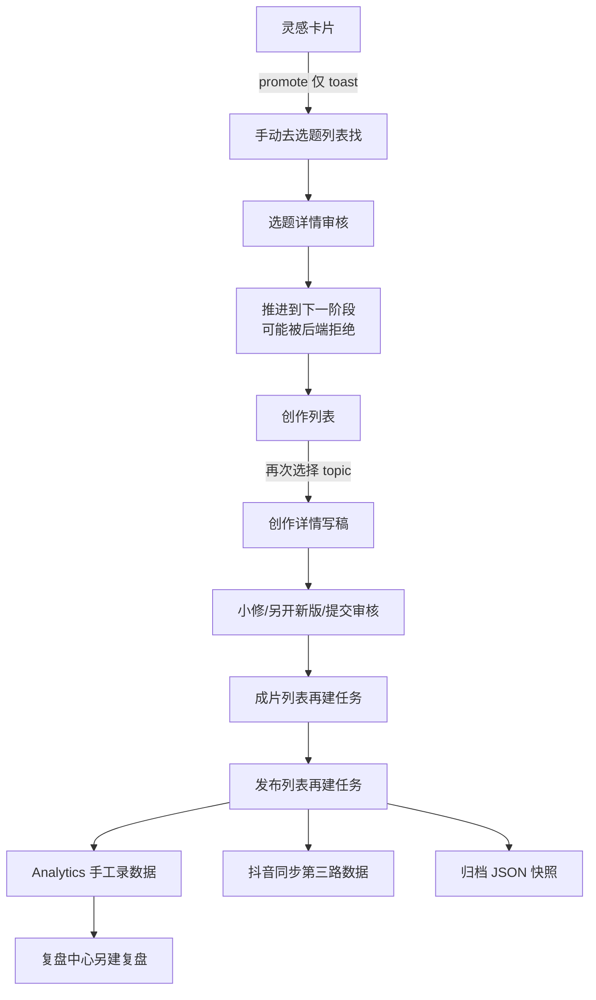
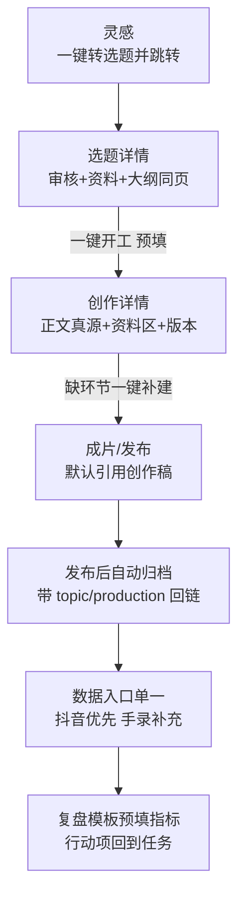

# XMT 产品改造清单（2026-09 · v3.1.2 审查）

【续进度补记 · v9.4.13（本地，尚未部署）】清单 B8：创作记录列表编辑、选题阶段、系统设置和个人资料的响应不确定时先只读核实，不自动重发；创作编辑和选题阶段的未决标记按账号保存，刷新后继续核实。桌面/移动通知设置未保存或待核实时增加离页保护；移动端改密结果不确定时锁定重复提交，提示重新登录核验。旧创作记录的 `operator_id` 为空时仍能比较原始快照。匿名意见旧编号回执不存在时不再重用编号，以免意见删除并清除回执后被恢复流程再次创建；保留内容须由用户明确以新编号重新提交。Chrome DevTools MCP 在本地隔离夹具中复核创作编辑“提交后响应丢失”、空操作人旧记录及刷新恢复，未重复写入。隔离 Chromium 自动回归通过选题阶段/保存恢复、移动工作中心（320/390px）、成片列表反馈、系统设置、移动通知偏好和匿名意见提交恢复；测试通过不代表 B8 全部写入路径已完成。VoiceOver 实际语音确认仅覆盖首页今日任务、灵感数量和关注事项三条加载提示；Android 原生专项后置。类型、构建、定向 lint、版本与更新说明治理结果见 `docs/UPGRADE_PROGRESS.md`。本地修改，未提交、推送或部署。

【续进度补记 · v9.4.12（本地，尚未部署）】清单 B5：移动工作中心、选题和成片列表卡片与主要操作，桌面选题创建结果恢复、内容动态查看和 Creator Center 趋势入口统一使用 Studio 悬停状态；减少动态效果模式移除悬停/按压位移并保留颜色反馈。Google Chrome / Playwright MCP / Chrome DevTools MCP 隔离内存夹具只悬停、不触发业务写入，覆盖亮暗主题、移动卡片、Creator Trends 周期按钮、主要恢复操作及 320px 无横向溢出；手工 MCP 验收不等同自动浏览器套件。类型、定向 lint、构建及版本治理结果见 `docs/UPGRADE_PROGRESS.md`。当前本地版本 v9.4.12；未提交、推送或部署。B5 全站悬停与主题审查仍在继续，Android 原生专项后置。

【续进度补记 · v9.4.11】清单 B4：将富文本编辑器工具栏、气泡菜单、右键菜单及浮动菜单中的链接/图片地址 `window.prompt` 改为 Studio 弹窗；确认后恢复选区并应用，取消不改正文。无选区添加批注由原生 `alert` 改为站内状态提示。隔离浏览器已复核链接确认/取消、图片取消、主工具栏无选区批注提示及右键菜单链接入口；BaseModal 辅助技术测试通过。仓库浏览器自动套件尝试运行时，Chromium 因 macOS `bootstrap_check_in` 权限错误 1100 退出，未进入断言。类型、定向 lint、匿名意见恢复/API 合同与审阅服务端测试、版本治理及构建通过。PR #90 六项 CI 通过并部署，合并 SHA `fdc787e1df4df07597b395dbe35f404d06573c28`，标签 `v9.4.11` 指向同一 SHA；迁移 066 已应用。Android 元数据为 90411，CI 生成 Debug 验收 APK artifact，未发布 Android 安装包。VoiceOver 仅确认听到首页三条加载提示，不代表全站语音验收完成。B4/B5 和 B8 仍有未完成项，详见 `docs/UPGRADE_PROGRESS.md`；Android 原生专项后置。

【续进度补记 · v9.4.10】清单 E/B4：选题模板/本机草稿/选题批量/灵感删除、复盘快照和摘要替换、复盘发布与归档、桌面和移动编辑器离开未保存内容，统一改用 Studio 确认弹窗；取消不写入，确认后调用既有操作。Chrome MCP 隔离夹具覆盖复盘、批量删除、灵感删除及发布详情离开；Playwright MCP 在 390×844 Android 模拟视口补验移动选题/制作页离开确认，取消保留草稿、确认才离开，新建稿件可在离开后恢复；仅 GET、无业务写入、无横向溢出。用户确认实际听到首页三条加载提示，VoiceOver 证据仅覆盖首页。匿名意见回执按用户决定不自动过期，删除意见时清除。Android 元数据同步至 90410，未发布 Android 安装包；随 PR #90 的 v9.4.11 合并部署。

【续进度补记 · v9.4.9】按 E 项删除孤儿页：移除没有任何路由或文件外引用的旧 `DouyinCreatorDataCenter.tsx`。当前 `/analytics/creator-center/work/:id` 等路径仍由 `CreatorWorkDetail` 接管，Creator Agent API 仍由 Creator Center 当前页面使用。无 API、权限、数据库或业务变化；Android 仅同步 90409 元数据、未发布 Android 安装包；随 PR #90 的 v9.4.11 合并部署。构建、类型和版本治理验证见 `docs/UPGRADE_PROGRESS.md`。

【清单 E 复核补记 · 2026-10-27】报告中心无独立月报/总结占位页签；月报/年报仍由按权限显示的总结归档入口承载。五个内容/协作分析旧地址均跳转到内容实验室相应 Tab，`/resources`、`/kanban` 跳转到统一资料中心、选题看板；日报、团队日报、总结归档复用同一页面。此为现有代码和隔离浏览器复核，详见 `docs/UPGRADE_PROGRESS.md`。

【续进度补记 · v9.4.8】B8 匿名意见首次提交增加随机请求编号及原子回执；响应丢失/刷新后只读核实，不自动重提，仅在明确 `not_found` 时允许同编号、同内容人工重试。编号/载荷冲突或核实失败时保留原稿并锁定写入。服务端不存提交人身份；回执不自动过期，删除意见时清除。新增 SAFE_EXPAND 迁移 066，先在隔离 SQLite 验证，后随 PR #90 的 v9.4.11 安全部署并确认已应用；HTTP、事务回滚、迁移、sessionStorage、类型、API 合同、版本治理、全仓 lint 与生产构建通过。Playwright MCP 390px 隔离浏览器验证 processed、刷新后 not_found 同编号重试、核实不可用时锁定与只读重核，均无横向溢出/控制台错误。用户确认实际听到首页三条加载提示，并已恢复 VoiceOver 关闭；该语音证据仅覆盖这三条提示。Android 仅同步 90408 元数据，未发布 Android 安装包。详见 `docs/UPGRADE_PROGRESS.md`，继续 B4/B5 全站验收及 B8 其余写入路径。

【手工验收补记 · 2026-10-27】B4/B5 成就系统空榜在 v9.4.7 部署后用隔离夹具复验：1440px 桌面和 390/320px 手机浅/深主题均无横向溢出，普通成员空状态、排行榜 polite status 与移动导航正常；320px 浅/深主题积分摘要对比度分别为 7.58:1/8.29:1。键盘 Tab、Enter、Shift+Tab、Space 切换三视图时焦点与选中状态一致。隔离业务 API 仅 GET，Socket.IO polling POST 为传输请求，未写业务数据；控制台无错误。仅本地手工验收证据，未运行仓库 Chromium 自动测试体或修改产品代码；未提交、推送或部署。2026-10-27 在 Mac 解锁状态下按授权临时开启 VoiceOver；用户确认实际听到“正在整理今日任务”“正在读取灵感数量”“正在读取关注事项”三条首页加载提示，此范围真实语音验收通过；随后已恢复 VoiceOver 关闭。详情见 `docs/UPGRADE_PROGRESS.md`。

【手工验收补记 · 2026-10-27】清单 B5 日历六类事件语义徽标已在 v9.4.7 部署后完成隔离浏览器矩阵：Playwright MCP 覆盖 1440px 桌面、390/320px 手机的浅/深主题；六类桌面徽标和手机标记均达到对比度阈值，42 个日期格保持七列、无横向溢出或面板裁切，读屏描述引用有效。Chrome DevTools MCP 在 320px 深色移动页确认网格和圆点可见，控制台无错误。自动 Chromium suite 本轮未运行；仓库 Chromium 既往受 macOS 启动权限错误 1100 阻断，未进入断言。只使用隔离内存夹具，无业务写入、真实数据库访问或代码行为修改；本轮仅本地更新验收记录，不提交、推送或部署。2026-10-27 在 Mac 解锁状态下按授权临时开启 VoiceOver；用户确认实际听到“正在整理今日任务”“正在读取灵感数量”“正在读取关注事项”三条首页加载提示，此范围真实语音验收通过；随后已恢复 VoiceOver 关闭。详情见 `docs/UPGRADE_PROGRESS.md`，继续其余未完成改造。

【续进度补记 · v9.4.5】移动首页只有在关注摘要及负责人待处理消息等相关数据成功读取后，才显示“当前没有需要立即处理的任务”；读取失败且无其它已知任务时显示“暂时无法确认”并保留来源重试入口，避免把未知结果当作空列表。Chrome MCP 隔离 390px 场景验证关注摘要/待处理消息分别 503→只读 GET 重试→确认空态；无 API、权限、数据库或真实业务数据变化。自动浏览器套件受 macOS Chromium 启动权限阻断，未进入断言；PR #87 已以 SHA `7d58e9d067b4c6a71e8cf14e83b44996a4458df0` 合并部署。详见 `docs/UPGRADE_PROGRESS.md`，继续剩余改造。

【续进度补记 · v9.4.4】移动首页“选题关注”读取期间补齐 `role=status` / `aria-live=polite`，与今日任务和灵感数量的加载播报保持一致。无 API、权限、数据库或真实业务数据变化；Android 元数据曾同步 90404，未单独构建 Android 安装包。该改造包含在 PR #87 的 v9.4.5 部署中，SHA `7d58e9d067b4c6a71e8cf14e83b44996a4458df0`。验收结果见 `docs/UPGRADE_PROGRESS.md`，继续剩余改造。

【续进度补记 · v9.4.3】移动首页本地加载状态夹具会挂起全部重复 GET，直到显式释放，避免第二次读取提前返回并掩盖加载提示。用于继续完成真实 VoiceOver 播报核验；产品 API、权限、数据库与真实业务数据不变。仅同步 Android 版本元数据至 90403，未构建 APK。详情见 `docs/UPGRADE_PROGRESS.md`。继续剩余改造。

【续进度补记 · v9.4.2】B4/B5 修复移动工作区浏览器验收夹具：改用仓库依赖的内存 Socket.IO 服务，仅接受本地隔离连接、不发业务事件，消除伪造握手造成的重复轮询重连。Chrome DevTools MCP 确认加载状态播报出现/消失、连接请求稳定、无控制台错误；目标 lint 与类型检查通过。VoiceOver 已临时开启并恢复关闭，但实际语音文本未由窗口工具捕获，仍待验收。产品 API、权限、数据库与真实业务数据不变；Android 同步 90402 元数据，GitHub CI 生成 debug 验收 APK artifact、未发布 Android 安装包。PR #84 的六项 CI 全部通过，已用精确合并 SHA `957b0a7c0b8b74183c225dc2e89c1bf3108f7f9d` 安全部署；详情见 `docs/UPGRADE_PROGRESS.md`。继续剩余改造。

【续进度补记 · v9.4.1】B8 桌面与移动通知偏好保存新增结果恢复：网络中断、408、429、5xx 只读核实，不自动重复提交；服务器值与本地草稿一致则确认成功，不一致时保留草稿并锁定编辑，提供载入服务器设置或明确确认覆盖；核实不可用时仅开放只读重试。无 API、权限、数据库或真实业务数据变化。定向验证及浏览器自动套件限制见 `docs/UPGRADE_PROGRESS.md`。Android 仅同步 90401 元数据，未构建 APK；继续剩余改造。

【续进度补记 · v9.4.0】B8 备份创建新增操作者隔离 UUID 请求关联和只读状态接口。响应丢失或刷新后先核实，处理中或核实失败时锁定重复创建；明确 `not_found` 后才允许用同一请求编号人工重试。继续兼容旧客户端无编号创建；状态读取沿用 `system:backup` 权限并禁止缓存。B4/B5 内容洞察补上协作文档选择框辅助名称，320/390px 双主题表格可内部滚动查看最右“判断”列，页面无横向溢出；Chrome DevTools MCP 隔离内存夹具手工核验，无业务写入。用户确认缺失/无效官方周期文件时日报、周报、月报发布数回退窗口均按北京时间包含报告当天（1/7/30 日）；有效官方日报仍以平台“昨天”文件为准。OpenAPI/API 合同已同步，无数据库迁移或真实业务数据写入。类型检查、版本一致性、目标 lint 和生产构建通过；自动化浏览器与 MCP API 套件未运行。Android 仅同步 90400 元数据，未构建 APK；本地不提交、推送或部署。继续 B8、B4/B5 剩余项，Android 原生专项后置。

【续进度补记 · v9.3.70】B5 移动首页今日任务/灵感摘要与移动选题首读增加 `status`/`aria-live="polite"`，延迟 GET 状态可由辅助技术识别，读取完成后提示自动消失。类型检查与定向 ESLint 通过；Chrome DevTools MCP 内存夹具实测首页和选题状态切换，320px 深色选题页无横向溢出、控制台无错误。仓库移动端 Chromium suite 在启动阶段受 macOS 权限拒绝（1100）阻断，未进入断言；真实 VoiceOver 语音未验收。无 API/权限/数据库/真实业务数据变化；Android 仅同步 90370 元数据、未构建 APK；本地不提交、推送或部署。继续收敛 B4/B5、B8，Android 原生专项后置。

【续进度补记 · v9.3.69】B5 移动消息首次读取提示增加 polite status 语义；B4 创作者作品详情封面按内容区适配窄屏，修复 320px 横向溢出，正常/错误状态的“返回作品库”操作均至少 40px 高并沿用 Studio 令牌。用户确认缺失/无效官方文件时所有报告周期回退都包含北京时间报告当天，日报/周报/月报窗口分别 1/7/30 天；现有实现及日报隔离回归已按该口径。类型检查、定向 ESLint、生产构建、版本治理及报表窗口测试通过；Playwright MCP 内存夹具复核消息加载播报及作品详情 320/390/1440px。仓库两项 Chromium 自动 suite 在启动阶段受 macOS 权限拒绝阻断，未进入断言；VoiceOver 语音仍待验收。Android 仅同步 90369 元数据、未构建 APK；本地不提交、推送或部署。继续收敛 B4/B5、B8，Android 原生专项后置。

【续进度补记 · v9.3.68】B4 资料归档详情以隔离只读夹具在 625/555/500/454/400 CSS px 视口下复核，页面无水平溢出、返回入口与移动底栏可用；这只是 CSS 视口模拟，并非原生缩放验收。B5 创作者账号卡片修复窄屏“查看作品”按钮文字换行并防止按钮超出玻璃信息条，Playwright MCP 在 320/390px 浅/深主题及 1440px 桌面视口确认按钮单行、留在卡片内且页面无溢出；隔离页业务请求仅 GET，控制台无错误/警告。补充 320/390/1440 CSS px 浏览器回归断言；类型检查、目标 ESLint、生产构建通过。仓库自动 Chromium suite 本轮未运行，VoiceOver 仍待验收。本地修改，不提交、推送或部署。

【进度补记 · v9.3.68】继续清单 B8/B4/B5：迁移 061–065 分别补齐审批流模板更新、资料分类变更、匿名意见管理状态/回复、旧选题模板增删改和月/年报摘要更新的结果恢复；结果不明时保留原载荷并只读核实，确认未处理后才可用同一编号显式重试，月/年报冲突保留草稿。日历事件日期格新增完整辅助描述；编辑器上下文菜单现支持 Shift+F10、Context Menu 键及 Tab/方向键/Escape 键盘操作。用户确认缺失/无效官方周期文件时所有回退窗口按北京时间自然日包含报告当天，日报/周报/月报为 1/7/30 日；有效官方日报仍按“昨天”窗口。迁移仅临时 SQLite 验证；API/事务/恢复测试、报表回归、类型检查和目标 lint 通过。Playwright MCP 隔离夹具验证月/年报写入恢复、冲突保留草稿；年报表单 320/390/1440 CSS px 浅/深主题无横向溢出。发布详情在 320/390/1024/1366/1440/1920 CSS px、编辑器工具栏在 320/390/819/1024/1152/1536 CSS px 手工核对无横向溢出；1024×768“更多操作”弹层在视口内，320px 取消编辑可回到只读详情且无写入。Chrome 实际原生缩放 80/90/100/110/125% 检查发布详情无横向溢出，页头返回和“编辑剧本”操作可达；125% 下编辑工具栏保存、版本保存、撤销/重做和格式操作完整可见，取消后返回详情，隔离夹具写入计数为 0。选题表格在 320/390px 浅/深主题及 1440px 无页面溢出，固定操作列横向滚动后仍可见，查看/删除按钮各 40×40px；只读查看并返回成功，控制台无错误且仅发起 GET。复盘详情在 320/390px 浅/深主题实测无页面横向溢出，页头操作在 320px 浅/深及 390px 深主题可达；行动项表格滚至最右端后固定操作列仍可用，详情抽屉在 320px 浅/深、390px 深主题可滚至底部且关闭/保存操作可见，仅读取后关闭未改动字段。API 仅 GET、控制台错误为 0；另有 Socket.IO 轮询 POST，不涉及业务写入。现有矩阵新增 1024px 断言；自动 Chromium suite 未运行，真实 VoiceOver 语音待验收。匿名用户首次提交的响应丢失恢复仍需明确匿名范围与回执保留期限。Android 仅同步 90368 元数据、未构建 APK；无真实数据库或业务数据写入。本地不提交、推送或部署。下一步继续收口 B4 全站剩余页面及读屏验收，Android 原生专项后置。

【手工验收补记 · 2026-10-26】B4 #4 成片制作详情经 Chrome 原生缩放 80%–125% 检查，无页面水平溢出，返回、复制、来源大纲及批注/建议入口可达；125% 下批注/建议滚动后可见且未遮挡底部导航。B5 公告“发布”按钮在 1440 CSS px 浅/深主题均有悬停变化，白字对渐变两端对比度分别为 4.96:1/5.67:1、5.22:1/5.99:1。均使用隔离内存夹具，未触发业务写入；公告夹具只发起列表 GET，控制台无错误。已确认无有效官方周期文件时日报/周报/月报回退窗口均包含报告当天（北京时间 1/7/30 个自然日）；有效官方日报文件仍以平台“昨天”窗口为准。工作区仅本地修改，不提交、推送或部署。

【手工验收补记 · 2026-10-26】B4 #4 拍摄详情在 Google Chrome 原生 125% 缩放（约 400 CSS px）下可展开/收起信息栏；展开后设备清单完整可读，信息栏视觉及文档阅读顺序均在编辑器之前，页面无横向溢出。Chrome DevTools 隔离夹具在 320 CSS px 浅主题与 390 CSS px 深主题复核相同结果，1440 CSS px 下编辑器与信息栏并排。业务 API 仅发起成片详情和版本历史 GET；Socket.IO 轮询 POST 为传输请求，控制台无错误/警告。已恢复 Chrome 100% 缩放。`npm run check` 和目标 ESLint 通过；自动浏览器套件启动 Chromium 时因 macOS `bootstrap_check_in` 权限拒绝（1100）未进入断言。

【进度补记 · v9.3.67】继续清单 B8 桌面消息恢复：桌面“全部已读”调用现有操作者隔离回执，写入前保存账号与 UUID。异常后只读核实，只有服务端明确未处理并经用户确认才允许沿用同编号重试；刷新可找回已提交结果，不会重复写入。账号切换隔离迟到结果/错误提示，服务端处理范围保持原事务命中消息，所以提交后到达的新消息继续未读。消息 API/回执合同、目标 ESLint、类型检查、版本/更新说明治理（511 个版本）、271 个测试入口检查、Android runtime 合同和生产构建通过；构建保留既有 Silk 大分包提示。Playwright MCP 本地内存夹具验证 POST 已提交但响应丢失、首次状态读取失败后刷新恢复；完整 Chromium suite 受 macOS 启动权限阻断、未进入断言。无新增迁移或持久业务数据写入；Android 仅同步 90367 元数据、未构建 APK。本地不提交、推送或部署。

【进度补记 · v9.3.66】P2-1 主题资产页增加按当前可见选题统计的城市/人物/项目明确登记数，按选题去重且与筛选无关，不把未登记视为错误或评分。B5 日历会议与“其他”改用不同语义色，六类事件有浅/深主题静态对比度契约。B8 公告删除先持久化账号/目标标记；网络、408、429、5xx 等不确定结果只读核实，不自动重发；刷新后继续核实，状态未明保持写锁。Creator Reports 官方周期文件缺失/无效时仍按日报昨天、周报含当天近 7 天、月报含当天近 30 天的北京时间自然日统计发布数，公开起止日；作品去重改用共享 BJT 解析，消除机器时区漂移。P2 API、日历对比度、公告客户端合同、报告隔离 SQLite、canonical 去重、官方日指标 3/3 与统一报告测试通过；Chromium 因 macOS `bootstrap_check_in` Permission denied (1100) 未进入浏览器断言，不计通过。无迁移/持久业务数据写入；Android 仅同步 90366 元数据、未构建 APK；本地不提交、推送或部署。

【进度补记 · v9.3.65】P2-1 主题内容资产补列当前正式稿件正文符合标准的“来源：资料”引用，沿用可见范围、排除私密/删除资料并与正式关联去重；不纳入草稿或归属不明的历史正文。主题资产页与选题详情的维度写入结果不明时只读核实，恢复标记先于写请求持久化；资产卡片写锁跨筛选卸载与刷新保留，核实失败时只能继续只读核实，确认缺席后才允许用户明确重试。B8 开始创作交接在阶段推进前及结果不明后核实服务端阶段；B8 成片剧本版本保存遇到结果不明时并行核对详情和历史，保留草稿且不重复建版。B5 新增日历六类事件浅/深主题语义映射及≥4.5:1 静态对比度契约。主题资产 API、维度恢复组件、交接单测 7/7、日历契约、类型和目标 ESLint 通过；隔离 Playwright MCP 实测维度 POST 响应丢失、GET 失败、搜索卸载、刷新恢复、手工 GET，仅 1 次写入；成片剧本专用恢复场景通过。仓库 Chromium 因 `bootstrap_check_in` Permission denied (1100) 未能启动，完整响应式套件和日历徽标视口矩阵仍未完成。无数据库迁移/真实业务数据写入；Android 仅同步 90365 元数据、未构建 APK；本地不提交、推送或部署。

【进度补记 · v9.3.64】B4 #4 修复复盘行动项创建表单：去除依赖视口断点的五列布局，改为随容器宽度自适应；1440 CSS px Chrome DevTools MCP 隔离页面测得标题、说明输入框各 221px，原生 Chrome 隔离页目视确认宽度正常。回归用例对标题/说明设置至少 160px 断言。B5 补齐之前未单独核验的六项 Studio 主操作浅/深主题 hover；不触发实际业务操作。抖音批量关联服务层现要求显式声明 `all` 或 `editable` 范围；路由按全局编辑角色或逐条创建人/负责人/发布操作人范围传值，legacy 与 contract Agent 同步都显式按关联用户过滤；缺范围时服务层失败关闭。只读审计未发现当前路由越权路径。北京时间审计确认昨天=采集日前一日、近 7/30 天包括采集日；窗口单测 3/3、统一报表和发布关联测试通过。目标 ESLint 0 错误（workflow.ts 有 12 条既有警告）；仓库 Playwright 本轮仍受 Chromium `bootstrap_check_in` Permission denied (1100) 阻断，未进入测试断言。无数据库迁移或持久业务数据写入；Android 仅同步 90364 元数据、未构建 APK；本地不提交、推送或部署。

【进度补记 · v9.3.62】继续 B4 #4：ProductionDetail、TopicDetail 与 ShootingDetail 在 1024/1366/1440/1920px 独立内存视口下无横向溢出；Chrome 80%–125% 原生缩放下 TopicDetail 操作区保持可达，ShootingDetail 工具栏和主操作完整可见。日历月份读屏状态覆盖 2026 年 10 月至 2027 年 1 月；仓库 Chromium 自动套件在启动阶段受权限阻断，未进入断言。Android 仅同步 90362 元数据、未构建 APK；本地不提交、推送或部署。

【进度补记 · v9.3.61】继续清单 B4/B5：已提交日报在审核完成前统一只读；成片制作结果经只读核实后，用户明确重新确认时清除过期结果提示，避免成功操作后保留过时的重试入口。移动浏览器全套 320px、390px 视口及桌面消息恢复场景通过；日报状态单测、目标 ESLint、全局类型、版本/日志治理、270 个测试入口检查、Android runtime 合同与生产构建均通过，构建保留既有大分包提示。无数据库迁移或业务数据变更；Android 仅同步 90361 元数据、未构建 APK。本地不提交、推送或部署。B4/B5 全站验收与清单剩余项继续，Android 原生专项后置。

【进度补记 · v9.3.60】继续清单 B8 回执保留评估：新增必须显式指定本地数据库文件的只读盘点工具，仅汇总 `*_request_keys` 与选题灵感评论内请求键的表名、数量及数据库原样时间范围，不输出请求编号、账号、载荷或正文。隔离 SQLite 测试验证显式路径、敏感字段不输出、异常 schema fail-closed 和盘点前后数据库字节不变。证据显示恢复标记没有最大重试期限，且部分 `created_at` 混合 UTC 默认值与北京时间显式值；因此不任意定 TTL、不启用清理，也未访问真实数据库。类型检查、目标 ESLint、工具专项测试、版本/更新说明与测试入口治理、生产构建及 `git diff --check` 通过；构建保留既有大分包提示。无数据库迁移或业务数据变化；Android 仅同步 90360 元数据、未构建 APK。本地不提交、推送或部署。下一步需持续观察只读盘点结果，再确定统一时间语义和客户端恢复期限；B4/B5 全站审计、清单其它项继续，Android 原生专项后置。

【进度补记 · v9.3.59】继续清单 B8：复盘标题/结论更新增加操作者/复盘隔离的幂等回执、稳定版本比较与审计原子性；请求结果不明时只读核实，明确未处理才开放原编号重试，冲突保留本地草稿和服务器当前内容，且本地恢复记录写入失败可显式修复后再解锁。新增 SAFE_EXPAND 迁移 057，仅在临时隔离数据库验证。B4/B5 顺带修复日报风险转行动项待确认时表单被隐藏、显式重试成功后表单未清空及控件可访问名称不稳定。API、迁移/readiness、类型、目标 ESLint、完整复盘响应式浏览器回归、生产构建和版本/变更说明治理通过；构建仍有既有大分包提示。无真实数据库或业务数据写入；Android 仅同步 90359 元数据，未构建 APK。本地不提交、推送或部署。B8、B4/B5 和清单其它项继续，Android 原生专项后置。

【进度补记 · v9.3.58】继续清单 B8 复盘行动项更新：加入操作者/行动项隔离的请求 UUID 与事务回执，并按整行写前快照 compare-and-swap，防止迟到编辑覆盖新内容；结果不明时只读核实、禁止盲目重放，确认为冲突则保留本地草稿和服务器最新值。新增 SAFE_EXPAND 迁移 055/056，仅临时隔离数据库验证，未迁移真实库；旧无编号客户端仍兼容，但陈旧并发更新返回 409。接口/迁移/readiness、类型检查、目标 ESLint、构建与治理检查通过，隔离 Playwright MCP 核心恢复交互通过；完整浏览器 suite 在后续未保存复盘结论离开提示断言失败，需继续修复并复测。回执尚无自动清理策略；Android 仅同步 90358 元数据、未构建 APK。本地不提交、推送或部署。继续 B8 与 B4/B5/清单剩余项，Android 原生专项后置。

【进度补记 · v9.3.57】继续清单 B4/B5：移动端账号安全改密表单补齐当前密码和新密码的持续可见标签及显式控件关联；浏览器回归改用可访问名称，保留无效输入零请求和失败后明确重试验证。原权限、校验、服务端行为不变；suite 运行状态见 `docs/UPGRADE_PROGRESS.md`。Android 仅同步 90357 元数据、未构建 APK；无业务数据写入。本地不提交、推送或部署。

【进度补记 · v9.3.56】继续清单 F/H/P2-1/B8：创作详情跳转成片制作时保留并预填选题；主题资产列出当前账号可访问的正式关联资料直达链接；旧 Creator Analytics 的 7/30/90 天改为含当天、排除未来日的北京时间自然日窗口，缺少粉丝基线返回未知；日报草稿结果不明时锁定并只读核实，确认写前状态未变才可同载荷显式重试；创作只读页显示真实权限/版本原因并隐藏误导性保存入口。隔离服务/API/统计/权限/流程测试、类型检查和目标 lint 通过；浏览器断言因 Chromium `bootstrap_check_in … Permission denied (1100)` 及 MCP profile 被占未运行，不计通过。无新迁移或真实业务数据写入；Android 仅同步 90356 元数据、未构建 APK。本地不提交、推送或部署；继续 B8、B4/B5 与清单剩余项，Android 原生专项后置。

【进度补记 · v9.3.55】继续 B8 灵感点赞结果恢复：点赞/取消点赞的新请求使用操作者隔离 UUID 与明确目标态，服务端投票和回执同事务提交；旧客户端 toggle 兼容。刷新/响应不明后恢复请求并只读核实，确认无回执且当前态可读才允许同编号安全重试。新增 SAFE_EXPAND 迁移 054，仅临时隔离库验证。HTTP/事务、幂等迁移、readiness、类型检查通过；仓库浏览器套件因 macOS Chromium `bootstrap_check_in … Permission denied (1100)` 未进入断言，刷新 UI 用例已加入但未计通过。未访问真实数据库/账号；Android 仅同步 90355 元数据、未构建 APK。本地不提交、推送或部署；B8、B4/B5 全站验收和清单其他未完项继续，Android 原生专项后置。

【进度补记 · v9.3.54】继续清单 B8 Creator Agent 绑定闭环：修复 `/api/creator-agent/bind` 已提交但 Agent 未收到 `agent_token` 时无法恢复的问题。新客户端使用 UUID + 独立高熵恢复能力和相同设备载荷重试；仅 request ID、错误 secret 或更改载荷均不能恢复。新增 SAFE_EXPAND 迁移 053，密文最长 24 小时，bind/ack 均 no-store，确认/过期后清除密文；桌面端请求前使用 Electron safeStorage 加密落盘待处理材料，收到凭据后持久化 token 与配置，再通过幂等 ACK 激活新凭据。已有设备在 ACK 前保留旧 token；账本写入失败会回滚绑定。旧客户端继续原合同。API/服务/迁移/readiness/客户端合同/safeStorage mock/Agent renderer security、类型检查、构建、版本与 changelog 治理均通过；定向 ESLint 0 errors、1 warning（`agent/desktop/main.ts` 中既有未使用变量）。未完成真实 Electron safeStorage 流程验收；未访问真实数据库或生产密钥，Agent v2.14.7-agent 未打包，Android 仅同步 90354 未构建 APK；本地不提交、推送或部署。下一步继续 B8 其他写入恢复和 B4/B5 全站验收，Android 原生专项后置。

【进度补记 · v9.3.53】继续清单 B8 Creator Agent 绑定闭环：创建绑定码支持同操作者/账号/有效期/请求 UUID 幂等恢复；服务端提交但页面未收到响应时，刷新后只读找回原码，不重复签发。新增 SAFE_EXPAND 迁移 052，加密短期恢复密文并在过期/使用后清除；绑定码消费、Agent 注册和设备元数据更新同事务。恢复标记只存 actor/account/request id，不存码值；账号切换时隔离旧请求，显式空/非法键拒绝，旧客户端仍兼容。服务/API/迁移/readiness/typecheck/目标 ESLint 与 Playwright MCP 隔离响应丢失恢复通过；仓库 Chromium suite 因 macOS 启动权限未进入断言体。真实数据库和生产均未触及，生产启用需先在受控运行时配置稳定专用密钥。按用户确认复核北京时间含当天的数据窗及抖音批量关联逐条编辑范围，对应测试通过且未改规则。Android 仅同步 90353 元数据，未构建 APK；本地不提交、推送或部署。`/bind` 返回凭据响应丢失恢复、B4/B5 全站验收和清单其他未完项仍继续；Android 原生专项后置。

【进度补记 · v9.3.48】完成 J6 默认轻量：首次配置及恢复默认关闭 React Bits 动效和所有装饰背景，防止默认加载 OGL/粒子；命名预设显式保留原来组件、强度和页面范围。已有保存的本地偏好不迁移、不覆盖。测试与浏览器验收结果见 `docs/UPGRADE_PROGRESS.md`。Android 仅同步元数据；本地不提交、推送或部署。

【进度补记 · v9.3.47】继续清单 B8 稿件批注回复恢复：新增 SAFE_EXPAND 迁移 049；回复与按操作者、稿件、线程及 SHA-256 内容指纹区分的请求账本原子提交，兼容未带编号的旧客户端。会话内保留原内容与 UUID，结果不明时锁定输入并只读核实；只有明确 `not_found` 才提供同编号、同内容显式重试，已提交但响应丢失不产生重复回复。API 回归覆盖并发同键、账号/线程/内容冲突、no-store 状态读取和事务回滚；迁移 readiness、类型检查通过。仓库 Chromium 在 macOS `bootstrap_check_in … Permission denied (1100)` 阶段受阻，WebKit 进程启动 abort，均未进入断言，不计浏览器通过；上一项工作流详情响应监听修正也尚未由整套浏览器测试确认。仅在临时隔离数据库测试迁移，无真实业务数据库或数据写入；Android 仅同步 90347 元数据、未构建 APK。本地不提交、推送或部署。继续 B8 剩余写入边界与 B4/B5 全站验收；Android 原生专项仍后置。

【进度补记 · v9.3.46】继续 B4/B8：改密请求绕过可能自动刷新/重放的全局 401 处理；只有明确确定拒绝允许纠正后重试，结果不明则清空密码并锁定表单。服务端提交后断开响应的隔离浏览器回归验证只发一次请求并通过。WorkflowDesigner 常用节点动作改用共享触控控件，补充窄屏与键盘回归；工作流详情 suite 以真实右键触发剪贴板菜单，菜单边界断言通过，但后续成片状态用例的 `waitForResponse` 超时，隔离 DevTools 手测返回 200，Playwright 监听差异未定位，整套不计通过；设计器 suite 受 macOS Chromium 启动权限阻断。新增 [Workflow Engine 操作手册](./WORKFLOW_ENGINE_OPERATIONS.md)，基于当前仓库说明 strict 模式与安全回退边界，不代表生产模式已核验。类型检查、版本/更新说明治理、Studio token、Android runtime 合同、生产构建和差异检查通过；构建仍有既有大分包提示。无数据库或真实业务数据变化；Android 仅同步 90346 元数据，未构建 APK。本地不提交、推送或部署。继续 B4/B5 全站审计、B8 全量写操作清点与清单其它事项；审批责任分配等需业务选择的事项不臆测，Android 原生专项后置。

【进度补记 · v9.3.44】继续 G/B4/B8：首页逾期/临期数据排除已退回选题；复盘日报风险转行动项字段补齐关联标签与无障碍名称。匿名意见删除增加 SAFE_EXPAND 迁移 046 与操作者隔离结果账本；结果不明但目标已被其他管理员或旧客户端先删除时，明确为“本次未确认成功”、清理过期恢复标记并解除写锁，不发送第二次 DELETE、不伪报成功。API/迁移回归通过；Playwright MCP 隔离 mock 验证目标缺失恢复及后续操作，复盘风险表单手机视口可见且可访问。仓库 Chromium 自动化受 macOS 启动权限限制未运行、不计通过。Android 仅同步 90344 元数据，未构建 APK。本地不提交、推送或部署；B4/B5/B8 与 Android 原生专项仍开放。

【进度补记 · v9.3.43】继续清单 B8 审批流模板创建恢复：模板、节点与请求结果账本在同一事务内提交；操作者隔离的 UUID 与载荷指纹防止重复创建及跨账号/异载荷重放。前端先持久化原请求，响应不明/刷新后只读核实并匹配 SHA-256 载荷指纹；确认未找到才允许同编号、同载荷显式重试，409 冲突不会误报已创建。410 删除墓碑不重建，保留旧客户端兼容。新增 SAFE_EXPAND 迁移 045、并发同键 API 测试和恢复浏览器用例；Chromium 本轮未运行、不计通过。Android 仅同步 90343 元数据、未构建 APK。本地不提交、推送或部署；B4/B5/B8 及 Android 原生专项仍开放。

【进度补记 · v9.3.42】继续清单 B4/B5/B8：移动消息“全部标记已读”加入操作者隔离的请求账本及刷新后只读核实，同编号重放不会误处理后来到达的消息；切换账号后旧的单条已读迟到回包不会污染新账号状态。活动日志成员筛选器补齐可访问名称，暗色 320/390px 及 320px 失败恢复回归已扩展；CreatorReports 删除操作达到 40×40px。新增 SAFE_EXPAND 迁移 044，不修改旧消息。Chromium 自动化受 macOS 启动权限阻断，未进入断言体、不计通过。Android 仅同步 90342 元数据、未构建 APK。本地不提交、推送或部署；B4/B5/B8 与 Android 原生专项仍开放。

【进度补记 · v9.3.40】继续清单 B2/B4/B5：抖音作品关联新增、替换、解除时按实际变化写入独立协作历史与活动日志，并与关联变更原子提交；逐条编辑权限与“任一平台发布即完成、异常视为处理完”规则不变，解除关联不回退选题完成态。日报月报/年报详情、选题审核和灵感详情弹层统一键盘焦点与背景隔离；移动错误提示改用高对比度主题令牌，实测 390px 浅/深主题为 6.88:1/14.43:1。Playwright MCP / Chrome DevTools MCP 隔离验收覆盖焦点、边界、滚动和只读请求；仓库 Chromium 自动化在测试断言前受 macOS 启动权限阻断、不计通过。无新增迁移、无历史回填；Android 仅同步 90340 元数据、未构建 APK。本地不提交、推送或部署，B2/B4/B5 和 B8 仍有后续项，Android 原生专项后置。

【进度补记 · v9.3.39】继续清单 B8 消息中心写入恢复：桌面“清空”现在先保存仅含操作者与 UUID 的会话恢复标记，再使用该编号执行清空；若响应不明或页面刷新，先只读核实服务端账本，暂时无法核实时锁定写入并保留编号。服务端在同一事务内删除当前操作者消息并保存删除数量；同编号重放只返回原结果，不会再次删除后来到达的新消息。状态查询按操作者隔离；保留旧客户端不带编号的兼容路径。新增迁移 042（SAFE_EXPAND）。Android 仅同步 90339 元数据，未构建 APK。本地不提交、推送或部署；B8 其它写入边界、B4/B5 全站验收与 Android 原生专项仍开放。

【进度补记 · v9.3.38】继续 B5 编辑器主题可读性：桌面文字颜色与高亮颜色弹层标题移除 `opacity-60`，统一使用 Studio 次级文字令牌；Chrome DevTools MCP 隔离夹具测得亮色/暗色对比度分别为 7.58:1 / 7.52:1，并为两种主题补充自动化对比度断言（仓库 Chromium 启动权限受阻，未计自动化通过）。无 API、权限、数据库或真实业务数据变化；Android 仅同步 90338 元数据，未构建 APK。本地不提交、推送或部署；下一项优先继续 B8 “清空全部消息”的不确定结果恢复与 B4/B5 全站验收，Android 原生专项后置。

【进度补记 · v9.3.37】继续 B8 人员创建恢复闭环：即使创建权限被撤销，登录用户仍可按当前操作者和原请求编号只读核实结果；状态读取不授予写权限，创建接口继续要求 `user:create`。撤权后保留浏览器恢复标记并禁用创建/重试，不把 401/403 当作原请求未提交的证据；仅确认 `not_found` 且权限恢复后，才允许用户显式复用同一编号重试。隔离 API 与 Chrome DevTools MCP 夹具覆盖已提交、未提交、撤权、刷新和恢复权限后的安全重试；仓库 Chromium 自动化在测试体前受本机启动权限阻断，不计通过。无数据库结构或真实业务数据变化；Android 仅同步 90337 元数据，未构建 APK。本地不提交、推送或部署；B8 其余用户操作边界、B4/B5 全站验收及 Android 原生专项仍开放。

【进度补记 · v9.3.36】清单 B4 原生 Chrome 缩放验收发现 ProductionDetail 的文字/高亮色板在 125% 缩放下可能进入左侧导航侧栏的堆叠层。现将共用编辑器下拉的水平安全范围限制在工具栏列内，避免侧栏遮挡，并增加菜单列边界及色块中心实际命中回归。Chrome 原生 125%/1366px 手工复测：侧栏右边界 240px，弹层从 264.8px 起，8 个颜色块均可命中，页面无横向溢出。Android 仅同步 90336 元数据，未构建 APK。本地不提交、推送或部署；继续 B4/B5 全站审计，Android 原生专项后置。

【进度补记 · v9.3.35】完成人员启停跨刷新安全恢复：以操作者、目标用户和同一请求编号只读核实；确认 `not_found` 后，只有编辑权限仍有效才可显式复用原编号重试；读取失败或权限撤销时继续锁定，禁止根据用户当前状态推断原请求结果。并发删除中若目标已被其他操作移除，先只读确认并提示本次请求未执行，避免虚报删除成功。严格要求启用字段为布尔值，堵住自禁用校验旁路；共享弹窗统一处理初始焦点、Tab 圈定、焦点恢复、嵌套栈、Escape 守卫和背景隔离。专项 API、幂等、弹窗测试通过；Playwright/Chrome DevTools MCP 隔离页实测同编号重试与并发删除写入计数，仓库 Chromium 自动化因 macOS 启动权限错误未进入测试体、不计通过。无新增迁移或业务数据修改。Android 仅同步 90335 元数据，未构建 APK。本地不提交、推送或部署。下一步继续 B4/B5 全站审计；Android 原生专项后置。

【进度补记 · v9.3.33】完成 B8 人员资料更新刷新后恢复：当前操作者刷新人员管理时，以请求编号和目标用户执行只读状态核实；确认已更新则清除会话恢复标记、关闭窗口并刷新列表，不重复提交。服务器未找到时恢复非密码字段并锁定原载荷，仅允许重新输入原密码后复用同一请求编号安全重试；密码不写入 sessionStorage。查询暂不可用时保持锁定并提供只读重新核实。状态查询按操作者/请求编号/目标用户隔离，认证即可查询，避免权限变更或重新登录后失去核实能力；同时阻止禁用当前登录账号。回归覆盖同页写入不提前查询、刷新时状态查询失败锁定、只读重查确认和操作者/目标隔离。复用迁移 039，无新增数据库结构。Playwright MCP 隔离交互通过；仓库 Chromium 自动化启动阶段因 macOS `bootstrap_check_in … Permission denied (1100)` 阻断、不计通过。本地不提交、推送或部署。下一步继续 B8 其余用户写入闭环与 B4/B5 全站审计；Android 原生专项后置。

【进度补记 · v9.3.32】完成 B8 人员创建刷新后恢复：当前操作者刷新人员管理时，使用创建请求编号进行只读状态核实；服务端已创建则清除恢复标记、关闭窗口并刷新列表，不再次提交。服务端未找到时恢复非密码字段、锁定原请求载荷，仅允许重新输入原密码后用同一编号安全重试；密码不写入 sessionStorage。补充“核实中/未找到/暂时无法核实”状态提示，避免将查询结果不明误说成已确认未创建。API 测试覆盖操作者隔离，Playwright MCP 隔离验收覆盖提交后响应丢失刷新与提交前失败刷新，仓库 Chromium 自动化在启动阶段因 macOS `bootstrap_check_in … Permission denied (1100)` 阻断、不计通过。本地不提交、推送或部署。下一步继续 B8 人员资料更新刷新恢复；Android 原生专项后置，B4/B5 全站审计继续开放。

【进度补记 · v9.3.31】继续 B8 人员管理创建闭环：用户创建请求响应不确定时，表单和其他人员写入口锁定，只提供重用同一请求键的安全重试；账号、角色关系、活动日志和 HMAC 指纹在同一事务写入，不保存密码明文。新增迁移 040（SAFE_EXPAND）。隔离 API 模拟提交后 503，验证重试仅生成一个账号/角色关系/日志条目，同一键不同载荷返回 409；Playwright MCP 手工隔离页面确认字段和取消入口锁定、重试复用 UUID 并最终关闭窗口，写入计数为 1。仓库 Chromium 自动化在测试体前因 macOS `bootstrap_check_in … Permission denied (1100)` 阻断，不计通过。抖音批量关联按用户确认的逐条编辑范围执行，不扩展到全局查看权限。下一步继续核对 B8 删除、启停与刷新恢复，B4/B5 全站审计和 Android 原生专项仍开放。本地不提交、推送或部署。

【进度补记 · v9.3.30】继续 B8 人员管理写入边界：编辑请求若服务端可能已提交但响应丢失，前端锁定原始表单与其他用户修改入口，仅允许复用相同请求键安全重试；服务端事务原子写入请求键和用户/角色/会话/操作日志更新。重放不会重复改密、变更角色、撤销会话或记录日志，键内只保存使用 JWT 服务端密钥计算的 HMAC 指纹，不存密码明文。新增迁移 039 为 SAFE_EXPAND；隔离 API 注入提交后 503 并重试，确认 auth_version、会话撤销与操作日志都只发生一次；Playwright MCP 界面确认表单冻结且两次 PUT 复用同一请求键。按用户确认，抖音批量关联继续遵循逐条编辑范围，本项复核 `npm run test:publishing-douyin-link` 通过。下一步仍需核对 B8 创建/删除/启停及全量用户写入边界，B4/B5 全站审计与 Android 原生专项仍开放。本地不提交、推送或部署。

【进度补记 · v9.3.29】继续清单 B4/B5 选题列表与看板触控审查：选择、排序、打开、下一步、阶段推进及共享分页控件现提供至少 40×40px 点击区；手机分页保留前后翻页和相邻页，桌面首末页入口保留。Playwright MCP 合成夹具覆盖 320/390/1440px 列表/看板，并复核 390px 深色列表与看板；页面无横向溢出，所有可见主按钮达标，未触发业务写入。共享分页的「人员管理」调用页也补入 51 人隔离回归：320/390/1440px 分页按钮均达 40×40px，页面无横向溢出；320px 前后翻页只发 GET，夹具创建/更新/删除均为 0，控制台无错误/警告。看板阶段栏自身横向滚动属于预期；选题页控制台 0 错误及 1 条既有 React Bits 安全回退提示。类型、定向 ESLint、版本/更新说明/入口/Studio/Android runtime 治理、生产构建、差异检查与日期窗口/抖音关联范围专项均通过；两项仓库 Chromium 自动化均在测试体前受本机权限阻断，详情见 `docs/UPGRADE_PROGRESS.md`。按用户确认继续遵循北京时间自然日且窗口含当天、抖音批量关联逐条编辑范围；本轮未改这些规则。本轮无 API、权限、数据库或业务数据变化；Android 仅同步 90329 元数据，未构建 APK。本地不提交、推送或部署。

【B8 补充验收 · v9.3.29】Playwright MCP / Chrome DevTools MCP 隔离夹具验证人员状态写入响应不明时暂停其他修改，通过单次只读 GET 核实“已禁用”，不重复 PUT；删除成功而列表刷新失败时明确提示已确认、不重复删除，行即时移除，显式重载只发 GET 并恢复空态。用户写入计数各为 1；3 条控制台错误仅为测试注入的预期 503，无 warning。`npm run test:user-mutation-audit-atomic` 与 `npm run test:user-session-revocation` 通过。无产品代码/API/权限/数据库变化；仓库浏览器自动化仍受 macOS Chromium 启动权限阻断，不计自动化通过。

【进度补记 · v9.3.28】继续 B4/B5 资料中心触控审查：资料库查看/编辑/删除入口为 32×32px、分页为 34×34px，通用对话框关闭按钮为 36×36px。现列表五类入口与共享关闭按钮统一达到 40×40px Studio 点击区；分类管理弹窗新增、编辑、删除和字段现有尺寸也纳入 320/390/1440px 回归。Playwright MCP 隔离夹具复核浅/深主题，文档宽度为 312/320、382/390、1440/1440px，页面无横向溢出，控制台无错误/警告；本轮未执行任何资料或分类写入。仓库 Chromium 自动化在测试体前因 macOS `bootstrap_check_in … Permission denied (1100)` 失败，不计自动化通过。完整门禁结果见 `docs/UPGRADE_PROGRESS.md`。无 API、权限、数据库或业务数据变化；Android 仅同步 90328 元数据，未构建 APK。本地不提交、推送或部署。

【进度补记 · v9.3.27】继续 B4/B5 番茄钟触控审查：实际 320px 全尺寸页测得重置按钮仅 38×38px；完整页/紧凑卡片的重置、统计读取重试及完成记录重试现统一为至少 40×40px Studio 按钮。回归增加 320×720、390×844、1440×900 下尺寸断言、统计 503→仅 GET 重试恢复及排行榜滚到底后与固定底栏分离。Playwright MCP 隔离实测 320px 完整页重置 40×40px、统计重试 138×60px，紧凑卡片重置 40×40px、统计重试 126×40px，开始按钮分别 130×42px / 150×40px；统计恢复后仍显示今日 0 个、重置后为 25:00，API 只有 GET。滚动到底时排行榜卡片下缘 y=608、底栏上缘 y=655，保留 47px 间距。390px 深色与 1440px 浅色均无横向溢出；控制台无非预期错误/警告（注入的统计 503 为预期错误）。仓库 Chromium 自动化因 macOS `bootstrap_check_in … Permission denied (1100)` 未进入测试体，不计自动化通过。类型检查、定向 ESLint、版本/说明/入口治理、Studio token、Android runtime、生产构建及差异检查结果见升级阶段记录。本项仅改 UI 与测试；无 API、权限、数据库或业务数据变化，Android 仅同步 90327 元数据，未构建 APK。本地不提交、推送或部署。

【进度补记 · v9.3.26】继续 B4/B5 窄屏审查：番茄钟页面在移动壳层已有“返回首页”时不再重复显示内容区入口，桌面端保留。Playwright MCP / Chrome DevTools MCP 隔离验收 320×720 深色、390×844 浅色与 1440×900 桌面，移动端仅留壳层 44×44 返回按钮、无横向溢出；重置后仍显示 25:00，业务请求仅 GET，控制台无错误/警告。仓库 Chromium 自动化受 macOS `bootstrap_check_in … Permission denied (1100)` 阻断，未进入测试体。同步了浏览器回归清理保护，避免重复关闭 HTTP 服务掩盖根因。不改变 API、权限、数据或数据库；Android 仅同步 90326 元数据，未构建 APK。本地不提交、推送或部署。

【进度补记 · v9.3.25】继续 B2 工作流数据完整性：审批模板新增/更新按共享选题状态转换矩阵校验节点，阶段先后判断也复用该状态机；审批动作仅接受“通过/驳回”。创作、成片制作和发布的状态文案表为对应 API 枚举唯一来源，新增/更新入口只接受合法字符串，未知状态及可被强制转换的单元素数组均返回 400。隔离回归确认非法模板、审批和子状态写入不会落库、改动现有内容、改变选题阶段或留下阶段历史。本轮不改变合法状态流转、不回填历史、不新增数据库结构。`test:topic-state-machine`、`test:workflow-stage-crud`、`test:production-access`、类型检查以及版本/构建门禁通过；工作流路由 12 条 lint 警告与 HEAD 基线一致。Android 仅同步 90325 元数据，未构建 APK。本地不提交、推送或部署。

【进度补记 · v9.3.24】继续 B4 窄屏稳定性：桌面端页面入场动画的初始状态从透明改为可见，动画即使未调度也不会造成整页空白；回归覆盖 1440px 桌面启动后收窄到 320px，并将真实移动壳层可见性断言与桌面过渡容器分开。Chrome DevTools MCP 隔离页在 320px、减少动态效果关闭时确认内容可见、无横向溢出；统计读取失败后通过只读重载恢复。本次同时依用户确认核验抖音批量关联逐条编辑范围，专项测试通过。类型检查、目标 ESLint、抖音关联测试、版本/更新说明/测试入口治理、Studio token 门禁、生产构建及差异检查通过；构建保留既有大分包提示。仓库 Playwright 自动化因 macOS Chromium `bootstrap_check_in … Permission denied (1100)` 未进入测试体。Android 仅同步 90324 元数据，未构建 APK。本地不提交、推送或部署。

【进度补记 · v9.3.23】继续 P0/B2 状态真源治理：手动推进、严格审批、审核动作、自动交接、发布完成和仓储层条件状态更新均复用共享状态机；普通资料更新类型不再接受 `status` 字段。现有合法转换不变，非法跳级与未知目标 fail-closed。全状态对比、仓储拒绝越级、审批越级/未知目标拒绝、阶段 CRUD 与创作交接专项测试通过；类型检查、目标 lint、版本/更新说明/测试入口治理、生产构建和差异检查通过，工作流路由的 12 条 lint 警告与 HEAD 基线一致，构建保留既有大分包提示。无数据库结构/历史数据变化；此项不代表 B2 完成，子记录语义及历史错位继续核查，不猜测、不批量回填。本地修改，不提交、推送或部署。

【进度补记 · v9.3.22】继续清单 B4/B5 人员管理触控审计：启用/禁用、编辑和删除按钮统一达到至少 40×40px。Playwright MCP / Chrome DevTools MCP 隔离页手动核验 320/390/1440px，固定操作区在视口内且无横向溢出；打开编辑弹窗后取消，夹具无创建、更新或删除请求。类型检查、目标 ESLint、版本/更新说明治理、Studio token 门禁、抖音逐条编辑范围专项、生产构建和差异检查通过；构建保留既有大分包提示。仓库 Chromium 自动化启动受 macOS 权限阻断，未进入测试体。无 API、权限、数据库或真实业务数据变化；Android 仅同步 90322 元数据，未构建 APK。本地不提交、推送或部署，B4/B5 全站审计继续。

【进度补记 · v9.3.21】B4 窄屏工具栏实测发现编辑器“更多操作”菜单在 320px 视口超出右侧 40px、文字颜色菜单超出 55px；现将标题、颜色、高亮、文件和更多菜单统一按视口边界定位并限宽。新增 320×812px 与 1024×600px/125% 缩放边界回归；Playwright MCP 隔离页验证浅色 320px 四类菜单，Chrome DevTools MCP 验证暗色 390px 颜色及更多菜单，均完整落入视口，无页面横向溢出且未写入稿件。类型检查、目标 ESLint、版本/更新说明治理、Studio token、测试入口、构建和差异检查通过。本地不提交、推送或部署；B4/B5 全站审计仍开放。

【进度补记 · v9.3.21】继续 B4/B5 公共壳层触控审计：公共顶部栏消息中心和主题切换命中区原为 38×38px，侧栏关闭按钮为 36×36px；现改用 Studio `.xmt-btn-ghost`，统一至少 40×40px。回归覆盖桌面公共操作、窄屏桌面导航打开/关闭，以及真实移动壳层返回/退出操作。Playwright MCP 与 Chrome DevTools MCP 隔离页实测：桌面消息/主题与窄屏菜单开/关均为 40×40px；移动壳层返回/退出为 44×44px；320px 文档无横向溢出，关闭菜单后 `aria-hidden` 恢复。DevTools 仅有 reduced-motion 模拟提示；仓库浏览器自动化因 macOS Chromium 启动权限失败，未进入测试体。类型检查、目标 ESLint、Studio token、版本治理、生产构建通过；抖音批量关联隔离测试确认逐条编辑范围。无 API、权限、数据库或业务数据变化。本地不提交、推送或部署；Android 原生专项仍按要求后置。

【进度补记 · v9.3.21】继续 B4/B5 复盘行动项详情触控审计：详情抽屉标题、负责人、日期、状态、说明和处理结果复用 Studio `.xmt-field`；单行字段达到至少 40px，说明/结果文本区可调整并保留 112/128px 编辑空间。响应式回归补齐可访问名称、可见性、尺寸和抽屉边界断言。Playwright MCP 实测浅色 320/390/1440px、Chrome DevTools MCP 实测深色 320/390px，均无页面横向溢出，字段尺寸达标且隔离页无控制台错误/警告。仓库浏览器自动化在 Chromium 启动阶段因 macOS `bootstrap_check_in … Permission denied (1100)` 阻断，未进入测试体。按用户确认再次验证抖音批量关联逐条编辑范围，专项隔离测试通过；没有改变权限或数据规则。类型、定向 lint、版本/更新说明治理及抖音专项测试通过，生产构建和差异检查结果详见升级阶段记录。本地不提交、推送或部署；Android 原生专项仍按要求后置。

【进度补记 · v9.3.21】继续 B4/B5 复盘中心触控与无障碍：实测状态/类型筛选高度仅 37px 且缺少可访问名称，短标题详情入口只有 20px；现统一使用 Studio 输入/按钮控件，补齐读屏名称和 40px 命中高度。浏览器交互还暴露“修改控件自动读取、点击应用再次读取”的重复请求；现改为多条件先编辑、点击后只读取一次，加载期间可应用新条件且旧响应不能覆盖新条件。Playwright MCP 手动覆盖浅/深主题 × 320/390/1440px，并实测零读取→单次完整 GET、延迟成功/503 的过期响应隔离；仓库 Chromium 自动化受 macOS 启动权限限制，未进入测试体。权限和数据库规则不变；Android 仅同步 Gradle 元数据至 9.3.21/90321，未构建 APK。本地不提交、推送或部署。

【进度补记 · v9.3.20】继续 B4/B5 触控目标审计：复盘行动项创建表单、行内状态下拉与日报风险联动的风险选择、行动项标题、负责人和日期字段统一达到至少 40px，复用 Studio `.xmt-field`；响应式测试加入对应尺寸断言。Chrome DevTools MCP 隔离夹具复核 320px 浅色、390px 深色及 1440px 桌面，无页面横向溢出、无控制台错误；仓库 Playwright 自动化受 macOS Chromium 启动权限错误阻断，未计通过。抖音批量关联逐条权限范围及官方数据窗口北京时间/包含当天规则的专项测试通过。无 API、数据库、权限或业务数据变化；Android 仅同步 Gradle 元数据至 9.3.20/90320，未构建 APK。本地不提交、推送或部署。

【进度补记 · v9.3.19】继续 B4/B5 数据复盘触控与响应式验收：年/月/选题筛选统一至少 40×40px，移动端选题筛选聚焦/滚动时预留固定底栏空间；修正浏览器回归先断言失败态隐藏内容、再要求完整数据视图的时序矛盾，将 17 视口矩阵放到只读重试成功后。Playwright MCP 隔离夹具手验 320/390px 移动壳层和 17 组移动/桌面视口、排序/热力图键盘横向滚动、固定导航遮挡与横向溢出；Chrome DevTools MCP 确认深色移动和浅色桌面正常渲染。类型检查、目标 ESLint、版本/更新说明治理（463 个版本）、248 个测试入口、构建和差异检查通过。仓库 Chromium 自动化本轮复跑仍在测试体前因 macOS `bootstrap_check_in … Permission denied (1100)` 失败，不计自动化通过。统计规则、权限及业务数据不变，无业务写入；Android 仅同步 Gradle 元数据至 9.3.19/90319，未构建 APK。本地不提交、推送或部署。

【进度补记 · v9.3.18】继续 B4/B5 移动触控尺寸审计：手机“我的”页面 14/16/18 字号选项和移动选题详情“重新加载资料”均达到至少 40×40px，浏览器回归覆盖 320px 浅色、390px 深色、字号修改后的窄屏布局及关联资料失败→只读重试恢复；资料重试仅发 GET。另为移动选题详情返回、编辑保存、审核展开/选择/确认，以及通知偏好返回/开关/保存加入 40px 回归断言。Playwright MCP 与 Chrome DevTools MCP 隔离夹具实测 18px 选项可点击且无横向溢出，资源按钮尺寸达标并可恢复；通知偏好页在 390px 浅色、320px 深色目标尺寸达标、无溢出，控制台无错误且接口仅读取。另按用户确认复核数据窗口为北京时间、近 7/30 天含当天、昨天为前一自然日，以及抖音批量关联严格遵循逐条编辑范围；逐日计算与抖音隔离 API 测试通过。类型检查、目标 ESLint、移动布局、版本/更新说明治理、Studio token 门禁、差异检查和生产构建通过；仓库浏览器自动化在 Chromium 启动前因 macOS 权限失败，未进入测试体。构建保留既有大分包提示。Android 仅同步 Gradle 版本元数据至 9.3.18/90318，未构建 APK。本地不提交、推送或部署。

【进度补记 · v9.3.17】继续 B4/B5 工作流与灵感卡片触控审计：发布管理抖音关联、编辑、外链、删除，创作管理查看/编辑，以及灵感卡片投票、评论、转选题、删除统一提升至至少 40×40px Studio 控件；状态只读核实入口也提升到 40px。发布操作列桌面同排、手机可换行；创作列表不加宽 104px 固定列，查看/编辑仍同排；灵感卡片窄屏主操作自动换行。Playwright MCP 隔离夹具实测发布列表 320px 亮/暗四入口完整可见、无横向溢出、标题可读宽度 118px；创作列表 320×568 浅色与 390×844 深色查看/编辑均为 40×40px，页面无溢出，固定列正常；灵感卡片在 320×900 浅色、390×844 深色、1440×900 深色下四个主操作均可见且至少 40×40px。Chrome DevTools MCP 复核三类页面深色/桌面布局与点击尺寸，隔离页面控制台无错误或警告。类型检查、定向 ESLint、抖音关联范围、创作列表更新合同、灵感关联及原子性测试、版本/更新说明治理、Studio token 门禁、差异检查与生产构建通过；构建沿用既有大分包提示。三项仓库浏览器自动化均在 Chromium 启动前受 macOS `bootstrap_check_in … Permission denied (1100)` 阻断，未进入测试体，不计自动化通过。无 API、权限、数据库及真实业务写入；Android 仅同步 Gradle 元数据至 9.3.17/90317，未构建 APK。本地不提交、推送或部署。

【进度补记 · v9.3.16】继续 B4/B5 选题表格操作区：桌面“查看/删除”原为不使用共享控件的 32×32px 图标按钮，现统一为 Studio `ActionButton`，触控命中区 40×40px，并新增 1366/1440/1920px 与 80%–125% 等效布局宽度的尺寸断言。Playwright MCP 隔离合成夹具实测 1093–1920px 页面无横向溢出，1093px 表格滚到最右后两项仍完整可见；移动列表 320/390px 搜索区域 44px、筛选按钮至少 40px，无溢出；320px 看板 7 个阶段可横向滚动到达，页面不被撑宽。亮/暗主题 hover 未见新的文字可读性问题；控制台 0 error，1 条 React Bits 对 topic-card 使用安全官方映射的预期 warning。`npm run check`、`npm run test:topics`、定向 ESLint、生产构建和版本治理通过；仓库 Chromium 自动化在启动阶段被 macOS `bootstrap_check_in … Permission denied (1100)` 阻断，未进入测试体。无 API、权限或数据库变化，未触发业务写入；Android 仅更新 Gradle 元数据至 9.3.16/90316，未构建 APK。本地不提交、推送或部署；B4/B5 全站审计及 G、B8 余项继续。

【补充复核 · v9.3.15】为验证发布剧本已有历史版本时的来源入口，Playwright MCP 在本机隔离夹具中保存一条合成小版本：历史版本来源按钮 147×40px，点击准确打开只读创作 v1.0；当前稿来源入口也跳至同一精确版本。320px 视口无横向溢出（文档宽 312px），控制台 0 错误/警告。模拟 PUT 仅作用于隔离夹具，不写入真实业务数据；这补足了本版本原记录中“历史来源入口未运行态验证”的缺口。仓库 Chromium 自动化仍在启动阶段受 macOS 权限阻断，不计通过。

【进度补记 · v9.3.15】继续 B4/B5 创作、拍摄与发布详情的移动操作尺寸：拍摄详情原“返回制作列表”36×36px、“展开信息栏”32×32px、编辑器“复制全文”高 26px；发布详情原“返回发布管理”高 22px、历史来源稿入口使用 36px 下限；创作详情的返回、关联与历史操作没有 40px 下限。现三类详情相关返回、关联、历史入口、信息栏开关及复制全文均设为至少 40px，回归增加 320/390px 尺寸与视口断言。Chrome DevTools MCP/Playwright MCP 隔离夹具手验 320px 浅色、390px 深色与 1440px 深色/浅色，无横向溢出；编辑后取消，没有业务写入。早期探索时误点“完成制作”，仅向本机隔离夹具发出模拟 PUT；随后停止并重启夹具，状态已丢弃，未触及业务系统。自动化、本地构建和完整版本治理结果见 `docs/UPGRADE_PROGRESS.md`。Android 仅同步 Gradle 元数据，未构建 APK。本地不提交、推送或部署；B4/B5 全站、G 与 B8 仍有未完成项。

【进度补记 · v9.3.14】按清单的业务化文案原则继续 B4/B5：此前发布详情和其他视图会把 `douyin` 等内部平台标识直接显示给用户。现以平台选项为统一来源，覆盖发布徽标/详情、选题表格/看板、详情与提报预览、桌面/移动工作台任务、周报、模板列表及资料视图；筛选仍用原值，编辑输入不被格式化后回写，自定义文字保持不变，历史归档别名兼容。小红书和微信视频号沿用既有语义色。单测 3/3 验证六种平台名称与徽标语义色；Playwright MCP 隔离夹具手验发布列表→详情，320px 浅/深色与 1440px 深色均显示“抖音”、无横向溢出/错误覆盖层/业务写入。仓库自动化启动问题、类型/lint/治理/构建结果详见 `docs/UPGRADE_PROGRESS.md`。Android 仅同步 90314 元数据，未构建 APK。本地不提交、推送或部署；B4/B5、G 与 B8 仍有未完成项。

【进度补记 · v9.3.13】继续 B4/B5 活动日志移动布局：320px 下标题与筛选原先挤在同一行，时间戳压缩正文至逐字换行，分页控件仅 34–36px、筛选框仅 27px。现手机端分层排列标题/筛选/分页，记录时间移到内容下方；筛选、分页、成员/日志只读重试统一达到 40px。Playwright MCP 隔离夹具实测 320px 浅/深色、390px、1440px 桌面；覆盖成员筛选与活动日志 503→只读重试、键盘 Enter 翻页及 `aria-current`，无横向溢出，业务写入 0。Browser 插件当前不可用，使用用户已授权的 Playwright MCP；仓库浏览器自动化因 macOS Chromium `bootstrap_check_in … Permission denied (1100)` 在测试体前失败，不计通过。类型检查、目标 ESLint、活动日志测试、版本/更新说明治理（457 个唯一版本）、Android runtime、Studio 令牌门禁（38 类）、差异检查和生产构建通过；构建仍有既有大分包提示。另按用户确认逐条编辑范围复核抖音批量关联，隔离 API 测试通过。无 API、权限、数据库或真实业务数据变化；Android 仅同步 Gradle 元数据至 90313，未构建 APK。本地不提交、推送或部署。B4/B5 全站审查及其他 G/B8 项继续。

【进度补记 · v9.3.12】继续清单 B4/B5 内容动态页移动触控：发现文档选择、查看和读取失败后的只读重试控件仅 38px 高；现统一提升到 40px，并将尺寸断言加入隔离浏览器回归。Playwright MCP 本机合成数据实测详情 503→只读重试、历史 503 保留上次成功记录并标记可能过期→重试恢复、A 文档读取延迟后切换 B 再释放 A，旧响应未污染 B；320/390px 明暗主题及 1440px 桌面均无横向溢出，相关控件实际高度 40px，夹具业务写入数为 0。仓库浏览器自动化因 macOS Chromium `bootstrap_check_in … Permission denied (1100)` 在测试体前失败，不计通过。类型检查、目标 ESLint、版本/更新说明治理、Android runtime 合同、差异检查和生产构建通过；构建保留既有大分包警告。无 API、权限、数据库或真实业务数据变化；Android 仅同步版本元数据至 90312，未构建 APK。本地不提交、推送或部署。B4/B5 全站审查及其他 G/B8 项继续。

【进度补记 · v9.3.11】继续清单 B4/B5 移动资料中心导航：从总览卡片进入项目、内容档案、知识库或素材归档子页时，移动壳层原本因这些路由不属于底部五个标签而把返回目标默认为“首页”，顶栏也显示“工作台”。现子页默认回到资料中心总览，顶栏显示“资料中心”；明确传入且有效的移动返回目标仍优先。纯逻辑测试和 320/390px 浏览器隔离回归覆盖四个入口、标题、回退路径、移动壳层与无横向溢出；手工 Playwright MCP 四条路径全部通过，Chrome DevTools MCP 复核项目资料库截图，全程合成数据且无业务写入。仓库 Playwright 自动化在 Chromium 启动阶段因 macOS `bootstrap_check_in … Permission denied (1100)` 失败，未进入测试体。类型检查、目标 ESLint、移动布局单测、版本/更新说明治理、Android runtime 合同及差异检查通过；无 API、权限、数据库或真实业务数据变化。Android 仅同步 Gradle 元数据至 9.3.11/90311，未运行 Capacitor sync 或构建 APK。本地不提交、推送或部署。B4/B5 全站验收及其余 G/B8 项继续。

【进度补记 · v9.3.10】继续清单 B4/B5 资料中心总览验收：浏览器回归扩展至 390px 浅色、320px 深色与 1440px 桌面，断言所有入口卡片完整位于视口、无横向溢出，键盘 Tab 有可见焦点，并验证项目资料库、内容档案库、知识库、素材归档库四个入口均进入正确页面，桌面侧栏仅对应导航项选中且无资料写入。Playwright MCP 隔离页实测资料库局部失败→只读重试恢复、三种视口/主题、焦点和四类卡片导航；控制台仅有夹具注入的预期 503 错误，无其他错误/警告。仓库浏览器套件因 macOS Chromium 权限在启动阶段未进入测试体。类型检查、目标 ESLint、版本/更新说明治理、Android runtime 合同、差异检查与生产构建通过；无产品代码、API、权限、数据库或真实业务数据变化。Android 仅同步 Gradle 元数据至 9.3.10/90310，未运行 Capacitor sync、未构建 APK。本地不提交、推送或部署。B4/B5 与其他 G/B8 项继续进行。

【进度补记 · v9.3.9】继续清单 B8：发布剧本的快捷保存现在使用最新稿并等待服务端回执或只读核实，失败、仍为原内容及结果不明均不显示为成功，且不自动重复提交；单测覆盖异步完成/失败/未确认和既有同步回调兼容性。Playwright MCP 隔离页面验证延迟成功及 503 未提交分支：草稿保留、显示冲突且不重试；仓库浏览器套件因 macOS Chromium 权限在启动阶段未进入测试体。抖音批量关联遵循逐条编辑权限；范围外不写入也不进入统计，全局编辑者可全量刷新，隔离 API 测试通过。类型检查、目标 ESLint、版本/更新说明治理、Android runtime 合同、差异检查和生产构建通过；未使用真实账号写入，本地不提交、推送或部署。B4/B5 与其他 G/B8 项继续进行。

【进度补记 · v9.3.8】继续清单 B4/B5 选题页面状态验收：桌面和 320px 移动选题详情将临时网络/服务读取失败与确认 404 分开；临时错误显示不泄漏服务端响应内容的页面级提示，提供只读 GET 重试，404 说明记录不存在或当前不可访问；同一组件切换选题后读取失败不再残留上一条详情。隔离 Playwright 测试增加两端 503→重试恢复、404、同组件路由切换、GET-only、无横向溢出断言；Playwright MCP 合成页手工验证通过，仓库浏览器套件因 macOS Chromium `bootstrap_check_in … Permission denied (1100)` 未进入测试体。类型、选题模块及交接/通知/时间戳测试、版本/更新说明/Android runtime 治理、目标 ESLint、差异检查和生产构建通过；既有大分包提醒不变。无 API、权限、数据库或真实业务数据变化；Android 仅同步 Gradle 元数据至 9.3.8/90308，未运行 Capacitor sync 或构建 APK。本地不提交、推送或部署。继续 B4/B5 其余页面状态验收及 G/B8 未闭合项，详见 `docs/UPGRADE_PROGRESS.md`。

【进度补记 · v9.3.5】继续 B4 移动选题列表响应式验收：发现五个筛选项在 390px 和 320px 下单行横向滚动，最后选项被屏幕边缘截住；改为自动换行后五项均完整可见，不再隐藏在横向滚动区域。Chrome DevTools MCP 本地合成夹具在浅/深色 320×844/390×844 复核：容器及页面均无横向溢出；浅色 320px 对比度为 5.13:1/7.58:1，深色 390px 为 5.44:1/8.01:1；点“进行中”保持筛选与 URL 行为，业务 API 均为只读 GET，网络中的 Socket.IO polling POST 不涉及业务写入，控制台无错误或警告；新增同尺寸自动化回归断言。类型、目标 ESLint、选题模块测试、版本与 Android runtime 治理、差异检查及构建通过；本轮仓库 Chromium 自动化因 `bootstrap_check_in … Permission denied (1100)` 未进入测试体，手工隔离夹具验收单独执行。无 API、权限、数据库或真实数据变化；Android 仅同步 Gradle 元数据至 9.3.5/90305，未运行 Capacitor sync 或 APK 构建。本地不提交、推送或部署。B4/B5 全站验收继续，详见 `docs/UPGRADE_PROGRESS.md`。

【进度补记 · v9.3.4】继续 B4/B5 创作详情键盘可达性及选题空态语义：修复正文“查找替换”面板关闭后焦点丢失，按钮打开时返回触发按钮，Meta/Ctrl+F 打开时返回正文；协作空闲时说明“当前没有协作者正在编辑正文”，不再误报系统同步；选题空结果/读取失败提示改用与页面层级一致的二级标题，其他共享空态默认保持三级标题。焦点、状态提示对比度和空态层级回归已加入浏览器测试。Chrome DevTools MCP 隔离合成稿件页在深色 1440×900 桌面验证 Escape、关闭按钮和快捷键，在深色 390×844 移动视口验证 Escape；正文未改、保存计数为 0、两种视口无横向溢出，编辑器工具栏控件均有读屏名称且查找面板正常换行。编辑器桌面/手机和选题页 Lighthouse 可访问性/最佳实践/SEO 均 100。选题隔离夹具中经 UI 删除合成记录后确认“暂无选题”为二级标题、无横向溢出；Agentic Browsing 仅提示既有 `llms.txt` 格式问题。仓库浏览器套件启动前因 macOS Chromium `bootstrap_check_in … Permission denied (1100)` 失败，不计自动化通过；Playwright MCP `Transport closed`。无 API、权限、数据库或真实业务数据变化；Android 仅同步 Gradle 元数据至 9.3.4/90304，未运行 Capacitor sync 或 APK 构建。本地不提交、推送或部署。B4/B5 全站验收继续，下一项检查编辑器工具栏与其余选题页面状态；详见 `docs/UPGRADE_PROGRESS.md`。

【进度补记 · v9.3.3】继续清单 G 移动首页今日任务：关注选题列表此前在任务排序前先截成 3 条，后续“查看剩余”无法展示关注预览第 4–6 条。现在将完整的服务端预览交给既有角色优先队列；保留默认 3 项和最多 6 项的原产品规则，不扩大任务上限，也不改变其他类别优先级。隔离浏览器回归用 8 条合成关注事项验证默认 3 条→展开 6 条、第 4–6 条可见、第 7 条仍不可见；Chrome DevTools MCP 在 390×844 实测无横向溢出、控制台无错误，网络无写操作。类型检查、目标 ESLint、首页摘要 API、版本/更新说明/Android runtime 治理、入口检查与生产构建通过；仓库浏览器自动化启动前因 macOS Chromium `bootstrap_check_in … Permission denied (1100)` 失败，不计自动化套件通过。无 API 路由、权限、数据库或真实业务数据变化；Android 原生专项后置，仅同步 Gradle 版本至 9.3.3/90303，未运行 Capacitor sync 或 APK 构建。本地不提交、推送或部署。继续 G、B8 其他写入恢复、B4/B5 全站验收；详见 `docs/UPGRADE_PROGRESS.md`。

【进度补记 · v9.3.2】继续清单 B8 移动端选题标题/说明保存结果安全恢复：写入前保存账号/选题限定恢复标记；PUT 响应不明时用现有详情 GET 只读核实。目标内容已保存则清理本地草稿且不重复写入；服务端仍为原内容时保留本地草稿，只允许用户明确重试；并发变化时展示服务端标题/说明并保留本地修改，要求用户选择采用服务端版本或继续本地修改。读回失败锁定选题内容和相关流程写入，重新打开时 GET-only 恢复。Chrome DevTools MCP 在 390×844 隔离合成数据中复核提交响应丢失、显式重试、读回失败后刷新恢复与并发冲突四种路径，核对服务端状态和写入请求计数。类型检查、目标 ESLint、选题/创作交接/抖音逐条范围测试、版本/更新说明/入口/Android runtime 治理与生产构建通过；仓库 Playwright 自动化在 Chromium 启动前因 macOS `bootstrap_check_in … Permission denied (1100)` 失败，Playwright MCP 返回 `Transport closed`，不计自动化通过。无 API 路由、权限、数据库或真实业务数据变化；Android 原生专项后置，仅同步 Gradle 版本至 9.3.2/90302，未运行 Capacitor sync 或 APK 构建。本地不提交、推送或部署。日期窗口仍按北京时间并包含当天；抖音批量刷新遵循逐条编辑范围。继续 B8 其他写入恢复、B4/B5 全站验收和 G 未闭合项。详见 `docs/UPGRADE_PROGRESS.md`。

【进度补记 · v9.3.1】继续 B8 移动端已有创作稿写入结果恢复：自动保存、保存/提交审核和审核通过遇到超时、网络异常或 5xx 时，通过已有详情 GET 只读核实同一稿件的版本、选题、状态和正文指纹；目标已生效则确认且不重复写入，仍为原状态时保留正文并仅允许用户明确重试，并发状态变化采用服务端最新记录且保留本机正文，结果无法读取时锁定编辑/写入并在刷新后只读恢复。新增账号/稿件隔离的最小 sessionStorage 标记，不含正文；明确拒绝类 4xx 不重试。Chrome DevTools MCP 本地隔离 fixture 实测自动保存响应丢失、写入及首轮 GET 均失败后的刷新 GET-only/明确重试、审核通过响应丢失；各场景均核对仅一次实际写入。类型、目标 ESLint、生产审核与创作幂等 API 测试、生产构建通过；仓库 Playwright 自动化因 macOS Chromium `bootstrap_check_in … Permission denied (1100)` 在测试体前失败，不计自动化通过。无 API 路由、权限、数据库或真实业务数据变化；Android 原生专项后置，仅同步 Gradle 元数据至 9.3.1/90301，未运行 Capacitor sync 或构建 APK。本地不提交、推送或部署；继续 B8 其他未闭合写入、B4/B5 全站验收及 G 未闭合项。详见 `docs/UPGRADE_PROGRESS.md`。

【进度补记 · v9.2.99】继续 B8 移动网页选题操作结果安全恢复：移动看板审核、选题详情审核和阶段推进的网络/超时/5xx 不再直接误报；先只读回读选题详情。目标状态已生效则确认且不重发；仍为原状态时只保留用户明确重试，服务端已被其他操作改动则采用最新状态；详情读回失败时锁定该选题的审核、推进和开始创作，提供只读核实。隔离回归新增六条移动页面场景；Chrome DevTools MCP 手动验证响应丢失、读回双失败/锁定、只读恢复、表单意见保留和显式重试，并核对写入计数。类型检查、选题测试、目标 ESLint、版本/更新说明/Android runtime 合同、差异检查和生产构建通过；仓库 Chromium 自动化因 `bootstrap_check_in … Permission denied (1100)` 在测试体前失败，不计自动化通过。无 API 路由、权限、数据库或真实数据变化；Android 原生专项后置，仅同步 Gradle 版本至 9.2.99/90299，未同步原生 assets、未运行 Capacitor sync 或 APK 构建。本地不提交、推送或部署；继续 B8 其他未闭合写入、B4/B5 全站验收及 G 未闭合项。详见 `docs/UPGRADE_PROGRESS.md`。

【进度补记 · v9.2.98】继续 B8 选题批量审核与看板状态结果安全恢复：批量审核或看板状态更新遇到超时/服务端异常后，只读回查同一选题详情；目标状态已生效则确认成功且不重发，仍为原状态时保留用户选择、仅允许用户明确点击重试，已被并发操作改动则采用服务端最新状态并移出过期选择。写入与首轮 GET 均失败时锁住该选题的批量审核、看板状态更新和删除，提供只读核实；回读没有写操作。隔离回归覆盖批量/看板各自的提交后响应丢失与写入失败、读回失败、锁定、只读恢复和显式重试。Playwright MCP 实测服务端计数确认响应丢失时每条只写一次；读回只产生 GET，只有用户明确重试才增加一次 POST。类型检查、选题/通知/批量反馈测试、目标 ESLint、生产构建通过；仓库浏览器自动化因 macOS Chromium `bootstrap_check_in … Permission denied (1100)` 未进入测试体，不计通过。无服务端路由、权限或数据库变化；Android 原生专项后置，仅将 Gradle 版本号同步至 9.2.98/90298；build-endpoints 依赖未生成的 production manifest，没有运行 Capacitor sync 或 APK。本地不提交、推送或部署；继续 B8 其余未闭合写入、B4/B5 全站验收和 G 未闭合项，Android 原生专项后置。详见 `docs/UPGRADE_PROGRESS.md`。

【进度补记 · v9.2.97】继续 B8 选题详情审核结果恢复：审核写入异常后通过现有详情 GET 只读核实；目标审核状态已生效则确认成功且不重发，服务器仍待审核时保留审核表单、需用户再次明确确认，发现其它状态则采用服务端最新数据并提示未重复提交。写入和首次 GET 均失败时锁定审核选项、负责人、意见、取消与提交，仅保留只读核实入口。隔离回归覆盖已提交但响应 503，以及首次回读失败后锁定→GET 恢复待审→用户明确重试。Playwright MCP 实测 POST 503 后 GET 200 确认成功仅一次写入；另一分支 POST/GET 均 503 后锁定，额外 GET 不发写入，用户确认后才 POST。类型检查、选题测试通过；仓库浏览器自动化因 Chromium `bootstrap_check_in … Permission denied (1100)` 未进入测试体，不计通过。无 API 路由、权限或数据库变化；Android 仅同步 9.2.97/90297 元数据，未构建 APK。本地不提交、推送或部署；继续 B8 其它路径、B4/B5 全站验收及 G 未闭合项，Android 原生专项后置。详见 `docs/UPGRADE_PROGRESS.md`。

【进度补记 · v9.2.96】继续 B8 选题删除结果安全核实：单条和批量 DELETE 遇到异常后只读检查同一条详情；404、成功响应或实时删除事件确认已删除后同步移除、不重发。若仍存在，说明本次未删除并等待用户再次确认；DELETE 与 GET 都失败则锁定该选题，页面提供只读核实，待核实记录不进入批量删除、批量审核或看板状态修改。隔离浏览器夹具覆盖三种结果；Playwright MCP 实测期间请求计数证明只读核实不会增加 DELETE，仍存在后显式再次确认才成功。类型、选题及批量逻辑测试、目标 ESLint、版本/文档治理、Studio token 检查和生产构建均通过；仓库 Playwright 自动化因 macOS Chromium 启动权限未进入测试体，不计通过。无后端路由、权限或数据库变化；Android 仅同步 9.2.96/90296 元数据，未构建 APK。本地不提交、推送或部署；继续 B8 其余路径、B4/B5 全站验收和 G 未闭合项，Android 原生专项后置。详见 `docs/UPGRADE_PROGRESS.md`。

【进度补记 · v9.2.95】继续 B8 灵感删除结果安全核实：删除响应异常后先读取同一条详情；404 确认目标已不存在并同步移除，不再发 DELETE；读回仍存在则明确说明本次没有删除，保持记录与重试入口，仍需用户再次确认。首轮只读读取失败时锁定该条删除操作，显示专用只读核实入口；实时删除事件也作为服务端确认。隔离浏览器夹具覆盖“DELETE 失败→详情仍存在→用户确认后重试”“删除已提交但响应丢失→详情 404 确认”“DELETE/首轮详情读取均失败→锁定→只读核实仍存在→明确重试”；Playwright MCP 隔离页实测响应丢失回查与读回失败后锁定/恢复，无真实灵感写入。`npm run test:inspiration-mutations-atomic`、类型与目标 ESLint通过；仓库 Playwright 浏览器套件因 macOS Chromium 启动权限未进入测试体，不计套件通过。无路由、权限或数据库变化；Android 仅同步元数据至 9.2.95/90295，未构建 APK。本地不提交、推送或部署；B8 其余写入/读回路径、B4/B5 全站验收和 G 未闭合项继续，Android 原生专项后置。

【进度补记 · v9.2.94】继续清单 B4/B5 资料详情可读性验收：复核元数据字段、正文、标签/文件/关联/审计空态及共享导航弱化文字，新增回归按实际透明面板逐层合成背景后计算 WCAG 对比度，覆盖 1440px 桌面和 390/320px 手机、明暗主题各 6 组。Chrome DevTools MCP 隔离归档页实测浅色桌面最低 5.35:1、浅色窄屏 5.69:1，深色各视口最低 5.97:1；全部高于 4.5:1，六组页面均无横向溢出。当前 `#5B667A`/`#8594AD` Studio 文字令牌已满足本页组合表面要求，因此未改业务或视觉源码，只增回归断言。归档纯逻辑测试 10/10 通过；仓库浏览器套件因 Chromium `bootstrap_check_in … Permission denied (1100)` 未进入测试体，不计自动化通过。类型、目标 ESLint、治理、Android runtime 合同及生产构建结果见 `docs/UPGRADE_PROGRESS.md`。无 API、权限、数据库或真实资料变更；Android 仅同步元数据至 9.2.94/90294，未构建 APK。本地不提交、推送或部署；继续 B4/B5 全站验收、B8 其它写入恢复与 G 未闭合项，Android 原生专项后置。

【进度补记 · v9.2.93】继续清单 B8 日历事件创建结果安全恢复：服务端新增 SAFE_EXPAND 迁移 038，将事件和账号范围幂等请求编号同事务提交；相同账号/编号/载荷重放返回原事件，跨账号或不同载荷冲突，删除后保留墓碑。增加账号限定状态查询；旧客户端不带编号时仍兼容。前端按账号在当前标签会话保存原表单和编号，创建响应不明确时先只读核实，已创建不重发，未找到只允许同编号显式重试，回查失败则锁住新建并支持刷新后恢复。API/迁移测试和 Chrome DevTools MCP 隔离浏览器实测通过：响应丢失后以同一编号核实到唯一事件并清除恢复标记。Playwright 仓库自动化因 Chromium `bootstrap_check_in … Permission denied (1100)` 在测试体前失败，不计通过。迁移仅在临时数据库验证，未对真实数据库运行；Android 仅同步元数据至 9.2.93/90293，未构建 APK。完整类型、lint、治理与构建结果见 `docs/UPGRADE_PROGRESS.md`。本地不提交、推送或部署；继续 B8 其他写入结果恢复、B4/B5 全站验收与 G 未闭合项，Android 原生专项后置。

【进度补记 · v9.2.92】继续清单 B4/B5 全站主题审计：创作详情深色页抽查发现侧栏、编辑器分组、审阅说明等常规文字最低仅 3.83:1，Studio 弱化文字令牌已调整为 `#8594AD`，RGB 通道同步，设计规范补充明暗主题基础表面阈值，静态门禁覆盖两主题五类基础表面。隔离页面双主题实测五处代表文案最低浅色 5.69:1、深色 5.42:1，关联选题两处悬停均通过；320/390px 明暗移动视口均无横向溢出，业务 API 仅读取。Playwright 自动化因本机 Chromium 启动权限在测试体前失败，不计通过；类型、lint、版本/文档治理、测试入口、Studio 令牌门禁、Android runtime 合同和生产构建结果见 `docs/UPGRADE_PROGRESS.md`。无 API、权限或数据库变化；Android 仅同步 9.2.92/90292 元数据，未构建 APK。本地不提交、推送或部署。

【进度补记 · v9.2.91】继续清单 B4/B5 成就页可读性：积分摘要、统计说明、成就类别、进度/日期、排行榜和空状态说明中原有 muted 普通文字统一改用 Studio 次级文字令牌；装饰图标和仅图标切换控件仍保持原有令牌。回归增加亮暗主题普通文字 4.5:1 下限断言、视图状态/键盘交互与 390px 暗色布局检查。Playwright MCP 隔离页实测 390px 暗色对比度 8.29:1、无横向溢出；Chrome DevTools MCP 独立复核 1440px 明色，统计、排行榜说明和动态空态对比度均为 7.45:1、页面无横向溢出。仓库 Playwright 自动化因本机 Chromium `bootstrap_check_in … Permission denied (1100)` 在测试体前失败，不计自动化通过。最终类型、lint、版本/文档治理、Android runtime 合同和构建结果见 `docs/UPGRADE_PROGRESS.md`。无 API、权限或数据库变化；Android 仅同步 9.2.91/90291 元数据，未构建 APK。本地不提交、推送或部署。

【进度补记 · v9.2.90】继续 B4/B5 日历页面主题可读性复核：星期标题、跨月日期、日程计数和“更多”提示原先使用较弱的 muted 色值，最低对比度为 3.56:1。现改用 Studio 次级文字令牌，并在日历回归中加入周标题、跨月日期、计数和溢出提示的 4.5:1 下限断言。Playwright MCP 隔离日历页复核 1440px 暗色和 390/320px 移动视口；Chrome DevTools MCP 独立复核 1440px 与 320px 暗色页面，均无横向溢出，采样文字对比度至少 7.00:1。仓库自动化因本机 Chromium `bootstrap_check_in … Permission denied (1100)` 在测试体前失败，不计自动化通过。无 API、权限或数据库变化；Android 仅同步 9.2.90/90290 元数据，未构建 APK。本地不提交、推送或部署。

【进度补记 · v9.2.89】继续 B8 创作列表新建结果防重复：创建请求使用服务端原子幂等账本和账号限定请求状态查询；响应不明确时只读核实，已创建不重发，确认未创建后仅以原请求编号显式安全重试；读回失败保留最小恢复标记并锁定创作列表写入，刷新后继续只读核实。SAFE_EXPAND 迁移 037 保留删除墓碑，旧客户端无请求编号仍兼容。临时数据库/API 测试覆盖幂等重放、载荷冲突、账号隔离、删除后不可复活及旧客户端。`npm run test:production-create-idempotency`、`npm run test:production-create-idempotency-migration`、迁移就绪、Android runtime、类型、版本一致性、更新说明治理（433 个唯一版本）、测试入口（245 个文件）、`git diff --check` 和生产构建通过；定向 ESLint 无错误、12 条警告。创作列表分包 23.49 kB、主入口 687.84 kB，既有 Tiptap 555.12 kB 与 Silk 843.50 kB 大分包提示仍在。Playwright MCP 隔离夹具手验已提交/未提交/读回失败刷新恢复三条流程，分别断言写入次数；仓库 Playwright 回归受本机 Chromium 启动权限阻挡，未进入测试体，不计自动化通过。迁移只在临时测试库验证，未对真实数据库执行。Android 仅同步 9.2.89/90289 元数据，未构建 APK。本地不提交、推送或部署。

【进度补记 · v9.2.88】继续 B8 创作删除防重复：DELETE 响应不明后只读读取详情；404 确认删除已生效并返回列表且不重发；记录仍在、版本/状态/正文均未变时只显示明确确认后的重试；读到最新内容已变化则采用服务器记录并取消重试。回查失败时锁定编辑、版本、删除和状态操作，刷新后继续只读核实。Playwright MCP 隔离页面覆盖已删除、未删除后明确重试、首次回查失败后刷新恢复三条路径，实测写入次数符合预期。`npm run check`、目标 ESLint（0 错误/警告）、创作审核 HTTP、成片工作流、抖音逐条范围回归、版本与更新说明治理（432 个唯一版本）、243 个测试入口、Android runtime 合同、`git diff --check` 和生产构建均通过；构建创作详情分包 61.56 kB，主入口 687.38 kB，既有 Tiptap 555.12 kB 与 Silk 843.50 kB 大分包提示仍在。新增仓库浏览器回归因本机 Chromium 在测试启动阶段 `bootstrap_check_in … Permission denied (1100)` 未进入测试体，不计自动化通过。Android 仅同步 9.2.88/90288 元数据，未构建 APK。本地不提交、推送或部署。

【进度补记 · v9.2.87】继续 B8 创作版本操作防重复：小修保存、另开新版请求超时/网络失败/服务端异常后，只读核实服务器版本与正文摘要。服务器版本已前进时采用最新版本且不重发；仍为原版本且正文摘要吻合时仅展示明确确认后的重试；读回失败时锁定该稿件写入，刷新后恢复只读核实。Playwright MCP 隔离页面验证已建版后返回 503、未建版后明确重试、首轮读回失败后刷新恢复三条路径，分别断言仅一次建版或确认后才发第二次写入。`npm run check`、目标 ESLint（0 错误/警告）、创作审核 HTTP、成片工作流、抖音逐条范围回归、版本与更新说明治理（431 个唯一版本）、243 个测试入口、Android runtime 合同、`git diff --check` 和生产构建均通过；构建创作详情分包 58.43 kB，主入口 686.94 kB，既有 Tiptap 555.12 kB 与 Silk 843.50 kB 大分包提示仍在。仓库浏览器自动化因本机 Chromium 启动权限在测试体前失败，不计自动化通过。Android 仅同步 9.2.87/90287 元数据，未构建 APK。本地不提交、推送或部署。

【进度补记 · v9.2.86】继续 B8 创作详情操作防重复：提交审核、状态更新请求响应不明时先只读核实服务端状态和正文摘要；目标状态与正文已生效则确认且不重发，仍为原状态且正文一致时仅展示明确确认后的重试，发现服务器已变化则采用最新内容并取消重试。状态操作前确认正文自动保存；核实标记只存账号、稿件、目标状态和 SHA-256 摘要，不存正文。回查失败时锁定编辑、版本、删除和状态写入，刷新后恢复只读核实。Playwright MCP 覆盖已提交/未提交/回查失败刷新/状态更新四分支；仓库浏览器自动化因 macOS Chromium 启动权限未进入测试体，不计通过。`npm run check`、目标 ESLint（0 错误/警告）、创作审核 HTTP、成片工作流、抖音逐条编辑范围、版本治理（430 个唯一版本）、243 个测试入口、Android runtime 合同、`git diff --check` 和生产构建均通过；构建新详情分包 55.85 kB，既有 Tiptap 555.12 kB、主入口 686.48 kB、Silk 843.50 kB 大分包提示仍在。Android 仅同步 9.2.86/90286 元数据，未构建 APK。本地不提交、推送或部署。

【进度补记 · v9.2.85】继续 B8 成片详情状态结果恢复：状态变更前先 flush 剧本，未保存完成则不发送状态请求；按账号与成片 ID 保存会话恢复标记。状态 PUT 响应不明确时只读回查，已生效不重复发送，仍为原状态时只允许用户明确确认重试，读回为第三种状态则采用服务器当前值；详情初读/回查失败均锁定状态、剧本、版本和归档写入，刷新后仅 GET 恢复。Playwright MCP 手动验证已生效、保持原状态与明确重试、读回失败后刷新恢复；Chrome DevTools MCP 独立复验已生效且仅一次 PUT。测试夹具的 503 为预期注入。类型、目标 ESLint、成片工作流、抖音逐条范围回归、版本与文档治理（429 个唯一版本）、243 个测试入口、Android runtime 合同及生产构建通过；自动化浏览器脚本因 Chromium `bootstrap_check_in … Permission denied (1100)` 在测试体前失败，不计自动化通过。本地不提交、推送或部署。

【验收补记 · v9.2.85】状态结果不明时不重复提交；页面只有在 GET 明确确认仍为原状态后才展示手动重试入口，状态暂时不可读期间编辑器和其他写入按钮被锁定，刷新后初始详情 GET 只读恢复。Playwright MCP 三分支手验与 Chrome DevTools MCP 单次写入复核完成；自动化脚本因本机 Chromium `bootstrap_check_in … Permission denied (1100)` 在测试体前失败，不计套件通过。`npm run check`、目标 ESLint、成片工作流与抖音范围回归、版本检查/治理、更新说明唯一性（429 个版本）、243 个测试入口、Android runtime 合同、`git diff --check` 和生产构建通过。构建保留原有 Tiptap 555.12 kB、主入口 685.96 kB、Silk 843.50 kB 大分包提示；新详情分包 28.05 kB。Android 仅同步 9.2.85/90285 元数据，未构建 APK；无 API/数据库/权限变化。本地修改，不提交、推送或部署。

【进度补记 · v9.2.84】继续清单 B8 成片制作创建防重复：新增 036 SAFE_EXPAND 幂等账本和创建者范围只读状态接口；创建记录与请求键同事务提交，载荷冲突返回冲突，删除后保留墓碑。页面发送前保存账号限定原表单/请求编号，响应不明先 GET 核实，未创建仅允许用户用原编号安全重试；状态读取失败暂停写入并支持刷新恢复。Playwright MCP 与 Chrome DevTools MCP 已手动验证安全重试、已创建后回查、状态读取失败后刷新恢复；夹具注入的 503/404 属预期响应，未观察到其它页面错误。最终自动化、治理、类型检查、构建和产物数据待完成后更新。本地不提交、推送或部署。

【验收补记 · v9.2.84】创建幂等 API、迁移/迁移就绪、成片工作流回归、抖音逐条权限范围、类型检查、版本/更新说明治理（428 个版本）、243 个测试入口、Android runtime 合同、差异检查和生产构建通过；构建主入口 685.40 kB，Tiptap 555.12 kB，Silk 843.50 kB，保留既有 >500 kB 提示。目标 ESLint 0 错误、12 条警告。仓库 Playwright 自动化在 Chromium 启动前因 macOS `bootstrap_check_in … Permission denied (1100)` 失败，不计套件通过；Playwright MCP / Chrome DevTools MCP 手验分支通过。迁移只在临时库测试，未部署、未运行真实环境迁移；Android 只同步 9.2.84/90284 元数据，未构建 APK。本地不提交、推送或部署。

【进度补记 · v9.2.83】继续 B8 成片制作完成反馈：完成状态 PUT 响应不明确时，现通过原详情端点只读核实，确认已完成后更新列表但不重复提交；确认仍在原状态时显示服务器状态并让用户重新确认；详情读取失败则暂停成片制作页写入，刷新后只读恢复。新增隔离浏览器回归覆盖已完成、仍制作中、完成与首次回查异常后刷新恢复，断言完成请求只发送一次。Playwright MCP 实测三条路径通过，夹具主动注入的 503 为预期；未观察其他应用运行时错误。`npm run check -- --pretty false`、目标 ESLint、版本检查/治理、更新说明唯一性（427 个版本）、240 个测试入口、Android runtime 合同、`git diff --check` 和生产构建通过；构建保留既有大分包提示（Tiptap 555.12 kB、主入口 684.91 kB、Silk 843.50 kB）。仓库 Playwright 自动化因 macOS Chromium `bootstrap_check_in … Permission denied (1100)` 在测试体启动前失败，新增断言未计自动化通过。无新增后端路由、迁移或权限规则；Android 仅同步元数据至 9.2.83/90283，未构建 APK。本地修改，不提交、推送或部署。

【进度补记 · v9.2.82】继续 B8 成片制作删除反馈：删除请求遇到网络/服务器异常时，先通过现有详情端点只读核实；确认记录已删除后从列表移除且不重发，确认仍存在则说明本次未重复删除并由用户决定是否重新确认，详情读取失败则暂停本页写入并在刷新后继续核实。新增隔离浏览器回归覆盖三种状态和仅一次 DELETE；删除按钮补充对应选题标题的可访问名称。Playwright MCP 覆盖“已删除→404 确认”“仍存在→不重复删除”“DELETE/首次详情读取均异常→写入锁定→刷新后 GET 恢复”；Chrome DevTools MCP 独立复验最后一条流程。自动化页面中的 503 与已删除详情的 404 均为夹具预期，未发现应用运行时错误。`npm run check -- --pretty false`、目标 ESLint、版本检查/治理、更新说明唯一性（426 个版本）、240 个测试入口、Android runtime 合同、`git diff --check` 和生产构建通过；构建保留既有大分包提示（Tiptap 555.12 kB、主入口 684.58 kB、Silk 843.50 kB）。仓库 Chromium 因 macOS `bootstrap_check_in … Permission denied (1100)` 未启动，未进入自动化测试体。无新增后端路由、迁移或权限规则；Android 仅同步版本元数据至 9.2.82/90282，未构建 APK。本地修改，不提交、推送或部署。

【进度补记 · v9.2.81】继续清单 B8/抖音自动关联权限边界：复查发现手动批量刷新已按逐条编辑范围收敛，但 Creator Agent 旧格式与 2.10.2 标准协议同步后的服务端自动关联仍未传递账号所属用户，存在把作品匹配给无权编辑稿件的路径。两种后台同步现均以账号所属用户为编辑主体，范围外记录不写入也不推进选题状态；既有手动全量刷新仍由全局编辑者权限控制。新增隔离回归验证旧格式、标准协议两条路径，自动同步不会越权；全局编辑者后续仍能完成剩余记录。`npm run test:publishing-douyin-link`、类型检查、目标 ESLint（0 错误）、版本检查/治理、更新说明治理（425 个版本）、239 个测试入口、Android runtime 合同、`git diff --check` 和生产构建通过；构建保留既有 >500 kB 分包警告（Tiptap 555.12 kB、主入口 684.13 kB、Silk 843.50 kB）。无新增 API 路由、数据库迁移或权限授予；Android 仅同步版本元数据至 9.2.81/90281，未构建 APK。本地不提交、推送或部署。

【进度补记 · v9.2.80】继续清单 B8/H 剪贴板反馈：编辑器右键菜单复制、剪切、粘贴按浏览器命令结果显示成功或失败提示；失败时提供系统快捷键替代说明，剪切失败不误报正文已修改。隔离回归注入成功与失败结果，验证每次用户操作只调用一次浏览器命令、菜单关闭及稿件未写入。Playwright MCP 与 Chrome DevTools MCP 隔离页面实测复制成功/失败、剪切失败、粘贴失败通知及菜单关闭；自动化脚本因 macOS Chromium `bootstrap_check_in … Permission denied (1100)` 在测试体启动前受阻，未计为自动化通过；选中整个文档时出现 1 条 Tiptap TextSelection 警告、无控制台错误。类型检查、目标 ESLint（0 错误、12 条既有警告）、抖音逐条关联范围 API 回归、版本/更新说明治理（424 个版本）、239 个测试入口、Android runtime 合同、`git diff --check` 和生产构建通过；构建保留既有 >500 kB 分包警告（Tiptap 555.12 kB、主入口 683.77 kB、Silk 843.50 kB）。无 API、权限或数据库变化；Android 仅同步版本元数据至 9.2.80/90280，未构建 APK。本地不提交、推送或部署。

【进度补记 · v9.2.79】继续清单 B4/B8：命令面板关闭时恢复打开前仍有效控件的焦点，键盘回归覆盖上下键首尾边界、Enter 激活日报结果、Escape/Ctrl+K 关闭与焦点恢复；Chrome DevTools MCP 在 1440px 实测 2px 焦点环、日报直达、Escape/Ctrl+K 恢复焦点、控制台无错误。抖音批量自动关联遵循用户确认的逐条编辑范围：本人创建、负责或作为发布参与者的记录可匹配；范围外不写入、不计入摘要，全局编辑者保留全量刷新。API 回归覆盖 director 三种关系、范围外隔离和管理员全量能力。类型检查、发布关联 API、目标 ESLint、版本/更新说明治理、239 个测试入口、Android runtime 合同、差异检查和生产构建通过；仓库浏览器自动化因 macOS Chromium `bootstrap_check_in … Permission denied (1100)` 未进入测试体。无新增路由、数据库结构或权限授予；Android 仅同步元数据至 9.2.79/90279，未构建 APK。本地不提交、推送或部署。G 的团队全景、关注选题定义、审核责任和播放骤降可信口径，以及 B4/B5 全站验收、B8 全量操作盘点仍开放。日期口径按用户确认的北京时间自然日且包含当天；本轮未改日期算法。

【进度补记 · v9.2.78】继续清单 G 与 B8：移动首页复盘摘要读取失败时保留“复盘”阶段，以未知数量和明确提示区分读取失败与真实空列表，并在该区块提供单独只读重试；恢复后显示准确数量与预览。抖音关联已完成但发布归档同步失败时，返回待同步数量并提示用户到对应详情页使用现有归档重试，不重复执行关联。隔离浏览器在 390×844 验证首页失败提示、GET 重试与预览恢复，在 1200px 验证发布页部分完成提示；均无横向溢出或控制台错误。首页 API、抖音关联/归档失败注入与详情页恢复测试、类型检查、目标 ESLint、版本检查/治理、更新说明治理（422 个版本）、239 个测试入口、Android runtime 合同、差异检查及生产构建通过；构建保留既有 >500 kB 分包提示。仓库 Playwright 因 macOS `bootstrap_check_in … Permission denied (1100)` 未进入测试体。无新增路由、权限、数据库结构或业务数据变更。Android 仅同步元数据至 9.2.78/90278，未构建 APK。本地不提交、推送或部署。G 的团队跨模块全景、稿件审核责任、播放骤降可信口径，以及 B4/B5 全站验收、B8 全量操作盘点仍开放；抖音批量关联权限范围当时待确认，已于 v9.2.79 按用户确认收敛至逐条编辑范围。官方数据日期口径按用户确认的北京时间自然日且包含当天；本轮未改日期算法。

【进度补记 · v9.2.77】继续清单 B8 手工抖音作品关联/解除的异常结果核实：PUT 结果不明时按发布记录详情只读读取 `douyin_work_id`，确认已应用则刷新且不重发；仍为原值则恢复候选供用户明确手动重试；服务端状态不可读时以账号/记录限定的当前标签恢复标记暂停发布页写入，刷新后继续 GET，详情缺少关联字段则按读取失败处理。无新 API 路由、迁移、权限规则或业务数据变更。浏览器回归覆盖已提交但 PUT/首次 GET 均异常后刷新只读恢复且仅一次 PUT，以及未提交分支只由用户点击重试。Chrome DevTools MCP 隔离页 390×844 实测两分支通过；仓库 Chromium 自动化受 macOS `bootstrap_check_in … Permission denied (1100)` 阻止，未进入测试体。类型、目标 lint、抖音关联 API、版本/更新说明治理（421 个版本）、239 个测试入口、Android runtime 合同、只读迁移检查（GO）、差异检查和生产构建通过，构建保留 >500 kB 分包提示（Tiptap 555.12 kB、主入口 681.83 kB、Silk 843.50 kB）。Android 仅同步版本元数据至 9.2.77/90277，未构建 APK。本地不提交、推送或部署。

【进度补记 · v9.2.76】继续清单 B8 发布详情剧本写入结果核实：覆盖普通保存及小/大版本动作。发送前保存账号和发布记录限定的标签会话快照，版本动作同时记录历史版本基线 ID；PUT 结果不明后只读查询发布详情与版本历史，确认本次版本已写入则刷新当前态、不重发，确认原值和版本历史均未变则恢复原编辑草稿并等待用户明确手动重试，服务端发生其他变化时保留最新值和草稿。若 GET 也失败则继续锁定编辑/保存/归档同步及离开，刷新后自动核实，页面提供显式只读核实入口。新增浏览器回归覆盖已提交但 PUT/首个详情 GET 失败后刷新恢复且版本仅一条、无重复 PUT；未提交分支保留草稿并由用户手动重试才产生一条版本。Chrome DevTools MCP 在隔离页面 390×844 实测两分支，读取计数与版本记录确认恢复过程只有一次有效版本写入，页面宽度无溢出。仓库 Chromium 自动化受 `bootstrap_check_in … Permission denied (1100)` 阻止，未进入测试体。官方日期窗口按用户确认的北京时间且包含当天，边界回归通过。`npm run check -- --pretty false`、目标 ESLint、剧本来源集成/迁移测试、统一报告、版本检查/治理、更新说明治理（420 个版本）、239 个测试入口、Android runtime 合同、迁移就绪检查（只读 GO）、`git diff --check` 和生产构建通过；构建保留 >500 kB 分包提示（Tiptap 555.12 kB、主入口 681.33 kB、Silk 843.50 kB）。Android 仅同步版本元数据至 9.2.76/90276，未构建 APK。本地不提交、推送或部署。

【进度补记 · v9.2.75】继续清单 B8 发布记录更新结果核实：PUT 响应不明时按记录 ID 只读读取当前值，与提交目标和原值比对。读回失败则保存账号限定的当前标签会话恢复快照、暂停发布页写入，刷新后继续 GET；已更新只刷新列表且不重发，仍为原值则恢复用户编辑草稿并要求明确手动重试，服务端有其他变化时保留最新值和草稿。修复编辑表单将完整时间戳写入 `type=date` 导致日期丢失，改为恢复北京时间自然日。用户确认官方数据窗口均按北京时间，昨天为采集日前一日、近 7/30 天包含当天；官方日期窗口及跨午夜/未来日测试复验通过，当前口径正确，本项不改算法。Chrome DevTools MCP 合成页面 390×844 验证已提交但 PUT 和首次 GET 均异常后刷新只 GET 恢复、未重复更新；未提交分支恢复原表单并仅在用户明确手动操作后重试。仓库 Chromium 自动化受 `bootstrap_check_in … Permission denied (1100)` 阻止，未进入测试体。类型检查、目标 ESLint、发布创建幂等/迁移、发布关联/指标、官方日期窗口/统一报告、版本检查/治理、更新说明治理（419 个版本）、239 个测试入口、Android runtime 合同、迁移就绪检查（GO）、差异检查和生产构建通过；构建保留既有 >500 kB 分包提示（Tiptap 555.12 kB、主入口 680.79 kB、Silk 843.50 kB）。Android 仅同步版本元数据至 9.2.75/90275，未构建 APK。本地不提交、推送或部署。

【进度补记 · v9.2.74】继续清单 B8 发布记录创建幂等闭环：增加 `SAFE_EXPAND` 原子请求账本与墓碑，同一编号/账号/载荷重复请求返回原记录；异账号或异载荷拒绝复用，删除后迟到请求返回 410，不复活数据。增加只读状态查询；前端在 POST/核实 GET 结果不明时保存原编号和载荷于当前标签会话、锁定发布页写入，刷新继续 GET；只有核实缺失后才提供同编号人工安全重试。新增服务端与迁移自动化测试。Chrome DevTools MCP 合成页面 390×844 验证服务端已提交但 POST 与首 GET 均失败后刷新仅 GET 恢复、只产生一次 POST、无横向溢出；仓库 Chromium 自动化受 `bootstrap_check_in … Permission denied (1100)` 阻止，未进入测试体。类型检查、目标 ESLint（0 错误、12 条既有警告）、API/迁移/发布关联/指标测试、版本治理、更新说明治理（418 个版本）、239 个测试入口、Android runtime 合同、迁移就绪检查（GO）、差异检查和生产构建通过；构建有既有 >500 kB 分包警告。日期窗口按用户确认的北京时间并包含当天，本项不改日期算法；Android 仅同步版本元数据至 9.2.74/90274，不构建 APK。本地不提交、推送或部署。

【进度补记 · v9.2.73】继续清单 B8 发布管理删除恢复：删除接口遇网络异常或服务端错误后，先按发布记录 ID 执行只读详情核实；若服务端仍有记录，关闭旧确认框并展示权威状态，必须由用户重新确认才发送下一次 DELETE；若已删除则清理页面并刷新；若核实失败，则把待核实编号按当前账号保存在标签会话，刷新后继续只读 GET，期间锁定本页面新增/编辑/关联/删除/详情入口。现有详情 GET 与 404 足以确认，不新增 API 路由、迁移、权限规则或业务数据。本地 Playwright MCP 合成 API 在 390px 覆盖仍存在、服务端已删除但响应与首读均失败、刷新只读 404 恢复；过程没有重复 DELETE，390px 文档宽度 382px。仓库 Chromium 自动化受 macOS `bootstrap_check_in … Permission denied (1100)` 阻挡，未进入测试体；类型检查/目标 ESLint已通过，版本/更新说明治理及构建待回填。日期窗口按用户确认的北京时间并包含当天，本项不改日期处理。Android 仅同步版本元数据至 9.2.73/90273，未构建 APK；不提交、推送或部署。继续 B8 其余写入路径、B4/B5 全站验收与 G 未闭合范围，Android 原生专项后置。

【进度补记 · v9.2.72】按 B4/B5 移动端验收发现：移动首页快捷操作使用共享 `ActionButton`，但 React Bits 动效外层 `Magnet` 固定 `w-fit`，使两列卡片按文字宽度收缩（390px 原始实测约 76–90px）。已修复共享按钮在 Magnet、ClickSpark、GlareHover、BorderGlow、ElectricBorder 模式下继承按钮解析后的全宽/内容宽度要求；新增 390px/320px 快捷操作宽度及无横向溢出自动化断言。Chrome DevTools MCP 合成账号实测 390px 按钮宽 173px、320px 按钮宽 138px，页面宽度与视口相同；“最近变化”展开、灵感入口导航成功且未发业务写请求。类型检查、目标 ESLint、首页摘要 API 测试、版本检查/治理、更新说明唯一性（416 个版本）、237 个测试入口、Android runtime 合同、差异检查和生产构建通过，保留既有 >500 kB 分包警告。仓库 Playwright 在 macOS Chromium `bootstrap_check_in … Permission denied (1100)` 时未进入测试体；隔离页面连接错误来自未启动的 Socket.IO 后端。此改动不涉及 API、权限、数据库或 Android 原生界面；Android 仅同步元数据至 9.2.72/90272，不构建 APK。本地不提交、推送或部署。继续 B8 其余写入结果恢复、B4/B5 全站验收及 G 未闭合项，Android 原生专项后置。

【进度补记 · v9.2.71】继续清单 B8 角色创建与删除异常结果恢复：角色创建请求遇网络错误、超时/限流或服务端异常后进入只读核实，核实期间暂停所有角色写入；按数据库已有唯一角色编码读取列表，核对名称、描述、权限集合。待核实快照仅存当前标签会话，刷新后保留锁定；读回一致后清除快照且不重发；读回失败继续锁定；确认未创建则恢复原表单供用户手动重试；同编码但资料不一致时展示服务器状态，不覆盖、不重发。角色删除结果不明时按角色编号只读读取详情；404 确认已删除并清理页面，仍存在则展示服务器状态，须用户明确重新发起删除；读取失败时维持写入锁定。Chrome DevTools MCP 390×844 隔离页面覆盖创建/删除写入响应异常、首次 GET 失败、刷新后只读恢复、缺失时人工重试；确认未核实期间无自动重发且无横向溢出。类型检查、目标 ESLint、版本/文档治理（415 个版本）、237 个测试入口、Android runtime 合同、差异检查及生产构建通过，保留既有分包体积提示；仓库 Playwright 自动化在 Chromium 启动时被 `bootstrap_check_in … Permission denied (1100)` 阻止，未进入测试体，隔离前端缺少 Socket.IO 服务且出现测试环境连接错误。日期窗口继续遵循用户确认的北京时间并包含当天，本项未改日期逻辑。数据库/API/权限未改变；Android 仅同步元数据至 9.2.71/90271，未构建 APK；本地不提交、推送或部署。继续推进 B8 其它结果恢复路径、B4/B5 页面验收及 G 未闭合项，Android 原生专项后置。

【进度补记 · v9.2.70】继续 B8/B4/B5：角色权限更新网络异常或 5xx 后进入只读状态核实，核实期间暂停所有角色写入，首次 GET 失败后刷新仍保留锁定，最终仅通过角色详情 GET 恢复且不重发 PUT；浏览器回归覆盖 1 次 PUT、连续读取失败、刷新及凭据清除。拍摄剧本历史说明、空态和版本文字升级 Studio 次级文本令牌，浅色/深色空态与已保存版本实测最低对比度约 7.02:1；390×844 手机与 1440×900 桌面均无横向溢出、控制台无警告/错误。工作流详情、发布归档、选题阶段、创作评审的缩放回归改用等效真实 CSS 布局视口，消除剩余根元素 zoom 假模拟。类型、目标 ESLint、版本与文档治理（414 个版本）、237 个测试入口、Android runtime 合同和生产构建通过；Chrome DevTools MCP 隔离夹具实测恢复与对比度。Chromium 自动化因 macOS `bootstrap_check_in … Permission denied (1100)` 未进入测试体，WebKit 引擎启动 abort，同样不计通过。Android 仅同步元数据至 9.2.70/90270，未构建 APK；本地修改，不提交、推送或部署。继续 B8 其余写入闭环、B4/B5 全站可见性/主题/响应式验收及 G 未闭合项，Android 原生专项后置。

【进度补记 · v9.2.68】继续清单 B8 灵感创建防重复：增加请求编号账本迁移并与灵感创建原子提交；同编号/同载荷重放返回原记录，跨载荷冲突拒绝，4 路并发同编号请求仍只写入一条；灵感删除后保留墓碑，延迟重试不会复活。结果不明时只读核实，首次核实也失败则锁定写入并将编号/原内容限于当前标签会话，刷新后仍可只读恢复。Chrome DevTools MCP 隔离夹具验证 POST/首读均失败后刷新只发 GET、恢复为一条灵感且清除会话凭据；仓库 Playwright 因 macOS Chromium `bootstrap_check_in … Permission denied (1100)` 未进入测试体。迁移/并发接口/评论回归、类型、目标 ESLint、生产构建和版本/文档治理通过，构建保留既有 >500 kB 分包提示（SilkBackgroundAdapter 843.50 kB）。用户确认官方日期窗口均为北京时间自然日，昨天取采集日前一日、近 7/30 天包含当天；补充跨 UTC 午夜与未来日测试，原规则符合未改。Android 仅同步元数据至 9.2.68/90268，未构建 APK。本地修改，不提交、推送或部署；继续 B8 其它写入/读回闭环、B4/B5 全站验收和 G 未闭合项，Android 原生专项后置。

【进度补记 · v9.2.67】继续清单 B8 灵感评论异常恢复：每条新评论先生成客户端请求编号，数据库唯一索引及服务端回放确保相同请求重试不会重复创建/广播；历史记录兼容，旧客户端仍可不传编号。评论已保存但响应丢失时按编号只读核实，状态读回失败会锁住再次提交，并在当前浏览器标签会话保存编号与草稿，刷新/重开详情继续恢复。迁移、接口原子性、迁移门禁、类型、目标 ESLint、版本/文档治理、测试入口、构建通过。Chrome DevTools MCP 隔离夹具确认确定失败复用同一编号安全重试；另一请求在服务端已提交、POST 与首个 GET 均异常后刷新，刷新只发 GET、不重复 POST，随后只读核实为唯一一条评论。仓库 Playwright 因系统 Chromium `bootstrap_check_in … Permission denied (1100)` 未进入测试体，不计自动化通过。Android 仅同步元数据至 9.2.67/90267，未构建 APK。本地修改，不提交、推送或部署；B8 剩余路径、B4/B5 全站验收和 G 未闭合项继续推进，Android 原生专项后置。

【进度补记 · v9.2.66】继续清单 B8 灵感点赞与转选题结果恢复：异常响应后优先读回服务端事实；读回也失败时锁住相应写入，只提供只读核实。转化已落库时直接打开已关联选题，恢复不再发送第二次写入。回归覆盖点赞/转化已提交但返回 503、首次状态读取失败及只读恢复；Chrome DevTools MCP 确认转化只发两次 POST（一次明确失败、一次服务端已提交但响应异常），随后通过 GET 打开选题 #990 并按真实 ID 读取版本历史。类型检查、目标 ESLint、Android runtime、灵感服务端合同、版本/更新说明治理、235 个测试入口及生产构建通过；仓库 Playwright 因 macOS Chromium `bootstrap_check_in … Permission denied (1100)` 未进入测试体，手工 MCP 验收不记为自动化套件通过。另按用户明确口径复核官方日期窗口：北京时间自然日，“昨天”是采集日的前一日，近 7/30 天含采集日；官方导入、数据新鲜度和统一报表三套测试通过，当前规则已符合、未改日期逻辑。Android 仅同步元数据至 9.2.66/90266，未构建 APK。本地修改，不提交、推送或部署；B8 剩余路径、B4/B5 全站验收、G 未闭合项继续推进，Android 原生专项后置。

【进度补记 · v9.2.65】继续清单 B8 人员管理删除恢复闭环：删除得到服务端确认后，页面立即从当前结果中移除记录并重读当前筛选；若重读失败，明确告知删除已成功，提供只读重试，避免重复提交。回归覆盖筛选后删除、读取 503、确认框关闭、只读重试以及仅一次删除。类型检查、目标 ESLint、生产构建、Android runtime 合同、版本检查/治理、更新说明唯一性（409 个版本）、235 个测试入口和差异检查通过，构建保留既有 SilkBackgroundAdapter 843.50 kB 分包提示；Playwright MCP 隔离页面实测恢复，唯一控制台错误为注入的预期 503。B4 同步将选题表格缩放测试改为桌面窗口/比例对应的实际 Chromium CSS 布局视口，并增加可视区、横向溢出和固定操作列重叠断言；Chrome DevTools MCP 15/15 组等效视口通过，仓库 Playwright 仍因 `bootstrap_check_in … Permission denied (1100)` 未进入测试体。当前页面无错误，有一条既有 React Bits 安全映射警告；Chrome 原生菜单缩放尚未直接验收，因此 B4/B5 仍开放。日期窗口按用户确认统一北京时间且包含当天，本项未改日期逻辑。Android 仅同步元数据至 9.2.65/90265，未构建 APK。本地修改，不提交、推送或部署；B8 其余路径与 G 未完成范围继续开放，Android 原生专项后置。

【进度补记 · v9.2.64】继续清单 G 手机工作台准确计数：此前移动首页只显示摘要接口返回的最多三条进行中选题，`active_topics.total` 未呈现，容易把预览误认为总量。现在按现有摘要范围标明“团队/我的进行中的选题”，独立显示总数与最近预览数；总数非零但预览缺失时显示明确恢复引导而非误报为空。服务端统计、账号范围、API/权限、数据库与状态流转不变；最近选题和“查看全部”使用共享操作按钮。新增浏览器回归覆盖团队 47/3、个人 2/1 和团队总数 47/预览 0 的空预览边界。类型检查、目标 ESLint、首页摘要 API、版本检查/治理、更新说明唯一性（408 个版本）、235 个测试入口、Android runtime 合同、生产构建及差异检查通过；构建保留既有 SilkBackgroundAdapter 843.50 kB 分包提示。Chrome DevTools MCP 隔离夹具在 390×844 浅色、320×844 暗色验证页面身份、计数、空预览提示、选题跳转、无溢出及无控制台错误。仓库 Playwright 自动化未运行，手工 MCP 验收不替代套件通过。用户确认官方数据窗口统一北京时间且包含当天，本项不修改日期逻辑。Android 仅同步元数据至 9.2.64/90264，未构建 APK。本地修改，不提交、推送或部署；G 审核责任/自审规则、播放异常阈值、跨模块团队概览、B4/B5 全站验收、B8 其余闭环和 Android 原生专项仍开放。

【进度补记 · v9.2.63】继续清单 G 桌面负责人审核待办：此前首页“审核稿件”仅打开详情，且详情把正文编辑和审核权限合并，导致审核者无法直接完成待办。现仅在服务端授权、`production:update` 已确认、稿件仍待审且为当前版本时聚焦“审核通过”；不自动提交，并清除一次性导航参数。无权/过期任务不显示操作。只读审核者审批时使用页面已读取正文和 `expected_content`，继续受服务端 ACL 与正文并发冲突保护约束；正文编辑器保持只读。新增首页待办→详情浏览器回归及只读账号边界。类型检查、目标 ESLint、首页摘要 API、创作审核 API、版本/更新说明治理（407 个版本）、235 个测试入口、Android runtime 合同、版本检查、生产构建与差异检查通过；构建保留既有 843.50 kB Silk 分包提示。仓库 Playwright 因 macOS Chromium `bootstrap_check_in … Permission denied (1100)` 在测试体前失败；Playwright MCP/Chrome DevTools 隔离夹具在桌面 1440×960 验证直达、焦点、只读正文、无自动写入、显式单次审批与只读账号无审批按钮/无写入，控制台错误为 0。日期窗口继续遵循用户确认的北京时间且包含当天，本项不改日期逻辑。Android 仅同步元数据至 90263，未构建 APK。本地修改，不提交、推送或部署；G 其它角色任务/卡点、B4/B5 全站验收、B8 未完成路径及 Android 原生专项仍开放。

【进度补记 · v9.2.62】继续清单 G 首页可执行入口：桌面选题状态筛选切换后同步写回 `status`，清除筛选会删去旧参数；切换列表/看板后可刷新恢复相同筛选。手机网页将待审核/创作阶段保存在 `status`，我的/进行中保存在 `topic_filter`，“全部”清除筛选，并给筛选按钮增加 `aria-pressed`。类型检查、目标 ESLint、选题 API 回归和差异检查通过；Playwright MCP/Chrome DevTools 隔离夹具在 1440×960 桌面和 390×844 手机网页核实状态变更、刷新保持与清空，手机无横向溢出，控制台无应用错误。仓库自动化因 macOS Chromium `bootstrap_check_in … Permission denied (1100)` 在测试体前失败，不计通过。官方日期窗口继续按用户确认的北京时间且包含当天，本项不改日期逻辑。Android 仅同步元数据至 90262，未构建 APK。本地修改，不提交、推送或部署；G 其余角色任务/卡点、B4/B5 全站验收、B8 未完成路径及 Android 原生专项仍开放。

【进度补记 · v9.2.61】继续清单 G 首页内容流：数据库中的 `approved` 选题属于有效进行中工作，但原五阶段预览只展示 `production`，导致首页计数、预览及下一步入口不一致。现将已通过待开始创作和创作中合并至创作阶段统计/三条预览，保留每条真实状态并标注待开工；阶段入口以 `status=creation` 打开联合筛选，服务端选题列表、桌面列表/看板和移动网页均支持，权限范围与阶段流转未改变。新增首页范围/预览、筛选 API、查询合同和浏览器回归。类型检查、目标 ESLint、首页/选题/OpenAPI 合同、版本/更新说明治理、235 个测试入口、Android runtime、生产构建及差异检查通过；构建保留既有 843.50 kB Silk 分包提示。Playwright MCP 隔离夹具在 1440×960 桌面与 390×844 手机网页实测阶段数据、联合筛选和看板，页面 0 错误、1 条既有 React Bits `magic-bento` 安全回退警告；仓库自动化本轮未执行。用户确认日期窗口统一北京时间，近7/30天包含当天；本项不改日期规则。Android 仅同步元数据至 90261，未构建 APK。本地修改，不提交、推送或部署。G 其它角色任务/卡点、B4/B5 全站验收、B8 剩余项和 Android 原生专项继续开放。

【进度补记 · v9.2.60】清单 G 创作者首页要求进行中的稿件可见保存状态。此前该状态提示仅在手机网页首页，桌面首页没有体现。现将提示提取为共享控件并接入桌面稿件待办；账号事件不匹配、只有 Yjs 协作同步或仅有服务端更新时间时均不显示已保存，只有当前账号明确的保存完成事件才显示确认。隔离浏览器发现状态值未变化时订阅不触发重绘的情况，组件改为订阅完整编辑事件；回归覆盖异账号保存事件后同状态的当前账号确认。类型检查、目标 ESLint、首页摘要 API 测试与差异格式检查通过。Playwright MCP 隔离夹具在 1440×960 桌面及 390×844 手机网页检查实际状态更新、账号隔离和移动无横向溢出，当前页面控制台错误/警告为 0；仓库自动化因 macOS Chromium `bootstrap_check_in … Permission denied (1100)` 在测试体前失败，不计通过。Android 仅同步元数据至 90260，未构建 APK。本地修改，不提交、推送或部署。G 其它角色任务/卡点、B4/B5 全站验收、B8 剩余项及 Android 原生专项继续开放。

【进度补记 · v9.2.59】继续清单 G 创作者首页任务：补齐“写两句”快捷入口。桌面工作台沿用现有创作管理页与新建弹窗，通过 `action=write` 一次性导航参数直达，只有 `production:update` 权限确认后才打开，参数随后清除；手机网页首页直达已有新稿编辑器，原生 Android 首页不增加网页入口。新增桌面弹窗/关联选题、手机编辑器跳转，以及账号切换后无权限入口消失的浏览器回归。类型检查、目标 ESLint、首页摘要 API 测试通过。Chrome DevTools MCP 隔离夹具在手机 390×844 与桌面 1440×960 实测两端路径，未创建稿件；仓库 Playwright 因 macOS Chromium `bootstrap_check_in … Permission denied (1100)` 在测试体前失败，不计自动化通过。Android 仅同步元数据至 90259，未构建 APK。本地修改，不提交、推送或部署。G 其它角色任务/卡点规则、B4/B5 全站验收、B8 剩余路径及 Android 原生专项继续开放。

【进度补记 · v9.2.58】继续完成清单 G“首页任务提供真实下一步动作”：手机网页首页“待审核稿件”现在直达当前稿件审核页，使用固定“审核通过”操作，并可回到工作台。审批前等待协作文稿保存确认；离线、保存失败/冲突/超时均不发送审批，沿用现有生产编辑权限和服务端稿件范围校验。若待办已过期或稿件状态不再是审核中，显示当前状态、关闭编辑并隐藏提交/审批按钮。新增首页待审核任务直达、真实一次性 PUT、完成后只读和无权限拒绝回归。类型检查、全仓 lint（0 错误/290 警告）、生产构建、版本治理、更新说明治理（402 个版本）与 Android 生产端点契约通过；保留既有 843.50 kB Silk 分包提示。Chrome DevTools MCP 390×844 隔离夹具核实审批 payload、状态更新、过期任务只读、无权限拒绝及无横向溢出；仓库 Playwright 因 macOS Chromium `bootstrap_check_in … Permission denied (1100)` 在测试体前失败，不计自动化通过。Android 构建产物测试因缺少 Android 专用工件未完成；未执行 Android 构建/同步。Android 仅同步元数据至 90258，未构建 APK。本地修改，不提交、推送或部署。G 其他角色任务/卡点规则、B4/B5 全站验收、B8 剩余路径及 Android 原生专项继续开放。

【进度补记 · v9.2.57】清单 G 首页审核待办现在在手机网页上也能一步到位：从“开始审核”进入选题后，只有在选题仍待审且当前用户具备审核权限时才展开审核区，并清除一次性导航参数；不自动提交，无权限/状态已变化时保持只读。新增手机有权直达与无权直达回归。类型检查与目标 ESLint 通过；Chrome DevTools MCP 在 390×844 隔离夹具核实审核区自动展开、参数清除且没有审核写入，无权限页面不显示审核控件；仓库 Playwright 因 macOS Chromium `bootstrap_check_in … Permission denied (1100)` 在测试体前失败。用户确认官方日期窗口一律按北京时间且近 7/30 天包含当天；现行契约已符合，昨天取采集日前一日。Android 仅同步元数据至 90257，未构建 APK。本地修改，不提交、推送或部署。G 其他角色任务/卡点规则、B4/B5 全站验收、B8 剩余路径及 Android 原生专项继续开放。

【进度补记 · v9.2.56】清单 G 角色化首页要求创作者可以快速记录灵感；桌面首页已有入口但手机网页首页缺失。响应式手机网页现提供“记灵感”快捷按钮，直达既有灵感页，不改 API、权限、数据库或灵感数据；原生 Android 首页不显示此网页快捷入口。Home 集成回归增加 390px 可见性断言。类型、全仓 lint、版本治理、更新说明治理、Studio token、Android runtime 合同和生产构建通过；Playwright 自动化仍因 macOS Chromium 权限在测试体前失败，Chrome DevTools MCP 手动确认 390×844 入口可见并能跳转。Android 仅同步元数据至 90256，未构建 APK。本地修改，不提交、推送或部署；首页其它角色任务/卡点规则、B4/B5 全站验收、B8 剩余路径及 Android 原生专项继续开放。

【进度补记 · v9.2.55】核对 G 发现 `AnnouncementBoard` 与公告 API 已有实现但没有产品页面挂载。桌面首页现以紧凑公告条展示置顶/最新内容；可展开原公告板，沿用既有管理权限、服务端确认和删除二次确认。公告列表失败显示独立只读重试，不误报为空；不改变 API、权限规则、数据库或业务数据。公告条覆盖桌面与响应式手机网页；原生 Android 移动首页排除该网页入口，专项行为不变。回归覆盖隔离 320px 失败/重试、置顶公告、展开/收起及只读用户边界；Home 集成回归增加 390px 手机网页呈现断言。首页可执行卡点任务同时显示负责人或待认领与截止日，负责人摘要改用次级文字令牌；Chrome DevTools MCP 1440px 隔离页实测明/暗主题对比度分别为 7.45:1 / 8.29:1。新增后 `npm run check -- --pretty false`、全仓 lint（0 错误/290 警告）、目标 ESLint、版本治理、更新说明唯一性（399 个版本）、Studio token（38 类）、Android runtime 合同、`git diff --check` 与生产构建通过；构建保留既有最大 843.50 kB Silk 分包提示。Playwright 自动化因 macOS Chromium `bootstrap_check_in … Permission denied (1100)` 在测试体前失败，不计自动化通过；Chrome DevTools MCP 实际 Home 隔离夹具确认 390×844 公告条可见、可展开公告板，页面宽度与视口均为 390px；320px 隔离夹具另覆盖公告读取错误重试、编辑者无管理按钮。Android 仅同步元数据至 90255，未构建 APK。本地修改，不提交、推送或部署。G 其他角色任务和卡点规则、B4/B5 全站验收、B8 剩余路径与 Android 原生专项继续开放。

【进度补记 · v9.2.54】工作台近 7 天播放变化已有来源、采集时间和观测日期，但没有直接说明统计日期口径；现明确标注按北京时间自然日、包含当天，并将指标标签和来源说明统一改用 Studio 次级文字。浏览器回归增加口径和亮/暗主题正文对比度断言。类型、首页摘要与官方日期窗口相关测试、版本治理、测试入口、Studio token、Android runtime、全仓 lint（0 错误/290 警告）及生产构建通过；构建保留既有最大 843.50 kB Silk 分包提示。仓库浏览器自动化因 macOS Chromium 权限在测试体前失败，MCP Playwright 连接关闭，未获得当前页面截图证据，不宣称浏览器验证通过。无 API、权限、数据库或真实业务数据变化；Android 仅同步元数据至 90254，未构建 APK。本地修改，不提交、推送或部署。下一步继续核对首页 G 的角色任务与可执行下一步，再推进 B4/B5、B8 未完成范围；Android 原生专项后置。

【进度补记 · v9.2.53】B4/B5 报告中心周报和数据导出审查发现暗色主题下周报指标/负责人/平台说明低至 3.82:1，导出类型/格式说明低至 3.82:1，且 h1 后标题跳至 h3。现将普通说明改用 Studio 次级文字，周报/导出标题调整为连续的 h1→h2→h3；在数据复盘浏览器回归中增加对报告中心失败/成功状态的标题顺序和普通说明令牌断言。Chrome DevTools MCP 隔离内存样例覆盖 320px 暗色周报失败态与导出页、390px 亮色周报成功态与导出页，Lighthouse Accessibility / Best Practices / SEO 均为 100，文档宽度等于视口宽度；未下载文件、无业务写入。仓库 Playwright 因 macOS Chromium `bootstrap_check_in … Permission denied (1100)` 在测试体前失败，不计自动化通过。类型检查、全仓 lint（0 错误/290 警告）、生产构建、版本与更新说明治理（397 个版本）、测试入口（234 个文件）、Studio token（38 类）、Android runtime、analytics 写范围、创作者新鲜度/官方导出/统一报表及差异检查通过；构建保留既有 843.50 kB Silk 分包提示。无 API、权限或数据库变化；Android 仅同步元数据至 90253，未构建 APK。本地修改，不提交、推送或部署。日期口径为北京时间并包含当天；继续 B4/B5、B8、G 未完项，Android 原生专项继续后置。

【进度补记 · v9.2.52】B4/B5 数据复盘与协作热力图审查发现暗色主题下指标标签、周期/历史说明和小时刻度对比度不足，且页面 h1 后直接出现 h3。现将相关普通说明统一改用 Studio 次级文字，并将数据概览、作品表现、个人排行与协作热力图标题提升至 h2；新增标题顺序和普通说明令牌回归断言。Chrome DevTools MCP 隔离内存样例覆盖 320px 暗色、390px 亮色、1440px 亮色，Lighthouse Accessibility / Best Practices / SEO 均为 100，文档宽度等于视口且无控制台错误。仓库 Playwright 因 macOS Chromium `bootstrap_check_in … Permission denied (1100)` 在测试体前失败，不计自动化通过。类型检查、全仓 lint（0 错误/290 警告）、生产构建、版本与更新说明治理（396 个版本）、测试入口（234 个文件）、Studio token（38 类）、Android runtime、analytics 写范围、创作者新鲜度/官方导出/统一报表和差异检查通过；构建保留既有 843.50 kB Silk 分包提示。无 API、权限、数据库或真实业务数据改动；Android 仅同步元数据至 90252，未构建 APK。本地修改，不提交、推送或部署。日期口径为北京时间并包含当天；继续 B4/B5、B8、G 未完项，Android 原生专项继续后置。

【进度补记 · v9.2.51】继续 B4/B5 创作者中心桌面/移动主题验收：作品库普通文字、亮色作品评分及作品详情暗色说明的对比度问题已改用 Studio 可读文字令牌；运营概览修复 12 处暗色普通文字对比不足，并修正账号资料卡跳级标题和“查看作品”按钮名称。Chrome DevTools MCP 隔离样例覆盖 320px 暗色、390px 亮色与 1440px 亮色运营概览，作品详情 320px 暗色；相关 Lighthouse Accessibility / Best Practices / SEO 均为 100，概览无横向溢出。新增作品页对比度、标题顺序及窄屏回归断言；Playwright 仓库自动化因 macOS Chromium 权限未进入测试体，不计通过。创作者新鲜度、官方导出、统一报表、类型与定向 lint 已通过，完整门禁见 `docs/UPGRADE_PROGRESS.md`。Android 仅同步元数据至 90251，未构建 APK；无 API、权限、数据库或真实业务数据变化。本地修改，不提交、推送或部署。继续 B4/B5、B8、G 未完项；日期按北京时间且包含当天，Android 原生专项按用户要求延期。

【进度补记 · v9.2.50】继续 B4/B5 创作者趋势页检查，在 320px 暗色主题发现未选周期按钮/周期合计等 6 处普通文字低于 4.5:1（最低 4.23:1）。现将周期按钮、合计、加载/空/不完整状态与来源说明改用 Studio 次级文字；Chrome DevTools MCP 隔离夹具复测 320px 暗色与 390px 亮色 Lighthouse Accessibility / Best Practices / SEO 均为 100，无横向溢出或控制台错误。新增趋势页普通说明明暗主题对比度回归，覆盖 320/390/1440px 及 90 天不完整状态；仓库 Playwright 因 macOS Chromium `bootstrap_check_in … Permission denied (1100)` 在测试体前失败，不计通过。无 API、权限、数据库或真实数据写入；Android 仅同步元数据至 90250，未构建 APK。本地修改，不提交、推送或部署。继续 B4/B5、B8、G 未完项，Android 原生专项按用户要求延期。

【进度补记 · v9.2.49】B4/B5 只读复核创作者运营报告页，在 320px 暗色主题发现 22 处普通文案对比度仅 3.87–4.23:1；现将报告与创作者中心共享页头/面板说明、指标标签、时间、数据完整度、状态和作品元信息改用 Studio 次级文字，装饰图标保留 muted。Chrome DevTools MCP 隔离夹具复测 320px 暗色与 390px 亮色 Lighthouse Accessibility / Best Practices / SEO 均为 100，无横向溢出，控制台错误/警告为 0；390px 暗色普通文案最低 7.57:1。新增桌面/移动、明暗主题文案对比度回归。类型、全仓 lint（0 错误/292 警告）、构建、版本/更新说明治理、测试入口、Studio token、Android runtime、官方导出/报表/新鲜度回归均通过；构建保留既有最大 843.50 kB 分包提示。仓库 Playwright 因 macOS Chromium `bootstrap_check_in … Permission denied (1100)` 在浏览器启动阶段失败，未进入测试体，不计通过。无 API、权限、数据库或真实报告写入；Android 仅同步元数据至 90249，未构建 APK。本地修改，不提交、推送或部署。继续 B4/B5、B8、G 未完项，Android 原生专项按用户要求延期。

【进度补记 · v9.2.48】根据确认的北京时间口径复核日报、周报、月报发现：发布作品数此前以期初基线日为下界且没有窗口上界，导致窗口前一日和未来作品被计入。现按对应官方逐日文件的首尾北京时间自然日闭区间统计，日报只对应昨天、近 7/30 天包含当天；期初基线保留为窗口前一日。隔离临时数据库边界回归修复前复现周报 10 条，修复后日报/周报/月报窗口内分别为 2/8/10 条，覆盖午夜两侧、窗口起止日及越界记录。相关创作者报告、官方导出/新鲜度测试、类型、lint、构建和版本治理均通过；完整证据见 `docs/UPGRADE_PROGRESS.md`。本地修改，不提交、推送或部署；B4/B5、B8 其他范围及 G 未完项继续开放，Android 原生专项按用户要求延期。

【进度补记 · v9.2.47】同一选题管理看板暗色模式复核发现显示总量、列计数、负责人和截止日期仅 3.83–4.22:1，空列提示为 4.22:1；看板加载提示也沿用 muted。现统一改用 Studio 次级文字；Chrome DevTools MCP 修复后实测 390×844px 移动亮/暗主题均无横向溢出，普通次级文字最低分别为 6.74:1/7.52:1。增加桌面亮/暗及移动看板对比度断言；仓库 Playwright 因 macOS Chromium `bootstrap_check_in ... Permission denied (1100)` 在启动阶段退出，未执行新增自动断言。类型检查、全仓 lint、构建及版本/文档治理通过。测试仍只用隔离内存夹具；B4/B5 全站主题/响应式、B8 其他读写闭环、G 待完善规则继续开放。

【进度续记 · v9.2.47】继续清单 B4/B5 移动与桌面选题页：移动暗色主题列表负责人/截止日期实测仅 4.08:1，加载/空结果态也沿用低对比 muted 令牌；详情常用元信息及关联资料/主题维度说明、空状态、协作备注同样使用 muted。现统一改用 Studio 次级文字，Chrome DevTools MCP 隔离页面实测暗色列表 8.01:1、详情全部普通文字 8.01–8.89:1，亮色列表 7.58:1、详情 7.00–7.58:1。桌面指标、筛选提示、表格表头、行内元信息和分页文字同步修复：暗色对比度由 3.83–4.22:1 提升至 7.52–8.29:1，1366×768 亮色为 6.74–7.58:1；1366/1440px 页面无横向溢出，亮色操作入口可见。选题标题/说明输入框补齐稳定 `id/name`，Chrome 表单识别问题消失。320px 亮色与 390px 暗色移动列表→详情实测无溢出，移动端最终控制台错误/警告为 0；桌面控制台无错误，仅有 reduced-motion 模拟器及 React Bits 安全 fallback 提示。新增 320px 亮色与 390px 暗色空结果对比度自动断言，因浏览器启动被系统权限阻断而未执行。测试只用内存夹具，未保存/写入业务数据。类型检查、移动布局测试、目标 ESLint、全仓 lint（0 错误/292 警告）和构建通过，构建保留既有最大 843.50 kB Silk 分包提示；仓库 Playwright 两项自动化因 macOS Chromium `bootstrap_check_in ... Permission denied (1100)` 在测试体前失败，不计通过。未改 API、权限或数据库；Android 仅同步元数据至 90247，未构建 APK；本地修改，不提交、推送或部署。继续 B4/B5 全站验收、B8 其他写入/读取闭环与 G 未完成项；日期按北京时间（昨天为前一自然日、近 7/30 天含当天）；Android 原生专项按用户要求延期。

【进度续记 · v9.2.46】继续清单 B8 资料中心删除闭环：资料软删除接口返回错误或连接中断时，先对当前资料做只读状态核实；核实读取失败时锁住编辑/删除，只提供只读重试。确认已移入回收站后，资料列表标注状态并隐藏编辑/删除入口，详情页转为只读，避免因响应丢失重复写入及重复审计。隔离夹具覆盖列表删除未提交后的只读恢复，以及详情删除已提交但响应 503、首次详情读取 503；Chrome DevTools MCP 隔离页面验证两种结果恢复、回收状态列表/详情只读边界，320px 页面无横向溢出。仓库浏览器自动化因 macOS Chromium `bootstrap_check_in ... Permission denied (1100)` 在测试体前失败，不计自动化通过；类型检查、目标 ESLint、资源 mutation/category 测试、全仓 lint（0 错误/292 警告）、构建和版本治理通过。构建保留既有最大 843.50 kB Silk 分包提示。未改 API、权限、数据库或真实资料；Android 仅同步元数据至 90246，未构建 APK；本地修改，不提交、推送或部署。继续 B4/B5 全站验收、B8 其他写入/读取闭环、G 中待明确的责任/指标数据规则；日期统一按北京时间，昨天为前一自然日、近 7/30 天包含当天，官方导出/统一报告/首页新鲜度合同测试通过，现有业务代码与确认口径一致；Android 原生专项按用户要求延期。

【进度续记 · v9.2.45】继续清单 B8 创作者运营报告写入闭环：报告生成或删除请求未获服务端响应确认时，页面只读重查报告历史；列表首次核实失败仍锁定全部报告写入，待核实标记按运营账号保存在本机，页面重载后仍保持锁定。读回后需用户检查新报告/删除目标的当前状态并明确解除，避免误将并发变化归因于本次操作。生成/删除已确认但列表刷新失败时也会跨页面刷新保持写入锁，仅在只读重读成功后自动解除；统一改为一条操作提示，避免重复报错。隔离浏览器回归覆盖生成/删除响应丢失、首次核实读取失败、只读恢复、页面重载仍锁定、用户确认解除，并检查 320px 无横向溢出及恢复动作不再写入。自动化、类型、构建和版本治理结果见 `docs/UPGRADE_PROGRESS.md`。未改 API、权限、数据库或真实报告；Android 仅同步元数据至 90245，未构建 APK；本地修改，不提交、推送或部署。B4/B5 其他页面、B8 其余读写闭环、G 阈值/团队概览/数据源规则仍开放；日期窗口已确认北京自然日且包含当天。Android 原生专项仍延期。

【进度续记 · v9.2.44】继续清单 B4/B5/B8 备份管理页：原页面使用旧式自写布局和按钮，现改用 Studio Atelier PageShell/PageHeader、指标卡、玻璃面板、共享按钮、来源状态和标准加载/空/错误状态；同时保留只读发现、来源信息、下载与明确的不可删除边界，不显示 SQLite 引擎或绝对目录路径。备份创建已获服务端确认但清单读回失败时，页面只显示一条可操作恢复提示并锁定再次创建；清单成功重读后恢复操作。Playwright MCP 隔离样例实测 320/390/768/1440px 明亮主题无横向溢出；Chrome DevTools MCP 复核 320/390px 明暗主题。模拟一次创建成功后注入清单 503，确认按钮禁用、恢复提示唯一，重新读取后备份文件出现并解除锁定；本次仅内存夹具写入，无真实备份操作。390px Lighthouse Accessibility、Best Practices、SEO 均 100；Agentic Browsing 唯一失败仍是全站 `llms.txt` 缺 H1。仓库 Chromium 自动化受 macOS 启动权限阻断，未进入测试体，不计通过。Android 仅同步元数据至 90244，未构建 APK；本地修改，不提交、推送或部署。B4/B5 其他页面、B8 其余读写闭环、G 规则待确认项及 Android 原生专项仍开放。

【进度续记 · v9.2.43】继续 B4/B5 设置中心主题检查：“关于系统”的品牌说明在暗色主题为普通正文但使用 muted 令牌，隔离页实测仅 4.53:1。改用 Studio 次级文字令牌后提升至 8.89:1，亮色为 7.00:1；回归兼容 Chromium CSS Color 4 `color(srgb …)`，增加两主题及 320/390px 无溢出断言。Chrome DevTools MCP 隔离页已复核桌面 1440px 明暗、移动 390px 明暗及 320px 暗色主题，页面身份、版本和内容正常，控制台错误/警告为 0；390px 亮色 Lighthouse Accessibility、Best Practices、SEO 均为 100。仓库自动化因 macOS Chromium 启动权限拒绝，在测试体前失败，不计通过。另确认数据日期规则均用北京时间且包含当天：昨天指前一自然日，近 7/30 天包括今天，与现有官方导入契约一致，无需改业务校验。Android 仅同步元数据至 90243，未构建 APK；本地修改，不提交、推送或部署；B4/B5 其他页面、B8 其余读写路径、G 未确认规则及 Android 原生专项仍开放。

【进度续记 · v9.2.42】继续 B8 日报提交异常恢复：提交接口报错后先只读核实服务器状态，若实际已提交则显示成功；仍为草稿/退回时保留内容供安全重试；状态读取失败时显示中性“状态待确认”、锁定编辑和重复提交并开放只读核实入口。桌面和移动网页仅草稿/退回可编辑，异步回读按账号身份隔离；未知服务端状态只读。Playwright MCP 隔离页实测服务端已提交但响应异常及首次读取失败后的恢复；夹具确认草稿写入、提交各仅一次，状态核实仅读。移动网页 390px、320px 无横向溢出。仓库 Chromium 自动化受 macOS 启动权限阻断，未进入测试体，不计自动化通过。Android 仅同步元数据至 90242，未构建 APK。本地修改，不提交、推送或部署；B4/B5 其他页面、B8 其余读写路径、G 待确认规则与 Android 原生专项仍开放。

【进度续记 · v9.2.41】继续 B4 登录页可操作性与无障碍：两种登录布局的密码显隐按钮从 16×16px 扩为 40×40px，图标尺寸不变，补充 Studio 键盘焦点环与输入留白；登录主体补唯一 `<main>` 地标。浏览器回归新增主内容地标、320/390px 触控区尺寸和密码显隐往返断言。Playwright MCP 隔离页面实测 320×740 与 390×844 均无横向溢出，显隐点击生效，390px 按钮未覆盖标签；Chrome DevTools MCP 移动 Lighthouse Accessibility 98→100。本地 API 未运行导致 Best Practices 96（公开设置请求 500），登录页禁止索引为预期 SEO 63；全站 `llms.txt` 缺 H1 的 Agentic Browsing 67 独立记录，不混入此项。登录提交未测。Android 仅同步版本元数据至 90241，未构建 APK。仅本地修改，不提交、推送或部署；B4/B5 其他页面、B8、G 与 Android 原生专项仍开放。

【进度续记 · v9.2.40】继续 B4/B5 移动网页工作中心主题审查：Chrome Lighthouse 在 390px 暗色下发现工作中心说明及日历/看板/灵感三个快捷入口副标题对比度均为 4.07:1。四处普通说明改用 Studio 次级文字令牌，并补充双主题浏览器回归。Chrome DevTools MCP 隔离页复测 390px 明/暗主题 Lighthouse Accessibility、Best Practices、SEO 均为 100，320px 明/暗主题无横向溢出。仓库浏览器自动化因 macOS Chromium 启动权限在测试体前失败，不计通过。类型检查、目标 ESLint、构建、版本与文档治理、Studio token、测试入口、Android runtime 合同、Production review API 测试及差异检查均通过；构建保留既有 843.50 kB Silk 背景分包提示。Android 原生专项仍后置。仅本地修改，不提交、推送或部署；B4/B5 其他页面、B8、G 与 Android 原生专项仍开放。

【进度续记 · v9.2.39】B4/B5 创作详情复核发现协作编辑器“系统正在同步文档状态”在暗色主题下仅 4.07:1。普通同步及协作者编辑状态提示改用 Studio 次级文字令牌，并增加亮暗主题对比度回归；成片、拍摄和发布详情均使用该组件。Chrome DevTools MCP 隔离页面复测与其他详情主题/窄屏结果补记于阶段记录。仓库浏览器自动化因 macOS Chromium 启动权限未进入测试体，不计通过。Android 仅同步元数据至 90239，未构建 APK；无 API、权限、数据库或业务数据变化。本地修改，不提交、推送或部署；B4/B5 其他页面、B8、G 与 Android 原生专项仍开放。

【浏览器交叉验收 · v9.2.39】发布管理列表只读检查：390px 明暗主题 Lighthouse Accessibility、Best Practices、SEO 均为 100；320px 页面无横向溢出，宽表可内层滚动。滚至最右后抖音关联、编辑、删除按钮均在屏幕内且指针命中正确；未执行任何业务写入。此为 MCP 人工验收，不计仓库浏览器自动化通过。

【进度续记 · v9.2.38】继续 B4/B5 详情页明暗主题检查：Chrome Lighthouse 在 390px 暗色成片详情发现 `WritingMetrics` 的字数、目标和预计阅读文字使用 muted 令牌，实际对比度 4.26:1。组件统一切换到 Studio 次级文字令牌，暗色三项提升至 8.38:1、亮色为 7.58:1。随后扩查发布详情，修复了 19 处普通字段/元信息的低对比文字，以及浅色主题工作流当前步骤标签；不改成片/发布业务流程。Chrome DevTools MCP 隔离页实测成片与发布详情 390px 明暗主题 Lighthouse Accessibility、Best Practices、SEO 均为 100，页面无横向溢出。操作区另在 320px、390px 和 1024×600/125% 下复核；选题表格桌面缩放矩阵及 768px 固定列交叉验收见 v9.2.37。仓库浏览器自动化本轮未运行，不计通过。质量门禁结果补记于升级阶段记录；构建保留既有 843.50 kB 分包警告。Android 仅同步元数据至 90238，未构建 APK；无 API、权限、数据库或业务数据变化。本地修改，不提交、推送或部署；B4/B5 其他页面、B8、G 与 Android 原生专项仍开放。

【浏览器交叉验收 · v9.2.38】Chrome DevTools MCP 隔离拍摄详情只读复核：320px 明/暗主题与 390px 明/暗主题 Lighthouse Accessibility、Best Practices、SEO 均为 100；320px 页面无横向溢出，滚至页面底部时写作统计位于固定导航上方。1024×600 桌面下小版本保存、大版本保存和完成制作均在视口内，指针命中对应按钮；控制台错误为 0。未触发状态、保存或版本写入；这是 MCP 人工验收，不记为仓库自动化通过。

【进度续记 · v9.2.37】继续 B4/B5 创作详情跨尺寸验收：实测发现正文工具栏滚动至顶部时会被应用顶栏遮住。现在桌面和移动壳层分别观察顶栏实际高度，正文工具栏动态错开；全屏编辑仍从屏幕顶部开始。Chrome DevTools MCP 隔离创作详情在 1024×600/125% 缩放及 320/390px 移动页实测，工具栏按真实坐标可命中、无横向溢出或控制台错误，模拟 API 写入为 0。类型、目标 ESLint、生产构建、版本/更新说明治理（381 个版本）、Studio token（38 类）、测试入口（234 个文件）、Android runtime 合同和差异检查通过；构建保留既有 843.50 kB 分包提示。仓库 WebKit 自动化启动子进程时 Abort trap，未进入测试体，不计通过。Android 仅同步元数据到 90237，未构建 APK；无 API、权限、数据库或真实业务数据变化；本地修改，不提交、推送或部署。其他 B4/B5、B8、G 与 Android 原生专项仍开放。

【浏览器交叉验收 · v9.2.37】继续核验 B4/B5 优先页面中的选题表格：Chrome DevTools MCP 隔离本地夹具只读检查 320px 移动卡片、768px 桌面窄内容区，以及 1366×768、1440×900、1920×1080 桌面视口各 80%–125% 缩放。320px 页面宽度与视口均为 320px；768px 宽表由内层横滚承载，滚至最右后固定操作列仍在视口内且查看按钮命中自身。桌面 15 组尺寸/缩放中查看、删除、进入创作按钮均可见且真实命中，下一步不与固定操作列重叠，页面无横向溢出；控制台错误为 0。未点击删除/阶段操作，未发业务写请求。该次是 MCP 人工交叉验收，不记作仓库浏览器自动化通过；未发现需修复缺陷，未改产品代码或版本。本地修改，不提交、推送或部署。

【进度续记 · v9.2.36】继续 B4/B5/B8 资料搜索读写闭环：`ResourceSearch` 增加同步互斥，同一轮重复提交只发一次 GET；改变关键词或筛选后允许新查询，旧迟到回包不覆盖最新结果；搜索中只锁定提交并公告忙碌状态，关键词保持可编辑。为 `/asset-center/search` 增加专属侧栏项并修正选中态/面包屑。隔离 Playwright MCP 实测同周期双提交、逆序响应、320px 窄屏无溢出和零浏览器错误；仓库 Chromium 自动化因 macOS MachPort 权限未进入测试体，不计通过。类型、目标 lint、定向搜索/导航/官方日期测试、Studio token、版本/文档治理和构建通过；Android 仅同步元数据至 90236，未构建 APK。无 API、权限、数据库或真实业务数据变化。本地修改，不提交、推送或部署；其他 B4/B5、B8、G 与 Android 原生专项仍开放。

【进度续记 · v9.2.35】按用户确认统一北京时间自然日窗口：昨天为采集日前一日，近 7/30 天包含采集当天。继续收紧 G 官方数据可信度：7/30 天每天都须有有限数值的投稿、播放、点赞、评论、分享；导入缺失、NULL、空白、非数字或布尔/数组/对象畸形值会在批次事务前拒绝，旧历史读端不补零或生成不完整仪表盘/趋势/周月报告，比例/时长可选空值及评论负数修正保留。新增隔离回归：较新完整窗口写入后，再回放较旧且日期有效的重叠窗口，断言重叠日保留较新指标值、采集时间与来源文件哈希。选题详情资料选择的“关联资料/搜索”改用共享 Studio 主按钮；搜索期间明确显示忙碌并锁定关键词与提交，重复表单事件只发出一次搜索请求，完成后恢复输入。Playwright/Chrome DevTools MCP 隔离本地夹具复核按钮状态、搜索结果/关联反馈与 320px 移动详情无溢出；仓库 Playwright 因 Chromium MachPort 权限未进入测试体，不计自动化通过。完成 B8 备份清单与匿名意见公开列表迟到读取隔离；B4 修正番茄钟奖杯在 Studio amber 背景上的图标对比度（暗色 11.35:1、亮色 3.56:1，仓库浏览器断言未执行）。官方服务合同、类型、定向 lint、版本/更新说明/Studio/入口治理及构建通过。仅本地修改，不提交、推送或部署；未改数据库结构或权限。仍开放：B4/B5 全站主题/响应式及其他页面验收，B8 其他读写闭环，G 阈值/团队概览等需产品规则确认的事项，以及未来 Android 原生专项。

【实施进度补充 · v9.2.35】继续推进 B2/B4/B5/B8/G：旧版发布归档按 nullable 语义安全呈现，未知平台中性展示、畸形结构不回显原始 JSON，“发布异常”使用珊瑚语义；数据复盘排名与热力图增加键盘横向浏览，行动项新建表单补齐可见字段标签、行内状态/结果名包含行动项标题；日报按用户身份隔离旧读取回包；消息单条已读与筛选/分页切换避免旧回包污染新视图；资料搜索提交控件统一为共享主按钮；首页抖音指标分别展示来源、可确认的观测日期和官方精确采集时间，不借用其他时间戳。归档、指标、日报、消息、搜索相关定向测试与类型/目标 lint 已通过；仓库浏览器自动化因 macOS Chromium 权限未进入测试体，MCP 隔离页手工验收与自动化状态分开记录。Android 仅同步元数据到 90235，未构建 APK；本地修改，不提交、推送或部署。B4/B5 全站主题/响应式、B8 其他读写路径、G 数据阈值及其他需产品确认规则、Android 原生专项仍未完成。

【进度续记 · v9.2.35】G 官方导出日期窗口已按用户确认写入现有导出契约：北京自然日；昨天为采集日前一日；7/30 天含采集日；以签名采集时间而非服务器到达时间锚定。所有 parser 版本均需通过昨天、7 天、30 天完整窗口校验；严格公历日期、连续区间、重复/未来/越界和不可信时间均在批次业务表写入前拒绝；7/30 天仪表盘、趋势和报告对无效历史窗口不汇总。90 天多批次历史重建能力未在本轮覆盖；最大离线等待年龄未定义，当前不限制。另修正强制改密对话框焦点进入/圈定/恢复及背景 inert，移动网页通知偏好编辑时清除过期“已保存”反馈，选题模板初次读取完成前阻止编辑/保存。导入/报告/新鲜度、消息与移动端契约测试和类型/目标 lint 通过；新增模板及登录/通知浏览器断言均因 Chromium 启动权限未进入测试体，MCP 未接管被占用的浏览器配置。Android 原生专项仍延期；未触及真实业务数据、不提交/推送/部署。

【进度续记 · v9.2.35】按用户确认，北京时间自然日窗口包含当天。90 天趋势现在要求截至今天的 90 个连续合法日期且逐日具备投稿、播放、点赞、评论、分享指标；已有官方历史不完整时返回 partial，不补零、不显示趋势合计，也不回退掩盖成旧快照；完全没有官方历史时保留原有快照来源，并精确过滤含今天、不含未来的 7/30/90 天窗口。校验仅证明当前物化序列，不保证能还原历史批次或 upsert 前值，不设离线最大等待阈值。人员管理按当前标签/页码/搜索词隔离迟到读取与旧写入回读；成就视图和活动日志分页补齐读屏名称/状态。另完成资料中心单库读取失败时保留其他成功计数、明确标记不可用并提供只读重试；登录安全状态页次要文字对比度静态计算满足正文对比要求。新增资料中心与登录状态页浏览器断言因 Chromium 启动权限未进入测试体，但 Chrome DevTools MCP 隔离夹具只读实测了登录状态页两主题三视口无横向溢出、状态读数正常且未发出写请求。对应服务测试、类型、lint、构建与治理结果按实际验证记录。仅本地修改，不提交、推送或部署。B4/B5 全站审查、B8 其他读写闭环、G 阈值/团队概览及 Android 原生专项仍开放。

【实施进度补充 · v9.2.34】继续 B8 读写一致性，并推进 B4 数据复盘跨分辨率验收：成就预设初始化现为单事务整组写入，中段失败回滚、并发和重复调用不留部分/重复数据；番茄钟开始、完成、取消增加事务及幂等保护，取消终态放入新增 032 `SAFE_EXPAND` 独立账本，以维持旧版 session 表查询及活动/完成统计语义。该迁移仅经只读就绪门禁返回 GO，未应用到任何真实数据库。创作列表修复 socket 新增事件与 HTTP 写入回应交错时重复增加总数、以及末页唯一记录删除后的页码越界；内容动态页区分读取失败和确认空结果，失败仅重试 GET、旧文档迟到响应失效，时间戳无效时不虚构保存记录。团队日报日期筛选补齐标签。数据复盘测试增加 17 个 CSS 视口场景，按 1366/1440/1920 桌面尺寸等效 80–125% 浏览器缩放，核对入口与筛选可见/无遮挡、键盘焦点及溢出；未有实测缺陷前不改页面布局。版本/更新说明治理（378 个版本）、类型、生产构建、定向 API/实时/迁移合同、Android runtime、Studio token（38 类）、测试入口（222 个文件）和差异检查通过；构建仍有既有最大 843.50 kB 分包提示，目标 ESLint 0 错误、成就路由现有 `any` 警告较基线少 1 条。隔离 MCP 人工实测创作列表和内容动态关键恢复/竞态，均未触及真实业务数据；内容动态验收只读（写入数为 0），创作列表创建/删除仅作用于隔离模拟 API。仓库 Chromium 因 macOS 权限在测试体启动前失败，Analytics 视口矩阵和团队日报标签自动化未运行，不计通过。Android 仅同步元数据至 90234，未构建 APK；仅本地修改，不提交、推送或部署。B4/B5 全站审查、B8 其他读写路径、G 可信规则/指标口径及 Android 原生专项仍开放。

【实施进度补充 · v9.2.33】继续 B8 创作详情版本保存后的读取恢复：服务端确认小修/另开新版后，页面立即保留接口返回的新版本号和本次提交正文；若详情或历史读取失败，不再沿用旧版本显示或发出模糊的保存失败提示，而显示持久说明“版本已保存、只重试读取、不要重复创建”，并提供只读详情重试入口。隔离浏览器回归注入版本 PUT 成功后的详情 GET 503，检查页面保留新版本、版本写入仅一次、显式恢复只发 GET。无 API、权限、数据库或版本规则变化；Android 仅同步元数据至 90233、未构建 APK。本轮验证结果见阶段记录；本地修改，不提交、推送或部署。B8 其他写入/读取路径、B4/B5 全站视口与主题审查、G 可信规则/指标口径和延期的 Android 原生专项仍未完成。

【实施进度补充 · v9.2.32】继续 B8 发布候选读取隔离并收敛 B4/B5 表单可访问性。`Publishing` 现要求候选响应仍属于最新请求、当前发布记录及当前搜索词；关闭、重开、切换稿件或改词后旧成功/失败/finally 均不能覆盖新状态，异常响应若携带了不匹配的发布记录也拒绝展示。人工关联只可提交当前候选列表中的作品，后端权限、API 和确认流程不变。隔离发布测试增加 A→B 逆序释放、B 候选只绑定 B，以及同一稿件关闭重开后旧响应不能覆盖新窗口的回归。`Publishing` 新增/编辑弹窗中的选题、平台、链接、日期、状态和四项手工指标共 9 个字段补齐稳定 `id`/`name` 与标签关联。`WorkflowDesigner` 的模板与节点字段补齐显式标签，模板/节点图标操作标明目标；节点增删不再默认为表单提交；匿名意见管理六项图标操作名称包含意见摘要。Chrome DevTools MCP 本地夹具实测：A 请求迟到不覆盖 B，人工关联仅写入隔离记录 `964 → 966`；同一记录关闭重开后旧响应也不能覆盖新结果，夹具挂起队列清空。打开发布弹窗确认 9 个字段均可按标签定位且 DevTools 不再报告表单标签/自动填充 issue；工作流快照确认字段/按钮可访问名称；匿名意见管理 320/390/1440px 明暗主题无横向溢出，Lighthouse Accessibility、Best Practices、SEO 均为 100（Agentic Browsing 50 为无关文档建议）。仓库三个 Playwright 浏览器脚本在 macOS Chromium `bootstrap_check_in ... Permission denied (1100)` 时启动失败，测试体未执行。类型检查、构建、目标 ESLint、抖音关联/匿名意见 API 合同、工作流语言、Android runtime 合同及版本/Studio/测试入口治理通过；ESLint 有 0 错误、1 条既有 Hook 依赖警告，构建最大 chunk 843.50 kB 并保留大分包提示。无 API、权限、审批策略、数据库或真实业务数据改动；Android 仅同步元数据至 90232，未构建 APK。本地修改，不提交、推送或部署。B4/B5 全站审查、B8 其他读写、G 可信规则/统计源及 Android 原生专项继续开放。

【实施进度补充 · v9.2.31】继续 B8 日历读取与跨月份归属，并补 B4/B5 表单无障碍：复核发现切换月份触发并行的排期/选题截止请求没有代次校验，慢回的旧月份可覆盖当前日历，也可能把旧错误写到新月份页面。现仅允许最新请求更新数据、错误和加载状态，并在月份更换/页面离开时废弃旧请求；创建事件表单标题、描述、类型、关联选题现均具有显式标签关联。新增隔离浏览器回归，覆盖旧月请求挂起、新月成功、再释放迟到成功/失败响应，并确认窄屏创建表单字段可按名称定位。Playwright MCP 本地夹具实际验证迟到成功响应不覆盖当前月份数据；迟到 503 不会将当前日历切成错误态，旧月事项/错误提示均不出现；390px 页面无横向溢出。控制台仅有测试主动注入的 503，无应用运行时错误。仓库 Playwright Chromium 因 macOS `bootstrap_check_in ... Permission denied (1100)` 在测试体前失败，未计自动化套件通过。类型检查、目标 ESLint、日历权限/API 回归、Studio 令牌、版本与文档治理、测试入口和生产构建通过。无 API、权限、数据库或真实业务数据变化；Android 仅同步元数据至 90231，未构建 APK；仅本地修改，不提交、推送或部署。B4/B5 全站验收、B8 其他操作/读取、G 可信规则/统计源与 Android 原生专项仍开放。

【实施进度补充 · v9.2.30】继续 B8 成片列表确认反馈：复核发现“完成/删除”底层写入虽已有同步互斥，但外层确认回调在重复事件进入时仍会提前将确认按钮恢复可用。现为确认处理器补充独立同步锁；重复事件立即退出，不影响原处理中状态，底层业务锁不变。`tests/browser/workflow-details-responsive.spec.ts` 加入延迟状态写入下同任务双触发回归，断言一条 PUT、确认期间按钮禁用、服务端成功后关闭弹窗并更新完成状态。Playwright MCP 隔离页人工验证通过；仓库 Chromium 因 macOS `bootstrap_check_in ... Permission denied (1100)` 在测试体前启动失败，新增断言未记为自动化通过。类型检查、目标 ESLint、生产构建、版本与文档治理通过。无 API、权限、数据库或真实业务数据变化；Android 仅同步元数据至 90230，未构建 APK；本地修改，不提交、推送或部署。B4/B5 其他页面、B8 其余写入、G 可信规则/数据源及 Android 原生专项仍开放。

【实施进度补充 · v9.2.29】继续 B8 灵感池写入闭环：删除、评论和转选题新增按灵感 ID 的同步互斥，服务端失败时分别保留灵感/评论输入/原操作入口，成功确认后再移除、清空或导航；评论成功增加明确反馈，详情切换后旧评论响应不覆盖新草稿。Playwright MCP 本地隔离夹具人工验证三条路径各自 503 后显式重试成功；评论和转选题在延迟重试期间双触发各仅产生一条写入。删除双触发断言已加到仓库浏览器测试，但 Playwright Chromium 因 macOS `bootstrap_check_in ... Permission denied (1100)` 在测试体前失败，故未记为实测或自动化通过。320px 页面 `scrollWidth 312 <= 320`，提交入口可见；隔离 API 仅使用模拟数据。类型检查、目标 ESLint、灵感 API 原子性/创建响应合同测试、版本/更新说明治理、测试入口及生产构建通过；浏览器脚本启动失败清理验证通过。无 API、权限、数据库或真实业务数据变化；Android 仅同步元数据至 90229，未构建 APK；本地修改，不提交、推送或部署。B4/B5 其他页面、B8 其余写入路径、G 可信规则/数据源及 Android 原生专项仍开放。

【实施进度补充 · v9.2.28】继续 B4/B5 全站暗色主题复核：复盘中心列表、个人行动项卡片和详情页的说明、元数据、表头、发布归档提示及详情抽屉此前使用 muted 令牌，在磨砂面板上对比度不足。现统一改用 Studio 次级文字令牌，装饰图标保留 muted。浏览器回归覆盖暗色列表/详情可见 muted 文本、9 个列表表头、7 个详情表头、详情发布归档说明、列表空状态、个人空行动项和详情抽屉；Chrome DevTools MCP 重启本地隔离夹具后复核，列表与详情表头最低 7.52:1、发布归档说明 8.29:1、抽屉文字最低 7.52:1。列表与详情 320/390/1440px 明暗主题均无横向溢出，320px 空状态和抽屉正常。仓库 Playwright 因 macOS Chromium bootstrap_check_in 权限拒绝在测试体前失败，类型检查、目标 lint、版本/文档治理和生产构建通过。无 API、权限、数据库或真实业务数据变化；Android 仅同步元数据至 90228，未构建 APK；本地修改，不提交、推送或部署。B4/B5 其余页面、B8 其他写入路径及 Android 原生专项继续开放。

【实施进度补充 · v9.2.27】继续 B8 成片状态与资源分类写入路径：`ShootingDetail` 原状态变更只依赖 React 渲染后的忙碌态，快速重复触发可能并发 PUT。现加入同步互斥、在途禁用状态按钮和处理中标签；服务端确认后先保留已确认状态，后续 GET 失败时提示只读重载、不回滚或诱导重复操作。`tests/browser/workflow-details-responsive.spec.ts` 覆盖延迟 PUT 下同任务双触发、按钮禁用、后续 GET 503 和重新加载读回。Playwright MCP 隔离页实测仅一条 PUT；注入 GET 503 后仍显示“已完成”，重载后服务端状态仍为“已完成”，控制台错误仅为预期注入响应。

同一版本继续补齐资源分类回归：复核确认 `ResourceCategoryManagementModal` 创建、更新、删除已有同步互斥；`tests/browser/resource-category-management.spec.ts` 增加创建失败后仅一次显式重试、受资料保护分类仍被拒绝删除，以及空分类延迟 DELETE 同任务双确认只发一条请求并在成功后移除。Playwright MCP 1440×900 隔离页实测通过，控制台错误为夹具主动注入的 503/409。资源分类与成片状态的仓库 Playwright 自动化均因 macOS Chromium `bootstrap_check_in ... Permission denied (1100)` 在测试体前启动失败，不记套件通过。资源分类/资源中心 mutation 合同测试、类型检查、目标 ESLint、版本与更新说明治理、测试入口/Android runtime 合同、差异检查通过；生产构建通过并保留既有大分包提示。无服务端 API、权限、数据库或真实业务数据变化；Android 仅同步元数据至 90227，未构建 APK；本地修改，不提交、推送或部署。B8 其他写入、B4/B5 全站审查及 Android 原生专项继续开放。

【实施进度补充 · v9.2.27】继续 B8 资源分类写入路径：复核确认 `ResourceCategoryManagementModal` 的创建、更新、删除均已有同步互斥，不需重复修改业务逻辑；原隔离回归缺少分类创建和删除的在途双触发覆盖。现扩展 `tests/browser/resource-category-management.spec.ts`：首次创建失败后同任务双提交只发一次重试；带资料分类仍被服务端拒绝；空分类在延迟 DELETE 回包期间同任务双确认只发一条请求，服务端成功后才移除。Playwright MCP 使用 1440×900 本地模拟数据页面验收通过，计数分别符合预期；3 条控制台错误均为夹具主动注入的 503/409。仓库 Playwright Chromium 因 macOS `bootstrap_check_in ... Permission denied (1100)` 在测试体前启动失败，不记自动化套件通过。类型检查、资源分类/资源中心 mutation 合同测试、目标 ESLint、版本与更新说明治理、测试入口治理、差异检查通过；生产构建通过并保留既有大分包提示。无生产业务逻辑、API、权限、数据库或真实数据变化；Android 仅同步元数据至 90227，未构建 APK；本地修改，不提交、推送或部署。B8 其他写入、B4/B5 全站审查及 Android 原生专项继续开放。

【实施进度补充 · v9.2.26】继续 B8 选题管理单条删除：`handleDeleteConfirm` 原先只在 React 异步更新 `deleteLoading` 后禁用确认按钮，没有同步在途保护。现先锁定单条删除入口，确认失败继续保留对话框并释放锁供明确重试；服务端确认成功才关闭确认并即时移除选题。批量删除路径及 `topic:delete` 权限/API 保持不变。`tests/browser/topics-list-responsive.spec.ts` 加入延迟 DELETE 回包下同一任务双触发与失败后重试断言。类型检查、定向 ESLint、选题模块/通知/批量反馈合同测试通过；Chrome DevTools MCP 隔离浏览器在 1440×900 实测快速双触发仅一条 DELETE，确认后成功反馈且列表移除。项目 Playwright Chromium 因 macOS `bootstrap_check_in ... Permission denied (1100)` 无法启动，自动化测试体未执行。无 API、权限或数据库变化；Android 仅同步元数据至 90226，未构建 APK；本地修改，不提交、推送或部署。B8 其他写入、B4/B5 全站审查和 Android 原生专项仍开放。

【实施进度补充 · v9.2.25】继续 B8 成片/发布写入盘点：成片小/大版本保存先等待协作编辑器刷新，发布普通/小/大版本保存依赖 React `saving` 状态；成片和发布的发布归档重试也仅依赖 React 忙碌态。按钮禁用态渲染前，同一事件周期仍可能并发触发并重复建版或发起重复归档重试。现为两个页面的版本写入、两处归档重试增加同步互斥，发布普通保存也复用版本保存锁；不改 API 或版本语义。`tests/browser/workflow-details-responsive.spec.ts` 新增延迟响应下成片/发布小版本保存及归档重试的同任务双触发断言。仓库 Playwright Chromium 因 macOS `bootstrap_check_in ... Permission denied (1100)` 无法启动，自动化测试体未执行；隔离 Chrome DevTools 手动仅确认发布详情小版本双击只发出一条请求，成片保存和归档重试尚未实测。类型检查、定向 lint、版本治理、生产构建及差异检查以本轮实际结果为准。无 API、权限或数据库变化；Android 仅同步元数据至 90225，未构建 APK。本地修改，不提交、推送或部署；B8 其他写入、B4/B5 全站验收和 Android 原生专项仍开放。

【实施进度补充 · v9.2.24】继续 B8 其它写入路径：选题详情和主题内容资产页的城市、人物、项目维度登记/移除仅依赖 React `saving` 状态，尚未渲染禁用态前同事件周期双提交仍可能并发发请求。两个入口现增加同步互斥锁，并在 `tests/browser/topic-mutation-feedback.spec.ts` 增加相应回归。Chrome DevTools MCP 隔离页面对两个入口分别触发同任务双提交、保持接口延迟后检查请求数，各仅一条写入；释放后标签和成功提示正确。仓库 Playwright Chromium 因 macOS `bootstrap_check_in ... Permission denied (1100)` 无法启动；Vite-only 隔离页 Socket.IO 轮询 500 来自未接实时服务的夹具。类型、定向 lint、资源 API 合同测试、版本治理和生产构建通过。无 API、权限、数据库或业务资料变化；Android 仅同步元数据至 90224，未构建 APK。本地修改，不提交、推送或部署；B8 其他写入、B4/B5 全站验收和 Android 原生专项仍开放。

【续进度补充 · v9.2.23】继续 B4/B5 移动首页审查：实页确认阶段计数的可见名称与显式辅助名称不同，Chrome Lighthouse 报 `label-content-name-mismatch`；个人稿件卡片的保存状态文字也被重复播报。现移除冗余覆盖，辅助名称直接从按钮可见文字计算，未知计数仍保留解释性辅助描述；保存状态仅播报一次。隔离 Chrome 390×844 检查 Lighthouse Accessibility、Best Practices、SEO 均为 100，名称不匹配项消失；仅剩与本页无关的 `llms.txt` Agentic Browsing 建议。首次浏览器回归进一步发现异常摘要状态下隐藏计数说明撑宽页面，现将说明限定在所属按钮内；移动首页隔离浏览器套件最终通过。控制台错误/警告为零，网络记录仅包含隔离本地测试夹具只读 GET。截图 `.playwright-mcp/audit-b4b5-home-status-final-390.png`。无 API、权限、数据库或业务数据变化；Android 仅同步元数据至 90223，未构建 APK；仅本地修改，不提交、推送或部署。B4/B5 全站审查、B8 其余写入路径及 Android 原生专项仍开放。

【审查补充 · v9.2.23】继续检查首页跨角色/视口：负责人移动首页 320×720 亮色和暗色均为 document width 320px，阶段列保持卡片内横向滚动；1440×900 桌面首页无横向溢出，Lighthouse Accessibility、Best Practices、SEO 均为 100。浏览器控制台无应用错误；桌面 reduced-motion 模拟提示属预期。业务 API 记录均为本地隔离夹具 GET，另有本地 Socket.IO 握手/轮询，不涉及业务写接口；未访问生产。

【B4/B5 后续审查 · v9.2.23】移动消息中心 320×720 亮/暗主题的 Lighthouse Accessibility、Best Practices、SEO 均为 100，document width 与视口同为 320px；筛选条可横向触达“系统”，筛选后空结果提示准确；切回“工作流”恢复夹具消息。未点击“全部已读”或其他写操作；网络业务接口均为 GET，Socket.IO 使用本地握手/轮询，控制台无错误/警告。未访问生产环境。

【续进度补充 · v9.2.22】继续 G 创作者稿件状态：移动首页个人稿件现在区分“正在保存”“本次会话已确认保存”“有修改待保存”“同步中，保存结果未确认”和“保存异常待确认”。状态只依据当前浏览器会话内当前账号产生的明确编辑器事件；没有事件、事件来自其他账号或仅表明协作同步时，显示“保存状态未确认”，不把服务端 `updated_at` 当作保存成功证据。复用现有按版本隔离的稿件文档 ID；编辑器内存事件增加当前用户标识，不改保存逻辑、API、权限或数据库。隔离 Chrome 回归覆盖初始未确认、账号隔离、协作同步不冒充持久化、待保存修改、同步中、保存中、成功确认和冲突提示；首页摘要 API 测试、类型检查、定向 ESLint、版本/文档治理、Studio token、Android runtime 合同、生产构建及差异检查通过；构建保留既有大分包提示，最大 chunk 843.50 kB。Android 仅同步版本元数据至 90222，未构建 APK；本地修改，不提交、推送或部署。G 创作者保存状态已完成；B4/B5 全站审查、B8 其余写入路径及 Android 原生专项仍开放。

【续进度补充 · v9.2.21】继续 G 第二屏内容流：移动首页的阶段条原先只显示数量，当前服务端摘要已经提供按权限范围过滤的各阶段最多 3 条选题预览。现增加默认折叠的“各阶段最新内容”，展示灵感池、待审、创作中、成片、待发、已发和复盘预览；灵感沿用限量 3 条的既有列表 GET，其余复用首页摘要，不全量读取选题；选题显示当前阶段停留时长，预览可直达选题/复盘，原阶段数字筛选不变。浏览器覆盖七阶段最多 3 条、灵感限量、阶段时间、直达、无额外选题列表请求和展开后 390px 无横向溢出。类型检查、定向 ESLint、首页摘要 API、版本/更新说明治理、Studio token、Android runtime 合同、生产构建和差异检查通过；完整选题阶段浏览器套件未运行，仅移动首页专属路径通过。无 API 契约、权限、数据库或业务数据变化。Android 仅同步元数据至 90221，未构建 APK；本地修改，不提交、推送或部署。G 创作者保存状态、B4/B5 全站审查、B8 其余写入路径和 Android 原生专项仍开放。

【续进度补充 · v9.2.20】继续 G 移动首页最近变化：新增默认折叠的活动摘要，展开后最多显示 5 条稿件版本、批注回复和选题状态变化，并保留现有服务端个人/团队可见范围与站内直达；折叠不请求，失败可显式重试，刷新失败保留最近一次成功数据。为活动读取增加可取消信号，以便关闭区块或账号切换时丢弃过期请求。隔离浏览器回归通过：折叠状态零活动请求、展开/重试/刷新全为 GET、初次失败恢复、刷新失败保留旧结果、恢复后打开对应创作记录；390px 移动首页布局通过。类型检查、定向 ESLint、首页活动 API 测试和生产构建通过；完整选题阶段浏览器套件未运行，只运行其首页专属验收路径。无 API 契约、权限、数据库或业务数据变化。Android 仅同步元数据至 90220，未构建 APK；本地修改，不提交、推送或部署。G 保存状态和阶段预览、B4/B5 全站审查、B8 其余写入路径及 Android 原生专项仍开放。

【续进度补充 · v9.2.19】继续 G 首页角色化任务：桌面任务列表原有角色顺序现抽为共享逻辑，移动首页由固定分类卡改为相同的优先任务队列，默认 3 项、最多展开 6 项。管理者先看到待办消息、同步异常和团队卡点；审核角色先看到待审稿件/选题，再优先保留个人稿件任务，防止重复审核项挤掉退回稿；普通创作者先续写个人稿，再看临近事项和发布。移动首页另加灵感池、待审、创作中、成片、待发、已发、复盘 7 阶段数量条；灵感总数仅经现有列表接口限量读取。未假称当前摘要不存在的保存状态；无 API 契约、权限或数据库变化。Chrome DevTools MCP 隔离核验管理者、审核者、创作者在 390×844/320×720 下无横向溢出，三条任务位于固定导航上方，控制台无错误；自动浏览器脚本已走完首页断言，之后在无关选题阶段流程等待超过 10 分钟，人工停止，故不记为完整套件通过。类型检查、定向 ESLint、首页摘要 API、版本/更新说明、测试入口、Studio token、Android runtime 合同、生产构建和差异检查通过；构建仍有既有 >500 kB 分包警告，最大 chunk 843.50 kB。Android 仅同步元数据至 90219，未构建 APK；本地修改，不提交、推送或部署。G 保存状态/阶段预览/移动最近变化、B4/B5 全站审查、B8 其余写入路径及 Android 原生专项仍开放。

【续进度补充 · v9.2.18】继续 G 移动首页角色化任务：首页摘要已带当前账号可见的 `my_drafts.tasks`，桌面工作台会展示个人草稿/退回稿，但移动工作台此前完全忽略该数据，创作者无法从首页对应任务直达续写。现新增“我的稿件”卡片，草稿可继续写稿、退回稿可处理退回并打开原创作记录；仅复用现有摘要响应，没有新增 API、扩大权限或访问稿件正文。浏览器回归加入两类稿件直达，以及亮暗主题操作文字合成对比度 ≥4.5:1；同步修正该浏览器脚本既有词法变量遮蔽和菜单定位冲突。`npm run test:topic-stage-record-repair-browser` 本机隔离浏览器完整通过，`npm run check -- --pretty false`、定向 ESLint、`npm run test:home-dashboard`、版本治理、更新说明治理（362 个版本）、测试入口（218 个）、Studio token（38 类）、Android runtime 合同、生产构建和差异检查通过；构建保留既有 >500 kB 分包提示（最大 843.50 kB）。验收截图 `/tmp/xmt-home-attention-390.png`。无 API、权限、数据库或真实业务数据变化；Android 仅同步元数据至 90218，未构建 APK；本地修改，不提交、推送或部署。G 的其它首页责任/可信指标、B4/B5 全站审查、B8 其余写入路径和 Android 原生专项仍开放。

【续进度补充 · v9.2.17】选题列表/看板切换时，概览指标和重点选题卡片仅在列表模式展示；看板不再重复阶段计数，阶段列提前进入桌面首屏。Chrome DevTools MCP 隔离页实测首列标题从原 y≈1002 提升至 y≈571，完整位于 1440×900 首屏；列表/看板切换正常。390×844 手机页平台筛选及恢复正常，页面级无横向溢出，底部导航未遮挡首列操作；仅访问本机隔离夹具，未触发业务写入。类型检查、目标 ESLint、版本/更新说明治理（361 个版本）、测试入口（218 个）、Studio token（38 类）、Android runtime 合同、生产构建及差异检查通过；构建保留既有 >500 kB 分包提示（最大 843.50 kB）。`npm run test:topics-responsive-browser` 在受限 sandbox 内首次因 macOS Chromium `bootstrap_check_in ... Permission denied (1100)` 未能启动；在本机浏览器运行许可范围内重跑后完整通过，包括新增首列首屏断言、桌面/手机审核互斥、列表操作列及缩放矩阵；MCP 手工验收另行记录。额外尝试审查首页时，通用隔离夹具未提供符合 Creator Dashboard 契约的 metrics 响应，导致首页字段缺失错误；该结果不是生产缺陷证据，首页视效与告警审查仍待契约完整夹具，不涉及业务写入。无 API、权限、数据库或业务数据变化；Android 仅同步元数据至 90217，未构建 APK；仅本地修改，不提交、推送或部署。B4/B5 全站审计、B8 其余写入路径、G 责任规则/可信指标及 Android 原生专项仍开放。

【续进度补充 · v9.2.16】资料全文搜索现支持资料库、分类与标签组合筛选，以及相关度、最近更新和标题升序；无结果时说明如何调整条件，并提供清除筛选、保留关键词重试。接口验证筛选和排序参数，标签按规范化名称匹配，查询持续遵守现有资源访问范围；不新增权限、数据库迁移或资料写入。搜索接口回归覆盖跨资源权限隔离、复合筛选、标签规范化、排序和无效排序拒绝。Playwright MCP 与 Chrome DevTools MCP 隔离夹具实测筛选组合命中、空结果建议及清筛恢复；亮/暗主题 390px 无横向溢出，命中词对比度分别为 7.81:1 / 11.92:1，控制台无错误/警告。仓库自动浏览器套件因 macOS Chromium `bootstrap_check_in ... Permission denied (1100)` 在启动阶段退出，测试体未执行；MCP 手工验收与自动化结果分别记录。Android 仅同步元数据至 90216，未构建 APK；仅本地修改，不提交、推送或部署；全站 B4/B5 审计仍开放。

【续进度补充 · v9.2.15】资料全文搜索接口已返回 SQLite FTS 命中标记，但搜索页此前移除 `<mark>` 包裹、导致关键词无法在正文片段中快速定位。现将成对命中标记安全解析为 React 语义元素，其他片段内容仍按普通文本显示；高亮使用 Studio amber 令牌。SSR 安全单测 2/2 通过；类型检查、目标 ESLint、版本/更新说明治理、测试入口、Studio token、生产构建、Android runtime 合同和差异检查通过。仓库浏览器回归因 Chromium `bootstrap_check_in ... Permission denied (1100)` 在测试体启动前失败；之后通过 Playwright MCP 与 Chrome DevTools MCP 隔离页确认亮暗主题命中词展示，二者结果分别记录。无 API、权限、数据库或资料数据变化。Android 仅同步元数据至 90215，未构建 APK；仅本地修改，不提交、推送或部署；全站 B4/B5 审计仍开放。

【续进度补充 · v9.2.14】B4/B5 资料中心隔离页审计发现搜索框仅依赖 placeholder，分页前后按钮只显示图标、辅助树无操作名称；现为搜索框增加“搜索资料关键词”，分页增加“上一页/下一页”，并明确使用 Studio 次级文字显示搜索结果分类。分类文字亮/暗合成对比度从 5.35:1 / 4.53:1 提升至 7.00:1 / 8.89:1。Playwright MCP 隔离流程及 Chrome DevTools MCP 1440×900 暗色页确认搜索结果、名称和无框架覆盖层；分页名称/单页禁用态正常，320/390px 无横向溢出。仓库自动化因 macOS Chromium `bootstrap_check_in ... Permission denied (1100)` 未进入测试体；类型检查、目标 ESLint、版本/更新说明治理（358 个版本）、217 个测试入口、38 类 Studio token、构建与差异检查通过；构建保留既有 >500 kB 分包警告（最大 843.50 kB）。Android runtime 合同通过；端点产物合同因未生成 `dist/xmt-mobile-build.json` 未通过验证，移动生产构建与原生资源按 Android 专项后置。Android 仅同步元数据至 90214，未构建 APK；本地修改，不提交、推送或部署；全站 B4/B5 审计仍开放。

【续进度补充 · v9.2.13】继续 B4/B5 知识库分类树可访问性：代码核对发现叶子分类仍呈现一个无展开内容的“收起/展开”按钮，读屏中父分类按钮也只读出相同动作。现仅在存在子分类时显示按钮，并将分类名写入操作名称；隔离页确认父子折叠/展开与叶子无效操作缺席。亮/暗 320px、亮色 390px 无横向溢出，1440px 桌面尺寸保持；浏览器自动套件受 macOS Chromium 启动权限限制未执行测试体。类型检查、定向 ESLint、版本/更新说明治理、217 个测试入口、38 类 Studio token 门禁、构建和差异检查通过；构建保留既有大分包警告。本地修改，不提交、推送或部署；B4/B5 全站审查继续开放。

【续进度补充 · v9.2.12】继续 B5 知识库暗色主题检查：分类计数 `text-studio-text-muted` 在磨砂卡片与页面背景合成后实测仅 4.22:1（亮色 5.69:1）。计数现改为 `text-studio-text-secondary`；Playwright MCP 实测修复后暗/亮主题分别为 8.29:1、7.45:1。仓库浏览器自动化因 macOS Chromium `bootstrap_check_in ... Permission denied (1100)` 在测试体启动前失败，隔离页实测代验。类型检查、目标 ESLint、版本/更新说明治理、217 个测试入口、38 类 Studio token 门禁、生产构建和差异检查通过；构建保留既有大分包警告。本地修改，不提交、推送或部署；全站 B4/B5 仍开放。

【续进度补充 · v9.2.11】继续清单 B4/B5 知识库移动端布局：隔离页 320px 检查发现，分类树仅一项时仍被桌面 620px 最小高度规则撑高，形成约 170px 空白并压低搜索/资料表格。最小高度现仅在桌面断点生效；浏览器回归增加亮暗主题 320/390px 分类面板高度与横向溢出断言。Playwright MCP 隔离夹具确认亮暗主题下 320/390px 分类面板按内容收缩，320px 面板由 269.5px 收缩至 106px、搜索框上移约 163px；1440px 桌面保留 620px。分类筛选只更新 URL，业务 API 仅 GET，无资料写入；控制台错误/警告为 0。`npm run test:resource-hover-contrast-browser` 因 macOS Chromium `bootstrap_check_in ... Permission denied (1100)` 在测试体启动前失败；隔离页手工复核代验。类型检查、目标 ESLint、版本/更新说明治理、217 个测试入口、38 类 Studio token 门禁、生产构建和差异检查通过；构建保留既有大分包警告。本地修改，不提交、推送或部署；B4/B5 全站审查及 B8/G 其余范围继续开放。

【续进度补充 · v9.2.9】继续 B5 发布管理可读性：Lighthouse 暗色主题检查确认表格表头和负责人副标题对比度仅 3.82:1、4.23:1；按磨砂卡片透明度与页面背景合成后，四个统计卡片标题也只有 4.22:1。现将表头、负责人副标题和共享 `MetricCard` 标题/单位统一改用 Studio 次级文字令牌，并增加亮暗主题回归。Playwright MCP 与 Chrome DevTools MCP 隔离页复核 320px 暗色主题：Accessibility、Best Practices、SEO 均为 100，七个表头 7.52:1，卡片标题及负责人文字均 ≥4.5:1；唯一未过项是无关的 `llms.txt` 建议。打开并取消“添加发布记录”弹窗后网络记录仅有只读 GET，没有写入；控制台错误/警告为 0。仓库浏览器脚本因 macOS Chromium `bootstrap_check_in ... Permission denied (1100)` 未启动，未执行测试体；类型检查、定向 ESLint、构建与版本治理通过。无 API、权限或数据库变化；Android 仅同步元数据至 90209，未构建 APK；本地修改，不提交、推送或部署。B4/B5 全站审查仍开放。

【续进度补充 · v9.2.8】继续 B5 协作可读性：编辑器成员头像、Yjs 光标名称及溢出头像之前统一用白字叠加成员颜色；实际计算发现绿色/橙色/青色分别只有 3.30/3.56/3.68:1。现集中八种协作色板并按背景自动选择浅/深文字令牌，未知颜色使用通过对比检查的默认组合。协作单测覆盖全色板及无效输入回退；生产审阅浏览器回归断言亮暗主题中可见头像对比度 ≥4.5:1。Playwright MCP 隔离创作详情实测首五个可见头像两主题均达标，控制台错误/警告为 0。`test:production-review-browser` 因 macOS Chromium `bootstrap_check_in ... Permission denied (1100)` 启动失败，未执行测试体；本地修改，不提交、推送或部署。B5 全站审查仍开放。

【续进度补充 · v9.2.7】补充修复侧栏图标模式交互：点击“内容生产”图标此前只改变隐藏分组状态，视觉上没有反馈；现在会展开侧栏并显示目标分组。浏览器回归已纳入此行为，Playwright MCP 隔离页实测侧栏由 72px 展开至 240px、目标分组展开且控制台错误为 0。改造与验证仍遵循下方 v9.2.7 版本记录；本地修改，不提交、推送或部署。

【B4 #4 视口复核 · v9.2.7】Playwright MCP 隔离页复核选题列表与创作详情，覆盖 1366×768、1440×900、1920×1080，各含 80%、90%、100%、110%、125% 缩放。选题查看/删除操作无裁切，“进入创作”与固定操作列无重叠，六个阶段标签保持单行；创作详情的版本操作和撤销/重做/格式刷/标题工具均在视口内；1024×900、125% 下编辑器“更多操作”菜单在视口内展开。页面错误为 0；选题页有 1 条 `magic-bento` 对 `topic-card` 不适用并回退安全映射的既有警告。当前仅 MCP 隔离页人工复核，不能记为自动浏览器套件通过；B4 全站审查仍开放。

【续进度 · v9.2.7】继续 B4/B5 桌面导航键盘与读屏审查：隔离首页确认“内容生产”分组收起时容器高度为 0，但子链接仍在 Tab 顺序和辅助树中；此前一次 Playwright 点击失败使用了返回页面后的过期快照，单独不构成缺陷证据。另确认桌面壳缩到窄窗时，关闭的移动导航抽屉虽 `aria-hidden`，子项仍可进入键盘焦点序列。现基于当前 DOM 修复：`aria-expanded`/`aria-hidden` 随实际显示状态更新；折叠列表子按钮 `tabIndex=-1` 并设置原生 `inert`；图标模式的分组按钮补齐可访问名称；关闭的窄窗导航抽屉同样设置 `inert`。抽屉打开后采用 modal dialog 语义，初始焦点进入关闭按钮，Tab/Shift+Tab 在抽屉内循环，Escape/关闭按钮关闭后焦点归还触发按钮。浏览器回归覆盖分组展开/收起、图标名称、Tab 顺序、抽屉状态与焦点闭环。Playwright/Chrome DevTools MCP 隔离页确认折叠子项从 AX 树消失、展开后恢复，图标按钮名称完整，抽屉焦点进入/循环/恢复均正常；在 390/768/1200px 检查页面无横向溢出。`npm run check -- --pretty false`、定向 ESLint、导航路由测试、生产构建、版本检查/治理、更新说明治理（351 个版本）、Studio token 门禁（38 类）及 `git diff --check` 通过；构建保留既有 >500 kB 分包提示。仓库 Playwright 因 macOS Chromium `bootstrap_check_in ... Permission denied (1100)` 在启动阶段失败，未执行测试体；改由 MCP 隔离浏览器手工验收。无 API、权限或数据库变化；Android 仅同步元数据至 90207、未构建 APK。本地修改，不提交、推送或部署。B4/B5 全站审查、B8 其它写入路径、G 责任规则/可信指标及 Android 原生专项仍开放。

【续进度 · v9.2.6】继续 B4/B5 桌面工作台审查：1440px 隔离页 Lighthouse Accessibility、Best Practices、SEO 均为 100，页面无横向溢出；但任务按钮原先仅以“开始审核”“审核稿件”等动作作为读屏名称，无法区分具体选题/稿件。现把任务类型和对应内容加入辅助名称，保留可见动作文案与导航不变；编辑与负责人角色的浏览器回归新增名称断言，原任务排序和跳转一并保留。Playwright/Chrome DevTools MCP 可访问树已复核两类角色；唯一 Lighthouse 未过项是无关页面的 `llms.txt` 建议。完整 `test:topic-stage-record-repair-browser` 因 macOS Chromium `bootstrap_check_in ... Permission denied (1100)` 未能启动，不能算通过；`npm run test:home-dashboard`、类型检查、定向 ESLint、构建、版本/更新说明治理（350 个版本）、测试入口（216 个）、Studio 令牌门禁（38 类）和差异检查通过，构建保留既有 >500 kB 分包提示。无 API、权限或数据库变化；Android 仅同步元数据至 90206，未构建 APK；本地修改，不提交、推送或部署。全站 B4/B5、B8 其它写入路径、G 责任规则/可信指标及 Android 原生专项仍开放。

【续进度 · v9.2.5】继续 B4/B5 移动首页无障碍审查：Chrome DevTools Lighthouse 首次检查发现关注选题、待审稿件、今日发布及负责人视图的数据同步异常卡片自定义 aria-label 丢失卡片内的可见文字；“查看全部”对比度仅 3.4:1，暗色主题多处辅助说明文字为 3.7–4.07:1。现移除与正文不一致的自定义名称，让按钮按实际可见标题、状态、负责人/平台、时间或同步结果生成名称；“查看全部”改用 cyan 对比令牌，首页辅助文字改用满足对比的主题次级色，错误提示使用语义错误色。浏览器回归验证亮/暗主题名称包含卡片可见信息，链接对比度至少 4.5:1。Playwright MCP 320×800 编辑视角和 390×844 负责人视角隔离页确认任务名称、无横向溢出、控制台错误/警告为 0；Chrome DevTools Lighthouse 在编辑视角与负责人视角的亮/暗主题 Accessibility、Best Practices、SEO 均为 100，唯一失败仍是与当前页面无关的 `llms.txt` 文件建议。完整 `test:topic-stage-record-repair-browser` 仍受 macOS Chromium `bootstrap_check_in ... Permission denied (1100)` 限制未能启动；`npm run check`、定向 ESLint、构建、版本检查/治理、更新说明唯一性（349 个版本）、测试入口（216 个）、Studio 令牌门禁（38 类）及差异检查通过，构建保留既有 >500 kB 分包警告。无 API、权限或数据库变化；版本升至 v9.2.5，Android 仅同步元数据至 90205，未构建 APK；本地修改，不提交、推送或部署。此轮覆盖移动首页和移动创作详情两个流程；B4/B5 全站主题、响应式与可访问性审查，B8 其它写入路径、G 责任规则/可信指标及 Android 原生专项仍开放。

【续进度 · v9.2.4】继续 B4/B5 移动创作与协作无障碍审查：320px 下保存/提交固定操作栏原先与底部移动导航占用相同区域，按钮不可见；现根据底部导航安全高度和系统键盘高度动态避让。协作光标的“其他协作者”容器补齐 group 语义，空容器从辅助技术树隐藏，溢出头像按协作者姓名提供名称。`tests/browser/production-review.spec.ts` 加入 320/390px 按钮与导航边界断言。Playwright MCP 隔离页实测 320×800、390×844 均无横向溢出且按钮不与导航重叠；将键盘占位设为 300px 后按钮仍位于键盘上方。Chrome DevTools Lighthouse：Accessibility 100、Best Practices 100、SEO 100；仅 `llms-txt` 内容检查未通过，与该页面交互无关。当前隔离页控制台错误/警告为 0。类型检查、定向 ESLint、创作审阅 HTTP 回归通过；完整仓库浏览器脚本未运行（此前 Chromium 启动受 macOS 权限限制），由 Playwright MCP 与 Chrome DevTools MCP 完成人工隔离验收。无 API、权限或数据库变化；版本升至 v9.2.4，Android 仅同步元数据至 90204，未构建 APK；本地修改，不提交、推送或部署。此轮只覆盖移动创作详情这一条流程，B4/B5 全站主题、响应式与可访问性审查、B8 其它写入路径、G 责任规则/可信指标及 Android 原生专项仍开放。

【续进度 · v9.2.3】继续 B5 无障碍细节：匿名意见管理回复弹窗之前仅用 placeholder 说明文本框用途，没有可见字段标签；读屏与语音输入不易确定输入目标。现加入“回复内容”标签，输入框统一使用 Studio `.xmt-field` 并允许纵向调整。匿名意见管理浏览器合同在亮暗主题 × 320/390/1440px 断言 textbox 可访问名称为“回复内容”，并保留打开/取消流程；Playwright MCP 本地隔离页面可访问树确认 `textbox "回复内容"` 且打开/取消正常。截图：`.playwright-mcp/anonymous-feedback-reply-label-v9.2.3.png`。完整 Playwright 自动脚本受 macOS Chromium `bootstrap_check_in ... Permission denied (1100)` 限制未能启动。类型检查、定向 ESLint、生产构建、版本/更新说明治理（347 个版本）、测试入口（216 个）、Studio 令牌门禁（38 类）及差异检查通过；构建保留既有 >500 kB 分包提示。无 API、权限或数据库变化；版本升至 v9.2.3，Android 仅同步元数据至 90203，未构建 APK；本地修改，不提交、推送或部署。B8 其它写入路径、B4/B5 全站审计、G 责任规则/可信指标及 Android 原生专项仍开放。

【续进度 · v9.2.2】继续 B8 匿名意见管理并发保护：列表失败后重试期间仍可操作记录，较旧 GET 若晚于新的状态/公开/回复/删除写入回包，旧快照可能覆盖已确认结果。现为列表读取引入请求代次，并在每类服务端写入确认后使旧读取失效；仅最新请求可更新列表、详情、错误和加载状态，过期失败也不覆盖新状态。`tests/browser/anonymous-feedback-admin-responsive.spec.ts` 加入延迟 GET 与状态写入交错回归；Playwright MCP 在本地隔离夹具实测“旧 GET 挂起 → 新状态写入/刷新 → 旧回包最后返回”，页面仍保持“已完成”，只出现夹具预期的 1 条 GET 503、无浏览器警告。截图：`.playwright-mcp/anonymous-feedback-admin-race-v9.2.2.png`。自动运行整套 Playwright 时 Chromium 因 macOS `bootstrap_check_in` 权限限制未能启动。类型检查、定向 ESLint、生产构建、版本/更新说明治理（346 个版本）、测试入口（216 个）、Studio 令牌门禁（38 类）及差异检查通过；构建保留既有 >500 kB 分包提示。版本升至 9.2.2；无 API、权限或数据库变化，Android 仅同步元数据至 90202，未构建 APK。本地修改，不提交、推送或部署。B8 其它写入路径、B4/B5 全站审计、G 责任规则/可信指标及 Android 原生专项仍开放。

【续进度 · v9.2.1】继续 B8 匿名意见写入闭环：此前 POST 确认后还等待意见列表与父页刷新，用户在慢速读取时仍看到“提交中”，可能误以为写入未完成；同事件周期也缺少同步提交互斥。现确认写入后立即解除忙碌、清空本次已提交表单并显示成功，列表 GET 独立运行，失败不会被误报为写入失败；POST 失败保留类型与正文以便重试。请求代次阻止旧列表回包覆盖更新结果，表单采用 Studio `.xmt-field`。Playwright MCP 于 320×800 本地隔离页验证双触发仅一条 POST、在途锁定、失败保留后显式重试，以及写入成功后两路 GET 503 仍显示成功；3 次确认写入、3 条保存，应用运行时错误 0、非预期警告 0、无错误边界，312px 文档宽度未超出 320px 视口。3 条 `socket.connect_failed` 警告来自隔离页未连接本地 API/Socket.IO；仓库 Chromium 自动脚本受 macOS `bootstrap_check_in` 权限限制未能启动。类型检查、定向 ESLint 通过；无 API、权限或数据库变化。Android 仅同步元数据至 90201，未构建 APK；本地修改，不提交、推送或部署。B8 其它写入路径、B4/B5 全站审计、G 责任规则/可信指标及 Android 原生专项仍开放。

【续进度 · v9.2.0】按 B4“资料正文直接可读可改可粘贴”接通资料详情编辑，支持标题、摘要、分类、可见范围与正文；复用现有服务端 `resource:update`、资料归属校验和审计事务，无权限模型、API 路由或数据库结构变化。请求中同步锁定编辑表单和关闭入口，失败保留输入；确认成功立即回显，后续详情读取失败提供只读重试，避免重复保存。Playwright MCP 本地 mock 覆盖失败保留、重复提交防护、在途锁定、Esc、确认后回显和只读恢复，1366px/320px 无横向溢出；资源事务/创建/分类测试、类型检查、lint、构建及版本治理通过。仓库 Chromium 测试因 macOS `bootstrap_check_in` 权限未启动；MCP 控制台仅有两条注入的 503。真实文件存储仍未接入，上传不开放。Android 仅同步元数据至 90200，未构建 APK；本地修改，不提交、推送或部署。

【续进度 · v9.1.46】B4/B5 资料中心入口实测发现：从概览打开项目资料库时，页面标题正确，但侧栏和面包屑因仅按 pathname 匹配而错误指向内容档案库；旧详情链接也未保留资料来源。现列表/详情导航均按 `library_type` 区分项目、内容档案、知识、素材，query 改变时更新侧栏分组；详情返回所属资料库，旧无参数详情按服务端资料类型补齐路由，保留旧项目与素材路径。新增导航合同和资料浏览器回归。Playwright MCP 隔离浏览器从资料中心点击项目库并核对标题/高亮/面包屑；旧详情 URL 自动归一并正确返回项目库；内容档案与素材路由也正确，项目亮/暗主题均通过且当前页控制台错误为 0。导航单测、类型检查、定向 lint、215 个测试入口、版本/更新说明治理与生产构建通过，保留既有 >500 kB 分包提示；完整浏览器自动化未运行。Patch v9.1.46，Android 仅同步元数据至 90146，未构建 APK；无 API、权限、数据库或业务数据变化。本地修改，不提交、推送或部署。继续 B8 其他 mutation 盘点及 B4/B5 全站主题/响应式验收；G 责任规则/可信指标仍需可靠口径/来源，Android 原生专项延期。

【续进度 · v9.1.45】B8 设置写入盘点发现系统、品牌、登录页设置共用保存函数只依赖异步 React 状态防重复，保存中字段仍可编辑，回包可能覆盖较新的未保存输入。现为三类设置增加同步写入锁并在服务端确认前锁定文本、选择及 Logo 控件；失败释放锁并保留修改，可重试。延迟隔离浏览器回归覆盖 Logo 保存失败后快速双击重试仅发起一次请求，并检查在途控件禁用；Playwright MCP 实测品牌设置双击仅一条 PUT、成功提示可见、页面正常渲染且控制台无错误。完整仓库 Playwright 启动受 macOS Chromium 子进程 `bootstrap_check_in` 权限限制；类型检查、定向 lint（仅保留该页两个既有 Hook 依赖 warning）、设置接口合同、版本/更新说明/测试入口治理、生产构建及差异检查通过，构建保留既有大分包提示。无 API、权限、数据库或真实设置变化；Patch v9.1.45，Android 仅同步元数据至 90145，未构建 APK。本地修改，不提交、推送或部署。继续 B8 其他 mutation、B4/B5 全站主题/响应式验收；G 责任规则/可信指标需明确口径与可靠来源，Android 原生专项延期。
【续进度 · v9.1.44】继续 B8 批注与修改建议写入边界：批注/回复等待服务端请求期间允许改写、取消或执行状态操作，且建议采纳保存期间需避免其它稿件写入并发。现批注/回复互斥锁定表单、取消和冲突操作；失败保留原输入以便重试，成功后再清理草稿。建议采纳纳入桌面共享稿件锁；移动端也锁定正文、保存与审核入口并拦截离页，直到保存与状态确认。Chrome DevTools MCP 隔离实测批注/回复失败保留输入及延迟请求锁定；桌面接受建议时正文只读且版本操作禁用；移动端接受时正文只读、保存/提交禁用、离页被拦截，服务端确认后状态更新为已采纳。自动回归已覆盖上述桌面/移动端场景；脚本在隔离服务模式成功编译并提供验收服务，但完整 Playwright 启动受 macOS Chromium 子进程权限限制，本轮未运行自动浏览器脚本。`npm run check -- --pretty false`、定向 ESLint、`npm run test:production-review`、版本检查/治理、更新说明唯一性（340 个版本）、测试入口（214 个）、生产构建与差异检查通过；构建保留既有 >500 kB 分包提示。Patch v9.1.44，Android 仅同步元数据至 90144，未构建 APK；本地修改，不提交、推送或部署。继续 B8 剩余 mutation 盘点及 B4/B5 全站主题/响应式验收；G 责任规则/可信指标需可靠口径，Android 原生专项延期。

【续进度 · v9.1.42】继续 B8 创作审核写入边界：审核请求等待服务端确认期间，原先版本保存、切换当前/历史版本、状态更新和删除仍可与审核并发操作同一稿件。现审核、状态、版本保存和删除共享同步互斥；正文、版本切换/保存及删除入口在写入确认前锁定，失败释放锁并保留重试。Playwright MCP 隔离实测所有相关入口禁用、正文只读、同事件周期两个提交入口仅发一次写入；服务端确认后状态更新为审核中且提交入口消失。浏览器回归修正为定位正式正文编辑器，并等待失败后入口恢复。截图：`/tmp/xmt-production-review-global-lock.png`。类型检查、定向 ESLint、创作审核 HTTP 回归、版本/更新说明/测试入口/版本治理、生产构建及差异检查通过；浏览器脚本因 macOS Chromium 子进程 `bootstrap_check_in` 权限限制未能启动，改用 MCP 实测；构建保留既有 >500 kB 分包提示。Patch v9.1.42，Android 仅同步元数据至 90142，未构建 APK；本地修改，不提交、推送或部署。继续 B8 其他 mutation 盘点及 B4/B5 全站主题/响应式验收；G 责任规则/可信指标需可靠口径，Android 原生专项延期。

【续进度 · v9.1.41】继续 B8 创作详情审核闭环：提交审核前等待自动保存确认；保存未确认时不发起审核写入。审核请求等待期间同步锁住提交操作和正文，快速重复触发只发出一次；写入失败保留草稿并允许重试，确认成功立即更新本地状态，避免后续刷新失败后再次提交。Playwright MCP 隔离实测连续两次正文保存 503 时审核写入为 0、审核失败保留草稿、延迟期间两个入口锁定/正文只读/双入口重复触发仅一次写入，确认后状态更新且提交入口消失。`npm run test:production-review`、类型检查、定向 ESLint、版本/更新说明/测试入口/版本治理、生产构建及差异检查通过；仓库浏览器脚本因 macOS Chromium 子进程 `bootstrap_check_in` 权限限制未能启动，改用 MCP 实测；构建保留既有 >500 kB 分包提示。Patch v9.1.41，Android 仅同步元数据至 90141，未构建 APK；仅本地修改，不提交、推送或部署。B8 其余 mutation 盘点、B4/B5 全站主题/响应式验收仍开放，G 责任规则/可信指标需可靠产品口径，Android 原生专项延期。

【续进度 · v9.1.40】B8/B4-B5：修复移动首页对不完整成功回包的崩溃边界。隔离复现 HTTP 200 `{}` 会令 MobileHome 在数组 `.slice()` 处落入 React 错误页；当前后端路由正常返回完整结构，因此不把该隔离形状当作线上现状。客户端现校验工作台摘要必需字段，异常时显示清晰提示并可只读重试，不把缺失数据冒充空任务。Playwright MCP 于 390px、1440px 隔离验证异常提示、恢复重试、无框架错误页；类型检查、定向 ESLint、服务端工作台测试、API 契约测试通过。仓库 Playwright 脚本因 macOS Chromium 子进程权限未能启动。Patch v9.1.40，Android 仅同步元数据至 90140，未构建 APK；本地修改，不提交、推送或部署。下一步继续 B8 其他页面反馈及 B4/B5 全站主题/响应式验收，G 责任规则/可信统计源仍开放，Android 原生端按计划延期。

【续进度 · v9.1.39】继续 G 数据可信提示：官方导出部分作品行解析失败过去会继续入库有效行，但服务端回执不保留行质量信息，Creator Agent 页面也不提示部分漏收。现服务端在持久化回执里保存格式校验后的来源质量计数与映射提示，Agent 最近同步展示读取/接收/拒绝/重复数量；这些来源报告只用于诊断，不覆盖服务端数据校验或指标计算，干净批次不额外提示。官方导出合同、Agent 回执/提示 4 项测试、主项目与 Agent 类型检查和构建、版本/文档/测试入口治理通过；全仓 lint 0 errors/294 warnings，保留既有最大 843.50 kB 分包提示。Playwright MCP 本地模拟 preload 实测部分/干净回执、390px 无溢出及无框架错误；未连接真实账号。当前 Python 环境缺 pytest/Scrapling，未重复运行 v9.1.38 已通过且本版本未修改的解析测试。Patch v9.1.39、Creator Agent v2.14.6-agent；Android 仅同步元数据至 90139，未构建 APK；不提交、推送或部署。下一步继续 B8 其他页面操作反馈及 B4/B5 全站主题/响应式验收；G 责任规则/可信统计源仍开放。

【续进度 · v9.1.38】继续 B8/G 可信处理：修复成就检查在遇到已获得项目时提前结束请求、漏判后续项目的问题；HTTP 回归确认接口正常返回、授予后续符合条件成就且重复检查不重复写入。抖音官方导出 v3 现在对表头未识别、解析异常和全行拒绝批次在业务写入前失败关闭，采集器增加全行拒绝质量告警；服务端合同覆盖三类告警。成就与官方导出服务端回归通过，Python 解析 4 项、类型检查、版本/更新说明治理、测试入口、生产构建和差异检查通过；构建保留既有 >500 kB 分包提示，定向 ESLint 0 errors、保留成就路由既有警告。Patch v9.1.38；Android 仅同步元数据至 90138，未构建 APK；不提交、推送或部署。B8 其他页面反馈、B4/B5 其余页面与主题验收、G 可信指标/责任规则及外部/Android 专项仍开放。

【续进度 · v9.1.37】继续 B8 选题详情重复写入保护：桌面详情阶段推进没有同步锁；移动详情保存、阶段推进、补齐记录及审核虽有 React 状态禁用，仍存在状态重绘前的快速连点窗口。现相关写入均以同步互斥保护，请求期间锁定对应操作并明确显示处理中状态。隔离浏览器注入延迟响应并在同一事件周期同步双击，桌面阶段推进及 390px 移动保存、阶段推进、补齐阶段记录、审核均验证只发出一次写入。并完成 B4/B5 登录页专项复核：三个布局的账号/密码字段补齐标签关联，备案链接提升为可读对比度，登录浏览器回归通过。类型检查、生产构建、版本/更新说明治理、测试入口及差异检查通过；定向 ESLint 0 errors、保留既有警告；构建保留既有 >500 kB 分包提示。登录回归会触发无后端的本机首页 API 连接拒绝日志，但测试断言通过。无 API、权限、数据库或业务数据变化；Patch v9.1.37，Android 仅同步元数据至 90137、未构建 APK；仅本地修改，不提交、推送或部署。B8 其它页面反馈、B4/B5 其余页面与主题验收、G 可信指标/责任规则及外部/Android 专项仍开放。

【续进度 · v9.1.36】继续 B8 审核写入反馈：桌面选题详情审核弹窗过去没有请求中锁定与同步互斥，慢网下可能重复提交；表单还可在请求期间改变，或取消隐藏仍在执行的操作。现审核开始后锁定审核选项、负责人、意见、取消和提交，并显示“正在提交审核…”，直到服务端确认后才解除。桌面/移动共用的选题看板同样按选题加同步互斥，阶段写入未结束前关闭该选题的所有阶段操作并显示处理中。隔离浏览器覆盖审核失败恢复、详情审核延迟时单次写入/表单锁定，以及桌面和 390px 移动看板延迟时同一选题各操作禁用且只写入一次；类型检查、生产构建、版本/更新说明治理、测试入口、差异检查和两组浏览器回归通过。构建保留既有 >500 kB 分包提示，定向 ESLint 无错误但保留既有警告。无 API、权限、数据库或业务数据变化；Patch v9.1.36，Android 仅同步版本元数据至 90136，未构建 APK；仅本地修改，不提交、推送或部署。B8 其它页面反馈、B4/B5 全站验收、G 可信指标/责任规则及外部/Android 专项仍开放。

【续进度 · v9.1.35】继续 B8 移动消息中心完整性：原移动端仅加载默认第一页 20 条，未读计数只反映已加载项目，“全部已读”也逐条处理当前页，漏掉未加载消息。现按页追加历史消息、未读计数使用服务端全账号摘要，并调用账号级全部已读接口；更多消息失败保留当前内容并支持同页重试/去重；单条标记在未读筛选内会刷新第一页，避免分页偏移跳项。`npm run check -- --pretty false`、定向 ESLint 通过；Playwright MCP 390px 实测 45 条跨三页、第二页 503 恢复、全局未读数 30、单条已读后未读分页无跳项、全部已读失败保留未读并重试后全量完成；批量操作只发账号级请求，页面无运行时错误。仓库 Playwright 脚本因 macOS 拒绝 Chromium 子进程启动未能运行。Patch v9.1.35；Android 仅同步元数据至 90135，未构建 APK；复用已有 API，无接口、权限、数据库或业务数据变化；仅本地修改，不提交、推送或部署。B8 余下页面反馈、B4/B5 全站验收、G 可信指标/责任规则及外部/Android 专项仍开放。

【续进度 · v9.1.34】继续 B8 首页待处理消息读取反馈：当首页无其它任务时，消息首次读取尚未完成会短暂误显示“今天没有必须处理的任务”；读取失败后重试一开始也会先清掉错误提示。现未确认期间显示“正在确认是否有待处理消息…”，失败提示持续到服务端重试成功，随后才展示真实的空任务结果。隔离浏览器注入 503 并延迟恢复，覆盖读取中、错误/重试提示保持、无虚假空态及成功后确认空任务；既有首页、权限、审核与 390px 移动流程通过。类型检查、定向 ESLint、生产构建、版本/更新说明治理、测试入口与差异检查通过，构建保留既有 >500 kB 分包提示。无 API、权限、数据库或真实业务数据变化；Patch v9.1.34，Android 仅同步版本元数据至 90134，未构建 APK；仅本地修改，不提交、推送或部署。B8 其它页面读取/写入反馈、B4/B5 全站验收、G 规则/可信指标及外部/Android 专项仍开放。

【续进度 · v9.1.33】继续 B8 选题模板写入期间的内容保护：创建或更新尚未获服务端确认时，表单字段仍可编辑，确认后清空会丢掉在途期间的新输入。现创建/更新期间显示明确的处理中状态、禁用全部字段和取消编辑入口，并用 `aria-busy` 暴露等待状态；失败时保留输入并支持重试。隔离浏览器注入写入 503，验证输入保留、显式重试后只创建一条；延迟 POST/PUT 验证四项输入锁定、更新无法取消、成功后准确显示已保存结果；单次创建、刷新失败后的只读恢复及 320/390/1440px 多主题页面可读性回归通过。`npm run check`、定向 ESLint、生产构建、版本/更新说明治理、测试入口、Android runtime 与模板权限合同通过，构建保留既有 >500 kB 分包提示。无 API、权限、数据库或真实业务数据变化；Patch v9.1.33，Android 仅同步版本元数据至 90133，未构建 APK；仅本地修改，不提交、推送或部署。B8 其他页面读取/写入反馈、B4/B5 全站验收、G 规则/可信指标及外部/Android 专项仍开放。

【续进度 · v9.1.32】继续 B8 知识库分类/资料读取隔离：知识库入口原先用 `Promise.all` 捆绑分类树与右侧资料，分类 GET 失败会误报资料结果整体不可用，关键词/筛选刷新也重复请求分类。现独立加载；搜索/分类切换只读取资料。分类故障明确提示右侧结果仍可用、保留当前筛选并只读重试；目录恢复前分类管理入口禁用，避免以不完整分类列表写入。隔离浏览器注入知识库分类 GET 503，验证结果仍显示、重试仅读分类、恢复前后管理入口禁用/启用；Playwright MCP 与 Chrome DevTools MCP 在 390/320px 复核错误态与恢复态，页面宽度无溢出，唯一控制台错误为预期 503。`npm run test:resource-hover-contrast-browser`、类型检查、定向 ESLint、生产构建、版本/更新说明治理和差异检查通过；构建保留既有 >500 KB 分包提示。无 API、权限、数据库或业务数据变化；Patch v9.1.32，Android 仅同步元数据至 90132、未构建 APK；本地修改，不提交、推送或部署。B8 其他页面读取/写入反馈、B4/B5 全站验收、G 规则/可信指标及外部/Android 专项仍开放。

【续进度 · v9.1.31】继续 B8 资料分类目录读取恢复：原资料列表与分类 GET 共用 `Promise.all`，分类暂时故障会误报整个资料库不可用。现资料列表独立加载；分类失败单独显示说明与只读重试，已有分类筛选保留为“名称待确认”，不会冒充“全部分类”。隔离浏览器注入分类 GET 503，验证资料列表仍展示、重试只请求分类、没有资料写入，且 320/390px 错误提示无横向溢出；同套审计记录恢复、详情/删除/创建与亮暗主题回归通过。类型检查、定向 ESLint、生产构建、版本/更新说明治理和差异检查通过；构建保留既有 >500 KB 分包提示。无 API、权限、数据库或业务数据变化；Patch v9.1.31，Android 仅同步元数据至 90131、未构建 APK；本地修改，不提交、推送或部署。B8 其他页面读取/写入反馈、B4/B5 全站验收、G 规则/可信指标及外部/Android 专项仍开放。

【续进度 · v9.1.30】继续 B8 资料详情附属审计读取恢复：资料主记录和审计 GET 原先共用失败路径，审计读取故障会误报整页详情失败。现主记录先正常展示，审计记录独立显示加载/暂不可用状态；失败时提供仅重读审计的入口，并按当前资料 ID/请求代次隔离迟到回包。隔离浏览器注入审计 GET 503，验证详情仍可用、显式重试成功且不重复读取详情或触发创建/删除；资源页亮暗主题、窄屏表格与既有删除/创建恢复回归通过。类型检查、定向 ESLint、生产构建、版本/更新说明治理和差异检查通过；构建保留既有 >500 KB 分包提示。无 API、权限、数据库或业务数据变化；Patch v9.1.30，Android 仅同步元数据至 90130、未构建 APK；本地修改，不提交、推送或部署。B8 其他页面读取/写入反馈、B4/B5 全站验收、G 规则/可信指标及外部/Android 专项仍开放。

【续进度 · v9.1.29】继续 B8 选题提报负责人名单读取反馈：桌面提报页此前只把 `/api/users` 失败写入安全日志，页面没有提示；负责人选项空白容易被误认为已完整加载。现明确显示名单加载中/暂时不可用；只读重试重新读取目录，不触发提报。提报输入、本机多草稿和已保存负责人 ID 均保留；负责人姓名无法确认时不猜测显示。隔离浏览器注入 503，验证错误反馈、重试恢复、用户目录请求两次、无选题 POST；原创作数据依据、提报失败保留、权限和 1440/390/320px 布局回归通过。类型检查、定向 ESLint、生产构建、版本/更新说明治理、测试入口、Android runtime 契约和差异检查通过；构建保留既有 >500 KB 分包提示。无 API、权限、数据库或业务数据变化；Patch v9.1.29，Android 仅同步元数据至 90129、未构建 APK；本地修改，不提交、推送或部署。B8 其他页面读取/写入反馈、B4/B5 全站验收、G 规则/可信指标及外部/Android 专项仍开放。

【续进度 · v9.1.28】继续 B8 选题详情负责人名单读取恢复：负责人目录 GET 原先与选题/大纲初始化共用失败路径，名单暂时不可用会误报详情加载失败并中断编辑草稿初始化。现目录独立按账号/选题请求代次加载；主选题、版本与编辑器初始化不受名单故障影响。负责人读取失败时明确说明姓名/可选名单可能不完整并提供只读重试；保留服务端当前负责人姓名，已有 ID 不因名单暂不可用而丢失；审核弹窗也可独立重试名单读取。隔离浏览器注入 `/api/users` 503，验证详情仍加载、提示/重试、恢复成员选项且无选题写入；全套首页/审核/状态/离页/移动回归通过。类型检查、定向 ESLint、生产构建、版本/更新说明治理、测试入口、Android runtime 契约和差异检查通过；构建保留既有 >500 KB 分包提示。无 API、权限、数据库或业务数据变化；Patch v9.1.28，Android 仅同步元数据至 90128、未构建 APK；本地修改，不提交、推送或部署。B8 其他名单/附属读取与写入反馈、B4/B5 全站验收、G 待定规则/可信指标及外部/Android 专项仍开放。

【续进度 · v9.1.27】继续 B8 发布/成片剧本历史读取恢复：两处详情先前将版本历史 GET 失败吞掉并渲染为“暂无已保存版本”，用户无法区分空历史与服务异常。现主记录先展示，历史单独加载；失败明确提示列表可能不完整并提供只读重试。版本创建成功后历史回读也复用该恢复路径，失败不会引导重复保存；按当前记录 ID 与请求代次隔离迟到结果。隔离浏览器覆盖两页 503→提示（不显示空结果）→重试→确认服务端返回真实空列表，并覆盖 390px 无横向溢出；既有桌面缩放/主题/历史路径回归通过。`npm run check`、定向 ESLint、生产构建、版本/更新说明治理、测试入口、Android runtime 契约和差异检查通过；构建保留既有 >500 KB 分包提示。无 API、权限、数据库或业务数据变化；Patch v9.1.27，Android 仅同步元数据至 90127、未构建 APK；本地修改，不提交、推送或部署。B8 其余页面/写入反馈、B4/B5 全站验收、G 待定规则/可信指标及外部/Android 专项仍开放。

【续进度 · v9.1.26】继续 B8 日报总结归档成员目录读取反馈：原用户目录 GET 失败会被静默吞掉并将成员选项清空，无法判断筛选列表是否完整。现显示明确提醒并提供独立重试；选中深链成员时临时保留其 ID/状态说明，避免失去筛选范围。归档子页面按账号与权限能力范围重建，读取代次阻止过期结果更新新名单。隔离浏览器覆盖 503→提示→只读重试→成员选项恢复、日报写入不增加，并回归归档状态/月年报详情及 390px。`npm run check`、定向 ESLint、生产构建、版本/更新说明治理、测试入口检查、Android runtime 契约和差异检查通过；构建保留既有 >500 KB 分包提示。无 API、权限规则、数据库或真实日报变化；Patch v9.1.26，Android 仅同步元数据至 90126、未构建 APK；本地修改，不提交、推送或部署。B8 其他页面/写入路径、B4/B5 全站验收、G 待定业务规则/可信指标及外部/Android 专项仍开放。

【续进度 · v9.1.25】继续 B8 复盘负责人名单读取与权限边界：新建弹窗和复盘详情共用按账号归属的负责人目录读取器；仅在当前账号具备 `user:view` 时请求名单，无权限时保留本人/系统默认选择并说明范围。读取失败时不再静默回退，而是提示选项可能不完整并支持重试；账号或凭证切换后迟到的旧名单响应不会覆盖新账号。隔离浏览器覆盖新建与详情读取失败/重试、无权限不发用户目录请求、跨账号迟到响应隔离；类型检查、定向 ESLint、生产构建、版本治理和差异检查通过。无 API、权限规则、数据库或真实业务数据变化；Patch v9.1.25，Android 仅同步元数据至 90125、未构建 APK；本地修改，不提交、推送或部署。B8 其他页面/写入路径、B4/B5 全站验收、G 待定业务规则/可信指标以及外部/Android 专项仍开放。

【续进度 · v9.1.24】继续推进 B8 读取恢复：桌面消息中心同一账号/筛选/页码刷新失败时保留最近成功列表和汇总、提示可能过期并支持重试；跨账号或筛选范围不复用旧数据。同步修正工作台未知选题状态，不再误标为“进行中”，明确显示“状态待确认”；测试夹具更新到当前首页摘要接口。`npm run test:mobile-work-center-browser` 全套隔离回归、类型检查、定向 ESLint、生产构建、版本治理及差异检查通过，覆盖 1440px 消息恢复/筛选隔离与 320/390px 布局。无 API、权限、数据库或真实业务数据变化；Patch v9.1.24，Android 仅同步元数据至 90124、未构建 APK；本地修改，不提交、推送或部署。B8 其他页面/写入路径、B4/B5 全站验收、G 待定业务规则/可信指标以及外部/Android 专项仍开放。

【补充验收 · v9.1.23】Playwright MCP/Chrome DevTools MCP 以只读 mock 数据复核桌面 1440px 团队日报错误态、旧内容保留、重试清除提示及页面无横向溢出。独立 Vite 页未连接 API/Socket 服务，观察到的 `/socket.io` 代理 500 已明确与功能无关；完整回归在带 Socket.IO 夹具的隔离服务完成。

【补充验收 · v9.1.23】增加日期切换请求代次保护：延迟的旧日期回包不能覆盖新日期日报，也不能把旧请求错误写入当前查询状态；隔离 Playwright 先挂起旧日请求、再加载新日期并待旧请求晚回，确认当前结果仍属于最新日期。

【续进度 · v9.1.23】完成 B8 团队日报读取恢复：同一日期/状态查询刷新失败时保留最近成功的团队日报，显示错误、“可能不是最新”说明与只读重试；换日期后隐藏旧查询结果，避免错配。隔离浏览器覆盖成功读取、同范围失败/旧结果保留/重试恢复和换日期失败隔离；类型检查、定向 ESLint 与差异格式检查通过。无 API、权限、数据库或业务数据变化；Patch v9.1.23，Android 仅同步元数据至 90123、未构建 APK；仅本地修改，不提交、推送或部署。B8 其他页面与写入路径、B4/B5 全站验收、G 仍待业务规则/可信统计源范围、外部及 Android 专项继续开放。

【续进度 · v9.1.22】完成 B8 首页最近变化刷新失败保留：此前已有结果的读取失败分支会清空最近活动，且成功状态没有手动刷新入口。现增加刷新控件；刷新期间继续展示最近成功内容，失败时保留内容并标注“可能不是最新”，可只读重试。隔离 Playwright 覆盖首次失败恢复、成功结果刷新失败后仍可见、再次重试成功；完整 `topic-stage-record-repair` 回归同时复核 390px 独立移动工作台布局；类型检查、生产构建、版本治理、目标 ESLint（0 errors/0 warnings）和差异检查通过。当前最近变化区只挂载于桌面 `Home`，不把它扩展到独立 `MobileHome`。复核发现首页卡片已使用 Studio 表面令牌，未见旧评估所称硬编码 Bento 深色渐变；命令面板页面入口已按权限从 `navigationSections` 动态生成，未见旧评估所称 12 项硬编码清单。两项仅校正文档判断，不代表 B4/B5 全站验收完成。Patch v9.1.22；Android 仅同步元数据至 90122，未构建 APK；无 API/权限/数据库/业务数据变化，仅本地修改，未提交、推送或部署。B8 其他页面、B4/B5 全站验收、G 待定规则与可信指标、外部及 Android 专项仍开放。

【续进度 · v9.1.21】完成本批 B8 全站未保存离页保护：以应用级路由守卫统一接入选题、创作稿、拍摄/成片、发布剧本、复盘与窄屏网页编辑；侧栏、站内链接、浏览器后退和退出登录均走页面现有保存/确认流程，在途操作阻止切换，取消后保留输入。登出延迟到确认进入 `/logout` 后才清会话；刷新/关闭提醒保留。`npm run test:topic-stage-record-repair-browser` 覆盖亮暗主题、浏览器后退、侧栏、登出取消和 390px 移动草稿，完整通过；类型检查、构建、版本治理及差异格式检查通过。Android 仅同步元数据至 90121，未构建 APK；无 API/权限/数据库/业务数据变化，未提交、推送或部署。B8 其他页面、B4/B5 全站验收、G 产品规则/可信指标及外部/Android 专项仍开放。

【PR评审整改 · v9.1.20】核实并修复 PR #81 自动评审核实并修复同步/协作可靠性风险：Creator Agent 的单账号同步 claim 使用数据库时钟租约，30 分钟过期后旧 running 行先结束再允许接管；Yjs `COORDINATION_UNAVAILABLE`/`COORDINATION_CONFLICT` 原批次保留并退避重试；创作建议无时区数据库时间按北京时间、显式 ISO offset 按原时区解析；分布式任务等待续租完成再报告结果。SAFE_EXPAND 迁移 031 新增 `creator_sync_tasks.claimed_at_ms`，迁移时存量运行任务获得一次宽限期。四类专项回归、类型检查、构建、全仓 ESLint（0 errors/299 warnings）、版本/迁移/部署门禁和测试入口检查通过；PR #81 已合并，GitHub Actions run 38693849890 在精确提交 `242008c45486684045f6cdf985e0714dd5ccb4cd` 上六项检查全部通过。2026-10-15 已按该提交部署，备份恢复演练、迁移检查、服务健康、数据库及未授权接口回读通过。Android 仅同步 90120，未构建 APK；清单其他开放项继续推进，后续部署等待用户另行授权。

【续进度 · v9.1.19】推进 B8 详情读取归属：选题、成片、发布、资料、复盘详情的首屏和附属历史/审计/风险请求加入记录 ID 与请求代次校验，晚回旧响应不能覆盖新路由；创作详情保留原有保护。选题审核/状态/聚合保存、成片状态/版本、发布剧本版本的写后刷新只更新对应当前记录；复盘快照/行动项响应校验复盘 ID。资料隔离浏览器实测旧详情延迟回包、切换记录后仍展示当前内容；工作流详情、选题详情、复盘行动项完整浏览器回归、类型检查、定向 ESLint 和差异检查通过。失败风险手动刷新保留上次成功数据。无 API、权限模型、数据库或业务数据变化；Android 仅同步元数据至 90119，未构建 APK；本批仅本地修改，未额外提交、推送或部署。B8 全站侧栏/浏览器后退未保存拦截、B4/B5 全站验收、G 产品规则/可信指标、外部及 Android 专项继续开放。

【续进度 · v9.1.18】成批闭合 G 手机首页准确计数/账号归属与桌面入口，并推进 B8 复盘离页保护：现有摘要增加 active_topics，全可见范围准确计数与最多三条元数据预览，包含已通过、排除已完成/驳回；手机取消前 30 条分页推算，失败保持未知，团队/个人标记准确。账号/角色/凭证变化后手机旧摘要及共用权限立即失效，迟到请求不能恢复旧数据和创建入口；桌面新建与空态依实际 topic:create，灵感显示三条预览。复盘返回先确认未保存文字，取消保留，写入期间不可返回；刷新/关闭会提醒，保存成功解除，放弃不写服务器，只读文字同样保护。隔离 API/OpenAPI 与首页/选题、复盘行动项完整浏览器回归通过，包含 >30 条、稳定排序、无分页读取、390/1440px 不可取消旧响应及离页状态。无数据库或权限模型变更；Android 仅同步 90118，未构建 APK；仅本地修改，不提交、推送或部署。G 指派/自审规则与可信骤降阈值、B8 全站导航/其他详情读取归属、B4/B5 全站及外部验收继续开放。

【续进度 · v9.1.17】成批推进 B8/H 内容保护：桌面/移动网页提报期间锁定内容和草稿切换/删除，同步防重，失败恢复原稿；最后一份草稿删除失败返回真实结果并明确提示已提报。复盘结论以已保存基线/提交快照同步，快照/行动项/刷新及保存回执保留未保存/在途文字；发布前要求保存，转为只读时保留文字并经明确确认恢复本地已保存结论。行动项表格和详情新结果正确同步，真正未保存编辑保留；复盘筛选与账号/个人行动项忽略迟到响应。创作资料确认读取且编辑器就绪后开放添加，移除空基线回退，插入/引用期间保护搜索、选择和关闭，失败保留正文/草稿/选择。四个完整浏览器套件及安全草稿/多草稿合同通过，覆盖 320/390/1440px、亮暗主题、延迟/503、双击、内容保留和账号/筛选竞争；类型检查与定向/全仓 ESLint 通过。无 API、权限模型、数据库或真实数据变化；Android 仅同步 90117，未构建 APK；仅本地修改，不提交、推送或部署。G 手机首页精确计数/账号归属与桌面入口、B8 复盘离页保护、B4/B5 全站及产品决策/外部验收范围继续开放。

【续进度 · v9.1.16】成批推进 P0/B4/B8：日报可填写能力与实际提交权限对齐，未授权用户仍可只读查看本人已有日报；团队/归档及报告中心入口按实际权限展示，无角色名称旁路。月报/年报保存期间锁定正文和年月选择，并同步防止重复请求；失败后保留原文，确认内容后可重试。JSON 导出明确模块范围，不再称完整备份，反馈文件已生成并开始下载；CSV 状态/平台中文化，JSON 代码保持原格式。MiMo 完成只读复核，当前批注点击菜单经浏览器复现后迁到页面根层，按实际尺寸限制视口并支持外部滚动/视口变化/Escape 关闭；FloatingMenu 建议核查为未挂载代码，保留启用前事项。日报权限 API、日报/总结表单恢复、分析/报告中心、创作审阅浏览器及菜单几何合同通过，覆盖撤销权限的管理层、只读已有/空记录、授权团队入口、月报双击失败重试/输入保留、导出文件/失败重试、320px 批注操作及协作恢复。无权限模型/数据库/真实数据变化；Android 仅同步 90116，未构建 APK；仅本地修改，不提交、推送或部署。B4/B5 全站、B8 其余操作、G 未完规则/可信指标范围及 Android 专项仍开放。

【续进度 · v9.1.15】继续 J4/B4 全局层叠表：原有令牌尚未被消费者使用，共享弹窗的 `z-50` 实测覆盖了 modal 令牌。现统一 CSS/Tailwind 语义层级并接入壳层、当前根浮层、弹窗/抽屉、操作提示、命令面板和编辑器菜单；通知随弹窗层加 10，菜单关闭遮罩随菜单层减 1。编辑器浮动菜单迁到页面根层并使用视口约束与逐帧祖先滚动跟随，定位后重算颜色面板方向/高度。资源页实际验证令牌变化、提示/命令叠加可达，编辑器验证菜单/遮罩变化与滚动不越界；全局搜索、日报、移动工作台、登录和灵感浏览器回归通过。无 API、权限或数据库变化；v9.1.15，Android 仅同步元数据至 90115、未构建 APK；仅本地修改，不提交、推送或部署。B4/B5 全站审计、B8 其他操作、G 未完项及 Android 专项仍开放。

【补充验收 · v9.1.14】延迟写入实测确认桌面日报提交期间正文和刷新仍可操作，成功回执会重置正文。现锁定正文/刷新并增加同步防重复提交保护；失败解锁且保留草稿，双击仅执行一次保存和提交。总结 API 合同的弹窗静态渲染断言迁到真实浏览器，月报三段、年报四段及空字段、关闭和只读路径均通过。资料、创作、选题及日报的未知状态映射也排除对象继承属性，特殊未知值不导致界面渲染错误；语言合同通过。仍仅本地修改，不提交、推送或部署。

【续进度 · v9.1.14】继续 P0/B8 日报状态与结果反馈核查：日报归档此前把“已退回/已归档”等状态混成“已提交”，另一归档列表把非已提交状态都标为“草稿”，未知值也会被误判。现统一显示“草稿/已提交/已审核/已退回/已归档”，未知值提示“状态待确认”。此外，日报正式提交失败后原本已有页面内重试说明，却又叠加全局失败通知；重试成功后通知仍短暂残留。现仅保留页面内失败说明，成功后显示单一成功反馈。隔离 Playwright 覆盖失败→安全重试→成功、六类状态、桌面及 390px 无溢出和控制台错误。无 API、权限、数据库或日报数据变化；v9.1.14，Android 仅同步元数据至 90114、未构建 APK；仅本地修改，不提交、推送或部署。P0/B4/B5/B8 其余范围、G 未完项及 Android 专项仍开放。

【续进度 · v9.1.13】继续 P0 业务语言核查：Chrome DevTools MCP 实际资料详情快照发现“可见范围 team / 状态 active”原样呈现；代码巡检又发现创作详情及选题列表未知状态会回退显示服务端原始码。现将资料 `private/project/team/company`、`active/published/deleted`，创作审核 `draft/review/approved/rejected` 和选题七个既有阶段统一映射为中文业务用语；未知值统一显示待确认提示，不透出服务端枚举。隔离浏览器覆盖映射与回退、两类详情真实呈现、资料页亮暗主题/320/390/1440px及写入失败重试、创作协作审阅和选题列表响应式操作回归。无 API、权限、数据库或数据变化；版本 v9.1.13，Android 仅同步元数据至 90113、未构建 APK；仅本地修改，不提交、推送或部署。P0/B4/B5/B8 其余范围、G 未完项及 Android 专项仍开放。

【续进度 · v9.1.12】继续 B8/B4 弹窗内操作反馈：隔离删除失败路径复现全局错误提示被确认弹窗遮罩挡住、关闭按钮不可达；桌面/移动全局通知容器提升至遮罩层级之上，桌面增加礼貌播报。资料删除失败后提示可见可关闭，显式重试仅执行一次并在服务端确认后完成；列表/详情恢复合同通过。`npm run test:resource-hover-contrast-browser` 通过，并并行复核设置、选题批量反馈/响应式、发布、灵感、复盘列表/行动项、匿名意见管理亮暗主题与窄屏测试。无 API、权限、数据库或业务规则变化；版本 v9.1.12，Android 仅同步元数据至 90112、未构建 APK；仅本地修改，不提交、推送或部署。P0/B4/B5/B8 其余范围、G 未完项及 Android 专项仍开放。

【续进度 · v9.1.11】继续 P0/B4/B5 登录页审计：style1 曾展示微信、企微和邮箱三个没有提交处理器的按钮，当前也没有相应登录服务配置，点击无动作。现隐藏未接通入口，不改变认证方式或授权；将重复英文系统尾注统一为中文业务说明。隔离浏览器按前景透明度合成后计算文字对比度，覆盖 style1/style2/style3 × 亮/暗主题，并验证 320px/390px 账号、密码和主操作可见、无横向溢出及无占位登录按钮。Playwright MCP 与 Chrome DevTools MCP 实测页面快照/320px，测试夹具无异常浏览器错误。`npm run test:login-theme-contrast-browser`、类型检查、定向 ESLint、生产构建、版本/更新说明治理、测试入口、Studio 令牌门禁、Android runtime 契约和差异检查通过。无 API、权限、数据库或真实账号变化；版本 v9.1.11，Android 仅同步元数据 90111、未构建 APK；仅本地修改，不提交、推送或部署。P0/B4/B5/B8 其余范围、G 未完项及 Android 专项仍开放。

【续进度 · v9.1.10】继续 G 首页聚合：原首页分别读取 5 组阶段选题列表与 12 条生产记录，再在浏览器拼接计数/预览并筛本人草稿，分页会漏掉较早的本人稿件。现由 `/api/dashboard/home-attention` 按原列表权限一次返回 5 个阶段的精确总数和每阶段最多 3 条元数据预览；个人摘要仅取当前操作人的草稿/退回稿，上限 12、不含正文。首页移除逐阶段选题和分页生产稿件请求，失败时各阶段保持未知，由一个可重试提示恢复；阶段预览标题和停留时间改用 Studio 次级文字令牌，隔离浏览器实测亮/暗主题对比度均 ≥4.5:1。隔离 API 覆盖可见范围、预览上限、正文隔离、操作人草稿范围及大量新近他人稿件下本人稿件不遗漏；浏览器确认主页旧列表请求为零、失败/重试、桌面/390px 通过。另修成就无配置时隐藏无效“检查新成就”操作。`npm run test:home-dashboard`、`npm run test:api-contract`、`npm run test:topic-stage-record-repair-browser`、类型检查、定向 ESLint、生产构建通过；无数据库迁移、权限规则或真实数据变化。版本 v9.1.10；Android 仅同步元数据 90110，未构建 APK；仅本地修改，不提交、推送或部署。P0/B4/B5/B8 其余范围、G 余项及 Android 专项仍开放。

【续进度 · v9.1.9】继续 P0/B5：成就系统 `/achievements` 普通成员看见“暂无成就”时，原提示要求点击其不可见的管理员按钮；现按管理权限分别说明正确下一步，管理员操作按钮改为“启用预设成就”，并仅在已有成就可检查时显示“检查新成就”，避免空配置下出现无效操作。积分榜空列表也说明当前没有可排行成员，并告知启用成员后会显示排行；同页修复筛选器辅助名称及稳定字段标识、标题层级和计分文本对比度。Lighthouse 还发现根文档错误标为英文且缺少产品描述，现改为简体中文并补充准确描述；由于系统需登录、不面向公开搜索，添加禁止收录的 robots 规则（不替代认证/服务端授权）。隔离浏览器覆盖普通成员/管理员权限态、亮暗主题、无障碍名称和字段标识、至少 4.5:1 文本对比度、页面元数据、robots、390px 无溢出及零业务写入；Chrome DevTools Lighthouse 无障碍、最佳实践、SEO 均为 100。无 API、权限、数据库或真实数据变化；Android 仅同步元数据至 90109，未构建 APK；仅本地修改，不提交、推送或部署。P0 全站业务语言、B4/B5 其余页面、B8 全量操作反馈、G 未完项及 Android 专项仍开放。

【复核进度 · v9.1.9】B7 灵感转选题现状已对照代码与隔离合同确认：转化在事务内关联选题 ID，浏览器在桌面/移动可直达并回链；重复请求返回原选题，历史 `promoted` 但无可靠 ID 的旧记录明确提示核对，不猜测、不重复建题。`npm run test:inspiration-topic-link`、`npm run test:topic-title-similarity`、`npm run test:inspiration-theme-contrast-browser` 和 `npm run test:mobile-work-center-browser` 通过；移动流程覆盖 320px/390px。仅修正回归测试对重复“已完成”文本的定位范围，无产品状态/数据写入变化。

【续进度 · v9.1.8】继续 B5 全站主题/对比度审计：Chrome Lighthouse 在实际挂载的全局顶栏发现“Ctrl K”快捷键提示深色主题只有 3.82:1；设置页移动端壳层又发现标题为 4.11:1、未选中导航为 4.07:1。现统一改用 Studio 次级文字令牌，并添加桌面顶栏、移动标题和五个导航标签的亮/暗主题对比度回归；Chrome DevTools MCP 与 Lighthouse 桌面/移动复核通过，移动 390px 无溢出。无 API、权限、数据库或真实数据变化，Android 仅同步元数据至 90108，未构建 APK；仅本地修改，不提交、推送或部署。此项只关闭本轮实测的全局顶栏和移动壳层问题，P0 业务语言其他路径、B4/B5 其余页面、B8 全量写入反馈、G 未完项及 Android 专项仍开放。

【续进度 · v9.1.7】继续 P0/B8 选题保存闭环：仅编辑标题等非大纲字段时，使用页面聚合保存，不再要求一个未挂载的大纲编辑器句柄；编辑大纲时，保存与版本留档在运行时句柄就绪前锁定，并告知“编辑器正在准备”。逻辑合同覆盖 runtime/legacy 与句柄就绪边界；隔离浏览器确认标题单独修改成功，且大纲保存失败保留输入、可显式重试并能建立准确版本。无 API、权限、数据库或真实数据变化；Android 仅同步元数据至 90107，未构建 APK；仅本地修改，不提交、推送或部署。P0 业务语言其他路径、B4/B5 全站审计、B8 全量写入反馈、G 未完项及 Android 专项仍开放。

【复核进度 · v9.1.7】继续核验 P0 用户文案：Layout 当前实际挂载的版本提醒 `UpdateNotification` 已使用“版本更新”及“查看更新说明”等业务语言；未发现需要改动的英文 “System Update” 可见文案。旧版浏览器用例中的“系统更新”选择器与当前组件结构不一致，不作为产品界面证据；本轮没有为适配旧用例改写产品文案。

【复核进度 · v9.1.7】B2 提报草稿已满足清单允许的“本地草稿 + 续写列表”方案：桌面与移动网页按账号保存在本机，支持多份草稿自动保存、手工保存、新建、切换续写与删除；只有明确提交时才创建服务端选题，界面也明确告知草稿不会提交审核。草稿集合合同及桌面/移动浏览器回归通过，320px/390px 工作台与流程回归通过。草稿仍是设备本地内容，不跨设备同步；B2 的状态真源和其它流程缺口仍开放。

【续进度 · v9.1.6】继续 P0/B2：选题从创作或成片制作阶段推进前，在状态迁移事务内核验当前阶段记录；缺失时回滚状态、历史及目标阶段写入，并返回“请先补齐后再推进”的明确原因。桌面与移动端隐藏推进入口并将补齐作为前置处理；隔离 API 验证两阶段拒绝/事务不留痕和补齐后重试成功，浏览器验证桌面/移动流程；移动端在推进确认后同步目标阶段记录状态，不再误报缺失。另清理选题编辑器未就绪/已关闭时的开发术语，保留“当前修改未保存”的明确反馈。无数据库迁移、权限变化或历史回填；Android 仅同步元数据至 90106，未构建 APK；仅本地修改，不提交、推送或部署。P0 业务语言其他路径、B4/B5 全站审计、B8 全量写入反馈、G 未完项及 Android 专项仍开放。

【续进度 · v9.1.5】继续 B10 移动端语言统一：移动个人页改为复用统一角色显示函数，与数据库角色表的内置名称一致；自定义/未知角色显示“自定义角色”，未分配时显示“未分配角色”，不再错误显示为普通人员或暴露内部代码。角色契约测试覆盖全部内置角色和未知/缺失情形；隔离移动浏览器验证个人页 `member` 正确显示“普通人员”，移动工作台与流程页面继续覆盖 320px/390px。无 API、权限、数据库或业务规则变化；Android 仅同步元数据至 90105，未构建 APK；仅本地修改，不提交、推送或部署。B10 状态/角色其他路径、P0 全站业务语言、B4/B5 全站审计、B8 全量操作盘点、G 未完项及 Android 专项仍开放。

【续进度 · v9.1.4】继续 B4/B8 发布管理操作盘点：发布记录删除、抖音数据关联刷新与人工关联均加入同步单飞锁；写入等待时锁定相关操作入口，防止重复请求或切换关联弹窗。Chrome DevTools 发现发布列表搜索缺少辅助名称，现为列表与抖音候选搜索补充可访问名称和稳定标识。延迟 DELETE/POST/PUT 隔离浏览器验证快速重复触发只提交一次；另覆盖搜索名称、删除失败重试及写入确认后列表刷新失败只读恢复。`npm run test:publishing-hover-contrast-browser`、`npm run check`、目标 ESLint、生产构建、版本/更新说明治理、Android runtime 契约、测试入口检查和 `git diff --check` 通过，构建保留既有 >500kB 分包提示。无 API、权限、数据库或业务规则变化；Android 仅同步元数据至 90104，未构建 APK；仅本地修改，不提交、推送或部署。B8 其他路径、P0 全站业务语言、B4/B5 全站审计、G 未完项及 Android 专项继续。

【续进度 · v9.1.3】继续 P0/B8：编辑稿离开保护提示不再出现“保存协调”等内部术语，明确说明最后一处未确认的修改可能无法恢复；发布记录新增/更新期间锁定表单并加入同步单飞保护，快速连点只发出一次写入，失败保留输入，刷新失败仍只需只读重载。两组隔离浏览器覆盖离开提示、延迟 POST 双击、忙碌控件和已确认写入后的只读恢复；`npm run test:workflow-details-responsive-browser`、`npm run test:publishing-hover-contrast-browser`、`npm run check` 与定向 ESLint 通过；对话框文件保留 1 条既有 Fast Refresh warning。无 API、权限、数据库或业务规则变化；Android 仅同步版本元数据至 90103，未构建 APK；仅本地修改，不提交、推送或部署。P0 全站程序员语言、B4/B5 全站审计、B8 其他写入路径、G 未完项及 Android 专项继续。

【续进度 · v9.1.2】首页任务区按钮原名“查看全部任务”但只跳转选题列表，现更名“进入选题管理”；隔离浏览器验证实际路由为 `/topics`。同时为桌面列表/看板筛选及移动选题搜索补充稳定控件标识、可访问名称；用户菜单名称纳入可见账号/角色，动画标题保留静态读屏文本并隐藏装饰副本。无 API、权限、数据库或任务数据变化；未部署、提交或推送；Android 仅同步元数据至 90102，未构建 APK。G 的完整跨模块团队任务视图及依赖业务规则/可信数据的指标仍开放，B4/B5 全站审计、B8 全量操作反馈盘点、Android 专项和其余项目继续。

【续进度 · v9.1.1】继续 G 首页第三屏可选数据：仅对已有 `creator:data:view` 权限且返回可信数据的账号，显示“近 7 天播放变化”和“粉丝总数”，并注明统计窗口、粉丝累计含义与同步时间。无权限时不发起创作者数据请求；无账号或指标缺失时隐藏，读取失败可单独只读重试。浏览器验证桌面有权展示、无权隐藏、无数据不伪造 0、失败恢复；独立 `MobileHome` 保持现状。无新增接口、权限规则或数据库迁移；Android 仅同步元数据至 90101，未构建 APK；仅本地修改，不提交、推送或部署。播放骤降阈值、专属稿件审核责任/权限模型、完整跨模块团队概览仍未完成；B4/B5 全站审计、B8 全量操作盘点、Android 专项及清单余项继续。

【续进度 · v9.1.0】继续 G 首页第三屏“最近变化”：去掉从普通稿件/发布更新时间和选题当前状态拼出的伪事件，新增只读服务端摘要，来源限定为显式稿件版本、既有批注/回复和选题阶段历史，最多 12 条并支持直达。稿件及批注/回复正文、历史备注不进入响应；按现有内容可见范围过滤。首页错误状态和只读重试与其他模块隔离；不再额外读取发布记录列表。SQLite/API 覆盖个人和管理者范围、顺序/上限、字段白名单和敏感正文隔离；OpenAPI、首页桌面浏览器事件直达、隔离 503 重试、类型检查和定向 ESLint 通过。无数据库迁移或权限规则变化；Android 仅同步元数据至 90100，未构建 APK；未部署，仅本地修改，不提交或推送。G 中播放骤降可信阈值、专属稿件审核责任/权限模型、完整跨模块团队概览仍开放；B4/B5 全站审计、B8 全量操作盘点、Android 专项和清单余项继续。

【续进度 · v9.0.7】继续 B9 导航入口与页面授权一致性：复盘菜单此前使用较宽的 `analytics:view`，但 `/retrospectives` 页面由 `analytics:retro:view` 路由守卫保护，可能出现入口可见、进入后被拒的体验。现把菜单可见规则改为与路由一致；服务器端仍分别按现有复盘可见范围校验，不新增/放宽权限。前端挂载合同覆盖两个入口权限相同；无 API、数据库或授权规则变化。Android 仅同步元数据至 90007，未构建 APK；未部署，仅本地修改。其余 B4/B5 全站审计、B8 操作盘点、G 未完项、Android 专项和清单其余项目继续开放。

【续进度 · v9.0.6】继续 G 首页内容流真实性与权限边界：复盘阶段此前误用“已发布记录”汇总数，并显示固定占位文案。现改为复用复盘列表完全相同的可见规则（管理者/`analytics:retro:view` 可见全部；其他账号仅见已发布、本人负责/创建或本人行动项关联的复盘），返回准确总数和最多三条标题/周期/状态摘要，不包含复盘正文。摘要查询失败只将复盘阶段标为不可用，不影响首页其他数据；普通编辑更新时间不冒充阶段停留时长。隔离 SQLite/API 覆盖个人范围、权限、预览上限和错误隔离；桌面浏览器覆盖真实卡片、复盘中心跳转与摘要失败隔离，移动工作台在 320px/390px 回归确认接口兼容和无溢出。`npm run test:home-dashboard`、API 合同、首页浏览器回归、类型检查、版本治理、更新说明治理及 Android runtime 契约通过。无数据库迁移或权限规则变化；Android 仅同步元数据至 90006，未构建 APK；仅本地修改，不提交、推送或部署。G 中播放骤降的可信阈值/指标口径、专属稿件审核责任与权限模型、完整跨模块团队概览仍未完成；B4/B5 全站审计、B8 全量操作盘点、Android 专项及清单其他项目继续开放。

【续进度 · v9.0.5】继续 B6 归档来源闭环：发布归档详情可回到来源选题，并展现归档时记录的成片/发布剧本来源创作版本；来源明确且有 `production:view` 权限时可直达对应历史稿，还可展开查看归档保留的准确来源正文快照。隔离浏览器进一步实际点击成片 v2.0 与发布 v1.0 两条来源，确认各自打开准确历史正文且保持只读；并覆盖来源不可用、无原稿查看权限、跨选题来源、旧归档边界与 320px/390px 无横向溢出，不借用当前稿件补猜。Playwright MCP 与 Chrome DevTools MCP 独立复核 v2.0 直达、正文及移动只读状态，观测期间无控制台错误/警告。既有归档 API/权限规则/数据库结构不变，未部署。Android 仅同步元数据至 90005，未构建 APK；仅本地修改，不提交或推送。B6 其他跨模块历史关系、B4/B5 全站审计、B8 全量操作盘点、G 未完项及 Android 专项仍开放。

【续进度 · v9.0.4】继续 B6 来源谱系直达：创作初稿快照只有在已有明确大纲版本时显示“查看来源大纲版本”，跳回对应选题；桌面自动定位并展开准确大纲历史，移动网页展示同一版只读正文。大纲历史读取失败可重试；来源版本缺失或无法定位时明确说明，不以当前大纲替代，且历史查看路径不开放选题编辑、审核或阶段推进。隔离浏览器覆盖 1440px 桌面、320px/390px 移动端的直达、准确版本、可达性、无横向溢出和缺失边界；无数据库迁移、权限变化或真实数据写入，未部署。Android 仅同步元数据至 90004，未构建 APK；仅本地修改，不提交、推送。B6 其他跨模块历史关系、B4/B5 全站审计、B8 全量操作盘点、G 未完项及 Android 专项仍开放。

【续进度 · v9.0.3】继续 B6 历史来源保真：创作历史版本清理除检查拍摄/发布当前稿来源外，也检查 `workflow_document_versions` 中各历史剧本保存时的来源；被任一历史版本引用的创作历史稿不清理。删除创作记录同样检查逐版本历史来源，只有历史卡保留引用时也拒绝删除，避免来源直达失效。隔离 API/SQLite 覆盖版本来源字段回读、历史来源保留、精确版本可读取和仅由历史版本引用时拒绝删除；无数据库迁移、权限变化或真实数据写入，未部署。Android 仅同步元数据至 90003，未构建 APK；仅本地修改，不提交、推送。B6 其他跨模块历史关系、B4/B5 全站审计、B8 全量操作盘点、G 未完项及 Android 专项仍开放。

【续进度 · v9.0.2】继续 B6 跨模块历史流转：成片与发布剧本的每条历史记录都显示该版本保存时明确关联的创作稿 ID/版本，可直达对应当前稿或历史稿；没有 ID/版本的旧历史与基线明确显示来源未记录，不借用当前剧本来源补猜。成片跳转经过编辑器离开保护；发布编辑/保存期间禁用来源跳转。隔离浏览器覆盖来源随版本写入、卡片展示、来源直达和未记录边界；未部署。Android 仅同步元数据至 90002，未构建 APK；仅本地修改，不提交或推送。B6 其他跨模块历史流转、B4/B5 全站审计、B8 全量操作盘点、G 未完项及 Android 专项仍开放。

【续进度 · v9.0.1】B6 为创作初稿来源快照补上可验证的大纲版本关联：migration 030 SAFE_EXPAND 仅新增可空字段，不回填旧数据；创建初稿时，仅当快照文本精确匹配唯一一条非基线显式大纲版本才记录版本号。桌面/移动创作详情展示版本号；缺失、仅基线或多个版本正文相同则保留原始快照并明确不推断。隔离迁移/API/浏览器测试通过；未执行生产迁移、未部署。Android 仅同步元数据至 90001，未构建 APK；仅本地修改，不提交或推送。B6 其他跨模块历史流转、B4/B5 全站审计、B8 全量操作盘点、G 未完项及 Android 专项仍开放。

【续进度 · v9.0.0】继续 B6 稿件多处存放与发布侧改稿分叉治理：选题大纲、拍摄剧本、发布文稿现可由用户显式保存小/大版本并查看准确历史正文；普通保存不产生版本。首次显式建档时保留当前基线，但历史时间/操作者未知则保持未记录；migration 029 只新增 SAFE_EXPAND 快照表，不回填或改写旧稿，删除业务记录时同事务清理快照。另核实已发布归档仍是选题级可更新快照、不是逐版本历史；新增回归确认显式发布小版本写入后归档同步成功、归档正文与线上发布稿一致且漂移标记清除。隔离迁移/API/浏览器测试及 Chrome DevTools MCP 复核通过；未执行生产迁移、未部署。B6 其他跨模块历史流转、B4/B5 全站审计、B8 全量操作盘点、G 未完项及 Android 专项仍开放。

> 目标：让传媒公司的人每天愿意打开 XMT，并更快、更舒服地完成「灵感 → 资料 → 写稿 → 协作 → 审核 → 发布 → 数据复盘」。

【续进度 · v8.5.23】继续 B4/B5 桌面选题表格审查：1440px 截图发现流程进度区的中文阶段名称在原有窄列中逐字换行。现将共享流程组件收敛为横向单行节点，保留工作流颜色与 Studio 语义令牌；隔离浏览器在 1366px/1440px/1920px 与 80%–125% 缩放下验证六个阶段名称均为单行，Playwright MCP 复核 1440px 页面宽度与行操作正常。`npm run test:topics-responsive-browser`、`npm run check`、目标文件 ESLint、`npm run build`、版本一致性/治理、更新说明治理、测试入口、Studio 令牌门禁、Android runtime 契约和 `git diff --check` 通过；构建保留既有 >500kB 分包提示。无 API、权限或数据库变化；Android 仅同步元数据至 80523，未构建 APK；仅本地修改，不提交、推送或部署。此项完成选题列表桌面流程标签检查点；B4/B5 全站审计、B8 全量操作盘点及其余清单项仍开放。

【续进度 · v8.5.22】B4/B5/B10 移动选题路径截图审查发现：320px 下详情“保存修改/进入创作”固定操作栏与主导航重叠，两个界面把截止日期/更新时间显示为 ISO 字符串，更新时间还会被窄列截断。现操作栏固定在底部导航上方；列表截止日期及详情更新时间/截止日期统一按北京时间显示，更新时间取日期粒度。隔离浏览器以 320px 与 390px 覆盖选题列表→详情、北京时间日期、操作栏边界与页面溢出；移动工作台、拍摄和发布回归通过。`npm run test:mobile-work-center-browser`、`npm run check`、目标文件 ESLint、`npm run build`、`npm run version:check`、更新说明治理（286 个版本）、测试入口（209 个）、Studio 令牌门禁（37 类）、Android runtime 契约和 `git diff --check` 全部通过；构建保留既有 >500kB 分包提示。无 API、权限、数据库或业务数据变化；Android 仅同步元数据至 80522，未构建 APK；仅本地修改，不提交、推送或部署。移动选题该路径局部完成；B4/B5 全站审计、B8 全量操作盘点及其他清单项仍开放。

【续进度 · v8.5.21】继续 B8 移动创作写入反馈：延迟保存时正文原本仍可编辑，而创建/更新请求使用点击时捕获的正文；如果用户在请求返回前继续输入，旧正文可能先落库，再被成功回调清除本机草稿。现保存/提交期间锁定正文与关联选题，且审核提交按钮不能与保存并发；失败后解除锁定，原正文保留并可显式重试。`npm run test:mobile-work-center-browser` 在 390px 隔离浏览器注入延迟 503，确认写入在途期间正文只读、提交禁用、失败后内容仍在，重试成功；320/390px 工作台和拍摄/发布回归通过。`npm run check`、目标文件 ESLint（0 errors/0 warnings）、`npm run build`、`npm run version:check`、更新说明治理（285 个版本）、测试入口（209 个）、Studio 令牌门禁（37 类）、Android runtime 契约及 `git diff --check` 全部通过；构建保留既有 >500kB 分包提示。无 API、权限、数据库或真实数据变化；Android 仅同步版本元数据至 80521，未构建 APK；仅本地修改，不提交、推送或部署。移动创作写入等待反馈局部完成；B8 全量操作盘点、B4/B5 全站主题/响应式审计、B6/G 与其余清单项继续开放。

【续进度 · v8.5.20】继续 B8/B10 移动创作流程：隔离浏览器发现 `/production/content/new` 原先没有加载可关联选题，且新建页读取状态尚未完成时权限判断会把 `canEdit=false` 误显示成 403；这也遮蔽了列表读取失败和恢复操作。现新建路径读取允许进入创作/生产阶段的选题，读取失败展示准确错误和只读重试；路由访问判断仅看授权，编辑控件仍等待数据就绪。创作保存/提交增加同步单飞锁，延迟请求下快速双击不会重复创建/更新。隔离 390px 浏览器覆盖选题 GET 503→只读重试、双击保存仅一个 POST、失败后正文留存、显式重试成功；完整移动工作台 320/390px 回归通过。Playwright MCP 与 Chrome DevTools MCP 在 390px 隔离 mock 页面确认选题选择、正文编辑和稿件页跳转；实时同步离线提示是本地未启动 Socket.IO 服务的预期现象，不代表真实账号/API 验收。`npm run test:mobile-work-center-browser`、`npm run check`、目标文件 ESLint、`npm run build`、`npm run version:check`、更新说明治理（284 个版本）、测试入口（209 个）、Studio 令牌门禁（37 类）、Android runtime 契约及 `git diff --check` 全部通过；构建保留 >500kB 分包提示。无 API、权限规则、数据库或真实业务数据变化；Android 仅同步版本元数据至 80520，未构建 APK；仅本地修改，不提交、推送或部署。B8/B10 仍只完成本路径，B4/B5 全站审计、B6/G 与其余 B8 项继续开放。

【续进度 · v8.5.19】继续 B8 移动日报重复操作防护：日报提交先保存草稿再提交，原先仅在第一次事件后更新 React `saving` 状态；延迟响应时快速双击可能并发保存相同版本，导致额外 409 和错误提示竞争。现增加同步单飞锁，从事件处理器起点即拒绝并发流程，失败后释放锁允许明确重试。隔离浏览器将日报草稿 POST 延迟，并在 320px/390px 对提交快速双击；两视口都只产生一次草稿写入，后续注入的提交失败可使用服务端新版本显式重试成功。`npm run test:mobile-work-center-browser`、`npm run check`、`npm run build`、定向 ESLint（0 errors/0 warnings）、`npm run version:check`、更新说明唯一性（283 个版本）、测试入口（209 个）、Studio 令牌门禁（37 类）、Android runtime 契约及 `git diff --check` 通过；构建保留 >500kB 分包提示。无 API、权限、数据库或真实业务数据变化；Android 仅同步元数据至 80519，未构建 APK；仅本地修改，不提交、推送或部署。此日报单飞写入路径局部完成；B8 全量操作盘点、B4/B5 全站审计及其他 B6/G 项仍开放。

【续进度 · v8.5.18】继续 B8 移动日报账号隔离：同一页面账号切换时，个人日报状态可能跨账号保留；上一账号未完成的 GET 也可能迟到并覆盖新账号内容。现按账号 ID 设立独立日报组件生命周期，切换时立即卸载旧状态；每次读取使用请求序号，且响应/错误/完成状态均验证请求仍属于当前账号。日报保存返回后若登录身份已变化，不继续以新身份执行提交，避免跨账号使用已保存记录。隔离 390px 浏览器挂起账号 A 的日报读取，切换到 B 并加载专属日报，再释放 A 响应，确认只显示 B 内容、仅读取两次且没有写入。`npm run test:mobile-work-center-browser`、`npm run check`、`npm run build`、定向 ESLint（0 errors/0 warnings）、`npm run version:check`、更新说明唯一性（282 个版本）、测试入口（209 个）、Studio 令牌门禁（37 类）、Android runtime 契约及 `git diff --check` 通过；构建保留 >500kB 分包提示。无 API、权限、数据库或真实业务数据变化；Android 仅同步元数据至 80518，未构建 APK；仅本地修改，不提交、推送或部署。此移动日报读取身份切换路径局部完成；B8 全量操作盘点、B4/B5 全站审计及其他 B6/G 项仍开放。

【续进度 · v8.5.17】继续 B8 移动选题列表读取反馈：`useTopics` 查询失败时页面没有检查 `isError`，`data` 为空便落入“没有符合条件的选题”，将服务异常伪装成真实零结果；空看板也会出现。现无成功数据且查询失败时改为明确错误与重试，数量显示“暂不可用”，不渲染空列表/空看板；若有上次成功缓存，保留内容并注明可能不是最新。查询期间重试按钮禁用。隔离浏览器在 390px 注入自动重试期间连续两次 503，验证错误/不误报空结果；用户显式重试成功后显示准确选题并清除错误。`npm run test:mobile-work-center-browser`、`npm run check`、`npm run build`、定向 ESLint（0 errors/0 warnings）、`npm run version:check`、更新说明唯一性（281 个版本）、测试入口（209 个）、Studio 令牌门禁（37 类）及 `git diff --check` 全部通过；构建保留 >500kB 分包提示。无 API、权限、数据库或真实业务数据变化；Android 仅同步元数据至 80517，未构建 APK；仅本地修改，不提交、推送或部署。此移动列表读取路径局部完成；B8 全量操作盘点、B4/B5 全站审计及其他 B6/G 项仍开放。

【续进度 · v8.5.16】继续 B8 移动创作列表刷新反馈：已有内容的列表刷新失败时，旧列表仍留在页面，却没有说明它只是最近一次成功读取结果，容易被误当作最新。现保留旧结果时显示“当前列表可能不是最新”，失败按钮改为“重新加载创作列表”；显式 GET 重试成功后替换内容并清除错误/过期提示。账号 ID 变化时清理旧账号列表，并以请求序号丢弃身份变化或组件卸载后的迟到结果。隔离浏览器覆盖首读成功→刷新 503→旧列表明确标注→显式只读重试返回新列表，继续覆盖工作台与拍摄/发布 320/390px 布局。`npm run test:mobile-work-center-browser`、`npm run check`、`npm run build`、`npm run version:check`、更新说明唯一性（280 个版本）、测试入口（209 个）、Studio 令牌（37 类）、定向 ESLint（0 errors/0 warnings）与 `git diff --check` 通过；构建保留 >500kB 分包提示。无 API、权限或数据库变化；Android 仅同步元数据至 80516，未构建 APK；仅本地修改，不提交、推送或部署。此移动读取反馈局部完成；B8 全量操作盘点、B4/B5 全站审计及其他 B6/G 项仍开放。

【续进度 · v8.5.15】继续 B8 移动端选题资料读取可靠性：此前资料接口失败被静默吞掉，页面仍显示“暂无关联资料”；资料请求又耦合在权限初始化可能重新触发的选题加载内，易重复读取并覆盖错误状态。现按选题 ID 独立加载关联资料，以请求序号丢弃过期响应，展示加载状态、明确错误提示和“重新加载资料”只读重试。`npm run test:mobile-work-center-browser` 覆盖资料 503、失败态不误报为空、显式 GET 重试及 320/390px 工作台与流程详情；Playwright MCP 与 Chrome DevTools MCP 在 390×844 隔离页面均确认仅两次 GET、重试后恢复、无页面运行时异常。隔离 Vite 未启动 API 服务，Socket.IO 轮询有预期 500；未连真实账号/API。`npm run check`、`npm run build`、`npm run version:check`、更新说明唯一性（279 个版本）、测试入口（209 个）、Studio 令牌（37 类）、定向 ESLint（0 errors/0 warnings）和差异检查通过；构建保留 >500kB 分包提示。无真实业务数据变化；Android 仅同步元数据至 80515，未构建 APK；仅本地修改，不提交、推送或部署。此项局部完成；B8 全量操作盘点、B4/B5 全站审计及其他 B6/G 项仍开放。

【续进度 · v8.5.14】继续 B8 选题详情手动保存反馈：失败回调此前静默吞掉错误；且服务端更新失败路径没有释放保存中状态，按钮会持续禁用。现在页面以内联错误提示明确“保存未完成、修改仍保留”，失败释放互斥状态，下一次保存开始时清除旧提示。隔离浏览器注入一次选题更新 503，验证服务端记录不变、编辑器仍保留草稿、只发出一次失败写入；用户再次点击后重试成功且总写入两次。`npm run test:topic-stage-record-repair-browser`、类型检查、生产构建、版本/更新说明/入口/Studio 门禁和差异检查通过；Playwright MCP 与 Chrome DevTools MCP 于 1440×960 隔离页面确认失败反馈、草稿保留、按钮恢复及重试成功，无页面运行时错误。定向 ESLint 0 errors、6 warnings；构建保留 >500kB 分包警告。无 API、权限、数据库或真实数据变化；Android 仅同步元数据至 80514，未构建 APK；仅本地修改，不提交、推送或部署。此项局部完成；B8 全量操作盘点、B4/B5 全站审计和其他 B6/G 项仍开放。

【续进度 · v8.5.13】继续 B4 工具栏浮层可达性：Playwright MCP 在 1200×839 下打开编辑器“更多操作”后，页面滚动会使工具栏锚点离开视口；菜单仍然悬浮在版本卡片上方，继续点按时被卡片拦截。现工具栏对全部下拉浮层监听捕获阶段的滚动与窗口尺寸变化，锚点完全离开视口即收起，浮层自身滚动且锚点仍可见时保持打开。新增隔离回归明确覆盖打开菜单→滚动主内容→菜单关闭，并重跑完整编辑器审阅、协作恢复、移动布局、批注和资料重试套件；Playwright MCP 与 Chrome DevTools MCP 独立复测同一行为，1200×839 下菜单均在工具栏离开后关闭，控制台无错误/警告。定向 ESLint、类型检查、生产构建、版本/更新说明治理、测试入口、Studio 令牌门禁和差异检查通过；构建保留 >500kB 分包提示。无 API、权限、数据库或真实业务数据变化；Android 仅同步元数据至 80513，未构建 APK；仅本地修改，不提交、推送或部署。此项本地完成；B4 全站剩余响应式/核心操作、B5 全站主题审计及其他 B6/B8 项仍开放。

【续进度 · v8.5.12】继续 B4/B5 编辑器批注可达性：新增/编辑批注已从自制遮罩迁移到 Studio `BaseModal`，输入具有明确关联名称，Escape 可从任意焦点取消，遮罩点击不误丢内容；对话框通过 `document.body` 根层 portal 脱离编辑器动画与滚动容器，解决 320×568 下弹窗落到视口外的问题。隔离浏览器覆盖浅色视口完整显示、深色标题对比度、取消不写入、新增/编辑批注；完整审阅、协作恢复和资料重试套件通过。`npm run test:production-review-browser`、相邻通用弹窗回归、定向 ESLint、类型检查、生产构建、版本/更新说明治理、测试入口、Studio 令牌门禁及 `git diff --check` 均通过；构建保留 >500kB 分包提示。移动用例增加服务端正文确认等待，消除隔离夹具保存时序导致的偶发定位超时。无 API、权限、数据库或真实业务数据变化；Android 仅同步元数据至 80512，未构建 APK；仅本地修改，不提交、推送或部署。此项本地完成；B4 全站剩余响应式/核心操作、B5 全站主题审计及其他 B6/B8 项仍开放。

【续进度 · v8.5.11】继续改造清单第 9 项：登录安全升级页面将外部监控原因、实时协作审批状态和风险事件中的工程术语改为明确的准备事项与处理建议，避免管理员把排查原文误当作操作说明；原始风险原因、配置来源仍保留在默认折叠的管理员明细中。隔离浏览器验证监控待确认、协作未审批、风险触发以及展开排查记录；Playwright MCP 与 Chrome DevTools MCP 分别核对 390px 窄屏、1440px 桌面、折叠/展开语义和控制台。另复核设置权限分组、关于页及备份页面：关于页仅显示已保存品牌/角色/流程信息；系统设置与备份分组按 `system:settings` / `system:backup` 显示，独立备份路由有 `system:backup` 守卫；备份接口与页面不暴露绝对路径、SQLite 引擎或数据库文件路径。截图：`/tmp/xmt-auth-rollout-copy/auth-readiness-desktop.png`、`/tmp/xmt-auth-rollout-copy/auth-readiness-risk-admin-details.png`、`/Users/youfeifei/Projects/xmt/.playwright-mcp/page-2026-10-12T07-35-07-269Z.png`。无真实账号访问、无 API、权限或数据库变化；Android 仅同步元数据至 80511，未构建 APK；仅本地修改，不提交、推送或部署。改造清单第 9 项本地完成；B4 全站剩余响应式/核心操作、B5 主题审计和其他 B6/B8 项仍开放。

【续进度 · v8.5.10】继续 B4 作品复盘入口可达性：桌面作品库此前只在整行挂鼠标点击，作品标题不是焦点控件，键盘用户无法从列表进入复盘。现将标题改为 Studio 主题文字链接，提供明确的“打开作品 + 标题”名称与键盘焦点样式；原有整行鼠标导航保留，点击链接不会触发行级重复导航。隔离 Playwright 覆盖作品库既有读取失败/重试及分页恢复，再于桌面聚焦标题、按 Enter 打开对应作品复盘；截图：`/tmp/xmt-creator-works-desktop-link.png` 与 `/tmp/xmt-creator-works-desktop-keyboard.png`。无 API、权限或数据库变化；Android 仅同步版本元数据至 80510，未构建 APK；仅本地修改，不提交、推送或部署。B4 全站剩余响应式/核心操作、B5 主题审计和其他 B6/B8 项仍开放。

【续进度 · v8.5.9】继续 B4 发布管理窄屏操作可达性：发布列表的关联、编辑、外链与删除按钮原先位于横向表格最右侧，窄屏必须先滚过中间字段才能操作。现将四个操作固定在右侧滚动视口，并以发布内容标题补充辅助名称；小屏压缩操作区但保留 32px 点按尺寸，收起装饰图标以给标题让出空间。隔离浏览器在 320px 亮/暗主题验证表格可横向滚动、操作单元为 sticky、Studio 表面令牌正确、操作按钮落在视口内且题目标题可见宽度不少于 110px。Playwright MCP 与 Chrome DevTools MCP 交叉核对发布管理页及按钮名称；滚至记录行后实测删除按钮范围 x=259–291、标题可见宽度 118px。安全打开编辑弹窗后用关闭按钮退出，未写入发布数据；Chrome 控制台无错误/警告。截图：`/tmp/xmt-publishing-list-actions-light-320.png`、`/tmp/xmt-publishing-list-actions-dark-320.png`。浏览器回归、定向 ESLint、类型检查、生产构建、版本/更新说明/测试入口/Studio 令牌治理和差异检查通过；构建保留已有 >500kB 分包警告。无 API、权限、数据库或 Android 原生行为变化；Android 仅同步元数据至 80509，未构建 APK；仅本地修改，不提交、推送或部署。B4 全站其余响应式/核心操作、B5 全站主题审计、B6/B8 其他改造仍开放。

【续进度 · v8.5.8】继续 B4 创作列表小屏操作可达性：原表格在 320px 需要横向滚到末列才能查看或编辑，负责人字段也误标成“操作”。现接入 `ResponsiveTableShell`，保留字段横滚并将操作列固定在右侧；查看/编辑按钮名称带上选题标题。隔离浏览器验证横向滚动仍存在、操作单元 sticky 且编辑按钮边界在 320px 视口内。Playwright MCP 与 Chrome DevTools MCP 在 320×568（先桌面初始化、再缩窄）确认页面身份、表格、可访问名称及真实按钮范围 x=243.5–281.5；打开编辑弹窗后 Escape 关闭，Chrome 控制台无错误/警告。截图：`/tmp/xmt-production-list-actions-light-320.png`。浏览器回归、定向 ESLint、类型检查、生产构建、版本/更新说明/测试入口/Studio 令牌治理与差异检查通过，构建保留已有 >500kB 分包警告。无 API、权限、数据库或 Android 原生行为变化；Android 仅同步元数据至 80508，未构建 APK；仅本地修改，不提交、推送或部署。B4 全站其他响应式/核心操作、B5 全站主题审计、B6/B8 其他改造仍开放。

【续进度 · v8.5.7】继续 B4/B5 创作管理核心弹窗：新建和编辑流程原为页面内自制遮罩，缺少统一对话框语义，窄视口也没有受控的内部滚动。现迁移到 Studio 共享 `BaseModal`，补齐可访问名称与模态语义、Escape 关闭配置、视口高度约束；写入期间禁用关闭入口，保留表单及反馈路径。隔离 Playwright 在 320×568 浅色新建与 390×844 深色编辑检查弹窗视口边界、Studio 表面令牌、内部滚动、Escape、创建/更新及刷新失败反馈；Chrome DevTools MCP 复核 320×568 新建弹窗可访问树、Esc 关闭及无控制台错误/警告，隔离页面桌面 1200×783 可正常显示。截图：`/tmp/xmt-production-create-modal-light-320.png`、`/tmp/xmt-production-edit-modal-dark-390.png`。`npm run test:production-list-feedback-browser`、定向 ESLint、`npm run check`、生产构建、版本治理、更新说明唯一性（272 个）、测试入口（209 个）、Studio 令牌门禁（37 类）和差异空白检查通过；构建保留既有 >500kB 分包警告。仅隔离夹具，未连接真实账号/API；无 API、权限、数据库或 Android 原生行为变化；Android 仅同步元数据至 80507，未构建 APK；仅本地修改，不提交、推送或部署。B4 剩余响应式/核心操作、B5 全站主题审计、B6/B8 其他改造仍开放。

【续进度 · v8.5.6】继续 B5 登录主题审计：首次登录强制改密弹窗此前固定白字/深色表面，浅色模式不可读；服务端登录成功后，认证 store 的同步更新还可能先触发重定向，令用户离开改密弹窗。现弹窗统一使用 Studio 主题令牌并补充对话框语义，且在写入认证态与显示改密界面之间加入同步导航保护，失败时清理保护状态。隔离浏览器使用假账号夹具，在三种登录布局及亮暗主题覆盖普通登录失败、强制改密弹窗、文本/输入对比度、主按钮渐变两端对比度、退出流程和控制台；未连接真实账号。截图：`/tmp/xmt-login-first-password-light.png`。`npm run test:login-theme-contrast-browser`、`npx eslint src/pages/Login.tsx tests/browser/login-theme-contrast.spec.ts` 通过；版本治理、类型检查、生产构建和其余门禁见本地验证记录。无 API、权限、数据库或 Android 原生行为变化；Android 仅同步元数据至 80506，未构建 APK；仅本地修改，不提交、推送或部署。B5 全站主题审计、B4 剩余响应式/核心操作审计、B6/B8 其他改造仍开放。

【续进度 · v8.5.5】继续 B5 外观主题令牌审计：AI 按钮原先使用单独紫色硬编码色板，Border Glow、Star Border、Electric Border、Click Spark 和 Glare Hover 分别把亮暗色写入组件参数；其中两个 Canvas 动效还无法直接解析 CSS 变量。现将按钮和光效接入 Studio 语义令牌，Canvas 使用浏览器对当前作用域颜色的计算值，边框和光泽直接消费 CSS 变量；移除按钮槽对全局主题 store 的重复订阅。隔离设置页在 320px 的亮/暗主题矩阵验证 AI 按钮文字色和 ≥4.5:1 对比度、光晕/星光/电流/火花的实际计算色、悬停光泽色和 Border Glow 有效阴影；个人偏好不写入。`npm run test:system-settings-browser`、`npm run check`、生产构建、`npm run version:check`、版本/更新说明/测试入口/Studio 令牌门禁、定向 ESLint 与 `git diff --check` 均通过；生产构建保留仓库已有 >500kB 分包警告。截图：`/tmp/xmt-reactbits-button-border-glow-320-dark.png`、`/tmp/xmt-reactbits-button-border-glow-320-light.png`。无 API、权限、数据库或 Android 原生行为变化；Android 仅同步元数据至 80505，未构建 APK；仅本地修改，不提交、推送或部署。B5 全站主题审计、B4 剩余响应式/核心操作审计、B6/B8 其他改造仍开放。

【续进度 · v8.5.4】继续 B5 外观主题令牌审计：React Bits 渐变、闪光与聚焦文本效果此前在主题令牌之外分别写死亮/暗 HEX；文本槽也订阅全局主题状态，即使渲染在另一主题作用域里仍可能颜色错位。现改用 `tokens.css` 中的正文、主色及各语义对比色 CSS 变量，使 `data-theme` 局部作用域决定实际颜色；移除冗余全局主题 store 订阅。隔离设置页在 320×844 选择渐变标题，分别核对亮/暗预览的 CSS 变量来源和浏览器计算渐变颜色均对应当前主题，并截取两主题动效文本。之后只在未保存草稿中关闭动效核对稳定预览，不保存个人偏好。截图：`/tmp/xmt-reactbits-gradient-text-320-dark.png`、`/tmp/xmt-reactbits-gradient-text-320-light.png`。`npm run test:system-settings-browser`、`npm run check`、生产构建、版本/更新说明/测试入口/Studio 令牌门禁、定向 ESLint 与 `git diff --check` 均通过；定向 lint 保留 `ReactBitsTextSlot.tsx` 一条 `any` 警告，构建保留既有 >500kB 分包警告。无 API、权限、数据库或 Android 原生行为变化；Android 仅同步元数据至 80504，未构建 APK；仅本地修改，不提交、推送或部署。B5 全站主题审计、B4 剩余响应式/核心操作审计、B6/B8 其他改造仍开放。

【续进度 · v8.5.2】继续 B6：手机浏览器查看历史创作版本时，使用同一 Studio 只读组件展示该历史保存的资料快照；不挂当前资料编辑面板、不请求当前草稿。隔离浏览器验证准确快照、旧记录“未记录”及明确空快照，并保留历史版本不可编辑边界。展示以 `isWeb()` 限定手机浏览器，Android 原生移动编辑器保持既有行为，留待未来专项。无 API、权限、数据库或真实稿件变化；Android 仅同步元数据至 80502，未构建 APK；仅本地修改，不提交、推送或部署。B6 完整主稿历史语义、B8 其他写入路径、B4/B5 全站审计仍开放。

【续进度 · v8.5.1】继续 B6/B4：成片详情原先只在大屏信息栏提供“查看创作版本”，该信息栏在小屏隐藏，手机浏览器无法从成片稿回看准确的历史创作版本。现于 `xl` 以下增加 Studio 来源卡片，导航继续经过原安全离开检查；信息栏图标按钮补明确可访问名称。桌面成片与发布来源入口均经隔离浏览器验证进入 v1.0 准确只读正文和资料快照，且不请求当前资料草稿。390px 首次加载的手机浏览器验证成片来源卡片可见、可直达 v1.0 只读正文，不读取当前资料草稿。另为选题列表补齐 320/390px 窄窗口下选中后批量操作条和按钮完整可见回归。隔离浏览器继续覆盖模板、作品库、设置、分析、公告、活动记录和灵感/资料/发布/复盘页面；模板夹具补齐测试用系统标题。认证态全站亮色测试因本机服务未运行而未执行，避免为测试启动可能改动本地数据库的完整服务。无 API、权限或数据库变化；Android 仅同步元数据至 80501，未构建 APK；仅本地修改，不提交、推送或部署。B6 全链路、B8 其他写入路径、B4/B5 全站审计仍开放。

【续进度 · v8.5.0】继续 B6 创作资料历史流转：此前生产资料草稿独立于正式正文保存，但版本历史只记录正文，历史页面还可能显示当前资料草稿，造成旧稿资料被误认为属于历史版本。现新增 SAFE_EXPAND 迁移 028；显式创建版本时，在同一事务读取并保存当时资料草稿，历史接口一并返回快照。桌面历史页只读呈现精确快照；旧记录未采集快照显示“未记录”，明确空快照显示“资料草稿为空”，不会加载当前资料草稿。隔离迁移/HTTP/浏览器验证幂等、事务、精确 API 响应和历史资料隔离。Android 移动编辑器仍按既定专项安排延期；仅同步版本元数据至 80500，未构建 APK。仅本地修改，不提交、推送或部署。B6 跨大纲、正文、资料、成片及发布的完整历史语义仍开放，B8 其他写入路径、B4/B5 全站审计仍未完成。

【续进度 · v8.4.8】继续 B6 成片/发布来源追溯：详情 API 之前返回来源正文和版本，却没有区分当前稿最近更新时间与历史快照时间；成片时间线又使用成片自身更新时间，编辑衍生剧本会让关联创作版本看起来被改动。现在返回独立 `version_timestamp`，当前版取创作稿更新时间，历史版取精确历史快照时间；成片时间线采用来源版本时间，成片与发布页面也直接展示该日期，无有效来源时间时不造时间。查看旧创作版本时，资料区说明显示的是该生产记录当前整理草稿，并非旧版本材料快照；尚未建立材料版本快照结构。隔离 SQLite/API 回归验证当前版、历史版和后续成片编辑互不串位；隔离浏览器确认成片/发布页展示来源时间、来源时间线节点及历史资料范围提示。无数据库结构、权限或真实业务数据变化。Android 仅同步元数据至 80408，未构建 APK；仅本地修改，不提交、推送或部署。B6 完整跨模块来源/版本历史仍开放，继续按照清单推进。

【续进度 · v8.4.7】继续 B8/B6 创作资料生产记录边界：`ProductionDetail` 在同一路由参数切换时没有请求序号，慢到的旧详情可覆盖新路由；创作资料面板也沿用同一 React 实例，旧读取可能覆盖新资料草稿，待保存定时器和迟到的来源插入可能在新稿状态下继续运行。现详情与历史分页按请求序号丢弃旧路由响应；资料面板按生产记录 ID 单独挂载，未完成自动保存仍通过原记录回调落回原稿；异步搜索/插入在返回后检查旧面板是否仍挂载，离开原稿后的结果不再操作新稿。隔离浏览器覆盖 303 请求挂起后切换 304 并放回旧详情响应、旧资料 GET 晚回不替换 304 草稿、切换时未保存资料只写入 303、来源插入查找延迟到切换后返回也不插入 304 正文。`npm run test:workflow-details-responsive-browser`、`npm run test:production-materials`、类型检查、生产构建、版本/更新说明/入口/Studio 门禁、定向 ESLint 和差异检查通过。无 API、权限、数据库或真实业务资料变化；Android 仅同步元数据至 80407，未构建 APK；仅本地修改，不提交、推送或部署。B8 其他写入路径、B4/B5 全站审计与 B6 完整跨模块来源历史仍开放。

【验证补充 · v8.4.7】同一 303→304 路由切换期间，延迟返回的第二页历史记录也会被忽略，不会追加到 304 的版本时间线；浏览器测试显式挂起历史分页请求、完成切换后再释放旧响应并验证旧版本操作者不出现。

【续进度 · v8.4.6】继续 B8 Creator Center 边界盘点：账号范围从慢账号切换到快账号时，旧查询可能晚返回并覆盖新账号数据；现将仪表盘、同步记录和采集端状态读取按请求序号保护，切换期间隐藏旧账号卡片，隔离浏览器以反序响应验证不串号。运营驾驶舱创建一次性设备绑定码原有按钮仅依赖 React 状态忙碌标记，连续快速触发缺少同步锁；成功提示也固定写“15 分钟内有效”，未展示 API 返回的实际截止时间。现加入请求前同步互斥，按服务端 `expires_at` 显示有效期；失败时说明错误并保留上次服务端已确认的码，允许明确重试。隔离浏览器同时验证快速双触发只发送一次 POST、绑定账号范围、模拟 503、旧码保留及恢复重试。无真实绑定码、API 权限、数据库或业务数据变化；Android 仅同步元数据至 80406，未构建 APK；仅本地修改，不提交、推送或部署。B8 其他 mutation、B4/B5 全站审计与 B6 完整来源历史仍未完成。

【续进度 · v8.4.5】继续 B8 运营报告写入/读取闭环：报告列表初次/失败重试期间此前仍可生成或删除，删除确认已打开时也可能启动列表重载，存在并行读写和旧列表结果覆盖较新状态的窗口。现按报告读取请求序号忽略过期响应；生成/删除得到服务端确认后使此前读取失效；报告重载期间锁定生成与删除，删除确认打开时禁止启动重载。隔离浏览器回归覆盖生成成功后刷新失败、删除确认阻止并行重载、延迟重载期间写操作禁用，以及只读重试可恢复且不重复写入。无 API、权限、数据库或真实报告数据变化；Android 仅同步元数据至 80405，未构建 APK；仅本地修改，不提交、推送或部署。B8 其他 mutation、B4/B5 全站审计与 B6 完整来源历史仍未完成。

【续进度 · v8.4.4】继续 B8 消息已读结果完整性：批量指定 ID 原先直接按请求数组长度反馈，重复 ID、已读 ID、其他账号或不存在的消息都会造成数量虚报；畸形 `ids` 还会落入“全部已读”分支。现校验参数、对有效 ID 去重，在事务中限定当前账号并分别返回实际匹配和状态变更数量；桌面成功提示采用服务端确认数。单条已读更新也改为同一条按当前账号限定的 UPDATE，避免先查询归属、后无用户条件更新的检查/写入间隙。浏览器复核清空流程时还发现并修正旧列表请求晚到、覆盖清空成功汇总的竞态；已确认的已读/清空操作会使旧读请求失效。保留空数组/未提供 ID 表示当前账号全部已读的兼容行为。隔离 SQLite 覆盖异常输入不写入、重复与已读记录、单条/批量账号边界、其他账号/不存在 ID 和全账号更新数；隔离浏览器覆盖桌面 30 条真实计数、清空失败保留/成功重试，以及延迟旧读请求不能恢复旧汇总，并继续检查 320/390px 移动工作台。无数据库结构或权限规则变化；Android 仅同步元数据至 80404，未构建 APK；仅本地修改，不提交、推送或部署。B8 其他 mutation、B4/B5 全站审计与 B6 完整来源历史仍未完成。

【续进度 · v8.4.3】继续 B8 角色管理完整性：角色删除原先先清理权限映射，再单独删除角色；后者失败会留下角色存在但权限已被删除的部分状态。现将内置角色保护、使用人数检查、映射删除和角色删除放入同一事务，权限缓存仅整体提交成功后失效。隔离 SQLite 验证仍被用户使用时拒绝删除、注入主记录删除失败时角色与权限映射一起回滚、解除故障后重试完整删除。无数据库结构或授权规则变化；Android 仅同步元数据至 80403，未构建 APK；仅本地修改，不提交、推送或部署。B8 其他 mutation、B4/B5 全站审计与 B6 完整来源历史仍未完成。

【续进度 · v8.4.2】继续 B8 选题保存反馈：创建、普通编辑、审核和阶段记录补建期间，为响应/实时事件/历史准备的详情读取现与各自写入在同一事务确认；详情或历史读回失败会整体回滚选题、阶段稿件/记录及相关操作记录。阶段变更参与人预先读取，创建负责人的非关键读取故障不反转已确认结果；实时事件仅在事务提交后发送。隔离 SQLite 临时模拟详情查询失败，覆盖创建/编辑/审核（含初始稿件）/补建整体回滚及恢复。无数据库结构或权限规则变化；Android 仅同步元数据至 80402，未构建 APK；仅本地修改，不提交、推送或部署。B8 其他 mutation、B4/B5 全站审计与 B6 完整来源历史仍未完成。

【续进度 · v8.4.1】继续 B8 灵感写入可靠性：评论写入、灵感更新时间和响应数据读回纳入同一事务；投票记录与计数原子更新，计数从实际投票记录计算，实时事件只在提交后广播；删除灵感及评论/投票清理在同一事务中执行，并按当前所有者、管理员或既有权限校验。隔离 SQLite 故障注入验证各路径失败整体回滚、恢复可重试、无权限删除无副作用和计数一致。无数据库结构或权限规则变化；Android 仅同步元数据至 80401，未构建 APK；仅本地修改，不提交、推送或部署。B8 其他 mutation、B4/B5 全站审计与 B6 完整来源历史仍未完成。

【续进度 · v8.4.0】B8 成片/发布归档故障反馈闭环：若成片自动保存或发布剧本写入已确认而后续归档刷新失败，API 独立返回待同步状态，不再把主写入误报失败；重新打开详情仍会通过当前脚本与已发布归档快照比对识别落后。新增受成片/发布权限及选题编辑范围保护的归档重试接口，重试只从已保存数据重建归档，不重复写入主记录。隔离 SQLite 注入资源归档更新失败，验证主稿仍保存、详情状态可重载、重试失败继续提示、恢复后同步准确且无重复记录；隔离浏览器覆盖成片自动保存、发布手动保存、可访问状态、移动窄屏、失败重试和清除提示；Playwright MCP 与 Chrome DevTools MCP 交叉复核隔离页面。无数据库结构或权限规则变化；API 新增，版本升至 8.4.0。Android 仅同步元数据至 80400，未构建 APK；仅本地修改，不提交、推送或部署。B8 其他 mutation、B4/B5 全站审计与 B6 完整来源历史仍未完成。

【续进度 · v8.3.3】B6/B8 复核发现创作显式创建版本时，主稿写入与旧版 `production_history` 快照曾分开提交：历史记录失败会令接口报错但当前稿/版本已改变。现将主稿、快照及大版本替代关系放入同一事务；历史保留清理作为提交后维护，失败不再误报主稿保存失败。隔离 SQLite 注入快照写入失败复现旧问题，并验证修复后正文、版本号和历史记录整体回滚、恢复后重试仅创建一个版本；再注入历史清理删除失败，确认新版本仍保存成功、旧快照仍保留。`npm run test:production-access`、`npm run test:workflow-script-source`、`npm run test:integrity:workflow`、`npm run check`、`npm run build`、版本一致性/治理、更新说明治理（255 个唯一版本）、测试入口（207 个）、Studio 令牌门禁（37 类）、定向 ESLint 与 `git diff --check` 通过；ESLint 0 error、11 条 `workflow.ts` 警告，构建保留既有 >500kB 分包提示。无数据库结构或权限变化；Android 仅同步元数据至 80303，未构建 APK；仅本地修改，不提交、推送或部署。B8 其它 mutation、B4/B5 全站审计与 B6 完整来源历史仍未完成。

【续进度 · v8.3.2】B8 用户创建、资料/角色更新和删除，以及密码修改（含认证版本与首次改密标记）和个人资料更新，现在均与活动日志同一事务提交；停用账户时，启用状态、认证版本、活动日志与会话撤销也同事务提交。日志或会话撤销失败会整体回滚，不会出现接口误报失败但会话已部分撤销。隔离 SQLite 注入创建、更新、删除、改密、资料日志和会话撤销失败，验证无孤立记录、失败不提前断开 socket、错误信息不泄漏及恢复后可重试。`npm run test:user-mutation-audit-atomic`、`npm run test:auth`、`npm run test:user-session-revocation`、`npm run test:user-list-pagination`、`npm run test:rbac-invariant`、`npm run check`、测试入口、定向 ESLint 和 `git diff --check` 通过。无权限或数据库结构变化；版本仍为 v8.3.2，仅本地修改，不提交、推送或部署。B8 其他 mutation、B4/B5 全站审计和 B6 全链路来源历史仍开放。

【续进度 · v8.3.2】B4/B5 通知偏好页实测发现深色主题辅助说明仅 4.12:1、设置分类标题仅 4.22:1；相关说明、分类标题及小字号状态统一使用 Studio 次级文字令牌；320px 下权限申请按钮改为可读的纵向布局，保存和偏好状态标签保持单行。隔离浏览器在 320/390px 浅色和 320px 深色下验证无横向溢出、主要操作保持可见，通知说明与分类标题亮暗对比均 ≥4.5:1；设置保存失败恢复、资料/密码、备份和 Logo 浏览器流程仍通过。另断言正确路由、页面非空、无框架错误层、控制台健康及真实交互结果。`npm run test:system-settings-browser`、`npm run check`、定向 ESLint 与 `git diff --check` 通过；ESLint 保留该页 2 条既有 Hook 依赖警告。截图：`/tmp/xmt-notification-settings-1440-light.png`、`/tmp/xmt-notification-settings-320-light.png`、`/tmp/xmt-notification-settings-320-dark.png`。无 API、权限、数据库或真实偏好变化；版本仍为 v8.3.2，仅本地修改，不提交、推送或部署。本页通过不代表 B4/B5 全站审计关闭；B8 其他 mutation 和 B6 来源历史仍开放。

【实施进度 · v8.3.2】B8 资料创建、更新、回收/恢复、标签绑定/解绑、关联增删、文件元数据增删，以及选题详情的资料关联/解除，现与操作记录同事务提交；审计失败会整体回滚，唯一关联冲突仍准确返回 409。隔离 SQLite 逐项注入审计失败，验证回滚、安全重试和错误信息不泄漏。`npm run test:resource-create-atomic`、`npm run test:resource-center-mutations`、`npm run test:content-topic-assets` 与定向 ESLint 通过。无数据库结构/权限/真实数据变化；Android 仅同步元数据至 80302，未构建 APK；仅本地修改，不提交、推送或部署。资料相关审计写入已闭环，但 B8 其他模块、B4/B5 全站审计、B6 完整来源历史仍未完成。
【续进度 · v8.3.2】B4/B5 内容资产页复核发现深色主题的平台/更新时间对比度为 4.22:1；现在卡片元数据、统计标签、维度和来源说明使用 Studio 次级文字令牌，不增加硬编码色。浏览器回归覆盖搜索、城市维度筛选、亮/暗主题和 320/390/1440px；标题、更新时间、状态、统计标签与数据来源均达到 ≥4.5:1，页面无横向溢出、无意外控制台问题。`npm run test:publishing-assets-browser` 通过；本页通过不代表 B4/B5 全站审计关闭。无 API/权限/数据库/真实数据变化；版本仍为 v8.3.2，仅本地修改，不提交、推送或部署。
【续进度 · v8.3.2】B8 日报提交/审核的业务状态与操作记录现同事务提交，并以原状态条件更新防止并发旧请求覆盖。隔离 SQLite 分别注入提交及审核日志失败，确认接口仅返回安全错误、状态/版本/审核字段整体回滚且不留孤立日志；解除故障后重试各仅记录一次。`npm run test:daily-report-audit-atomic`、`npm run test:daily-report-permissions` 通过。无数据库结构/权限/真实数据变化；B8 其他模块、B4/B5 全站审计、B6 完整来源历史仍未完成；仅本地修改，不提交、推送或部署。
【续进度 · v8.3.2】B8 复盘创建、编辑、指标快照替换、行动项新增/更新、发布及归档均改为与操作记录同事务提交；编辑及状态流转校验版本/旧状态，避免陈旧请求覆盖。隔离 SQLite 对七类日志注入失败，验证创建/字段/版本/快照/行动状态回滚和无孤立记录；解除故障后重试成功。`npm run test:retrospective-audit-atomic`、`npm run test:integrity:retrospectives` 与 `npm run test:publishing-metric-sources` 通过。无数据库结构/权限/真实数据变化；B8 其余模块、B4/B5 全站审计、B6 完整来源历史仍开放；仅本地修改，不提交、推送或部署。
【续进度 · v8.3.2】B4/B5 选题模板页浏览器实测发现深色主题平台/创建者辅助文字仅 3.83:1，现改用 Studio 次级文字令牌，不新增颜色。Playwright 覆盖桌面 1440px 暗色、移动 390px 浅色及 320px 暗色；标题、说明、表单标签、模板辅助文字及确认提示均要求 ≥4.5:1，页面无横向溢出，320px 保存按钮滚动后可触达并执行原生必填校验。隔离新建流程注入一次列表 GET 503，确认写入已成功时不误报、双击仅一次 POST，单独 GET 恢复后记录出现。`npm run test:template-management-browser` 通过；本页完成不代表 B4/B5 全站关闭。无 API/权限/数据库/真实数据变化；版本仍为 v8.3.2，仅本地修改，不提交、推送或部署。
【实施进度 · v8.3.1】B8 修正创作资料保存反馈：事务确认草稿已保存后，接口直接返回本次正文、修订号、操作者和时间，不再依赖后续读取才生成成功响应。隔离 API/SQLite 测试模拟额外读回未命中，验证响应仍准确、无独立读回、数据库正文和修订号已持久；`npm run test:production-materials`、类型检查、定向 ESLint 通过。无数据库结构/权限/真实数据变化；Android 仅同步元数据至 80301，未构建 APK；仅本地修改，不提交、推送或部署。本项仅修复创作资料保存确认，不代表 B8 全量 mutation、B4/B5 全站审计、B6 全链路或清单整体完成。
【实施进度 · v8.3.0】打通资料库及知识库“分类管理”入口，支持新增、改名、移动、删除；服务端既有 `resource:category_manage` 继续拦截越权操作，有资料/子分类时拒绝删除并显示原因。新建子分类按父子关系生成路径；分类移动/改名在事务内按父子关系拒绝循环，并同步所有后代路径。写失败保留输入；写成功后若列表读取失败，锁定继续写入并仅提供 GET 重试，避免重复新增/编辑/删除。知识库“新增资料”接入现有弹窗，创建成功后打开对应详情。隔离 API/浏览器回归覆盖权限、递归路径、循环、删除保护、503 读写恢复、详情跳转和 320px 窄屏。无数据库结构或新权限变化；Android 仅同步版本元数据至 80300，未构建 APK；仅本地修改，不提交、推送或部署。B4/B5 全站审计、B6 完整来源历史流转及 B8 全量 mutation 盘点仍开放；本项不代表整体清单完成。
【实施进度 · v8.2.3】B6 资料来源回收边界明确化：创作资料区说明原资料更新或移入回收站后，已复制内容仍保留，来源回收后可能无法打开；加入草稿与引用到正式正文仍是独立操作。隔离数据库/API 验证草稿正文及来源 ID 稳定、回收来源不能再次插入、失败不改草稿或正式正文。另扩展 `workflow-script-source.test.ts`，确认带资源 ID 的精确创作历史版本在被成片/发布引用、历史清理及归档刷新后仍保留来源链接和来源文字；`npm run test:workflow-script-source` 通过。大纲快照/API/迁移、资料草稿/API、剧本来源/API/迁移五组隔离合同测试均通过。B4 浏览器交叉复核在拍摄详情桌面 1440px、手机 390/320px 和发布详情 320px 完成：页面无横向溢出，关键操作入口可见，剧本编辑可打开后取消，固定底栏不遮挡操作；控制台无错误/警告。B5 生产审阅回归补齐正文布局等待与鼠标选区后，`test:production-review-browser` 连续两次通过。类型检查、构建、版本治理、定向 ESLint 与 `git diff --check` 通过；构建保留既有大分包警告。新增来源/B4 补证仅为隔离测试与记录，不改变运行时代码或版本号。无 API、权限、数据库或真实数据变化；Android 仅同步版本元数据至 80203，未构建 APK；仅本地修改，不提交、推送或部署。B6 全链路、B4/B5 全站审计及 B8 全量操作清点仍开放。
【实施进度 · v8.2.2】修正 B5 生产审阅窄屏右键回归：先以桌面尺寸挂载页面再缩窄时，测试自行使用的旧屏幕坐标可能落到视口外；现直接对目标编辑器执行定位式右键，由浏览器确保滚入视口。亮/暗主题 390px 下右、左边缘子菜单翻转及边界检查，连同桌面/移动审阅和协作保存恢复全套 `test:production-review-browser` 通过。仅校准测试定位，无产品行为、API、权限或数据库变化；Android 仅同步版本元数据至 80202，未构建 APK；仅本地修改，不提交、推送或部署。B4/B5 全站审计及 B6 来源历史流转仍开放。

【实施进度 · v8.2.1】B6 资料来源状态继续收敛：资料选择器按现有本站来源链接分别显示“已加入资料草稿”“已引用到正文”“资料草稿与正文均有”或“待用”，不再用一个“已用”状态混淆两条内容线。状态只读解析当前资料草稿与正文，不新增服务端写入、权限或数据库结构。来源状态逻辑 6 项、`test:production-materials` 与隔离 `test:workflow-details-responsive-browser` 通过；桌面浏览器确认加入草稿后状态准确变化且未写正式正文。另补来源失效契约：原资料更新或进入回收状态后，已复制的草稿正文和来源 ID 保持不漂移，回收资料不能再次插入，失败操作不改动草稿；隔离数据库/API 回归通过。Android 仅同步版本元数据至 80201，未构建 APK；仅本地修改，不提交、推送或部署。B6 仍未完成：继续核对草稿与创作历史版本、成片/发布分支的完整保留和来源失效后的可见语义。

【实施进度 · v7.8.43】继续 B8 Creator Center 作品详情恢复：详情 GET 初次失败不再只显示无操作入口的通用错误；保留返回作品库导航、显示持续错误和只读重试，恢复过程不修改作品或复盘数据。隔离 390px 浏览器从作品列表进入详情，注入详情 GET 503，验证明确错误/返回入口，重试只执行一次 GET 后展示详情，返回作品库只触发列表读取。`npm run test:creator-works-browser`、`npm run check`、定向 ESLint、生产构建、版本检查/治理、更新说明唯一性（240 个版本）、测试入口（195 个）、Studio 令牌门禁（37 类）和 `git diff --check` 通过；构建保留仓库既有超过 500 kB 的大分包警告。无 API、权限、数据库或真实业务数据变化；Android 仅同步元数据至 70843，未构建 APK；仅本地修改，不提交、推送或部署。本项仅修复 Creator Center 作品详情初次读取恢复，不代表 B8/B4/B5 或全清单完成。

【实施进度 · v7.8.42】继续 B8 Creator Center 读取恢复并补齐窄屏可读性：作品库首次 GET 失败时不再直接落入通用错误页或误示空库，提供明确错误和重试；已加载作品在刷新失败时保留；分页失败可按原游标重试，不丢失已加载内容。桌面保留指标表格，窄屏改用可直读作品卡片呈现评分、播放、点赞、互动率和完播率，并为排序选择器增加可访问名称。隔离 390px 浏览器分别注入初次、列表刷新及下一页 GET 503，验证空态保护、数据保留、准确重试入口、请求次数、关键指标显示与无横向溢出；只访问本机测试夹具，无真实作品写入。Playwright MCP 和 Chrome DevTools MCP 交叉复核作品卡片、排序名称及 390px 布局；DevTools 的 Socket 连接告警仅因隔离环境没有启动本地 Socket 后端，不影响模拟 API 请求或作品读取。`npm run test:creator-works-browser`、`npm run check`、定向 ESLint、生产构建、版本检查/治理、更新说明唯一性（239 个版本）、测试入口（195 个）、Studio 令牌门禁（37 类）和 `git diff --check` 通过；构建保留仓库既有超过 500 kB 的大分包警告。无 API、权限、数据库或真实业务数据变化；Android 仅同步元数据至 70842，未构建 APK；仅本地修改，不提交、推送或部署。本项仅修复 Creator Center 作品列表读取与窄屏可读性，不代表 B8/B4/B5 或全清单完成。

【实施进度 · v7.8.41】继续 B8 Creator Center 读取恢复：趋势中心首次 GET 失败提供页面内重试，不再静默结束；同周期刷新失败时保留最近一次成功数据并标注错误，切换周期后不混显其它周期的旧数据。并发请求按最新发起顺序应用，过期响应不会覆盖当前周期。隔离浏览器覆盖初次失败→只读恢复、同周期刷新失败→数据保留→再次恢复、切换周期失败不混显旧图表→所选周期恢复；重试确认只发一次 GET，原逐日趋势桌面/390px 回归通过。`npm run test:creator-trends-browser`、`npm run check`、定向 ESLint、生产构建、版本检查/治理、更新说明唯一性（238 个版本）、测试入口（194 个）、Studio 令牌门禁（37 类）和 `git diff --check` 通过；构建保留仓库既有超过 500 kB 的大分包警告。无 API、权限、数据库或真实业务数据变化；Android 仅同步元数据至 70841，未构建 APK；仅本地修改，不提交、推送或部署。本项仅完成趋势中心读取恢复，不代表 B8/B4/B5 或全清单完成。

【实施进度 · v7.8.40】继续 B8 Creator Center 读取恢复：抖音数据驾驶舱、同步日志、采集端状态分别处理结果；其它读取成功时保持可用。已有驾驶舱数据刷新失败会明确说明并保留最近成功内容；初次核心数据失败提供重试。采集端状态不明时显示暂不可用而非离线；没有同步记录时采集指标为“—”，不误报零。隔离浏览器分别注入三类 GET 503，覆盖初次恢复、部分刷新失败/数据保留、完整只读重试和无意外错误；`npm run test:topic-stage-record-repair-browser`、类型检查、定向 ESLint、生产构建、版本检查/治理、更新说明唯一性（237 个版本）、测试入口（193 个）、Studio 令牌门禁（37 类）和差异检查通过。构建保留仓库既有的大分包警告。无 API、权限、数据库或真实数据变化；Android 仅同步元数据至 70840，未构建 APK；仅本地修改，不提交、推送或部署。本项仅完成 Creator Center 驾驶舱读取可靠性，不代表 B8/B4/B5 或全清单完成。

【实施进度 · v7.8.39】B8 补齐 Creator Center 报告列表初次读取错误：GET 失败不再同时误示“尚未生成报告”，改为明确的暂不可用状态和只读重试。账号范围与报告列表结果分别应用，任一读取成功都不会被另一请求失败丢弃；恢复重试重新读取必要数据，不触发报告生成或删除。`npm run test:creator-reports-browser` 注入列表 GET 503，验证准确错误/空态、账号数据仍可用、重试只读与完整 Creator Reports/Auth readiness 亮暗主题回归；类型检查、定向 ESLint、生产构建、版本检查/治理、更新说明唯一性（236 个版本）和差异检查通过。生产构建仍提示仓库已有大分包。无 API、权限、数据库或真实数据变化；Android 仅同步元数据至 70839，未构建 APK；仅本地修改，不提交、推送或部署。此项仅修复 Creator Center 初次报告列表错误，不代表 B8/B4/B5 或全清单完成。

【实施进度 · v7.8.38】继续 G/B8 首页工作台读取可靠性：阶段接口失败不再压成 0，分区用“— / 暂时无法读取”并列入可重试提示；成功读取的空结果仍准确显示无内容。任务来源或最近变化来源不可读且当前无结果时，不误报“今天没有任务/还没有最近变化”。隔离浏览器分别注入待审选题与关注事项读取 503，验证状态区分、任务区告警、只读重试恢复及没有写请求；Playwright MCP 使用拦截 API 的本地模拟数据复验失败与恢复，390px 无横向溢出。`npm run test:topic-stage-record-repair-browser`、`npm run test:home-dashboard`、类型检查、定向 ESLint、生产构建、版本检查/治理、更新说明唯一性（235 个版本）、测试入口（193 个文件）、Studio 令牌门禁（37 类）和 `git diff --check` 均通过。生产构建仍提示仓库已有超过 500 kB 的分包。无服务端 API、权限、数据库或真实业务数据变化；Android 仅同步版本元数据至 70838，未构建 APK；仅本地修改，不提交、推送或部署。仅完成首页部分读取失败闭环，G/B8/B4/B5 和整份改造清单继续开放。

【实施进度 · v7.8.37】落实 E「Analytics 的 DataExport + WeeklyReport ↔ ExportPage」：完整周报、CSV 与 JSON 备份统一进入受 `export:data` 保护的报告中心；Analytics 保留数据复盘，移除重复周报/导出页签，且只向有导出权限者提供直达按钮；移除报告中心仅“规划中”的月报/总结占位。修正真实 API 契约：选题端点返回 `{ data, stats, exportTime }`，分析端点返回选题状态、成员活动、每日趋势、平台分布四组统计对象，CSV 映射已按该结构实现，保留 JSON 原响应包络。隔离浏览器按真实对象结构验证 CSV 内容、CSV/JSON 下载、双触发防重、503 重试、GET-only、窄屏及 `analytics:view` 不足以访问导出中心。之前 v7.8.36 夹具曾错误返回数组，未能证明真实接口下载；该验证缺口已在此版本明确更正。接口实现、权限规则、数据库及真实业务数据均未改；Android 仅同步版本元数据至 70837，未构建 APK；仅本地修改，不提交、推送或部署。此为 E 合并与 B8 导出路径修复，不代表 B8、B4/B5 或全清单完成。

【实施进度 · v7.8.36】B8 补齐“数据导出”操作反馈与防重复：选题/分析 CSV 导出期间同步锁定请求和类型切换；失败、无数据、成功分开显示持久页面状态，失败后可安全重试，成功明确记录条数。其初版隔离浏览器夹具错误地把真实 API 对象响应模拟成数组，因此没有验证实际 CSV 映射和下载；v7.8.37 已改用真实响应结构修正并重测。无真实数据/API/权限/数据库变化；Android 仅同步元数据至 70836，未构建 APK；仅本地修改，不提交、推送或部署。B8 其它路径、B4/B5 全站审计及 G 中依赖产品规则/可信统计源的范围仍开放。

【实施进度 · v7.8.35】B8 修复周报复制兜底路径误报成功：现代剪贴板 API 被拒后检查旧式 `execCommand('copy')` 的布尔结果，未复制成功时保留页面内错误并提供重试提示；成功后清除错误，临时文本框始终清理。隔离浏览器覆盖剪贴板权限拒绝、兜底失败/成功及反馈真实性；无真实剪贴板内容、API、权限或数据库变化。Android 仅同步元数据至 70835，未构建 APK；仅本地修改，不提交、推送或部署。B8 其它路径、B4/B5 全站审计及 G 中依赖产品规则/可信统计源的范围仍开放。

【实施进度 · v7.8.34】B8 补齐数据复盘总览、选题明细和周报的读取状态：统计初次读取失败显示“—”而非 0，刷新失败保留最近一次成功结果并标明其周期；过期/未知统计未恢复前不可导出。选题明细可独立重载，刷新失败期间保留已确认数据；周报初次失败不再静默留白，刷新失败保留已确认周报并在恢复前禁用复制。隔离浏览器分别注入团队/月度统计、选题明细和周报 GET 503，验证只读重试、旧结果保留与 390px 无溢出；数字动效不会将未知值转换成 0；指标来源、口径和服务端计算未更改。无真实指标/API/权限/数据库变化；Android 仅同步元数据至 70834，未构建 APK；仅本地修改，不提交、推送或部署。B8 其它路径、B4/B5 全站审计及 G 中依赖产品规则/可信统计源的范围仍开放。

【实施进度 · v7.8.33】B8 补齐团队活动日志的读取失败闭环：初次日志 GET 失败时持续提示并提供只读重试，不落入“暂无活动记录”；已有记录刷新失败时保留最后一次成功数据。成员筛选用户列表失败独立显示状态和重试，不阻塞日志恢复。隔离浏览器分别注入日志/用户列表 503，验证恢复均为 GET-only、保留已加载日志和 390px 无溢出。无真实日志、用户、API、权限或数据库变化；Android 仅同步元数据至 70833，未构建 APK；仅本地修改，不提交、推送或部署。B8 其它路径、B4/B5 全站审计及 G 中依赖产品规则/可信统计源的范围仍开放。

【实施进度 · v7.8.32】B8 修复发布归档 GET 失败后只短暂通知、随后仍误示空集合的问题：首次成功读取前，归档数与摘要指标显示暂不可用；初次失败页面持续提示并提供只读重载，不会显示“暂无资源归档”；后续刷新失败则保留最近一次成功列表和已确认数量。隔离浏览器注入初次/刷新 503，验证 GET-only 恢复且不发 DELETE；多平台/旧版快照、权限、亮暗主题、桌面缩放、390px 无溢出回归通过。无真实归档/API/权限/数据库变化；Android 仅同步元数据至 70832，未构建 APK；仅本地修改，不提交、推送或部署。B8 其它路径、B4/B5 全站审计及 G 中依赖产品规则/可信统计源的范围仍开放。

【实施进度 · v7.8.31】B8 补齐资料详情页独立删除入口的重复写入风险：同步锁在 React 忙碌状态渲染前拦截连点；写入处理中，确认弹窗不接受二次确认、取消、关闭、Esc 或遮罩关闭；失败仍停留在详情且确认可重试。隔离浏览器以 503 验证失败保留，再快速双触发确认，仅发出一次成功 DELETE；并验证处理中关闭路径被锁定，原资料列表删除/只读恢复回归通过。无真实资料、API、权限或数据库变化；Android 仅同步元数据至 70831，未构建 APK；仅本地修改，不提交、推送或部署。其它 B8 路径与 B4/B5 全站审计仍开放；G 中依赖产品规则/可信统计源的范围仍待明确。

【实施进度 · v7.8.30】B4/B5 修复创作详情编辑器右键菜单实际位置被玻璃卡片偏移并裁切：菜单/遮罩移出卡片层级到页面根层，右键监听在布局阶段注册。Playwright MCP 实际交互确认 390×844 菜单完整位于视口内；Chrome DevTools MCP 交叉确认亮色 390×844 与深色 320×844 菜单均不越界、控制台无错误。`npm run test:production-review-browser` 覆盖菜单/颜色子菜单边界和翻转、亮暗主题、缩放工具栏及协作恢复通过；Topics 与复盘响应式浏览器回归也通过。无稿件/API/数据库/权限或真实协作数据变化；Android 仅同步元数据至 70830，未构建 APK；仅本地修改，不提交、推送或部署。B4/B5 全站审计、B8 其它写入路径及 G 中仍待产品规则/可信数据的范围继续开放。

【实施进度 · v7.8.29】B8 继续补齐复盘详情结论保存、指标快照、发布与归档的失败恢复/防重复回归：快速双击各仅一次请求，503 不提前更改内容或状态，显式重试成功后按服务端响应更新；任一写入处理中，其它复盘写入入口锁定。隔离浏览器全程注入延迟失败并覆盖重试；Playwright MCP 与 Chrome DevTools MCP 交叉核对结论保存、快照生成失败后保留/成功重试，Chrome 页面 320×844 实际视口无横向溢出。亮/暗主题 × 320/390/1440px 自动回归通过。无 API、数据库、权限规则或真实复盘数据变化；Android 仅同步元数据至 70829，未构建 APK；仅本地修改，不提交、推送或部署。B8 其它写入路径、B4/B5 全站主题/响应式审计及 G 中仍待产品规则/可信数据的范围继续开放。

【实施进度 · v7.8.28】B8 复盘详情页的所有写入共用同步互斥，防止快速重复点击或操作并发；行动项列表、详情抽屉和结论编辑在请求期间锁定相关输入，失败后保留内容并可显式重试。日报风险转行动项失败后保留来源/输入，成功后清空当前转换入口。隔离浏览器覆盖双击仅一次 PATCH/POST、503 后行动项状态/结果及风险表单保留、重试成功和详情抽屉防重复；亮/暗主题 × 320/390/1440px 回归通过。Playwright MCP 与 Chrome DevTools MCP 在隔离夹具交叉复核，Chrome 控制台记录的 503 为预期注入故障。无 API、数据库、权限规则或真实复盘数据变化；Android 仅同步元数据至 70828，未构建 APK；仅本地修改，不提交、推送或部署。B8 其它写入路径、B4/B5 全站主题/响应式审计及 G 中仍待产品规则/可信数据的范围继续开放。

【实施进度 · v7.8.27】B8 复盘行动项创建失败时不再提前清空标题与说明；只有服务端确认后才清空，请求中锁定输入并阻止重复提交。隔离浏览器覆盖双触发仅一次 POST、503 后输入保留、明确重试成功后列表更新并清空已提交内容；亮/暗主题 × 320/390/1440px 回归通过。无 API、数据库、权限规则或真实复盘数据变化；请求仅写入本机隔离夹具；Android 仅同步版本元数据至 70827，未构建 APK；仅本地修改，不提交、推送或部署。B8 其它操作路径、B4/B5 全站主题/响应式审计及 G 中仍待产品规则/可信数据的范围继续开放。

【实施进度 · v7.8.26】B8 新建复盘增加同步防重锁，快速重复提交不会创建多条记录；创建失败时保留新建窗口和已填输入，允许明确重试；服务端确认成功后进入对应详情。隔离浏览器覆盖双触发仅一次 POST、503 失败后数据保留及显式重试；原亮/暗主题 × 320/390/1440px 列表回归通过。无 API、数据库、权限规则或真实复盘数据变化；创建请求仅写入本机隔离夹具；Android 仅同步版本元数据至 70826，未构建 APK；仅本地修改，不提交、推送或部署。

【实施进度 · v7.8.25】B8 复盘详情读取失败不再误报“复盘不存在或当前账号不可访问”；首次失败明确不可用，已有详情刷新失败则保留最后成功内容。日报风险读取失败不再误报“没有风险”，保留已加载风险并暂停风险转行动项，成功读取后恢复。隔离浏览器覆盖详情/风险 GET 503、连续刷新失败、只读重试、旧数据保留和转换禁用；Playwright MCP 与 Chrome DevTools MCP 交叉验收，亮/暗主题 × 320/390/1440px 回归通过。无 API、数据库、权限规则或真实复盘数据变化；Android 仅同步版本元数据至 70825，未构建 APK；仅本地修改，不提交、推送或部署。B8 其它操作路径、B4/B5 全站主题/响应式审计及 G 中仍待产品规则/可信数据的范围继续开放。

【实施进度 · v7.8.24】B8 复盘列表和“我的复盘行动项”读取失败分别显示错误与只读重试，不再伪装为空或静默清空；后续刷新失败时保留最近一次成功数据。复盘列表错误改用局部状态，避免全局通知 store 更新造成失败重读循环。隔离浏览器覆盖两类初次 GET 503→独立重试恢复→已有数据刷新失败仍保留→再次只读恢复；Playwright MCP 与 Chrome DevTools MCP 交叉验收，亮/暗主题 × 320/390/1440px 原列表布局回归通过。无 API、数据库、权限规则或真实复盘数据变化；Android 仅同步版本元数据至 70824，未构建 APK；仅本地修改，不提交、推送或部署。B8 其它操作路径、B4/B5 全站主题/响应式审计及 G 中仍待产品规则/可信数据的范围继续开放。

【实施进度 · v7.8.23】B8 人员管理操作日志读取失败不再被清空后误示为“暂无操作日志”；失败时显示明确错误和只读重载入口，已加载的日志在再次读取失败期间保留。隔离浏览器覆盖初次 GET 503→错误提示→GET 恢复，以及已有日志时 GET 503→记录保留→再次只读恢复，并核对请求均为 GET。无 API、数据库、权限规则或真实日志/用户数据变化；Android 仅同步版本元数据至 70823，未构建 APK；仅本地修改，不提交、推送或部署。B8 其它操作路径、B4/B5 全站主题/响应式审计及 G 中仍待产品规则/可信数据的范围继续开放。

【实施进度 · v7.8.22】B8 人员管理启用/禁用与创建、编辑、删除共用同步互斥，阻止快速重复切换和并发写入；删除取消不发送请求，失败保留用户行与确认框以供明确重试，服务端确认后立即更新当前列表。隔离浏览器覆盖启用/禁用连点仅一次 PUT、删除取消无写入、延迟双确认仅一次 DELETE、首次 503 后保留确认/用户并重试成功；移动工作流 320/390px 回归通过。无 API、数据库、权限规则或真实用户数据变化；Android 仅同步版本元数据至 70822，未构建 APK；仅本地修改，不提交、推送或部署。B8 其它操作路径、B4/B5 全站主题/响应式审计及 G 中仍待产品规则/可信数据的范围继续开放。

【实施进度 · v7.8.21】B8 角色权限页读取失败显示明确错误和重载，不再把接口失败呈现为空列表；角色创建/更新在服务端确认后先提示成功，后续角色/权限清单重读失败会持续说明结果，重载只执行 GET。创建/更新/删除使用同步互斥；删除前二次确认，失败保留角色和确认框，成功后立即更新当前列表。隔离浏览器覆盖角色和权限清单分别读取 503→重试、创建/更新成功后重读 503→只读恢复、创建连点仅一次 POST、删除取消无写入及失败重试；Playwright MCP 与 Chrome DevTools MCP 交叉验收，并在 390px 检查无横向溢出。无 API、数据库、权限规则或真实角色数据变化；Android 仅同步版本元数据至 70821，未构建 APK；仅本地修改，不提交、推送或部署。B8 其它操作路径、B4/B5 全站审计及 G 中仍待产品规则/可信数据的范围继续开放。

【实施进度 · v7.8.20】B8 首页公告板统一使用现有公告 API：初始列表读取失败显示明确错误和重试，不再伪装成空列表；创建不再本地伪造编号、时间或操作者。创建/删除增加同步互斥与服务端确认，删除前二次确认；若成功写入后的 GET 失败，会持续提示已确认并只读重载。写入入口只对既有 `system:announcement` 权限开放。隔离 390px 浏览器覆盖初始读取恢复、创建双击仅一次、创建后 GET 503、删除取消/失败重试和成功后只读恢复；Playwright MCP 与 Chrome DevTools MCP 交叉检查响应式及权限态。无 API、权限规则、数据库或真实公告数据变化。Android 仅同步版本元数据至 70820，未构建 APK；仅本地修改，不提交、推送或部署。B8 其它写入路径、B4/B5 全站主题/响应式审计及 G 中仍待产品规则/可信数据的范围继续开放。

【实施进度 · v7.8.19】B8 移动网页通知偏好保存增加同步互斥，快速重复触发仅提交一次；保存期间暂时锁定选项切换，避免页面选择与请求快照不一致。失败保留所选值并支持重试，成功才提示已保存。隔离 390px 浏览器覆盖同步双击、切换禁用、503 后状态保留与重试；无真实通知数据、API、数据库或权限变化。Android 仅同步版本元数据至 70819，未构建 APK；仅本地修改，不提交、推送或部署。B8 其它写入路径、B4/B5 全站主题/响应式审计及 G 中仍待产品规则/可信数据的范围继续开放。

【实施进度 · v7.8.16】B8 移动网页个人资料保存使用同步锁，防止忙碌状态渲染前快速重复触发多个 PUT；失败后保留姓名与邮箱输入并可显式重试。隔离浏览器延迟接口中双击只写入一次，首次 503 后输入保留，重试成功；整套 320/390px 移动工作流回归通过。无 API、数据库、权限或真实业务数据变化，仅使用本机隔离夹具；Android 专项继续延期，仅同步版本元数据至 70816，未构建 APK；仅本地修改，不提交、推送或部署。B8 其它写入点、B4/B5 全站主题/响应式审计仍开放。

【实施进度 · v7.8.15】B8 选题模板列表初次读取失败会显示不可用状态和重试入口，不再误报为“还没有模板”；创建、编辑、删除及只读重载通过同步锁避免重复或并发操作。隔离浏览器注入首次 GET 503 后只读恢复，延迟创建期间连续提交仅产生一次 POST，并覆盖创建成功后刷新失败与既有权限/审批流回归。无 API、数据库、权限或真实业务数据变化，仅使用本机内存夹具；Android 仅同步版本元数据 70815，未构建 APK；仅本地修改，不提交、推送或部署。B8 其它写入点、B4/B5 全站主题/响应式审计仍开放。

【实施进度 · v7.8.14】B8 数据创作建议的暂不采用和采纳反馈现按单条建议/证据设置同步锁，快速重复触发只会提交一次；页面同时按条目维护请求中状态，互不覆盖其他建议。失败仍明确提示并可重试。隔离浏览器延迟反馈接口分别验证暂不采用、采纳两类双触发，各仅一个写请求；失败恢复、草稿保留、权限与样本门槛及 1440/390/320px 回归通过。无 API、数据库、权限或真实业务数据变化，仅使用本机内存夹具；Android 仅同步版本元数据 70814，未构建 APK；仅本地修改，不提交、推送或部署。B8 其它写入点、B4/B5 全站主题/响应式审计仍开放。

【实施进度 · v7.8.13】B8 资料创建成功后立即提示服务端已确认并进入详情；详情或审计读取失败时改为明确的可恢复读取错误，不再误报“资料不存在”。已创建来源的详情持续说明创建成功并提示只重试读取、不要重复创建；成功恢复后继续展示该记录。隔离浏览器注入详情 GET 503，验证重试仅执行 GET、创建 POST 仅一次；Playwright MCP 与 Chrome DevTools MCP 交叉复核。无 API、数据库、权限或真实业务数据变化，仅使用本机内存夹具；Android 仅同步版本元数据 70813，未构建 APK；仅本地修改，不提交、推送或部署。B8 其它写入点、B4/B5 全站主题/响应式审计仍开放。

【实施进度 · v7.8.12】B8 灵感点赞/取消属于切换写入，现按单条灵感增加同步锁和请求中禁用，快速连点不会造成重复反向写入；按钮补充当前按压状态，失败仍恢复本地计数并允许重试。隔离浏览器覆盖投票 503 回滚、成功重试、延迟响应期间双击仅一次写入，以及亮暗主题与 320/390/1440px。无 API、数据库、权限或真实业务数据变化，仅使用本机内存夹具；Android 仅同步版本元数据 70812，未构建 APK；仅本地修改，不提交、推送或部署。B8 其它写入点、B4/B5 全站主题/响应式审计仍开放。

【实施进度 · v7.8.11】B8 资料库删除经服务端确认后立即从当前列表移除；若随后资源列表读取失败，持续提示已确认删除并可只读重载，重载期间不开放继续删除，避免误判和重复操作。旧发布归档删除也即时移除当前项并更新总数，不依赖额外列表读取。隔离浏览器覆盖 GET 503、重载只读和归档一次写入，资料页亮暗主题与窄屏原回归通过。无 API、数据库、权限或真实业务数据变化；Android 仅同步版本元数据 70811，未构建 APK；仅本地修改，不提交、推送或部署。B8 其它写入点、B4/B5 全站主题/响应式审计仍开放。

【实施进度 · v7.8.10】B8 桌面日报“草稿保存后提交”现分别确认两次写入：草稿保存成功立即保留服务端日报和版本；随后提交失败时持续提示草稿已保存、尚未提交，重试使用同一日报及最新版本。隔离浏览器模拟提交 503 后重试成功，Playwright MCP 与 Chrome DevTools MCP 分别复核，未创建重复日报。无 API、数据库、权限或真实业务数据变化，仅使用本机内存夹具；Android 仅同步版本元数据 70810，未构建 APK；仅本地修改，不提交、推送或部署。B8 其它写入点、B4/B5 全站主题/响应式审计仍开放。

【实施进度 · v7.8.9】B8 选题批量审核/删除逐项按服务端确认更新：成功项即时更新当前页，失败项保留选择，避免混合结果被整体重试。随后列表 GET 失败时持续说明成功/失败数量并提供只读重载；隔离浏览器覆盖部分成功、单项写入失败、GET 503 与恢复，验证写入计数不因重载增加。无 API、权限、数据库或真实业务数据变化，仅操作本机内存夹具；Android 仅同步版本元数据 70809，未构建 APK；仅本地修改，不提交、推送或部署。B8 其它写入点、B4/B5 全站主题/响应式审计仍开放。

【实施进度 · v7.8.8】B8 发布管理的抖音自动关联及手工关联/解除，以服务端写入确认为准；若发布列表后续 GET 失败，持续说明操作已完成并提供只读重载，避免重复操作。隔离浏览器覆盖两类路径的 POST/PUT 成功→GET 503→只读恢复，写入各仅一次；Playwright MCP 复核两类路径，Chrome DevTools MCP 独立复核自动关联，唯一控制台错误为预期注入的 HTTP 503。无 API、权限、数据库或真实业务数据变化，仅操作本机内存夹具；Android 仅同步版本元数据 70808，未构建 APK；仅本地修改，不提交、推送或部署。B8 其它写入点、B4/B5 全站主题/响应式审计仍开放。

【实施进度 · v7.8.7】B8 备份创建经服务端确认后，若服务器备份清单读取失败，持续说明备份已创建并提供只读重载，避免重复创建；清单暂不可读且没有已知记录时不再显示“没有发现备份文件”。隔离浏览器夹具覆盖 POST 成功→inventory GET 503→提示和空态保护→GET-only 恢复，创建请求仅一次；类型检查和定向 ESLint 通过。未创建真实备份文件；无 API、权限、数据库或真实业务数据变化。Android 仅同步版本元数据 70807，未构建 APK；仅本地修改，不提交、推送或部署。B8 全量写入反馈清点、B4/B5 全站主题/响应式审计仍开放。

【实施进度 · v7.8.6】B8 人员管理创建/编辑经服务端确认后立即保留成功结果；用户列表刷新失败时持续提示操作已确认并提供只读重载，避免误报失败或重复操作。隔离浏览器分别注入创建、编辑后的 `/api/users` GET 503，确认重试只发 GET 且两种写请求各仅一次；字段标签补齐与输入框的可访问关联。类型检查与定向 ESLint 通过，无 API、权限、数据库或真实业务数据变化；Android 仅同步版本元数据 70806，未构建 APK；仅本地修改，不提交、推送或部署。B8 全量写入反馈清点、B4/B5 全站主题/响应式审计仍开放。

【实施进度 · v7.8.5】B8 成片制作计划创建、删除和完成经服务端确认后即时保留结果；删除/完成直接更新当前页，刷新失败持续说明操作已完成并提供只读重载；初始列表失败不再显示为“暂无制作计划”，忙碌时拦截重复或冲突写入。隔离移动浏览器在完成成功后注入列表 GET 503，验证已完成状态和重复完成入口消失，重载仅请求 GET；320/390px 工作台流程回归通过。无 API、权限、数据库或真实业务数据变化；Android 仅同步版本元数据 70805，未构建 APK；仅本地修改，不提交、推送或部署。B8 全量写入反馈清点、B4/B5 全站主题/响应式审计仍开放。
【实施进度 · v7.8.4】B8 选题详情资料关联/解除关联以服务端写入确认为准，直接更新当前列表，无额外资料 GET；成功关联后才从搜索结果移除，解除写入失败则保留当前关联与确认框。同步防止快速重复及相互冲突操作，初始资料未加载成功时不开放关联。隔离浏览器验证两类 mutation 各一次、页面立即显示/移除资料且列表读取次数不增加；保留原桌面缩放、只读、移动与阶段修复回归。无 API、权限、数据库或真实业务数据变化；Android 仅同步版本元数据 70804，未构建 APK；仅本地修改，不提交、推送或部署。B8 全量写入反馈清点、B4/B5 全站主题/响应式审计仍开放。
【实施进度 · v7.8.3】B8 匿名意见管理的状态更新、公开/隐藏、回复和删除均以服务端写入确认更新当前页面；若列表 GET 失败，持续说明写入已成功，删除行先移除，提供只读重载并拦截重复操作。隔离浏览器在四类操作后注入 GET 503，验证成功提示/本地状态、各写请求仅一次和重试只发 GET；亮暗主题 × 320/390/1440px 回归及 320px 提示溢出检查通过。Playwright MCP 与 Chrome DevTools MCP 交叉复核状态更新和删除恢复。无 API、权限、数据库或真实业务数据变化；Android 仅同步版本元数据 70803，未构建 APK；仅本地修改，不提交、推送或部署。B8 全量写入反馈清点、B4/B5 全站主题/响应式审计仍开放。
【实施进度 · v7.8.2】B8 运营复盘报告生成/删除以服务端写入确认与列表读取分开反馈：成功后立即说明结果；删除行先从本地列表移除。若刷新 GET 失败，保留成功提示并提供只读重载，提示不要重复操作。隔离浏览器注入写入成功后的 GET 503，验证各写请求仅一次、只读重试恢复且不重写；Playwright MCP 与 Chrome DevTools MCP 在本机隔离夹具交叉复核生成及只读重试。类型、构建、版本/更新说明、Studio 令牌、定向 ESLint 与差异检查通过；构建有既有大分包提示。无 API、权限、数据库或真实业务数据变化；Android 仅同步版本元数据 70802，未构建 APK；仅本地修改，不提交、推送或部署。B8 全量写入反馈清点、B4/B5 全站主题/响应式审计仍开放。
【实施进度 · v7.8.1】B8 灵感提交结果改为以服务端创建响应为准：记录立即进入当前列表并显示成功，不依赖实时广播；提交期间防止重复请求。通知动作改为稳定选择，避免更新通知状态带动列表重复读取。隔离浏览器确认直接展示、无二次列表 GET、仅一次 POST 及 320/390/1440px 亮暗主题回归。无数据库或权限变化，Android 仅同步版本元数据 70801；仅本地修改，不提交、推送或部署。B8 全量写入反馈清点、B4/B5 全站主题/响应式审计仍开放。
> 本轮只观察、分析、提方案、排优先级；不改业务代码、不改生产数据、不做大规模重构。
> 证据来源：`main` 分支真实代码 + 本地 `data/xmt.db` 真实数据 + 浏览器实测（1366×768 / 亮暗主题）。

【实施进度 · v7.8.0】B8 日历新增操作的写入确认与后续读取分离：事件创建成功后，如日历/选题读取失败，错误页持续说明具体事件已创建，重试只重新读取日历，不会重复创建；创建请求本身失败时表单保留。隔离 Playwright 在 320/390px 覆盖失败创建→重试成功→后续 GET 503→只读重试恢复，核对创建请求不重复且无横向溢出。无 API、数据库、权限或真实业务数据变化；Android 仅同步元数据至 70800，未构建 APK；仅本地修改，不提交、推送或部署。B8 其余 mutation、B4/B5 全站审计仍开放。

【实施进度 · v7.7.0】B8 发布管理创建/更新/删除操作的服务端确认与列表刷新分离反馈：创建、更新、删除成功后，后续列表 GET 失败会说明已确认的操作并提供只读重试，防止重复提交；删除行立即移除并注明汇总可能未刷新。单一持续提示取代重复通用通知；390px 下按钮移到提示文字下方。隔离浏览器覆盖创建/删除 GET 503、删除失败重试、重读恢复和只读 GET 计数；Playwright MCP 与 Chrome DevTools MCP 在桌面及 390px 移动页面交叉复核。`npm run test:publishing-hover-contrast-browser` 通过。编辑器审阅和登录主题隔离回归通过；通用浅色脚本因默认 5175 服务未运行，未据此推断全站主题审计完成。B8 其余 mutation、B4/B5 全站覆盖继续开放；G 审核责任/自审规则、播放骤降可信阈值和完整团队跨模块概览仍未完成。无 API、数据库、权限或真实业务数据变化；Android 仅同步版本元数据至 70700，未构建 APK；仅本地修改，不提交、推送或部署。

---

## A. XMT 当前整体评价

### 视觉
Studio Atelier（v3.1.0）方向正确：深空墨蓝 + 发丝线 + 玻璃层 + 镜面高光，已经比典型后台更像「内容生产控制台」。但落地仍是**双设计系统并存**：
- `studio/*` + `xmt-btn*` + token（Topics/Home/Publishing 等）
- `useThemeStyles` + `common/*` + 页面自写 `rounded-xl bg-studio-primary`（TopicDetail/Analytics/Users/Production 列表等）

结果：同一产品里按钮/卡片/弹窗圆角、阴影、hover 行为不一致；浅色下大量 `bg-white/[0.0x]` 暗色玻璃片几乎消失；`text-studio-cyan hover:text-white` 在浅色下 hover 后文字看不见（`ProductionDetail.tsx:591,787`）。首页 Bento 硬编码深色渐变，浅色主题不生效。ogl/ReactBits 动画在控制台刷屏 `Color format not recognised`（单次首页 4000+ 条 warning），装饰层成本过高。

**结论：气质对了，统一度不够；需要「收敛」而不是再设计一套。**

### 易用性
信息架构过载：8 组导航、40+ 路由，但日常真正高频的只有选题/创作/成片/发布/消息/日报。存在：
- 双资料体系（`/resources` vs `/asset-center/*`）
- 三套复盘（Retrospectives / CreatorReports / Export 周报 + Analytics report）
- 选题三视图（Topics 列表 / Kanban / Calendar）各自成页
- 6 个 Content*/Collaboration* 调试面板高度同构
- 隐藏页仍可直达（`/analytics`、`/export`、`/retrospectives` 侧栏无稳定入口）
- CommandPalette 硬编码 12 项，漏掉灵感/看板/日历/复盘/抖音等

按钮消失问题（v3.1.2）已在创作详情修好——1366×768 实测「另开新版 / 小修保存 / 提交审核」均可见且可换行。但同类风险源仍在：`GlassPanel` 默认 `overflow-hidden`、表格 `min-w-[1080px]`、版本侧栏 `xl:grid-cols-[...320px]` 无小屏降级、z-index 多套浮层体系。

### 内容生产效率
**当前最大问题不是缺功能，是链路割裂：**
1. 灵感转选题只 toast 不跳转，无 topic_id 回链（`Inspirations.tsx:266-285`）
2. 选题「进入创作」跳列表页，建创作还要再选一次 topic
3. 状态双轨：Topic 手动「推进到下一阶段」+ workflow 后端二次改状态，UI 可点但可能被拒
4. 稿件内容散落五处：topic.outline / production.content / 材料草稿 / shooting.script / publishing.script（发布侧改稿会静默分叉）
5. 指标三录：Publishing 手填、Analytics 再录、抖音同步第三路，无对账
6. **严重 bug：`Production.tsx:138-160` 编辑保存调用 `createProduction` 而非 update——每次编辑保存会新建一条创作记录**

从灵感到发布约 12–15 次点击、5 个列表页 + 3–4 个详情页。创作者被流程推着走，而不是被内容拉着走。

### 信息架构
一级导航定位清晰（首页/内容生产/资料中心/抖音运营/日报/组织协作/系统管理），但：
【实施进度 · v3.3.44】内容生产分组已将“创作管理”“成片制作”移到“选题管理”之后；桌面浏览器确认八项顺序并点击“创作管理”成功进入目标页，移动工作流在 320px/390px 回归通过。其余导航入口顺序、路由和权限保持不变。
- 「日报系统」整组只有 DailyReportPage 三个 tab 路由
- 「资料中心」5 入口 4 个库 + 搜索，真正能用的主要是知识库（山东地情 16120 条）和内容档案（15 条）
- 系统管理混放用户/权限/审批流/模板/系统配置/备份/日志/匿名意见/登录灰度
- 调试入口需 `?debug=1` 是好设计，但 ContentOS 等能力与「数据分析」边界模糊
- 命令面板、首页工具区、导航三套入口指向不一致（资源库 `/resources` vs `/asset-center`）

### 编辑体验
Tiptap + Yjs + 版本 + 格式刷 + 协作已有专业底子。问题在「治理过重、写作过轻」：
- 【复核 · v8.5.23】原评估中的“缺搜索替换、字数目标、专注写作和大纲续写”已由 v3.3.0 补齐；当前可见于 `src/components/editor/FindReplacePanel.tsx`、`WritingMetrics.tsx`、`Editor.tsx` 和 `ProductionDetail.tsx`，查找替换、写作指标及大纲结构合同测试通过。
- 【复核 · v8.5.23】AddTopic 大纲当前使用统一 `ContentEditor` 的 `mode="rich"`；“保存草稿”已由账号隔离的本机草稿集合支持续写，原先两条问题不再是现状。
- 【本地已完成 · v9.0.0/v9.1.15 复核】选题大纲、成片剧本和发布文稿均有各自独立正文快照；用户显式保存小/大版本，普通保存不产生版本，历史可读并保留准确来源关联。未知旧操作人/时间继续显示未记录。当前数据库、真实 API 合同及桌面/320/390px 页面回归通过；生产迁移与部署尚未执行，不把来源引用单独当作正文历史。
- 【已完成 · v5.0.0/v8.5.0】Yjs runtime 文档状态已用 SQLite 有序增量和 checkpoint 持久化；`test:yjs-runtime-persistence` 覆盖跨进程恢复、checkpoint 压缩及持久化失败边界。仍需按生产运行环境单独验收备份/恢复与多实例运维，不再描述为“只在 Node 内存”。
- 【部分开放 · v8.5.23 复核】leave-guard / GracefulDispose 内部仍较复杂；但 TopicDetail 面向用户的离开提示已改成“存在未保存的修改/保存失败”，不再暴露 aggregate draft 或 Runtime 术语；创作版本被替代时也已改为编辑器内横幅，并非全屏弹窗。
- 目标是「让人愿意长时间写稿」，目前更像「版本治理控制台」

### 数据分析
- `Analytics`：团队/月度/用户统计 + 手工录数 + 导出 + 周报文案——是数字面板，不指导创作
- 抖音运营中心：官方导出口径治理认真（v2.22–v3.0.5 修了大量假增长/假基线问题），有作品分层、健康度、趋势
- 复盘（Retrospectives）有指标快照 + 行动项，是**最接近「可行动」**的一块，但未挂到发布/选题闭环
- ContentIntelligence/OS/Generation：建议只读，不能回写正文
- 缺回答：「最近什么表现好 → 下条拍什么 → 标题怎么改」

### 移动端
Android 有独立 MobileShell 5 Tab（首页/选题/工作/消息/我），覆盖选题/创作/日报方向正确。但：
- 手机浏览器仍是 PC 缩小版（仅 `isAndroid()` 切壳）
- WorkHub 跳出的排期/看板/灵感/成片仍是桌面页
- 状态/角色显示英文 raw value（`topic.status`、`user.role`）
- Android versionName 2.19.3 与 package.json 3.1.2 不一致，包过期
- 编辑器复用桌面 ContentEditor，小屏写作体验未单独设计

### 性能
- 首页并行拉 pending×100 + **全量 topics/publishing 循环翻页**（`Home.tsx:62-80`）
- `getProduction()` 无分页，且 Production 页重复调用 4 次
- `getMessages()`/`getUsers()` 无参全量
- 首页 ReactBits/ogl 控制台数千条 warning
- 大页面组件（NotificationSettings 986 行、TopicDetail 868、Login 914）几乎无 memo
- 资源中心 1.6 万条知识库已具备 FTS，但主入口仍偏浏览

### 稳定性
- 编辑器写入一致性规范（Yjs/DB/Snapshot 三源）是认真治理过的
- 但 Production 编辑保存变新增是**数据正确性 bug**
- 审核成功无反馈、消息已读失败静默、周报加载失败吞掉
- 双通道通知（桌面 Notification + RealtimeToast）可能双发
- 近版（v3.1.x）版本说明质量好；更早「放了些小惊喜」空洞，`changelog.ts` 有版本号撞车与工程师笔记外泄

【复核进度 · v6.1.3】用户更新列表原有两条 `v2.20.5`，导致设置页重复 React key 警告；已合并为一条累计记录，完整保留两次的修复范围，并新增唯一性合同测试。重复键已消除；其他历史工程术语本轮未逐项清理，仍需按用户可读性继续复核。

### 长期产品潜力
**潜力高。** 已有：完整内容主链路、权限/角色、协作编辑、抖音数据资产、知识库 FTS、日报/复盘。产品愿景（内容中台 → 品牌中台 → 行业中台）与现有骨架匹配。风险不在「能不能做更大」，而在**功能面继续膨胀、真源不统一、日常体验不够顺手**——先收敛再扩展，才有品牌化/复制价值。

---

## B. 当前最值得改的 10 个问题（按影响范围排序）

### 1. 创作「编辑保存」实际是新建记录
【当前问题】`Production.tsx` 的 `handleUpdate` 调用 `createProduction`，不是 update。
【用户实际感受】改完稿子一点「保存」，创作列表多一条，版本/负责人/状态错乱；越认真编辑越脏。
【根因】编辑弹窗与创建弹窗共用提交路径，未区分 update。
【建议改法】编辑走 update API；若历史已产生重复记录，提供一次性「合并重复创作」核对清单（按 topic_id+content 相似度），不自动删生产数据。
【复核进度 · v6.1.2】当前编辑保存已走更新接口，并携带旧正文防止覆盖协作者修改；普通编辑不创建新版本，合同测试通过。对本地库只读核对得到 48 条创作记录、47 个选题；未发现同选题/同版本/正文完全一致的重复组。有一组同选题、同版本、同操作人且短时间创建的记录，但正文差异明显，仅列人工核对候选，不自动合并或删除。历史重复关系仍未确认。
【涉及页面】创作管理列表 / 编辑弹窗
【预计工作量】小
【风险】低（修复本身）；清理历史数据需人工确认
【收益】极高——直接止损数据污染

### 2. 状态双轨 + 假草稿，流程「点了不一定算数」
【当前问题】Topic 手动推进 vs workflow 后端联动校验；AddTopic 草稿与提交同路径。
【用户实际感受】推进失败原因不明；「保存草稿」第二天找不到未完成稿。
【根因】Topic 状态机与 Production/Shooting/Publishing 副表状态两套语义并行；无 draft 生命周期。
【建议改法】单一状态真源（以 Topic 阶段为准，副表状态作子状态）；推进按钮前置校验「缺创作/缺成片」并一键补建；AddTopic 增加真实草稿（或本地草稿 + 续写列表）。
【回归保护 · v6.1.2】隔离 API/SQLite 测试已验证：非法推进会说明原因且不更新状态；合法阶段推进按需补建并复用既有创作/拍摄/发布记录；补建失败时阶段与历史记录一并回滚。本轮仅增加测试保护，未调整状态机；单一状态真源与副表语义收敛仍未完成。
【实施进度 · v3.3.48】移动端选题详情在“已通过/创作中”阶段提供“开始创作/进入创作”：先查找并复用现有稿件，缺失时创建带入选题大纲的草稿、同步创作阶段并直达编辑页；支持返回原选题，离线与权限不足时不创建。隔离浏览器覆盖已有稿件复用和缺失稿件创建；沿用既有 API/权限边界，无数据库变化。
【实施进度 · v6.1.6】工作流后续交接按选题当前阶段推进：创作首次审核通过才进入成片制作，重复保存不再重复触发；成片完成只能从成片阶段推进到发布阶段，已存在发布记录不会被重置状态或覆盖发布侧文案；发布完成不能跳过前序阶段。隔离 SQLite/API 回归覆盖正常闭环、越级拒绝和重复交接保护。无数据库结构/业务数据变化。历史错位状态不自动回填；AddTopic“保存草稿”与提交审核仍未形成独立生命周期，B2 尚未关闭。
【实施进度 · v6.1.5】桌面与移动端统一使用阶段优先的创作交接：已通过选题先调用事务化阶段推进，由服务端补建或复用初始稿件，再查询并直达编辑页；阶段失败不会留下孤儿稿。历史上已处于“创作中”但缺稿的选题仍可补齐大纲草稿，并增加两端单飞保护。Playwright 浏览器覆盖移动 390px 和桌面 1440px 的真实点击与编辑页到达；合同和选题 API 回归通过。无数据库结构/业务数据变化。B2 尚有工作流其他子表状态直写与 AddTopic 真草稿生命周期待治理，本项不宣称 B2 全部关闭。
【实施进度 · v6.1.7】桌面与移动选题提报共用当前账号的本机草稿；桌面输入自动保存，旧版桌面键自动迁移。手机续写后保留负责人等桌面字段；提交前同步保底保存，成功后清理，失败保留可重试内容；浏览器存储写入失败会明确说明。没有 `topic:create` 权限时，已有本机草稿不会被读取或展示。隔离 Playwright 覆盖 390px/1440px、迁移/续写、存储失败、权限拒绝及提报失败/成功；无 API 或数据库迁移。草稿仍是设备本机单份内容，不跨设备同步。B2 尚未整体关闭：其他工作流子记录的状态真源与历史错位记录仍待核实；不自动回填或清理。
【实施进度 · v6.1.8】成片记录完成并推进到发布阶段后，服务端拒绝把该记录退回其他状态或改挂到其他选题；创建和更新也校验成片状态枚举。隔离 SQLite/API 回归覆盖拒绝且不写库，并确认完成后仍可修正文案。无数据库结构/业务数据变化；历史错位不自动回填。发布状态能否从“已发布”回退尚缺少产品语义与审计依据，本阶段不改该行为。B2 尚未整体关闭。
【实施进度 · v6.1.9】保留发布状态原有更正行为和权限边界；同一事务将每次状态更正的操作人、前后值写入选题历史及操作日志。创作审核、成片完成、发布完成等自动阶段交接也写入选题历史；发布子状态更正不回退 Topic“已完成”阶段。隔离 SQLite/API 覆盖待发布→已定时、已发布→已定时、自动阶段历史、完成阶段保持及状态更正时的归档快照保留。无数据库迁移，不批量回填历史；Android 仅同步版本元数据至 60109，未构建 APK。现有归档是按选题保存的最近一次发布 JSON 快照：状态更正为非已发布时保留，后续再次发布/同步可更新同一条归档，并非不可变的多版本历史。多平台下任一发布记录成功即推进 Topic“已完成”，归档只取最近更新的已发布记录；改造清单尚未定义“任一成功”或“所有预设平台均处理完”作为完成条件，也未界定发布异常是否终态。本轮保持现状，等待业务规则确认后再继续收敛。B2 尚未整体关闭。
【实施进度 · v6.1.10】已确认多平台完成规则：任一平台“已发布”即将 Topic 推进到“已完成”，不等待其他平台；如果没有成功发布，只有全部发布记录都为“发布异常”时才按“全部已处理”完成，仍有待发布/已定时记录时保持“发布中”。规则覆盖发布记录新增/更新、拍摄交接后进入发布、Topic 手动推进及审批流模板；完成态仍不可自动回退。新增共用判定与隔离 SQLite/API 回归，覆盖有成功但兄弟平台待发布、失败与待处理并存、全部失败和手动完成门禁。无数据库迁移，不改归档粒度；发布归档仍为 topic 最近一次已发布快照。B2 尚未整体关闭。
【实施进度 · v6.1.11】多平台指标、周报与主题资产继续按 `publishing_id` 逐条核算；周报和发布成功判定纳入已关联抖音作品。选题归档的 `published_records` 收录所有有效已发布平台及各自指标，并保留最近一条旧字段兼容；抖音关联成功会触发有效发布完成判定与归档刷新。主题内容资产说明指标所属平台、发布记录号并直达详情。隔离 SQLite/API 回归覆盖指标、周报、关联、归档列表/详情和旧字段兼容；Playwright 桌面 1440px、移动 390px 验证标签、链接和溢出情况，控制台无错误。无数据库迁移或历史回填；Android 仅同步版本元数据至 60111，未构建 APK/开展原生专项。仅本地修改，未提交、推送或部署。顶层归档仍是按 topic 保存的最近一次快照；全平台消费者需读取 `published_records`，B2 仍有其他清单项未关闭。
【实施进度 · v6.1.12】自动发布快照已从资料中心概览和导航栏通过“发布归档”独立进入，与通用内容档案库分开；列表标注平台与发布记录数，详情逐条展示平台、发布时间、数据日期、独立指标及对应发布记录链接，并兼容只有旧 `publishing`/`analytics` 字段的快照。平台内部代码显示为中文，父级导航不再和当前子页同时高亮。保持 `/api/resources/archives` 原管理员/主管与上传者范围、详情所有权校验不变；删除按钮需有 `resource:delete`，确认提示只会删除归档快照。隔离 API 与 Playwright 桌面/390px 移动回归、Playwright MCP 页面复核通过，控制台无错误且无横向溢出。无迁移、回填、历史快照改写或跨库合并；Android 仅同步版本元数据至 60112，未构建 APK/开展原生专项。仅本地修改，未提交、推送或部署。B2 仍有其他状态真源和草稿生命周期事项待完成。

【实施进度 · v6.1.13】自定义审批流获批后的阶段推进与标准工作流一致：事务内重新核对选题阶段；进入已通过/创作中、成片制作或发布中时幂等补建对应子记录，保留已有稿件；写入带操作者和节点信息的选题历史、操作日志。完成阶段继续受现有多平台规则校验，仍有待发布/已定时任务时不能完成，“发布异常”按已处理规则不变。修复严格审批模式把本次刚写入的影子记录立即用于本次判定、导致通过请求自我阻断的问题，并保护同一模板节点后续使用。隔离 SQLite/API 覆盖权限拒绝、目标记录创建/复用、历史留痕、待处理发布阻断和全部异常完成。无数据库迁移、历史回填或业务数据改写；Android 仅同步版本元数据至 60113，未构建 APK/开展原生专项。仅本地修改，未提交、推送或部署。其他状态直写与 AddTopic 真草稿生命周期仍待下一步治理。
【涉及页面】Topics / TopicDetail / Production / Shooting / Publishing / AddTopic / workflow API
【预计工作量】中
【风险】中（状态迁移需兼容历史数据）
【收益】极高——减少「白点」和重复录入

【实施进度 · v6.1.14】桌面和移动选题提报共用账号隔离的多份本机草稿列表，可新建、选择续写和删除；提报成功仅清理当前草稿，其他未提交内容保留。旧版按账号保存的单份草稿及旧桌面键会迁入列表，只有新副本写入成功才清理旧键；无创建权限时不读取草稿。本机存储失败会保留页面输入并提示。隔离单元与 Playwright 覆盖旧格式迁移、两份草稿切换/刷新/删除、桌面与移动互续、提报失败保留/成功清理、权限拒绝和存储失败。无 API 或数据库迁移；草稿仍只在当前设备浏览器，不跨设备同步。Android 仅同步版本元数据至 60114，未构建 APK/开展原生专项。仅本地修改，未提交、推送或部署。B2 后续继续审计其余状态子记录语义与历史兼容。
【实施进度 · v6.1.15】成片 API 在原有权限范围内将真实子状态变化、操作者和成片记录编号同步写入选题历史与操作日志，状态更新及留痕同事务提交；重复完成或未变化的编辑不重复生成状态审计。无 schema migration、历史回填或状态/权限规则变化。隔离 SQLite/API 覆盖无权限拒绝、计划中→制作中、完成交接、审计内容及模拟日志写入失败时的事务回滚。其余活跃状态写入路径也已核对：Topic 阶段、创作版本与发布更正均保留对应历史，分析接口仅更新指标。AddTopic 已按改造清单的本机多草稿替代方案完成（v6.1.14），不提供跨设备同步；既往缺失状态记录不凭现状回填。Android 仅同步版本元数据至 60115，未构建 APK/开展原生专项。仅本地修改，未提交、推送或部署。
【实施进度 · v6.1.16】详情 API 返回创作稿、成片制作与发布记录是否存在；当前活动阶段缺记录时显示提醒，有 `topic:update` 且通过选题归属编辑策略的用户可一键幂等补建，事务内复核阶段并同时写入选题历史/操作日志，选题阶段不变。已完成且缺少发布记录时仅提示核查，不自动伪造发布历史。隔离 API 覆盖三类阶段、重复请求、归属拒绝、完成态拒绝及日志失败回滚；Playwright 桌面/移动浏览器覆盖提示、补建及完成态边界。无 schema migration、历史回填或业务库写入。Android 仅同步版本元数据至 60116，未构建 APK/开展原生专项。仅本地修改，未提交、推送或部署。
【实施进度 · v6.1.17】创作状态由草稿提交审核、审核通过等真实变化，现将创作记录编号、前后状态和操作者写入选题动态与操作日志；创作状态、审计和审核通过阶段交接同事务保存，过期并发状态更新会被拒绝。普通状态更正不创建内容版本；复用既有历史表，不做 schema migration 或历史回填。隔离 API 覆盖普通状态留痕、版本不变、审核通过交接、重复状态不重复审计，以及日志写入失败时状态/阶段/成片创建整体回滚；移动端浏览器回归显示“创作状态调整”中文动态标签。定向 API、工作流和浏览器测试、类型检查、构建及版本治理通过。Android 仅同步版本元数据至 60117，未构建 APK/开展原生专项。仅本地修改，未提交、推送或部署。

【实施进度 · v6.1.20】选题详情中无编辑权限的账号会看到“当前账号仅可查看此选题”，不再显示“无编辑权限”或类似禁用按钮的操作；编辑拦截提示建议联系负责人。只调整用户提示，不改变访问控制、API 或数据库。隔离 Playwright 覆盖只读状态、无编辑/补建入口及返回列表；桌面 1440px 与移动 390px 回归通过。Playwright MCP 快照核对只读文案，Chrome DevTools MCP 确认移动只读提示、控制台无错误/警告。Android 仅同步版本元数据至 60120，未构建 APK/开展原生专项。仅本地修改，未提交、推送或部署。
【实施进度 · v6.1.21】审批流设计器中的风险等级、规则类别、失败原因和建议说明已改为面向业务用户的中文；风险摘要改按当前阶段规则校验结果展示，修正规则阻断但仍显示低风险的误导，不改变审批策略、权限、接口或数据。纯映射单测与隔离 Playwright 覆盖非法阶段提示、编辑/取消交互、桌面 1440px 和移动 390px；Playwright MCP 与 Chrome DevTools MCP 已复核页面，未见 JavaScript 错误。DevTools 仍提示原有 React Bits 安全映射信息及表单标签 issue。无数据库变化；Android 仅同步版本元数据至 60121，未构建 APK/开展原生专项。仅本地修改，未提交、推送或部署。
【实施进度 · v6.1.22】B4 第一阶段为选题详情和创作详情增加真实浏览器操作可见性/防裁切检查：创作稿补建与编辑、当前版本编辑、小修、另开新版和提交审核，覆盖 1366/1440/1920px 与 80%–125% 缩放；桌面组合全部通过，原移动 390px 交互回归保持通过。所有场景使用隔离浏览器/API fixture，无业务库写入。本轮不更改产品行为，也不替换全站 `GlassPanel` 溢出规则。Topics 表格、编辑器工具栏及其余详情页操作尚未纳入验收，B4 继续开放。仅本地修改，未提交、推送或部署；Android 仅同步版本元数据 60122，未构建 APK/开展原生专项。
【实施进度 · v6.1.23】B5 登录主题适配：背景使用主题 ambient/app 令牌；布局二依当前主题切换表单，布局三明确限定浅色作用域，避免白底文字错配。隔离浏览器覆盖三种布局 × 两种主题的关键文字对比，并验证创作详情关联选题链接悬停可读。后续浅色修正涉及知识库选中分类、Creator Center 指标与等级徽标、选题优先提示及发布候选匹配文字；隔离浏览器在亮/暗主题测得资源标题悬停及知识库两类选中分类对比度均 ≥4.5:1，发布悬停来源/指标文字对比回归通过。B4 第二阶段：Topics 列表“下一步”操作由独立列移入标题行，修复固定操作列遮挡；隔离浏览器覆盖查看/删除/下一步在 1366/1440/1920px 与 80%–125% 缩放下可见且互不覆盖。第三阶段：编辑器主工具栏及选区 BubbleMenu 的标题、文字颜色、高亮、导出和“更多操作”菜单依据视口空间翻转并限高滚动；隔离浏览器覆盖主菜单 1024×600/125%、导出 1920×600/125% 及选区高亮/文字颜色浮层 1024×600/125%，均不越界。Playwright MCP 与 Chrome DevTools MCP 曾复核主菜单坐标、滚动上限及控制台；本轮由项目 Playwright 复测选区调色板。第四阶段：拍摄详情“完成制作”及发布详情编辑、取消、保存操作覆盖 1366/1440/1920px × 80%–125% 缩放与 390px 移动视口；归档列表/详情补充多平台/旧快照、亮暗主题文字、权限删除和桌面缩放、小窗口确认、移动布局实测通过。移动工作中心与拍摄/发布列表详情覆盖 320/390px；类型、版本/更新说明治理及 Android runtime 契约通过。无登录流程、权限、API、数据库或业务数据变化。Android 仅同步元数据至 60123，未构建 APK/开展原生专项。仅本地修改，未提交、推送或部署。B4 更多详情操作、其余实际挂载浮层与原生多系统/浏览器缩放仍待核查；B5 尚需继续全站浅色问题审计，当前覆盖不足以关闭全项。
【续进度 · v6.1.23】继续审查看板阶段按钮/逾期日期、Creator Center 状态/趋势/错误提示/作品评级、登录品牌标签和旧版富文本批注的主题对比色；同时修复旧编辑器浅色删除按钮悬停底色。登录主题、资料/知识库选中状态、Creator Center 创作建议及生产评审/选区浮层浏览器回归通过，类型检查通过；定向 ESLint 0 errors（保留既有告警）。这些是已核对页面的局部收敛，不构成全站 B5 完成证明。仅本地修改，未提交、推送或部署；B4/B5 仍开放。
【续进度 · v6.1.23】继续修正选题看板逾期时间、移动网络状态、创作依据采纳/反馈失败、资料/提报/备份错误态、备份徽标、番茄钟名次和编辑器危险操作的对比色。移动工作中心 320/390px、Creator Center 建议页双主题状态对比浏览器回归通过；全量 lint 0 errors/315 warnings，最终类型检查与生产构建通过，版本仍为 6.1.23。B5 仍须逐页完成其余悬停、徽标、固定色和错误/空状态审查；B4 仍待更多详情操作、实际挂载浮层和原生缩放验收。仅本地修改，未提交、推送或部署。
【续进度 · v6.1.23】再审工作台阶段、协作冲突、审批风险、登录安全错误、消息/通知、灵感筛选、移动日报、周报、资源删除及编辑器保存/冲突状态文字；工作台补齐“驳回”图标语义色。审批设计器语言、登录三布局亮/暗主题、Creator Reports/Auth Readiness、移动工作区 320/390px 浏览器回归通过。最终类型检查、构建、全量 lint、版本/更新说明门禁与差异检查通过；lint 0 errors/315 warnings，构建有既有大分包提示。B4/B5 仍未全量关闭，保持本地且不部署。
【续进度 · v6.1.23】Creator Reports 旧口径报告警示改用主题对比令牌，生成日报/周报/月报入口收敛到主按钮规范；亮/暗主题隔离浏览器实测旧口径提醒、异常说明及四种作品等级徽标对比度均 ≥4.5:1。拍摄完成按钮与发布详情“已通过”文字改用高对比令牌；发布编辑/保存入口采用品牌主按钮样式。拍摄详情“完成制作”和发布详情编辑/取消/保存操作补充 320px 手机验收，320/390px 均无横向溢出且按钮未裁切；桌面缩放矩阵继续通过。项目 Playwright 和 Chrome DevTools MCP 真实视口复核未见底栏遮挡；全页截图中的 fixed 元素偏移为截图表现。B4/B5 仍需扩大实际页面与浮层覆盖，不代表全站审计完成。无 API、权限、数据库或业务数据变化；仅本地修改，未提交、推送或部署。
【续进度 · v6.1.23】移动端主操作/选中态、通知未读徽标、报告中心与桌面日报的当前标签改用相应主题令牌；共用删除确认按钮改用主题适配危险样式。隔离浏览器在亮/暗主题验证移动日报提交、桌面日报/周报选中标签及旧口径报告删除确认文字对比度均 ≥4.5:1；删除确认打开后取消，未执行删除。320/390px 移动工作区布局通过，类型检查通过。B4/B5 仍开放，不据局部覆盖关闭全站审计；仅本地修改，不提交、推送或部署。
【续进度 · v6.1.23】再将数据复盘前三名、选题审核通过/驳回选择及确认、移动消息筛选、日历今日标记、日报归档当前类型、全局分页当前页改用主题专用对比令牌。隔离浏览器在亮暗主题测得报告/排行/审核/消息/日期/分页文字对比度均 ≥4.5:1；日报归档、移动工作区及选题详情浏览器回归通过，Topics 列表继续通过 1366/1440/1920px × 80%–125% 缩放矩阵。仅主题样式及测试变化，无 API、权限、业务数据或数据库改动；审核未提交，确认弹窗仅取消。B4/B5 仍开放，不据局部覆盖关闭全站审计；仅本地修改，不提交、推送或部署。
【续进度 · v6.1.23】编辑器右键菜单文字颜色/高亮子菜单现在按视口空间向左或向右展开，避免窄屏边缘操作时越界；箭头方向同步。隔离稿件浏览器在 390×844 分别验证浅色主题靠右打开文字颜色子菜单向左展开、深色主题靠左打开高亮子菜单向右展开，主/子菜单均完整留在视口内，Esc 可关闭；编辑器桌面工具栏、批注和协作恢复回归通过。类型检查、构建、全量 lint（0 errors/315 warnings）及差异检查通过。仅本地 UI/回归变化，无 API、权限或数据库改动；不提交、不推送、不部署。B4 其余详情操作、已挂载浮层及原生缩放仍待核查，B5 全站浅色审计仍开放。
【续进度 · v6.1.23】B5 再复核登录/关于页品牌标记、拍摄指标图标、发布完成标记、资料选中态、成就头像、选题阶段推进及编辑器离开失败弹窗。拍摄指标浅色渐变改用同色系深对比令牌；离开弹窗改用统一主/危险按钮和主题错误文案，拍摄详情返回按钮补无障碍名称；亮暗主题浏览器回归通过，对比度达到 4.5:1。资料搜索/选择后取消，保存失败时选择继续编辑；未插入、丢弃稿件或修改业务数据。B4/B5 全站审计仍开放。版本保持 6.1.23，仅本地修改，未提交、推送或部署。

【续进度 · v6.1.23】共用确认弹窗 warning 改用亮暗主题适配 amber 语义按钮，默认确认统一到主按钮；删除/清空保留危险按钮。审批流默认模板、管理员角色图标及系统内置角色徽标改用 primary 对比令牌。角色卡片在 390px 下改为纵向信息布局，避免名称逐字换行；宽屏仍维持横向。发布列表点赞/分享/评论指标及来源小字改用主题对比令牌并移除低透明度；创作资料草稿保存失败重试入口改用高对比 cyan 令牌。隔离浏览器测得两主题确认/角色徽标和发布指标文字对比度均 ≥4.5:1、390px 无横向溢出且角色名称单行；另以临时 503 验证资料失败→重试→已保存闭环。确认操作仅打开后取消，未推进业务状态。类型检查、定向 ESLint 和四组浏览器回归通过。B4/B5 全站审计仍开放；版本保持 6.1.23，仅本地修改，不提交、推送或部署。

【续进度 · v6.1.23】B5 继续审查匿名意见箱，“提交意见”图标改用 cyan-soft/cyan-contrast 语义令牌；隔离浏览器亮/暗主题实测图形前景与合成背景对比度达到 3:1，页面无浏览器错误。仅展示样式和测试变化，无业务流程、API、权限或数据库变化；全站 B4/B5 仍开放，仅本地修改，不提交、推送或部署。

【续进度 · v6.1.23】B4/B5 核查匿名意见管理表格：1080px 宽表将回复、删除等操作放在横向滚动最右侧，手机初始视口不可见；操作列现固定于滚动窗口右边缘并在窄屏换行，外层 GlassPanel 关闭重复裁切，横滚与圆角仍由 ResponsiveTableShell 控制。隔离浏览器覆盖亮/暗主题 × 320/390/1440px，验证操作可见、页面无横向溢出、状态文字对比 ≥4.5:1、删除图标对比 ≥3:1，且外层卡片 overflow-visible；点击回复仅打开后取消，没有提交或删除。截图 `/tmp/xmt-anonymous-feedback-admin-light-320.png`、`/tmp/xmt-anonymous-feedback-admin-dark-390.png`、`/tmp/xmt-anonymous-feedback-admin-light-1440.png`。B4/B5 仍开放，仅本地修改，不提交、推送或部署。

【续进度 · v6.1.23】B4 继续复核复盘列表：宽表最右的“详情”现在固定于滚动视口，外层 GlassPanel 不裁切表格壳。隔离浏览器覆盖亮/暗主题 × 320/390/1440px，手机滚动至按钮后实测与固定底部导航不重叠；页面无横向溢出。截图 `/tmp/xmt-retrospective-list-light-320.png`、`/tmp/xmt-retrospective-list-dark-390.png`、`/tmp/xmt-retrospective-list-light-1440.png`。未执行详情编辑或任何数据修改；B4/B5 仍开放，仅本地修改，不提交、推送或部署。
【续进度 · v6.1.23】进一步复核复盘详情行动项宽表：原横向表格最右侧“详情/保存”在手机不可达，且网格子列被 1080px 表格撑宽整页。现在行操作固定于滚动窗口右侧，手机按钮纵向紧凑排列、桌面横排，详情页网格可收缩；两个按钮分别滚动到可视区时均避开固定底栏，320px 下详情抽屉关闭/保存控件完整可见。“已逾期”徽标在亮/暗主题实测文字对比度 ≥4.5:1。隔离浏览器覆盖亮/暗主题 × 320/390/1440px；详情仅打开后关闭，确认无写入请求。Playwright MCP 与 Chrome DevTools MCP 复核 320px 暗色、1440px 桌面均无横向溢出或控制台错误。复盘列表另补滚动底部避让距离，修正 MCP 交叉检查发现的原生 scrollIntoView 仍会将按钮置于固定导航下方的问题。仅本地展示与回归改动，无 API、权限、数据库或业务数据变化；B4/B5 仍开放，仅本地修改，不提交、推送或部署。
【续进度 · v6.1.23】B4/B5 继续覆盖人员管理：用户表的启停、编辑、删除操作收拢到固定操作列，窄屏仍可横向浏览其他字段；状态列改为只读“已启用/已禁用”，图标按钮补无障碍名称。隔离浏览器覆盖 320px 亮色、390px 暗色和 1440px 桌面，七种内置角色徽标、状态文字及启停文字对比度均 ≥4.5:1，页面无横向溢出；删除确认仅打开后取消，无用户写请求。项目隔离 Playwright 回归通过；Playwright MCP 本地地址连接拒绝，Chrome DevTools MCP 所列旧测试端口已停止监听，未将其记录为本轮交叉验收。无 API、权限或数据库变化，仅本地修改，不提交、推送或部署；B4/B5 全站复核继续。
【续进度 · v6.1.23】权限管理角色卡片将移动验收扩展至 320px；管理员、负责人和自定义角色名称保持单行，编辑/删除按钮在视口内并标注对应角色的无障碍名称。隔离浏览器验证亮暗主题下系统角色徽标/图标对比度 ≥4.5:1，自定义角色删除图标 hover 对比度 ≥3:1。Playwright MCP 在 320px 实测无溢出及浅色 hover 6.84:1，Chrome DevTools MCP 深色交叉验证 10.84:1；据真实样式复核将未生效的 hover 色类修正为语义令牌，并加入背景变化断言。只悬停删除操作，没有打开确认或执行删除；审批流编辑仅打开后取消。`npm run test:workflow-designer-language-browser` 通过，无业务角色/权限/API/数据库变化；版本仍为 6.1.23，仅本地修改，不提交、推送或部署。B4/B5 其他页面覆盖继续。
【续进度 · v6.1.23】选题列表查看/删除图标补充包含选题标题的无障碍名称，并修正删除悬停色令牌；隔离浏览器确认 320/390px 横向表格滚动后固定操作列仍在视口内，桌面 1366/1440/1920px 与 80%–125% 缩放下按钮未被裁切。亮暗主题 hover 背景真实生效、图标对比均 ≥3:1。Playwright MCP 在 320px 测得浅色对比 6.95:1，Chrome DevTools MCP 在 768px 深色交叉测得 10.40:1 且无控制台错误。只滚动/悬停，没有打开详情、确认删除或写业务数据；`npm run test:topics-responsive-browser` 通过。无 API、权限、数据库变化；版本保持 6.1.23，仅本地修改，不提交、推送或部署。B4/B5 其他范围继续。
【实施进度 · v6.1.19】创建“已通过”的创作记录时，事务内重新核对选题阶段；只有阶段未变化且允许创建时才推进到创作中。选题阶段、历史和创作记录同事务提交，任一写入失败全部回滚。隔离 SQLite/API 覆盖正常阶段交接、未通过阶段拒绝和创作记录插入失败回滚；无 schema migration、历史回填或业务库写入。Android 仅同步版本元数据至 60119，未构建 APK/开展原生专项。仅本地修改，未提交、推送或部署。
【实施进度 · v6.1.18】选题审核与手动阶段推进在事务中使用原状态条件更新；如果事务外校验后已有操作先改变状态，旧请求返回冲突，不覆盖新阶段、不追加审核/阶段历史，也不重复创建创作稿。隔离 SQLite 回归模拟另一操作先提交，分别验证审核和阶段推进的过期请求保护；无 schema migration、历史回填或业务库写入。Android 仅同步版本元数据至 60118，未构建 APK/开展原生专项。仅本地修改，未提交、推送或部署。

### 3. 首页不是工作台，是聚合看板
【当前问题】Bento 指标 + 待办只展示 pending 选题 + 工具快捷 + 灵感/公告；待办只能点进详情。
【用户实际感受】进来不知道「今天我该干什么」；管理员看不到全团队卡点；创作者看不到自己的稿。
【根因】首页按「有什么数据展示什么」拼装，未按角色任务流设计；且为算指标全量拉数。
【建议改法】见 G 节：第一屏「我的今日任务」，第二屏「内容流卡点」，砍掉工具墙/意见箱/番茄钟常驻。
【涉及页面】Home
【预计工作量】中
【风险】低
【收益】极高——每天第一眼价值

### 4. 跨分辨率/浏览器按钮与浮层被裁切（类 v3.1.2 问题面）
【当前问题】版本按钮已修，但 `GlassPanel overflow-hidden`、表格 min-width、320px 固定侧栏、多套 z-index 仍在。
【用户实际感受】其他电脑/缩放下工具按钮、下拉、操作列时有时无。
【根因】布局用固定列宽 + overflow-hidden 裁切；测试只做字符串断言不做真浏览器多分辨率。
【建议改法】工具栏/操作区统一 `flex-wrap + min-w-0 + shrink` 契约；GlassPanel 对编辑器容器 `overflow-visible`；表格统一 `ResponsiveTableShell`；建立 1366/1440/1920 + 80%/90%/100%/110%/125% 视觉回归清单。
【涉及页面】全站（优先 ProductionDetail / Editor Toolbar / Topics 表格 / 各 Detail 操作区）
【预计工作量】中
【风险】低
【收益】极高——直接对应真实投诉

【进度 · v9.1.47 B4】资料详情当前未接入在线编辑和文件上传；编辑原本表现为可点击但无动作，上传仅禁用却未说明原因。现两者明确显示“暂未开放”并禁用；浏览器回归断言入口状态和说明文本，并在 1366/320px 验证无横向溢出且操作均在视口内。此举不代表在线编辑/上传能力已完成，后续仍需按产品范围接入真实操作。

【复核进度 · v9.3.5 B4】Playwright MCP 隔离合成页复核全局命令面板 320px 浅/深主题：面板及内容不溢出，导航/搜索结果均可显示；另以 Playwright MCP 和 Chrome DevTools MCP 交叉检查创作详情手机编辑工具栏和返回/保存/提交按钮，均在视口内且未被固定主导航遮挡。桌面及等效缩放视口 1366/1440/1920/1708/1600/1309/1152px 下创作工具栏及可见操作按钮不越界，文档宽度始终不大于视口。仅手工隔离页复核，不等同浏览器自动化套件通过；不触发写入。

【复核进度 · v9.3.62 B4 #4】ProductionDetail、TopicDetail 与 ShootingDetail 在 1024/1366/1440/1920 CSS px 初始窗口宽度的隔离浏览器复核未发现横向溢出；TopicDetail 的返回、进入创作、编辑选题、关联资料、补齐阶段记录等操作均可滚动到达且未越出主内容区。真实 Chrome 原生 80%/90%/100%/110%/125% 缩放下，TopicDetail 操作区保持可见；125% 下城市/人物/项目菜单列出三个选项，Esc 关闭后当前值不变。ShootingDetail 在 1024px 下编辑工具栏分行但未裁切，主要操作均在视口内；Playwright MCP 确认信息栏可展开/收起复位，控制台无错误或警告。全程使用内存夹具，没有触发业务写入。ProductionDetail 原生缩放、编辑器工具栏与色板边界详见 `docs/UPGRADE_PROGRESS.md`。这批页面通过不代表 B4 全站关闭；其它 Detail/工具栏页面与仓库 Playwright Chromium 启动权限问题仍需分别验收。

【实施进度 · v7.8.44】创作详情/编辑器增加 320px 亮色移动网页按钮可见性与防裁切回归，覆盖返回、格式、保存草稿、提交审核；Playwright MCP 与 Chrome DevTools MCP 在隔离夹具确认 320px 无横向溢出。右键浮层用例先加载桌面编辑器再缩窄至 390px，避免初始窄屏令应用选中移动壳而误测未挂载的桌面菜单；移动批注使用键盘选区。检查到的正文/提示文字对比度均 ≥4.5:1。`npm run test:production-actions-responsive-browser` 通过；无产品行为、API、权限或数据库变化。B4/B5 全站审计仍继续，仅本地、不提交/推送/部署；Android 仅同步元数据至 70844，未构建 APK。

### 5. 亮色主题「暗色残留」与 hover 同色
【当前问题】`bg-white/[0.0x]`、`hover:text-white`、BubbleMenu/Login 同色叠字、浅色 muted 对比不足、全局 selection 过淡。
【用户实际感受】切亮色后层级消失、hover 文字没了、选中看不清。
【实施进度 · v6.1.23】灵感卡片“有新评论”徽标由普通浅色表面改为 cyan 语义表面，并在实时 Socket.IO 事件后验证亮/暗主题文字对比度；搜索、分类筛选及提报字段补齐可访问名称。隔离浏览器覆盖 320/390/1440px 和提报弹窗，仅打开后取消，无业务写入。Playwright MCP 在 320px 亮色确认徽标完整可见、页面未横向溢出；Chrome DevTools MCP 独立暗色复核无控制台错误。该页面完成不代表全站 B5 关闭，其他悬停、徽标、错误/空状态仍需逐页核查。
【实施进度 · v6.1.23】继续复核后发现部分 `studio` 颜色透明度工具类没有有效生成 CSS：RGB 通道映射与完整语义变量名不匹配，且 `surface-elevated` 未登记；另有 `studio-bg/card/border/text/danger/emerald` 遗留类未映射。现修正 alpha 通道映射、保留 `*-soft`/主按钮语义变量、补齐 elevated surface，并将旧类名接回规范 Studio token。新增静态守卫确认源码引用的 37 种 Studio 色彩工具类都有令牌映射；灵感 alpha/别名等值合同、选题列表、资料表格、消息清空和发布列表五组隔离浏览器回归通过，亮暗主题悬停/选中表面、文字与图形对比和窄屏操作断言通过；Playwright MCP 与 Chrome DevTools MCP 在隔离夹具复核 320px 深色状态无溢出、控制台无错误。无 API、权限、业务流程、数据库或业务数据变化；版本保持 6.1.23，仅本地修改，不提交、推送或部署；B4/B5 全站审计继续。
【实施进度 · v6.1.23】编辑器选区工具栏、浮动工具栏与右键菜单的高亮/文字色选项改为共用稿件语义调色板，保持保存到稿件的颜色数据与亮暗主题外观不变。`npm run test:production-review-browser` 覆盖桌面/移动编辑、格式工具、讨论与协作恢复，类型检查和定向 ESLint 通过；不涉及 API、权限或数据库变化。B5 全站固定色审计仍继续。
【根因】token 有了但组件仍写死暗色玻璃与 white；双主题源（`xmt_theme` vs `useTheme`）。
【建议改法】P0 修 hover/同色叠字；`bg-white/[0.0x]` → `bg-studio-surface-soft/xx`；浅色 muted ≥4.5:1；合并主题源；扩展 light-theme 对比测试覆盖面。
【涉及页面】ProductionDetail / EmptyState / CommandPalette / BubbleMenu / Login / 全站
【预计工作量】小–中
【风险】低
【收益】高——亮色可用性

【实施进度 · v7.8.45】CommandPalette 在 320px 下，搜索行的 `ESC` 键帽曾溢出面板并被 `overflow-hidden` 裁切；输入框增加 `min-w-0` 后回到面板内。实测暗色主题分类、键帽与操作说明只有 3.69–4.08:1 对比度，现将搜索占位符、分类、结果摘要、空态与页脚说明统一改用 Studio 次级文字令牌。隔离浏览器在 320px 亮/暗主题验证初始导航列表与搜索结果、面板/文档无横向溢出，全部文字与占位符对比度均 ≥4.5:1；Playwright MCP 与 Chrome DevTools MCP 交叉复核。`npm run test:global-search-browser`、类型检查、定向 ESLint（0 errors/warnings）、生产构建、版本检查、更新说明唯一性（242 个版本）、测试入口（195 个）、Studio 令牌门禁（37 类）和 `git diff --check` 通过；构建保留既有超过 500 kB 的分包警告。仅 UI 与回归变化，无 API、权限或数据库改动。B4/B5 全站审计未关闭；Android 仅同步元数据至 70845，未构建 APK；仅本地、不提交/推送/部署。

【复核进度 · v9.3.5 B5】重测命令面板和创作编辑器在浅/深主题的实际文字；此次实测样本文字均未低于 4.5:1，命令面板占位符浅/深为 7.58:1/8.01:1，创作编辑器内容最低为 5.69:1/5.97:1。另按渐变背景两端单独核算“提交审核”白字，浅/深主题最低为 4.8:1/5.01:1。当前两页未发现新的 B5 对比缺陷，不代表全站审计关闭。

【复核进度 · v9.3.6 B5 登录】Playwright MCP 在隔离合成夹具核对 style1/style2/style3 三种布局与浅/深主题的 320px、390px 移动显示：可见控件均位于视口内、页面无横向溢出、密码显隐控件达到 40×40px；style3 深色系统主题仍使用设计规定的浅色画布。合成首次改密验证背景 inert/aria-hidden、Tab/Shift+Tab 焦点循环与取消后的焦点恢复；320px 浅色错误提示对比度 6.86:1，按钮仍完整可见。Chrome DevTools MCP 独立复核深色 320px 页面，控制台 0 错误/警告。仓库 Chromium 自动化仍在启动阶段被 macOS `bootstrap_check_in … Permission denied (1100)` 阻断，手工 MCP 验收不计自动化套件通过。新增仅供本机测试的 fixture 服务开关；无产品 API、权限、数据库或真实业务数据变化，Android 仅同步版本元数据，不构建 APK。本项登录页采样通过，B5 全站主题审计仍开放。

【复核进度 · v9.3.7 B4/B5 编辑器选区】窄屏选中文字时原 BubbleMenu 宽约 468px，H1–H4 与“添加批注”被视口裁切；现改为窄屏换行，操作按钮与色块至少 40×40px，颜色面板扩至 216px 以保留四列色块的 10px 间距，并在移动视口锚定右缘，桌面单行规则保留。Playwright MCP 与 Chrome DevTools MCP 在隔离合成页实测 320px 浅色、390px 深色：菜单宽 304px/374px，颜色/高亮面板均为 216px 且完整位于视口，页面无横向溢出；未保存或改变夹具正文。Chrome DevTools MCP 另发现关联选题与目标字数输入缺少 `name`，现已补充且保留既有可访问标签与保存行为；390px 深色复核后字段标识 Issue 消失、控制台无 error/warning。新增 320/390px 亮暗主题回归覆盖控件命中、弹层边界与稿件不变，并补写作目标字段标识回归。仓库 `npm run test:production-review-browser` 在 macOS Chromium `bootstrap_check_in … Permission denied (1100)` 处于测试体前失败，不计自动化通过。无 API、权限、数据库或真实稿件变化；Android 仅同步版本元数据，未构建 APK。本地不提交、推送或部署。B4/B5 全站验收继续。

【实施进度 · v7.8.46】编辑器选区浮动菜单中的“高亮颜色”标题在亮色主题曾因 `opacity-60` 仅有 2.53:1 对比度；“文字颜色”标题使用相同样式。两者现改用 `text-studio-text-secondary`。隔离浏览器把文字和祖先透明度计入实际合成，亮/暗主题两类标题均 ≥4.5:1；Playwright MCP 与 Chrome DevTools MCP 交叉实测高亮标题分别达 7.58:1/7.52:1。`npm run test:production-review-browser` 原编辑器工具栏、缩放、窄屏、批注与协作恢复通过；类型检查、定向 ESLint（0 errors/warnings）、生产构建、版本/版本治理、更新说明唯一性（243 个版本）、测试入口（195 个）、Studio 令牌门禁（37 类）及 `git diff --check` 通过；构建保留既有超过 500 kB 的分包警告。无真实稿件、API、权限、数据库变化；Android 仅同步元数据至 70846，未构建 APK；仅本地、不提交/推送/部署。B5 与 B4 全站审计继续开放。

【实施进度 · v9.2.10】消息中心桌面列表“本页 N 条，共 N 条”在暗色磨砂面板合成后只有 4.22:1；改用 Studio 次级文字令牌，亮/暗主题实测为 7.45:1/8.29:1。浏览器回归覆盖桌面计数与危险按钮对比度、“清空→取消”零写入，以及独立 320×844 移动消息页亮暗主题与无横向溢出。Playwright MCP 隔离页确认控制台错误/警告为 0，取消后只有 GET；自动脚本受 macOS Chromium `bootstrap_check_in ... Permission denied (1100)` 限制，在测试体启动前失败。无 API、权限或数据库变化；Android 仅同步元数据至 90210，未构建 APK；本地修改，不提交、推送或部署。B4/B5 全站审计仍开放。

【实施进度 · v9.3.41 B5】全局文字选区由 28% 透明主色改为 Studio 明暗主题选区令牌，覆盖普通正文、表格与编辑器；亮色实测 5.17:1，深色 5.64:1。静态契约及隔离浏览器回归覆盖实选文本和对比度，Playwright MCP 与 Chrome DevTools MCP 交叉验收通过。仓库 Chromium 自动化在测试体前因 macOS `bootstrap_check_in … Permission denied (1100)` 阻断，不计自动化通过。与 B4 月历七列修复及 B8 复盘幂等恢复合并为 v9.3.41；无真实业务数据写入。Android 仅同步 90341 元数据，未构建 APK；仅本地修改，不提交、推送或部署。B4/B5 全站审计仍开放。

### 6. 稿件多处存放、发布侧改稿分叉
【实施进度 · v8.0.0】成片/发布首次保存独立剧本时记录同一选题内已审核创作版本的 `production_id + version`，详情可识别衍生来源；发布归档增加 `script_sources`，并在已发布/已关联记录的成片或发布剧本更新后同步刷新，避免归档与线上剧本分叉。迁移 026 只为两张阶段表添加成对可空来源字段，SAFE_EXPAND，不回填来源不明的旧剧本；接口覆盖历史已审核版本反查、跨选题拒绝、来源不可静默变更和旧稿不猜测补写。`test:workflow-script-source`、`test:workflow-script-source-migration`、详情响应式浏览器、发布归档浏览器和抖音发布关联回归通过；类型检查、生产构建、版本/更新说明/测试入口/Studio 令牌门禁及差异检查通过，Playwright MCP 与 Chrome DevTools MCP 在隔离页面交叉复核。定向 ESLint 无错误但有 24 条警告，生产构建保留既有大分包警告。Android 仅同步元数据至 80000，未构建 APK；未应用真实数据库、未提交/推送/部署。本项仍未完成：大纲、创作正文、材料草稿、成片、发布之间的统一主稿语义与完整历史流转继续开放。
【续进度 · v8.0.0】追溯关系新增生命周期保护：已被阶段稿引用的历史小版本不会在创作版本清理时被删除；仍被成片/发布记录引用的创作记录返回冲突而不删除。归档新增去重的准确创作来源正文快照，详情读取会拒绝暴露跨选题的异常存量来源。接口回归验证历史来源 v1.0 在同主版本较新历史版本存在时仍可反查，归档后的成片/发布改稿同步更新阶段内容而不漂移来源；归档保存精确来源正文。B6 其余跨大纲、创作、材料草稿及阶段稿的统一语义仍开放。
【续进度 · v8.0.1】Chrome DevTools 移动网页复核发现成片/发布的历史来源链接在移动创作页仍展示当前稿；现桌面与移动端均按 `?version=` 精确读取和只读展示历史快照，缺失/读取失败时 fail-closed。移动端返回当前稿先等数据确认加载，再创建当前编辑器，避免旧历史正文进入当前协作文档；来源详情往返路径保持不变。`test:workflow-details-responsive-browser` 覆盖桌面与 390px 移动端精确来源、缺失版本保护和返回当前稿；Playwright MCP/Chrome DevTools MCP 在隔离页面复核。无 API、权限或数据库变化；Android 仅同步元数据至 80001，未构建 APK；不提交、推送或部署。B6 仍未完成，下一步继续统一大纲、创作正文、材料草稿、成片和发布间的语义及历史流转。
【续进度 · v8.1.0】继续把“创作稿 = 正文真源”与创建来源分开：审核、工作流建稿以及桌面/移动一键开工时，在同一事务保存准确的 `topics.outline` 来源快照；手工创建只有服务端校验大纲仍一致后才标记来源，过期页面返回冲突且不留下稿件。桌面和移动创作详情可查看创建时快照，后续改纲/改稿不漂移；没有可信来源的旧稿明确标为未记录，不推断或回填。迁移 027 SAFE_EXPAND 只新增快照表。迁移与 HTTP 合同、TopicService/审批流程、浏览器和编辑权限回归通过；类型检查、构建、版本治理（246 个唯一版本）、测试入口（197 个）、Studio 令牌门禁（37 类）、生产稿版本同步及差异检查通过；定向 ESLint 无错误，有 11 条既有警告；生产构建保留仓库已有大分包警告。Android 仅同步元数据至 80100，未构建 APK；未应用真实数据库、不提交/推送/部署。B6 仍开放：继续审计材料草稿和大纲→创作版本→成片/发布分支之间的完整历史流转。
【续进度 · v8.2.0】“创作资料”明确为独立整理草稿，不会自动改动 `production.content`；从资料库加入资料草稿时保留复制正文及 `/asset-center/resources/:id` 来源链接。只有明确选择“引用到正文”才写入正式创作稿。API/纯逻辑回归证明草稿保存、并发版本冲突、已复制正文不随资料库修改、正式正文保持不变；桌面浏览器实际执行搜索资料→加入资料草稿，回读得到原文与来源链接且未发起正式正文写入。Playwright MCP 与 Chrome DevTools MCP 隔离页交叉复核界面及 390px 移动历史版本流程。`test:production-materials`、`test:workflow-details-responsive-browser` 通过。生产审阅浏览器专项在更正其编辑器选择器后仍于选区断言失败，未将其记为通过；API、权限、数据库无变化。Android 仅同步元数据至 80200，未构建 APK；仅本地修改，不提交、推送或部署。B6 仍开放：继续梳理大纲、创作版本到成片/发布分支的完整历史和来源关联。
【实施进度 · v7.8.47】成片/发布详情加载独立 `script_content` 时改用 nullish 回退规则：只有未建立本地稿（`null`/`undefined`）才引用创作原稿；保存为空字符串的独立分支继续显示为空，并保留“本地编辑版”标识。此前两个页面将空字符串误当作无本地稿回退创作内容，造成用户清空后的剧本看似复原。隔离浏览器注入成片/发布空白剧本，验证不显示创作原稿，发布页呈现空白剧本提示；Playwright MCP 与 Chrome DevTools MCP 复核桌面布局。`npm run check`、`npm run build`、`npm run version:check`、`npm run test:version-governance`、更新说明唯一性（244 个版本）、测试入口（195 个）、Studio 令牌门禁（37 类）及 `git diff --check` 通过；定向 lint 0 errors，保留既有 5 条 unused import/hook 依赖警告，构建保留仓库已有超过 500 kB 的分包警告。无真实稿件、API、权限、数据库变化；Android 仅同步元数据至 70847，未构建 APK；仅本地、不提交/推送/部署。该项只修复空内容分支回退，跨模块来源标记、快照反查仍待完成。

【当前问题】大纲 / 创作稿 / 材料草稿 / 成片脚本 / 发布脚本 五处；发布可再改剧本且不回写。
【用户实际感受】「到底哪份是最终稿？」；归档快照与线上稿不一致。
【根因】按流程表拆分存储，缺「内容主版本」概念。
【建议改法】明确「创作稿 = 正文真源」；成片/发布默认引用创作稿，允许「衍生脚本」并标记分叉；归档关联 production_id/topic_id 可反查。不强制合并表。
【涉及页面】ProductionDetail / ShootingDetail / PublishingDetail / 归档
【预计工作量】中
【风险】中
【收益】高——减少版本混乱

### 7. 灵感→选题→创作链路断点多、无查重
【实施进度 · v3.3.47】桌面/移动端选题提报与灵感转选题前新增标题相似提醒，复用当前账号可查看的选题搜索，不扩大权限范围；相似结果或检查失败时先由用户确认，只有明确继续才发起创建/转化，失败重试复用该标题确认。浏览器回归覆盖 320px/390px、桌面确认、转化确认和提报失败重试；无 API、权限、数据库或历史记录变化。
【实施进度 · v3.3.48】选题详情一键开工已补移动端创建/复用与预填大纲；详见 B2 实施进度。

【当前问题】promote 不跳转无回链；不能查「以前是否做过类似」；资料不能引用溯源。
【用户实际感受】好想法埋没；重复开发同一选题；写稿时资料用完就丢。
【根因】灵感是孤立 CRUD；资源插入是 HTML 拷贝无 resource_id。
【建议改法】promote 后直达 `/topics/:id` 并回写灵感 topic_id；灵感/选题搜标题相似（先用现有 FTS/标题分词即可）；资料插入增加「引用来源」轻量标记（见 H/I）。
【涉及页面】Inspirations / Topics / AddTopic / ProductionResourcesPanel
【预计工作量】中
【风险】低
【收益】高——内容资产开始沉淀

### 8. 通知与操作反馈「不知道成没成功」
【实施进度 · v9.1.47 B8】新增资料弹窗补充同步提交锁；服务端确认前锁定标题、分类、可见范围、摘要、正文及取消/关闭入口，并阻止重复 POST。失败保留输入并恢复重试；成功后仍只在服务端确认后进入对应资料详情。Playwright MCP 隔离页面验证同一事件周期两次表单提交只发一个请求、在途控件锁定、Esc 不关闭及成功后保留知识库来源；自动化浏览器脚本启动受 macOS Chromium `bootstrap_check_in` 权限限制。类型检查、定向 ESLint、资源 API 合同测试和生产构建通过；Vite-only 实测因未连接 Socket.IO 有预期实时连接失败提示。本地改造，不提交、推送或部署；B8 其他写入路径与 B4/B5 全站验收继续开放。
【实施进度 · v7.8.18】设置中心旧备份入口新增永久删除二次确认；创建与删除请求互斥，快速重复触发仅执行一次。写入失败时删除项和确认保持原样，可重试；服务端确认删除后先从当前页移除，再读取列表。若读取失败，持续提示删除已确认并只重试列表；创建成功但清单失败也同样分开反馈。隔离内存夹具覆盖取消、503、双击、服务端确认及只读恢复，没有访问真实备份文件。无 API、权限、数据库或真实业务数据变化；Android 仅同步元数据至 70818，未构建 APK。B8 其他写入路径仍待盘点，B4/B5 全站主题/响应式审计及 G 中依赖明确产品规则/可信统计源的范围继续开放；仅本地修改，不提交、推送或部署。
【实施进度 · v7.8.17】桌面通知偏好、个人资料和密码修改的写入函数增加同步互斥，快速重复触发每次仅发起一个请求；请求失败后通知/资料/密码内容可重试，密码只在服务端确认成功后清空。隔离浏览器在延迟响应期间双击三类操作，并分别注入 503 后显式重试，确认服务端持久值与输入恢复边界。无 API、权限、数据库或真实业务数据变化；Android 仅同步元数据至 70817，未构建 APK。B8 其他写入路径仍需完成盘点，B4/B5 全站主题/响应式审计以及 G 中依赖明确产品规则或可信统计源的范围继续开放；仅本地修改，不提交、推送或部署。
【复核进度 · v6.1.3】修复选题批量审核/删除把 0/N 全失败结果显示为“完成/成功”的问题；现在全部成功、部分失败和全部失败分别显示成功、数量提醒和错误重试提示。反馈合同测试覆盖三类结果，无 API、权限或数据库变化；仅本地修改，未提交、推送或部署。
【实施进度 · v3.3.43】消息中心已有待处理筛选和列表关联跳转；桌面提醒现按选题与消息类型在 5 分钟窗口内复用通知标记，窗口内更新不重复提示音，消息记录和未读状态仍逐条保留。桌面通知点击只接受安全站内路径并直达业务页，外站/异常链接退回消息中心。通知契约、消息设置、移动消息/账号安全 320/390px 浏览器、Android runtime/endpoint 契约、类型、版本、定向 lint、生产构建与 Android Web 资源同步通过；lint 仅有既有 `any` 警告，构建有既有大分包提示。无 API、权限、数据库变化。真实系统通知授权、多标签、真实账号及 Android APK/真机未验证；本机缺 Java/adb/SDK。

【实施进度 · v3.3.45】桌面消息标记已读失败时留在消息中心，保留未读状态和重试入口；请求中显示处理中并阻止重复提交，重试成功后才进入关联选题。移动端既有同类行为保持不变。隔离 Playwright 覆盖桌面失败→留页/未读→重试成功跳转与无框架错误；不改消息 API、权限或数据库。

【实施进度 · v3.3.49】消息中心已接入服务端分页；“未读/待处理/系统”筛选与总数使用一致查询，顶部未读、待处理和消息总量为当前账号全局汇总。“全部已读”一次处理账号内跨页未读消息；筛选后回到第 1 页，末页清空后回退有效页。隔离 SQLite/Playwright 覆盖服务端筛选、45 条分页、统计与账号隔离；无数据库迁移或权限变化。

【实施进度 · v3.3.42】移动消息读取失败且没有本机缓存时显示错误及重试，成功返回空列表时才显示“暂无消息”；本机缓存可用时提示数据可能较旧。未读标记失败或离线时保留在消息页，成功后才打开关联内容。移动账号页修改密码校验当前密码和新密码 6 位下限，请求中锁定重复提交并保留成功提示。移动浏览器在 320px/390px 覆盖失败重试、表单校验与双击请求去重；类型检查、版本检查、定向 lint、草稿契约和生产构建通过。该项不改变服务端密码规则、权限、API 或数据库。真实账号和 Android APK/真机仍待验收。
【当前问题】审核成功无 toast；消息已读失败静默；桌面通知 + toast 双发；设置保存无反馈；Logo「上传成功」实为本地选图。
【用户实际感受】点了像没点；通知轰炸或完全无感。
【根因】反馈未纳入组件契约；通知无频控/聚合。
【建议改法】所有 mutation 统一 success/error toast 契约；通知去重合并（同 topic 同类型 5 分钟聚合）；「待处理」消息一键直达业务对象。
【涉及页面】Topics 审核 / Messages / NotificationSettings / Mobile* / RealtimeToast
【预计工作量】小–中
【风险】低
【收益】高——信任感

### 9. 设置页技术栈外泄、用户/管理员边界糊
【实施进度 · v3.3.25】设置中心已按“我的设置 / 系统管理 / 产品信息”分组；管理分类仍分别按系统配置和备份权限显示，失去权限后回退到个人通知偏好。关于页读取已保存品牌信息，移除未经检测的运行正常、模块已启用和固定备份承诺；配置和备份读取失败可重试，阻止默认配置误保存。沿用现有设置路由，未拆成多个独立 URL。当前 AuthRolloutStatus 已具备管理员运维明细折叠。隔离浏览器已验证三类权限视图、错误恢复和桌面/窄屏布局；真实账号与生产验收仍未执行。

【当前问题】「关于系统」全员可见 Express+SQLite+Socket.IO；备份暴露 `data/xmt.db`；AuthRollout 通篇工程师语言。
【用户实际感受】普通编辑看不懂、不敢点；重要配置（品牌/通知）和运维配置挤在一起。
【根因】设置页按「我们有什么配置」组织，不是按「谁需要改什么」。
【建议改法】拆「我的设置」（资料/密码/外观/通知）与「系统管理」（品牌/备份/权限/登录安全）；技术信息折叠进管理员「关于」脚注。
【涉及页面】NotificationSettings / AuthRolloutStatus / BackupPage
【预计工作量】中
【风险】低
【收益】中高——专业感与安全感

### 10. 移动端是「能用的 PC 子集」，不是「外出工作台」
【实施进度 · v3.3.27】移动创作列表/详情与 `production:view`、`production:update` 权限对齐；只读稿件隐藏提交动作且不读写本地草稿，无查看或修改权的入口显示拒绝。移动通知读取偏好、渠道、事件三项并校验全部成功后才可保存，失败可重试，避免接口失败时空列表覆盖用户偏好。隔离浏览器已覆盖只读、无查看、无新建权限，以及通知 503→重试→保存恢复。剩余移动写入流程仍需逐页审计。

【实施进度 · v3.3.28】移动选题新建/编辑与 `topic:create` / `topic:update` 及服务端所有者边界一致；待审核详情新增独立 `topic:audit` 通过/驳回与意见操作；日报提交要求 `report:daily:submit`，权限确认前不恢复本地草稿，日报加载失败可重试且禁止空表单覆盖；移动消息批量已读逐条确认并保留部分失败状态。拍摄/发布路由已有 `workflow:*` 路由权限，日历关联选题已有服务端归属校验。契约测试与构建通过；本机后端不可用，本轮未获得可信浏览器交互证据，真实账号和生产仍未验收。

【实施进度 · v3.3.30】拍摄、发布与移动创作编辑器在手机宽度采用基础写作工具栏，保留撤销/重做、常用字形、列表和链接；完整工具栏仅保留在桌面。发布编辑区在窄屏改为上下排列。Playwright 在 320px、390px、1440px 响应式视口下验证发布详情无横向溢出且保存/取消按钮可见；390px 下拍摄“完成制作”操作可见。Android `versionName` 已和工程版本同步到 3.3.30，`versionCode=30330`；APK 和真机尚未构建/验收，实时协作后端未连接。

【实施进度 · v3.3.31】工作中心看板点击拍摄中/发布中选题时，按 `topic_id` 查找相应流程记录并使用流程记录 ID 打开详情；缺记录或查询失败时提示并返回选题详情。补充路由解析回归测试。无数据库迁移；真实账号与生产环境仍待验收。

【实施进度 · v3.3.32】移动工作中心日历、灵感与看板在 320px/390px 浏览器下完成入口、月切换、取消提交与返回流程验收，页面无横向溢出。修复灵感按钮/卡片动作窄屏断字、触屏删除入口不可见、看板筛选标签竖排。使用本地隔离 API 夹具；真实账号、生产与 Android 真机仍待验收。

【实施进度 · v3.3.33】首页快捷入口进入日历后可返回首页，工作中心入口仍返回工作中心；日历排期、已转化灵感可直接打开关联选题，选题详情可返回来源页。320px/390px Playwright 隔离夹具通过；真实账号、API 服务端及 Android 真机仍待验收。

【实施进度 · v3.3.34】移动日历加载失败时显示明确错误与重试，加载中/失败时隐藏可能属于旧月份的汇总；创建失败后保留表单并可重试，避免重复请求。临时数据库验收确认日历事件所有者与关联选题的服务端权限边界。320px/390px 浏览器夹具、权限 API 测试通过；未新增日历编辑/删除交互。

【实施进度 · v3.3.35】移动日报草稿保存成功而后续提交失败时，立即保留服务端新版本号；用户重试携带该版本，避免旧版本导致 409 冲突。320px/390px 隔离浏览器夹具覆盖提交 503→新版本重试成功，日报权限契约测试通过。真实账号、生产 API、Android 真机仍待验收。

【实施进度 · v3.3.36】移动创作详情按服务端 `canEditProduction` 能力和 `production:update` 双重确认写范围；无归属编辑权的 director 可只读查看，编辑器不会恢复本地改稿，也不显示保存/提交入口。临时 SQLite 验证 editor 可编辑、director 越范围写入仍 403；隔离 Playwright 覆盖只读/可编辑角色。真实账号、生产 API、Android 真机仍待验收。

【实施进度 · v3.3.37】移动选题详情权限状态更新不再触发重复加载和控件反复卸载；提报/审核 API 保留服务端错误说明。隔离 Playwright 覆盖 member 提报 503 后重试、选题负责人编辑失败后刷新恢复草稿、仅有 `topic:audit` 的 director 审核失败后保留意见并重试；既有权限规则未改变。真实账号、生产 API、Android 真机仍待验收。

【实施进度 · v3.3.39】移动日报补齐未填写、草稿、审核中、已通过、已退回、已归档的中文状态与对应操作说明；退回时直接显示审核意见，已通过/归档为只读且始终展示服务端内容，不恢复或覆盖本机未提交草稿。依据服务端可编辑状态契约验证 320px/390px 移动浏览器流程；未改变权限或状态机，无数据库迁移。真实账号、生产服务、Android APK/真机仍待验收。

【实施进度 · v3.3.40】移动首页、选题列表/详情、创作列表及拍摄/发布列表/详情对未知状态显示“状态待确认”；拍摄 `pending` 显示为“计划中”，不泄漏原始枚举、不留白，未知选题状态使用中性样式，发布详情状态用语与列表一致。消息页核对确认内部 `type` 不直接展示，页面使用中文业务分类。Android 工程版本与 production endpoint manifest 同步为 `3.3.40 / 30340`。本阶段不修改权限、状态机、API 或数据库；隔离 Playwright 覆盖首页/选题列表与详情以及拍摄/发布 320px/390px 列表与详情。真实账号、生产服务、Android APK/真机仍待验收。

【实施进度 · v3.3.41】移动消息缓存与选题提报/修改、创作稿及日报本机草稿按当前账号隔离；共享设备切换账号后不再从旧版无归属键或其他账号键恢复内容。原本机数据不自动删除或迁移，避免无法确认归属时错误披露。隔离浏览器复验第二账号消息、选题和日报页面，既有 320px/390px 工作流回归通过。无权限、API、数据库变化；真实账号/Android 真机仍待验收。

【实施进度 · v3.3.42】移动消息读取失败且没有可用缓存时显示错误和重试，成功返回空数组才显示“暂无消息”；未读标记失败或离线时留在消息页显示反馈，成功后才打开关联内容。移动改密码增加与服务端一致的必填和 6 位长度校验，请求期间阻止重复提交，成功后保留页面展开以显示成功提示。隔离 Playwright 在 320px/390px 覆盖加载/标记失败恢复、密码校验和双击去重；移动工作流、共享设备隔离、草稿契约、类型检查、版本检查、定向 lint、生产构建与 `git diff --check` 通过。无服务端规则、权限、API 或数据库变化；真实账号及 Android APK/真机仍待验收。

【实施进度 · v3.3.38】移动“我的”账号页补全文案、后期、摄像角色中文显示；Android 工程版本与 production endpoint manifest 同步到 3.3.38 / 30338，契约校验通过。前端与 Capacitor 同步通过；debug APK 因本机缺 Java Runtime 未能生成，真机仍待验收。未调整角色授权。

【实施进度 · v3.3.26】手机浏览器首次打开时按视口选择现有移动壳层和移动页面，选择在本次打开期间固定以保护编辑状态；原生 Android 认证和端点逻辑保持独立。工作子页导航归属、返回入口及全局操作反馈已补齐，390px 下工作中心→真实日历→切换月份→返回工作通过隔离验证。日历/看板/灵感/拍摄仍复用现有响应式页，真机编辑、全部入口验收及 Android 包升级尚未完成。

【原始审查问题（v3.1.2）】状态/角色英文、WorkHub 跳桌面页、编辑器未适配、Android 包版本落后。其中 WorkHub 手机浏览器入口、选题状态、七种内置角色中文显示、移动编辑器、日报及拍摄/发布状态已在 v3.3.26–v3.3.40 分阶段处理；v3.3.41 增加共享设备本机内容账号隔离，v3.3.42 补充移动消息失败态区分与改密码重复提交保护。消息页不直接展示内部 severity/type 枚举。剩余 Android APK 构建、真机和真实账号验收需要具备 JDK 的环境。
【用户实际感受】外场只能看个大概，审核/改稿费劲。
【根因】Android 优先做了壳和登录，未按移动任务裁剪。
【建议改法】见 I 节：移动端只保留查看/轻改/灵感/审核/评论/简单数据。
【涉及页面】mobile/* / WorkHub / Android 构建
【预计工作量】中
【风险】低
【收益】中高——覆盖外场与管理者

---

## C. 视觉改造方案

方向锚点维持 **Studio Atelier · Content Ops Control Room**（Linear 精度 × Pro App 材质 × Arc 层级），目标不是更炫，而是：**现代、专业、耐看、长时间办公不疲劳**。改造原则是**收敛到已有 token**，禁止再发明第二套。

| 项 | 现状问题 | 改法 |
|---|---|---|
| **色彩** | 双色板、硬编码 hex、暗色玻璃片、浅色 muted 不足 | 唯一源 `tokens.css`；禁业务 hex；新增 `--xmt-overlay-tint` 替换 `bg-white/[0.0x]`；浅色 `text-muted` 提到 ≥4.5:1；主强调仅 primary，cyan/violet/coral/amber 只作数据/语义 |
| **字体** | 层级尚可，数据未处处 tabular | 保持 Inter/PingFang；标题 24–32/600、正文 14/1.6、标签 12；指标/时间/版本号统一 `.xmt-data-number` |
| **卡片** | XMTCard / GlassPanel / .xmt-card / 页面自写 四套 | 只保留 **GlassPanel（区块）+ XMTCard/MotionCard（列表项）**；圆角 18/22 不再出现 28/34 业务圆角；阴影只用 card/floating/modal 三级 |
| **页面间距** | 有的挤有的松 | 8px 基数；页边距 24；卡片距 16；列表项高 48–56；专业工具偏紧但区块间必须呼吸 |
| **导航** | 8 组过碎、名称跳、入口三套 | 收成 5 组：工作台 / 内容生产 / 资料与资产 / 运营数据 / 系统（admin）；调试面板合并进「系统 → 实验室」；CommandPalette 从 `allNavigationItems` 生成 |
| **按钮** | 三套按钮 + ConfirmModal 自写 | 一律 `ActionButton`（ReactBitsButtonSlot）；危险操作统一 danger variant；禁页面手写 `bg-studio-primary`；**所有工具栏按钮 `flex-wrap + min-w-0`，禁止被 shrink 裁掉** |
| **表格** | min-w 硬编码、无统一壳 | 一律 `ResponsiveTableShell` + 操作列 sticky 右侧；禁在 `overflow-hidden` 卡片内再横滚 |
| **弹窗** | BaseModal 与页面自写 fixed 并存 | 全部走 BaseModal/FormModal/ConfirmModal + `.xmt-overlay`；统一 z-index 表（见 J） |
| **编辑器** | chrome 与正文色板曾混用 | chrome 走 `--editor-*`；正文高亮/批注保持内容语义色；选区继续用高对比 `--editor-selection-*`（v3.1.1 已修） |
| **暗色模式** | 有的区域灰成一片、有的过亮 | 恢复层级：app-bg → surface → surface-soft → elevated；玻璃透明度统一；禁纯黑底+纯白字大块 |
| **响应式** | 按钮消失类问题 | 见 B4；增加 1366×768 / 1440×900 / 1920×1080 / 缩放 80–125% / 小窗 的「核心操作始终可见」契约测试（真浏览器，不只字符串断言） |

签名时刻保留 4 个即可：卡片顶边 sheen、玻璃壳层叠、数据 tabular-nums、页面入场 stagger。**装饰性粒子/ogl 默认关闭**（性能与控制台噪音）。

---

## D. 功能改造方案

### P0（必须解决）
1. 修复创作编辑保存变新增（B1）
2. 核心操作按钮跨分辨率/缩放可见契约 + GlassPanel 裁切修复（B4）
3. 亮色 hover/同色叠字/对比度（B5）
4. 审核/保存/删除/导出等 mutation 统一成功失败反馈（B8）
5. Topic 状态推进前置校验与明确失败原因（B2）
6. 移除 UI 程序员语言（TopicDetail 离开弹窗、System Update、AES/HMAC、api/app.ts 等）（第十九节）
7. 移动端状态/角色中文映射（B10 部分）

【复核进度 · v6.1.4】活动 API 的未知功能、内容超限与暂时失败提示已改为简洁中文和重试建议；HTTP 回归覆盖新旧接口 404、真实超限请求 413 与 500 错误脱敏。含 AES/HMAC 的旧 `DouyinCreatorDataCenter.tsx` 不在 App 路由中，未改不可达代码；当前 Creator Dashboard 使用业务化提示。TopicDetail 离开提示和版本更新提示已在 v6.1.2–v6.1.3 收敛；本项仅为用户可见区域首轮清理，不代表全站所有文案已审完。

### P1（明显提升体验）
1. 首页改造成角色化工作台（G）
2. 灵感→选题直达 + topic_id 回链 + 标题相似提示（B7）
3. 选题详情「一键开工」预填创作；缺环节一键补建（B2/F）
4. 编辑器搜索替换、字数/目标、专注写作与大纲续写已在 v3.3.0 完成；后续围绕独立稿件版本和协作持久性继续（H）
5. 资料区：直接内容 + 引用插入 + 来源 + 已用标记（H 资料区）
6. 设置拆分「我的 / 系统」（B9）
7. 通知聚合与「待处理」直达（B8）
8. 列表分页/虚拟化：Production / Messages / Home 指标（J）
9. 合并重复入口：Kanban→Topics 视图；/resources→asset-center；调试面板 6→1
10. 真实选题草稿或本地续写

### P2（以后可以做）
1. 内容资产库：按城市/人物/项目聚合历史稿、资料、数据（L）
2. 数据指导创作：表现好选题/标题模式 → 选题建议（第十节）
3. 全局搜索 ⌘K 覆盖稿件/资料/日报/复盘全文（已有 FTS 可复用）— v3.5.0 已完成本地首阶段
4. 协作编辑增强（批注线程、审阅建议模式）— v3.6.0 已完成本地首阶段
5. 移动端审核/评论完整化 + 推送（默认关，按需开）— v3.7.0 网页移动端评论首阶段本地完成；Android 端及推送按用户要求延期到未来专项
6. 品牌化配置（系统名/登录形象/默认主题）——v3.8.0 已核验既有系统名/品牌/登录页配置，并补齐系统默认主题
7. 指标单一真源与抖音/手录对账——v4.0.0 本地完成首阶段；旧历史只在可唯一匹配时兜底，未匹配/歧义值不猜测回填
8. Yjs 运行态持久化（降低协作丢中间态风险）——v4.1.0 完成服务端追加日志/checkpoint；v4.2.0 增加客户端持久化 ACK、保留未确认批次、退避重试和重连补发；v4.3.0 按账号/稿件房间将未确认增量暂存 IndexedDB，重开后先 SYNC 再恢复补发、ACK 后清理；v5.0.0 加入可选 Redis Streams 房间协调及共享 SQLite 冲突恢复；v5.0.1 在真实临时 Redis + 两 Node 进程中验证跨实例房间事件、生产成员列表查询和 Redis 中断/恢复，并在隔离代理验证 sticky-cookie 路由；v5.0.2 为 Creator Agent 标准同步（schema v1）增加账号级运行中任务互斥并完成双进程验收；v5.0.3 修正实时通知使用错误的时间戳伪造消息 ID，使其匹配持久消息主键，并完成两 API 进程间消息投递、用户隔离、已读及断线恢复验收；Playwright MCP 与 Chrome DevTools MCP 在隔离浏览器/API/Socket.IO 环境验证桌面和移动消息页实时更新与离线后重连恢复。v6.0.0 新增 SAFE_EXPAND 迁移 024 与共享数据库租约 runner，双独立 Node 进程验收抢占互斥、自动续租、释放、崩溃后过期接管、fencing token 递增及旧持有者失效；底座尚未挂接生产任务。真实 Caddy/生产代理、完整 API 多实例、持久 Redis、任务级副作用幂等和生产崩溃恢复仍待完成，生产仍为单实例

【v6.0.0 后续接入审查】已逐项盘点后台定时工作：实例本地房间回收、已关闭的内存快照、API 外且已有文件锁的系统备份、用户会话级浏览器流均不应共用全局租约。旧短视频采集服务的 scheduler 无启动调用，且其 `social-review` 路由由 `api/app.ts` 明确不挂载；因此不为不可达的 legacy 服务扩建租约能力，也不恢复路由或启动任务。当前已挂载的抖音 OpenAPI / Creator Agent 路径中尚未发现需要共享定时调度的活动任务。只有产品明确恢复旧采集路径时，才先补账号互斥、发生幂等键、崩溃恢复与失租取消，并用假适配器双进程验收。此处为文档盘点，无行为变化，未升版本、未启动任务或部署。

【实施进度 · v6.0.1】P2-8 已挂载数据路径并发核对：Creator Agent schema v1 的同账号并发由迁移 023 唯一索引阻止；官方导出 schema v2 在同一数据库事务中按批次 ID 幂等。现已在隔离 SQLite + 双 Node 进程中验证同时上传相同批次不会重复写入；遇到数据库忙时可通过 503、新 nonce 与稳定批次 ID 安全重试。协作配置门禁与本机临时 Redis 双 API 集成复验通过，覆盖跨实例协作、Redis 故障恢复和 sticky-cookie 代理合同；测试关闭 RDB/AOF，不等同 Redis 持久化/HA。当前只找到单后端 Caddy 示例且本机无 Caddy，安全部署脚本仍限制单 PM2 实例；生产多实例门禁未开放。旧抖音 `/sync*` 为 410，Webhook 当前只做验签和去重存储，没有活动处理 worker；因此没有周期任务可接入通用租约。无业务代码或数据库变化。v6.0.1，Android 仅同步元数据 60001，未构建 APK；仅本地修改，未提交、推送或部署。

【实施进度 · v6.0.2】P2-8 本地 Redis 恢复验收继续推进：隔离测试 Redis 绑定本机并写入临时目录，关闭 RDB、开启 AOF 与 `appendfsync always`；向 Socket.IO stream 写入记录后重启 Redis，确认 stream 记录数保留，双 API 进程恢复协作并完成后续 Yjs 写入。该测试不代表生产 Redis 持久化、HA、备份或恢复能力。真实 Caddy 尚未验收，仓库只有单后端配置示例，安全部署脚本仍限制单 PM2 实例，生产横向扩容门禁不变。无业务运行逻辑或数据库变化。Android 仅同步元数据至 60002，未构建 APK；仅本地修改，未提交、推送或部署。

【实施进度 · v6.0.3】P2-8 本地 Redis AOF 验收扩展为强制进程终止：集成测试只对自己启动的本机 Redis 子进程发送 `SIGKILL`，重启后确认已确认写入的 Socket.IO stream 条目完整；Redis 离线时 API 仍拒绝协作写入，恢复后两实例继续持久化和广播 Yjs 更新。AOF 使用 `appendfsync always`。这不覆盖断电、磁盘/主机故障、AOF 损坏、备份恢复或生产 HA；真实 Caddy/负载均衡仍未验收，生产保持单 PM2 实例门禁。无业务运行逻辑或数据库变化。Android 仅同步元数据至 60003，未构建 APK；仅本地修改，未提交、推送或部署。

【实施进度 · v6.1.0】Phase 4 运维可观测性首阶段：活跃 API 的请求、认证、限流、Socket、协作、数据库、消息、日报、工作流和发布日志均输出白名单结构字段；日志不含原始 URL、SQL/异常消息、IP、UA、用户名哈希、房间/用户标识，Origin 与 transport 经规范化。Creator Agent 2.14.5-agent 桌面与采集阶段日志改为本地 NDJSON 白名单事件，仅保留阶段、状态、聚合数量和安全错误类别，不含账号/设备标识、浏览器路径、URL 或原始 worker/异常文本。Pino/Agent 字段合同、敏感信息排除、协作权限/协调/Redis 恢复及相关业务测试通过；定点修复 `ip-address`、`engine.io` 生产依赖告警和 `brace-expansion` 开发依赖告警，完整依赖审计为零漏洞。未改业务操作、响应权限、数据库或生产配置。Sentry 未连接外部服务，Web 浏览器错误采集和生产采集留存策略仍待完成。仅本地修改，未提交、推送或部署；Android 仅同步元数据至 60100，未构建 APK。

【实施进度 · v6.1.1】Phase 4 Web 日志首阶段：登录 trace、Socket 生命周期、前端 API 错误、错误边界、权限、通知、编辑器和运行环境诊断改为统一 JSON 浏览器控制台事件。事件/字段采用白名单；请求/登录尝试 ID 仅保留存在性，错误仅保留安全类别，Socket 断连原因仅保留已知枚举，不输出令牌、原始标识、动态错误文本或堆栈，不发送外部遥测。保留现有用户提示和业务处理；无 API 响应、权限、数据库或 Agent 变化。客户端日志合同、Socket 生命周期、Web 登录运行时、401 恢复、Playwright 本地模拟登录观察、登录导航、版本治理、类型检查和生产构建通过；全仓 lint 0 errors、324 warnings，构建有最大 843.50 kB 的 Silk 分包提示。浏览器验收未访问线上账号；登录导航测试未启动 API 服务，其他首页初始化请求在 Vite 代理处被拒绝，但模拟登录与跳转断言通过。Sentry 与生产日志采集/保留策略仍待完成，Phase 4 未退出。仅本地修改，未提交、推送或部署；Agent 保持 2.14.5-agent，Android 仅同步元数据至 60101，未构建 APK。

**每条 P 功能都对应真实问题；答不出「解决什么真实问题」的不进列表**（例如：再加 AI 按钮、再加图表 Dashboard、再加设置项——都不做）。

---

## E. 建议删除 / 合并的功能

| 动作 | 对象 | 理由 |
|---|---|---|
| **删除** | `pages/DouyinCreatorDataCenter.tsx` | 孤儿页，无路由引用；已于 v9.4.9 删除 |
| **删除/并入** | ContentOS / ContentIntelligence / ContentGeneration / CollaborationDashboard / CollaborationUX 五页 | 同 context 同构调试面板 → 合成「内容实验室」1 页多 Tab |
| **删除入口** | ExportPage 的「月报/总结」空页签 | 纯「规划中」占位；月报总结已在日报 Summary |
| **合并** | Kanban → Topics 页内「列表 / 看板」视图；Calendar 保留独立排期页 | 看板只聚合 Topic；日历还包含独立排期事件，不能丢失非 Topic 事件 |
| **合并** | `/resources` → `/asset-center` | 双资料体系；Home 工具「资源库」改指 asset-center |
| **合并** | Analytics 的 DataExport + WeeklyReport ↔ ExportPage | 报告中心一处即可 |
| **合并** | 「日报系统」3 路由同组件 | 导航组降级为一项「日报与总结」 |
| **降级** | Achievements / Pomodoro 独立页 | 首页已有 compact 番茄钟；成就并入「我的」或消息 |
| **隐藏** | AuthRolloutStatus 对普通用户 | 仅管理员「系统 → 登录安全」，文案改用户可读 |
| **隐藏** | 备份页 SQLite 路径/引擎细节 | 管理员可见摘要即可 |
| **收敛** | ConfirmModal / 页面自写 modal / 三套按钮 | 只留 studio 契约 |
| **取消重复操作** | 编辑创作再选 topic；灵感转选题后手动找；发布数据与分析双录 | 预填/回链/单一指标入口 |
| **取消** | 版本更新全屏渐变大弹窗常驻打断 | 改顶栏轻提示 + 设置内更新说明 |
| **不删但冻结** | RichTextEditor legacy | 已 deprecated；AddTopic 迁出后不再新用 |

【复核进度 · v6.1.3】版本更新从覆盖页面的全屏弹窗改为顶栏下方的非阻断轻提示；完整变更清单通过“查看更新说明”进入设置页，关闭提示仍按版本记录已读状态。移动端继续使用“我的 → 更新说明”，本轮未扩展 Android 原生端。版本反馈和轻提示均只改客户端，不改变 API、权限或数据库；仅本地修改，未部署。

【实施进度 · v3.3.51】P1-9 已完成：桌面与移动选题管理提供列表/看板切换，共用搜索与阶段筛选；旧 `/kanban` 兼容进入看板，待审核与阶段流转遵循 `topic:audit` / `topic:update` 权限。5 个内容/协作分析页收敛到“系统 → 内容实验室”，旧路由定向到原视图；番茄钟保留路由但移出调试导航。P1-10 已完成：桌面/移动本人草稿可保存后刷新恢复，提报失败保留、成功后清理；移动本机存储写入失败会提示。`/resources`→`/asset-center` 已有跳转。日历保留独立排期事件能力；无数据库迁移或服务端草稿写入。下一步 P2-1 内容资产库，先核实稿件、资源、项目的既有稳定关联，不猜测历史关系。

【实施进度 · v3.3.52】P2-1 首阶段完成：资料中心新增“主题内容资产”，按可访问的选题汇总稿件、正式关联资料、拍摄、发布和最近数据；对选题/稿件/拍摄/发布上的同一资料引用去重，资源和选题仍按当前账号权限过滤，数据仅对具备 `analytics:view` 的账号返回。没有把标题、正文或拍摄地点相似度用作关联，也没有数据库迁移。城市、人物缺少结构化关系，系统没有独立内容项目实体，因此 P2-1 仍未完成；下一步先确定可审计的明确录入/关联模型。
【实施进度 · v3.3.53】P2-1 第二阶段：选题负责人可显式登记城市、人物和项目；内容资产页支持按标签筛选并按维度汇总可见主题、稿件、资料、拍摄和发布数量。新增迁移 017 保存选题级关系，唯一键避免同义空格重复；新增/移除进入选题历史且与标签写入处于同一事务。操作同时校验 `topic:update` 与选题归属，可见筛选项不跨越账号选题范围；没有历史文本自动回填。本项仍需后续根据实际覆盖决定是否建设独立实体和人工确认式历史导入。

【实施进度 · v3.3.54】P2-1 录入覆盖推进：桌面与移动选题详情直接展示、登记、移除城市/人物/项目维度，复用迁移 017 和既有选题权限/操作历史；不新增迁移、不猜测文本或回填历史资料。Playwright MCP、Chrome DevTools MCP 与隔离 API 浏览器测试覆盖桌面交互及移动窄屏。当前仍未部署，暂无真实标签使用样本；待本地版本发布并积累数据后再核验覆盖率、命名重复及别名治理需求。

【实施盘点 · v3.3.54】P2-2 数据指导创作：Creator Center 已按账号作品基线展示 TOP 作品，但尚未把表现证据连到新选题建议；“内容生成助手”的标题仅依据当前稿件演化。旧 social-review 报告虽聚合标题关键词与表现，路由未挂载且关键词是静态词表，不作为新建议真源。后续复用账号范围受控的 Creator Agent 数据，要求足够样本并与账号基线对照，建议须展示作品样本与指标依据；仅当用户同时具备 `topic:create` 时提供新建入口，不据自由文本回填或生成未验证结论。

---

【实施进度 · v3.4.0】P2-2 首阶段：运营概览从当前授权账号的去重作品中提取显式标签与问句标题，按发布时间段对比播放中位数；特征/对照各至少 3 条，作品最近 7 天更新且播放为正，比值达到 1.5 才展示。建议可查看两组样本，并带账号范围进入新选题；桌面/移动重新核验后仅由用户手动追加参考背景，不覆盖草稿、不自动提交。沿用 `creator:data:view` 与 `topic:create`，无新迁移，不启用旧 social-review。仍是观察性建议，真实采集覆盖、采纳反馈与后续效果追踪尚未完成；保持本地，未部署。

【实施进度 · v3.5.0】P2-3 本地完成：全局命令面板在 Ctrl/⌘K 或顶部入口打开，至少输入 2 个字符后以 250ms 防抖并行检索稿件正文、资料 FTS、日报及条目、复盘摘要/行动项/指标，同时保留选题、成员与页面搜索。每个来源最多返回 8 条，支持取消过期请求与部分来源失败重试。稿件按现有参与者范围、资料按资源范围、日报按本人/归档权限、复盘按现有可见范围过滤；结果提供直达路径，日报按日期/成员定位归档。无新迁移。隔离 SQLite HTTP 回归覆盖正文检索与本人日报隔离；Playwright MCP 和 Chrome DevTools MCP 已验证六类结果、快捷入口、日期直达，Chrome 控制台无错误。仅本地修改，未提交、推送或部署；P2-2 真实样本与效果观察仍待部署后继续。

【实施进度 · v3.6.0】P2-4 本地首阶段完成：生产稿件新增按稿件与版本隔离的批注讨论、线程回复、结束讨论、原文定位及修改建议接受/拒绝；锚点保留原文和上下文，正文移动后仅在唯一匹配时可定位/替换。读取复用稿件参与范围，新建和回复沿用 `workflow:comment`，接受建议还校验 `production:update` 与稿件编辑归属；历史版本只读。接受操作先精确替换并等待自动保存确认，确认后才写入“已采纳”，过期原文或保存不确定时保持待处理。新增 SAFE_EXPAND 迁移 018。隔离 SQLite/HTTP 与 Playwright 回归通过；Playwright MCP、Chrome DevTools MCP 实测批注、回复、替换保存，Chrome 控制台无错误。仅本地修改，未提交、推送或部署；移动端交互与通知仍待 P2-5。

【实施进度 · v3.7.0】P2-5 网页移动端评论首阶段本地完成：移动创作页可创建按选区锚定的批注/修改建议，查看和回复讨论、定位原文及结束讨论；继续使用 `workflow:comment`、稿件参与范围与版本隔离，不新增 API/迁移。Playwright 回归覆盖桌面审阅全流程及 390px 移动评论、无横向溢出与无页面异常；Playwright MCP 与 Chrome DevTools MCP 在 390×844 实测移动批注创建和线程展示，控制台无 error/warn。Android 原生端与推送服务按用户要求延期到未来专项；当前推送仍保持默认关闭。仅本地修改，未提交、推送或部署。

【实施进度 · v3.8.0】P2-6 本地完成：复核发现系统名称、页签标题、系统图标、品牌名/Logo/文案及登录页布局/欢迎语已通过 `app_meta.system_settings` 统一保存，系统管理沿用 `system:settings` 权限；缺口为系统默认主题。现新增暗色/亮色默认值管理，兼容旧设置 JSON，旧数据默认暗色；仅在当前浏览器没有有效 `xmt_theme` 个人选择时生效，管理员不能覆盖已保存的个人偏好。系统设置保存后，同页未设个人偏好的界面同步应用新默认值。无数据库迁移；Android 版本元数据同步 30800，不涉及原生端专项实现或 APK 构建。仅本地修改，未提交、推送或部署。

【实施进度 · v4.0.0】P2-7 本地完成首阶段：以单条发布记录为指标归属，按字段采用“抖音官方导出 → 手工累计补充 → 运营采集 → 有新来源快照时禁用的旧当前值 → 可唯一匹配的旧选题级记录”的优先级。月度/用户统计、周报、分析导出、发布列表、主题资产、发布归档和复盘快照共用解析结果并显示来源。迁移 019 只增加手工值审计及快照来源/字段存在标记；历史数据不改写、不删除、不猜测迁入，同日多发布或没有对应发布的旧值不参与发布汇总。隔离数据与官方导入契约回归通过；最终类型、Lint、构建和浏览器验收结果详见 `UPGRADE_PROGRESS.md`。Android 仅同步版本元数据，不构建 APK、不做原生专项；本地修改，未提交、推送或部署。

【实施进度 · v4.1.0】P2-8 首阶段在服务端为各授权协作 room 持久化已接受 Yjs 更新：更新先写入追加日志，再替换内存文档并广播；每 100 条事务化压缩为检查点，重启/空闲清理后按 checkpoint 与后续更新重建。损坏数据 fail-closed；数据库失败不改变内存或广播，编辑器提示协作状态异常；删除稿件/拍摄记录会清理协作副本。新增 SAFE_EXPAND 迁移 020；正文自动保存、版本、审核、时间轴及 Socket.IO wire 协议不变。详细本地验证与首次部署注意见 `UPGRADE_PROGRESS.md` 与 `PhaseP2-8-Yjs-Runtime-Persistence.md`。仅本地修改，不提交、推送或部署；首次部署前存量 Node 内存状态无法回填，需先完成编辑正文自动保存。

【实施进度 · v4.2.0】P2-8 第二阶段：现有 `collaboration:update` 增加可选 Socket.IO 成功/失败 ACK；成功仅在服务端持久化、应用并广播后返回，未传 ACK 的旧客户端继续兼容。客户端单批次等待确认，失败或超时保留并指数退避重试，连续编辑不会绕过退避计时；重连后先接收服务端 SYNC 再重发。隔离浏览器确认失败→保留可见告警→重试成功恢复已验收；服务端测试覆盖成功 ACK 和未加入房间的拒绝 ACK。没有新增迁移或改变正式正文保存。仅本地修改，未提交、推送或部署；关闭页面前未确认的客户端内存仍不可恢复，多实例仍未支持。

【实施进度 · v4.3.0】P2-8 第三阶段：客户端将本机产生的 Yjs 增量先存入按账号与精确 `roomId` 隔离的 IndexedDB，仅暂存未确认增量；重开页面时先应用服务端 SYNC，再按顺序恢复并重发，成功 ACK 后清理本机副本。无法读取本机队列时，编辑器暂时只读以防旧正文覆盖未恢复内容；写入失败显示说明但仍继续尝试联网确认。单房间本机上限 5000 条/32 MiB。测试覆盖 provider 重建恢复、本机读取/写入错误和真实浏览器整页重载恢复；无服务端迁移/API/Socket 事件变化。仅本地修改，不提交、推送或部署；清理浏览器站点数据后不保证恢复，多实例房间协调仍未完成。

【实施进度 · v4.4.0】P2-2 采纳反馈采集阶段：每条数据建议按样本 ID 与播放指标生成证据指纹；用户明确将依据加入选题草稿时记录“已用于草稿”，也可标记“暂不采用”。迁移 021 按账号、用户、建议和证据版本隔离，保留样本规模/汇总播放值及自报反馈，不保存作品标题。服务端重新校验授权账号及当前证据，过期样本反馈拒绝写入。桌面与 390/320px 浏览器回归覆盖记录、失败重试和窄屏布局。此反馈不等于正式选题已提交或发布效果已验证；P2-2 真实采纳率及后续表现、P2-1 标签覆盖和别名治理仍需部署后真实使用数据。仅本地修改，未提交、推送或部署；Android 仅同步元数据 40400，未构建 APK。

【实施进度 · v4.5.0】P2-2 正式提报归因阶段：用户将建议明确加入项目背景并提交后，选题 `topic_id` 与创作账号、建议 ID、当前证据版本关联；反馈、关联和选题创建在同一事务提交。服务端再次核验 `creator:data:view`、账号范围与最新证据；来源过期时冲突拒绝且不创建选题，普通提报不受影响。SAFE_EXPAND 迁移 022 只记录 topic_id 和证据键，通过 topic_id 接入现有发布指标归属，不复制作品标题或推算效果。真实发布表现仍待部署积累；P2-1 标签覆盖与别名治理仍待真实数据。仅本地修改，未提交、推送或部署；Android 仅同步元数据 40500，未构建 APK。

【实施进度 · v5.0.0】P2-8 第四阶段本地实现：增加显式启用的 Redis Streams Socket.IO adapter；共享 SQLite 上的 Yjs 并发写入以持久版本复核、冲突重载和有界重试处理，锁在同一写事务内复查，presence 查询跨实例房间。默认仍为单实例，Redis 初次不可达会有界重试后拒绝启动；多实例禁用进程内临时快照。独立 Node 子进程共享隔离 SQLite 的并发写入/恢复测试已通过，但本机没有 Redis server/Docker，真实 adapter、sticky session、Redis 恢复、负载均衡和全量服务状态未验收；生产配置不变，当前不宣称多实例可上线。无新增数据库迁移，仅本地修改；Android 仅同步版本元数据 50000，未构建 APK。下一步：在隔离环境提供 Redis + 两服务实例及 sticky-session 代理，完成跨实例房间、presence、锁、并发 Yjs、断连恢复与重复任务审计，再评估是否允许扩容。

【实施进度 · v5.0.1】P2-8 真实 Redis 联调本地通过：新增 `test:collaboration-redis-integration`，以只绑定本机、关闭 RDB/AOF 的临时 Redis 启动两个完整 API 子进程并共用隔离 SQLite；真实 JWT 用户完成授权入房和 presence 查询，跨进程文档锁能拒绝 Yjs 更新；两个实例并发写入形成版本 1/2，Redis 停止期间更新 fail-closed 且不落库，恢复后版本 3 保存并广播。隔离代理验证无 affinity 的 polling 失败、sticky cookie 固定节点后 polling 与 websocket upgrade 可用；该代理不等同真实 Caddy/生产配置。测试数据随进程清理。尚未覆盖生产负载均衡配置、Redis 持久性/HA，也未审计通知、定时任务或其他进程内状态；生产仍默认单实例且未改生产配置。版本 5.0.1，Android 仅同步元数据 50001，未构建 APK；仅本地修改，未提交、推送或部署。

【实施进度 · v5.0.2】P2-8 Creator Agent 标准同步（schema v1）跨实例互斥：审计确认快照多实例关闭，房间清理只回收当前进程内存，备份由进程外系统任务经共享锁调度；每日采集定时器没有 API 启动调用，本轮不启用。SAFE_EXPAND 迁移 023 为 `creator_sync_tasks(platform, account)` 增加运行态唯一索引，建索引前检查历史重复记录，发现时 fail-closed 且不自动删改。不同 Agent/API 进程同时同步同一账号时，败方收到 HTTP 503、`CREATOR_SYNC_BUSY` 和 `Retry-After: 5`；SQLite 暂时锁定也返回可重试结果。任务到达终态后可用原任务编号重试。双 Node 子进程共享隔离 SQLite 测试覆盖跨设备竞态、锁释放、独立账号与历史重复记录保留；HTTP 安全测试验证忙时 503 及 nonce 数据库锁不被误判为防重放 409。官方导出 schema v2 仍使用原批次事务幂等路径；旧版 `social-review` 路由未挂载且未改造。该约束要求实例共享数据库，不解决私有数据库、远端浏览器会话粘滞或进程崩溃恢复。通知、完整 job runner、生产代理与 Redis 持久性/HA 仍待验收，不代表可上线横向扩容。版本 5.0.2，Android 仅同步元数据 50002，未构建 APK；仅本地修改，未提交、推送或部署。

【实施进度 · v5.0.3】P2-8 站内消息及断线恢复：`createMessage` 现在返回 `executeInsert` 生成的实际消息 ID，并在记录写入成功后推送。消息中心与移动消息页收到实时事件或 Socket 重连时，重新读取持久消息和未读数。双 API 进程、临时 Redis Streams、隔离 SQLite 与 sticky-cookie 代理联调通过，覆盖跨实例消息、用户房间隔离、ID 可读取并可标记已读，以及断线期间消息和未读数恢复。此验收不代表生产 Caddy、Redis 持久性/HA 或压力投递已完成。无数据库迁移。版本 5.0.3，Android 仅同步元数据 50003，未构建 APK；仅本地修改，未提交、推送或部署。

## F. 内容生产流程优化

### 当前流程（真实点击路径）

问题：约 **12–15 次点击、5 列表 + 3–4 详情**；灵感无回链；状态双轨；内容五处存放；指标三录。

### 建议流程（少跳页、真源清晰）

| 改造 | 为什么 |
|---|---|
| 灵感 promote 成功 → `navigate(/topics/:id)` + 灵感存 `topic_id` | 消灭「创建了但找不到」 |
| 选题详情「开始创作 / 建成片 / 建发布」预填外键与标题 | 消灭重复录入与跳列表 |
| Topic 阶段为唯一主状态；副表状态为子状态；推进前检查并一键补建 | 消灭「点了不算数」 |
| 成片/发布默认只读引用创作稿，衍生稿显式「分叉」 | 消灭最终稿不明 |
| 发布完成自动归档 + 可反查 | 资产开始沉淀 |
| 指标以抖音官方导出为准，手录作补充并标注来源 | 消灭三录不一 |
| 复盘从发布记录一键带出指标快照 | 数据真正指导下一轮 |

**让创作者少跳页面的核心：详情页一站式，列表只做发现与批量。**

---

## G. 首页改造方案

### 设计原则
首页回答四个问题：**今天做什么 / 卡在哪 / 谁要处理 / 最近有什么变化**。角色不同第一屏不同。禁止「有数据就堆」。

### 第一屏（角色化「我的今日」）
| 角色 | 内容 |
|---|---|
| 创作者 | 我的进行中稿件（含保存状态）/ 截止临近 / 待我修改的退回稿 / 快速「记灵感」「写两句」 |
| 编辑/编导 | 待我审核选题与稿件 / 团队卡点（超 2 天未动）/ 今日发布 |
| 管理员/负责人 | 全团队卡点 / 逾期 / 数据异常（播放骤降、同步失败）/ 待处理消息 |

交互：每条任务**就地可点下一步**（通过/退回/打开编辑器），不是只「查看详情」。

### 第二屏「内容流」
横向阶段条：灵感池 → 待审 → 创作中 → 成片 → 待发 → 已发 → 复盘。每阶段显示数量 + 3 条最新 + 卡点时长。点击进入筛选后的列表。

### 第三屏「最近变化」（可折叠）
- 我参与稿件的新版本/新评论
- 关注选题的状态变化
- 可选：本周播放/粉丝（有权限且有数据才显示）

### 删除/移出首页
| 模块 | 处理 |
|---|---|
| Bento 七宫格 + 再四张 MetricCard 重复指标 | **删**（指标去「运营数据」） |
| 实用工具 6 宫格（含隐藏页导出/番茄钟） | **删**，入口回归导航 |
| 热门灵感 + 投票 | **移**到灵感库；首页最多 1 条「灵感提醒」 |
| 公告板 | **保留但压缩**为顶栏公告条 |
| 意见箱 | **移**到用户菜单 |
| 番茄钟常驻 | **移**到「我的」或快捷命令 |
| 全量拉 topics/publishing 算指数 | **删**，改服务端聚合接口 |

### 首屏信息密度
一屏内：问候 + 3–6 条可操作任务 + 阶段概览条。少卡片、多列表行；数字只出现在阶段计数与真正关键的 1–2 个 KPI。

---

## H. 编辑器改造方案

目标：**媒体稿件创作台**，不是 Word 复制品，也不是版本治理控制台。

### 保留（已够好）
- Tiptap 格式、表格、引用、高亮、批注
- 自动保存 + 明确保存状态
- minor/major 版本（小修/另开新版）语义符合媒体改稿习惯
- 格式刷、协作光标、沉浸写作（immersive）
- 资料区可调高度 + 直接编辑资料内容

### 补齐（真正影响写稿）
1. **搜索替换**（含高亮命中）
2. **字数与目标**：当前字数/目标字数/预计阅读时长（稿件常见需求）
3. **专注写作模式**：隐藏侧栏与版本历史，只留正文 + 细保存条
4. **大纲续写**：从大纲标题一键插入小节骨架
5. **AddTopic 迁出 legacy**，与主编辑器同一能力

### 简化（过重干扰创作）
1. leave-guard 文案与交互改为「有未保存修改」三态，去掉 Runtime 术语
2. superseded 全屏弹窗改为编辑器顶部一条可操作 banner
3. 协作/遥测/适配器保留在代码层，**UI 只暴露**：在线协作者、保存状态、冲突提示
4. 无权限时显示只读原因，不显示「无编辑权限」灰按钮

### 资料区（延续「直接展示、低学习成本」）
| 做 | 不做 |
|---|---|
| 资料正文直接可读可改可粘贴 | 复杂资料块类型系统 |
| 选中资料片段 →「插入正文 / 引用插入」 | 向量 AI 知识库 |
| 引用插入自动带「来源：资料名」小字 | 强制脚注编号体系 |
| 搜索资料、标记「已用/待用」 | 重型标签治理后台 |
| 抽屉高度拖拽（已有） | 多窗格 IDE 布局 |
| 可选：一键「摘要」（有 AI 能力时） | 自动整理打乱用户笔迹 |

插入策略：**引用插入**保留来源；**粘贴全文**作草稿素材。记录 resource_id 以便「这篇稿用过哪些资料」。

---

## I. Android 移动端改造方案

### 手机真正需要留下的
| 优先级 | 能力 | 说明 |
|---|---|---|
| P0 | 查看稿件/选题 | 列表 + 详情可读、状态中文 |
| P0 | 轻改稿件 | 纯文本/轻格式 + 保存状态，不搬全量工具栏 |
| P0 | 快速记灵感 | 桌面/锁屏快捷入口，一屏提交 |
| P0 | 待办与审核 | 通过/退回 + 简短意见 |
| P1 | 评论/@ | 针对段落或整篇 |
| P1 | 我的任务/截止 | 今日、本周 |
| P1 | 简单数据 | 播放/粉丝/完成数，不做分析 |
| P1 | 日报 | 已有，保留 |
| P2 | 消息推送 | 默认关，审核/退回/@ 才推 |

### 不要搬到手机的
完整富文本工具栏、版本历史管理、资料库四库管理、权限/备份/工作流设计、抖音采集 Agent 配置、数据分析多图、模板管理、活动日志、品牌设置。

### 其它
- 手机浏览器访问走移动壳，而不是 PC 缩小版
- WorkHub 外链页做移动简化或改为原生列表
- 状态/角色/错误全部中文
- Android 版本号与 package.json 对齐发布

---

## J. 技术改造建议（只列影响稳定/性能/维护/跨设备的）

1. **数据正确性**：Production update 误 create；清理重复创作需脚本 + 人工确认，禁止盲删
2. **列表性能**：`getProduction`/`getMessages`/`getUsers`/Home 聚合加分页或服务端 summary API
   【进度 · v3.3.49】消息中心服务端分页/筛选、全局 summary 与跨页已读完成；人员管理服务端搜索和分页完成。首页阶段计数本就读取服务端精确 total、样例请求有界，本次确认口径正确，未新增跨角色汇总接口。
3. **响应式契约**：核心操作 `visible` 真浏览器矩阵测试；GlassPanel overflow 策略；表格统一壳
4. **Z-index 单表**：sticky 工具栏 30 / 页面浮层 80 / modal 200 / 命令面板 300 / 编辑器菜单 400，写入 tokens
5. **主题源唯一**：废弃 `useTheme` 双轨，统一 `xmt_theme` + store + `data-theme`
6. **ReactBits 默认轻量**：ogl/粒子默认 off，避免数千 console warning 与低端机卡顿
7. **通知管道**：socket 事件 → 业务通知 → UI 反馈 一条链，去掉双发
8. **Yjs 持久化**（P2）：至少定期 snapshot 落库，降低重启丢中间态
9. **Android 构建版本与文档同步**；HTTPS 环境变量发布检查
10. **禁止**为洁癖整体重写路由/状态/编辑器——在现有 monolith 上渐进

开发约束（实施阶段必须遵守）：
- 不破坏生产数据；migration 必须写明回滚
- 保证桌面端、Android、亮暗主题、多分辨率
- 每次 UI/功能/修复/删除/性能变更：升版本号 + 中文更新说明 + 中文 commit/PR/发布说明

---

## 内容层面文案原则（配套第十九节）

| 禁止出现 | 改为 |
|---|---|
| API / Payload / Runtime / Sync job | （不出现）保存 / 同步 / 系统 |
| HTTP error / Internal Error | 「保存失败，请重试」+ 可复制错误码（管理员） |
| aggregate draft / Runtime dispose | 「有未保存的修改」 |
| SQLite (libsql) / data/xmt.db | 「本地数据」（管理员详情折叠） |
| Socket.IO / Express / React | 关于页脚注或删除 |
| System Update | 「版本更新」 |
| Failed to load users | 「成员列表加载失败」 |
| topic.status 英文 raw | 已有中文映射表，全端复用 |
| 暂无数据 | 「还没有稿件，去创建第一条选题吧」+ 按钮 |
| 放了些小惊喜 | 写清用户可感知变化 |

---

## 改造路线图（3–6 个月）

### 第一阶段（约 2–4 周）· 修明显问题
**目标**：止血，让每天敢用。
**改什么**：
1. Production 编辑保存 bug + 重复数据核对清单
2. 按钮/浮层跨分辨率可见性与 GlassPanel 裁切
3. 亮色 hover/对比/同色叠字
4. 审核等关键操作成功失败反馈
5. UI 程序员语言清理（含 TopicDetail 离开弹窗）
6. 移动端状态中文
**为什么先做**：都是「信任」问题，工作量小、收益大、不动库结构。
**预计影响**：全角色每日操作不再踩坑；投诉类问题下降。

### 第二阶段（约 4–8 周）· 优化核心体验
**目标**：少跳页、第一屏有用、写稿顺手。
**改什么**：
1. 首页工作台化（G）
2. 灵感→选题直达与回链；选题「一键开工」
3. 状态推进前置校验 + 一键补建环节
4. 编辑器搜索替换/字数/专注模式；AddTopic 去 legacy
5. 资料引用插入 + 来源 + 已用标记
6. 设置拆分我的/系统；通知聚合
7. 重复入口合并（Kanban/Resources/调试面板）
8. 列表分页与 Home 聚合接口
**为什么其次**：直接提升「每天愿不愿意打开」。
**预计影响**：主链路点击数约降 30–50%；写稿与审核体验明显变好。

### 第三阶段（约 6–10 周）· 升级内容生产流程
**目标**：流程成为一条内容流水线。
**改什么**：
1. Topic 主状态真源 + 副表子状态（兼容历史）
2. 成片/发布引用创作稿 + 分叉标记
3. 发布自动归档回链；AddTopic 真草稿
4. 复盘从发布带出指标；行动项回到任务
5. 指标单一来源与抖音优先口径
**为什么后做**：涉及状态与数据语义，需在体验稳定后做兼容迁移。
**预计影响**：从想法到发布/复盘真正连起来；重复录入基本消失。

### 第四阶段（约持续）· 完善内容资产与数据能力
**目标**：数据指导创作，资产可复用。
**改什么**：
1. 内容资产库（按主题/人物/地点聚合历史稿、资料、数据）
2. 全局搜索（复用 resource_fts + 稿件全文）
3. 表现分析 → 选题/标题建议（可执行入口，不是图表墙）
4. 移动端审核评论完整化、推送
5. 品牌化配置（服务品牌中台愿景）
6. Yjs 快照落库
**为什么最后**：建立在流程与真源之上，否则又变成堆功能。
**预计影响**：公司内容不消失、可检索、可复用；XMT 从工具变成内容资产中台。

---

【续进度 · v6.1.23】选题批量驳回使用珊瑚语义表面令牌、批量删除统一危险按钮；行选择状态以 `aria-pressed` 暴露。隔离浏览器回归覆盖亮暗主题下选择/取消及批量按钮悬停背景变化和文字对比。Playwright MCP 实测亮色驳回 7.12:1、删除 5.70:1，深色删除 9.57:1；Chrome DevTools MCP 对同一测试夹具仅渲染移动工作台，没有桌面批量操作区，故未将该控件记为交叉验收，控制台无错误。测试只选择本地夹具行并取消、悬停，没有触发业务操作；无 API、权限、数据库变化。版本保持 6.1.23，仅本地修改，不提交、推送或部署；B4/B5 其他范围继续。
【续进度 · v6.1.23】项目资料表格操作列固定在横向滚动视口右侧，查看/编辑/删除无须先横滚，删除图标悬停改用主题危险软表面令牌，操作名称附上资料标题。隔离浏览器覆盖亮暗主题 × 320/390px，页面无横向溢出；Playwright MCP 实测 320px 操作入口 x=243/宽 32px，亮/暗删除图标 hover 对比度分别为 6.73:1、10.67:1，hover 背景生效且控制台无错误/警告。只悬停，没有打开删除确认；无 API、权限、数据库变化。`npm run test:resource-hover-contrast-browser` 通过；版本保持 6.1.23，仅本地修改，不提交、推送或部署，B4/B5 全站范围继续。
【续进度 · v6.1.23】消息中心“清空”按钮统一使用危险操作按钮，不再使用自定义半透明珊瑚悬停类。隔离浏览器覆盖亮暗主题下文字/图标对比及 320px 可见性、页面无横向溢出，并确认没有业务 API 写入；Playwright MCP 浅色悬停实测 5.28:1，控制台无错误/警告。只悬停，没有打开确认或清空消息；无 API、权限、数据库变化。`npm run test:messages-clear-hover-browser` 通过；版本保持 6.1.23，仅本地修改，不提交、推送或部署，B4/B5 全站范围继续。
【续进度 · v6.1.23】B8 系统设置反馈回归扩展：在隔离设置夹具中验证保存成功提示；注入一次 503 后验证失败提示、持久值不变及重载仍使用已保存主题。唯一预期的 503 浏览器资源错误单独计数，其余运行时及控制台错误仍须为零。`npm run test:system-settings-browser` 通过，覆盖 1440/390px 和个人主题优先级；不连接真实账号或生产 API，也没有业务数据写入。仅本地测试与文档修改，不提交、推送或部署；B8 全部 mutation 的成功/失败反馈尚待逐项覆盖。
【续进度 · v6.1.23】B8 匿名意见管理状态更新、公开/隐藏操作补齐成功提示；隔离夹具覆盖成功写入、公开失败时提示可见且持久状态保持不变。B8 选题资料解除关联补齐成功提示，并验证成功后资料从详情列表移除。`npm run test:anonymous-feedback-admin-responsive-browser`（亮/暗主题 × 320/390/1440px）与 `npm run test:topic-stage-record-repair-browser`（含桌面 80%–125% 缩放矩阵及移动流）通过；测试未连接真实账号或生产服务。无 API、权限、数据库变化；仅本地修改，不提交、推送或部署，B8 其它 mutation 仍待核验。
【续进度 · v6.1.23】B8 资料列表/详情删除现在具备成功与失败反馈、请求中防重复提交；503 时确认弹窗保留且资料仍在，重试成功后列表刷新/详情导航按结果执行。扩展 `npm run test:resource-hover-contrast-browser` 以隔离 API 验收两处删除失败→重试成功及现有亮暗主题/320/390px操作可见性。无 API、权限、数据库变化；仅本地修改，不提交、推送或部署，B8 其它 mutation 仍待逐项核验。
【续进度 · v6.1.23】B8 失败重试闭环继续扩至发布删除、审批流模板删除和成片完成：服务器失败后错误提示保留、确认框不关闭；重试成功才关闭并刷新状态。`npm run test:publishing-hover-contrast-browser`、`npm run test:workflow-designer-language-browser` 与 `npm run test:mobile-work-center-browser` 通过，分别覆盖 503→重试成功；移动工作流包含 320/390px。测试数据仅在隔离 fixture 内修改；无生产 API、权限、数据库或真实业务数据变化。仅本地修改，不提交、推送或部署；B8 仍需完成其余 mutation 清点。
【续进度 · v6.1.23】B8 选题删除同样改为服务端成功后才关闭确认框；删除失败保留原选题及重试入口。`npm run test:topics-responsive-browser` 新增隔离 503→失败提示/确认框保留→重试成功并从列表移除流程，原桌面缩放及移动操作列验收通过。全站确认框复核另确认消息清空、用户删除、创作稿删除、资源归档删除已有失败保留路径。测试不连真实账号或生产服务；仅本地修改，不提交、推送或部署，B8 尚有其它 mutation 待复核。
【续进度 · v6.1.23】B8 选题详情拆分服务端写入与后续详情刷新结果：审核、阶段推进、阶段记录补齐及选题信息保存成功后若 GET 刷新失败，现明确告知写入已确认并要求重载，不再错误呈现为 mutation 失败；选题保存会立即将已确认草稿设为新基线，保留并标识写入期间出现的新编辑。`npm run test:topic-stage-record-repair-browser` 分别注入隔离的一次补齐后刷新和保存后刷新 503，验证写接口持久、无需重复保存/补建、重载显示正确结果；预期 HTTP/控制台错误单独计数，其余浏览器错误为零。无 API、权限、数据库或真实业务数据变化；仅本地修改，不提交、推送或部署。B8 全量操作清点、B4/B5 全站审计仍开放。
【续进度 · v6.1.23】B8 主题资产页及选题详情的城市/人物/项目维度新增与移除操作补齐成功结果提示；列表刷新时主题资产卡片会卸载，因此成功信息存于页面级状态，避免提示丢失。`npm run test:mobile-work-center-browser` 验证选题详情新增/移除成功提示、主题资产页注入 503 后重试成功且提示跨列表刷新保留，320/390px 移动布局及其它流程回归通过；`npm run test:publishing-assets-browser` 通过。无 API、权限、数据库或业务数据改动；版本保持 6.1.23，仅本地修改，不提交、推送或部署；B8 全量操作清点、B4/B5 全站审计继续。
【续进度 · v6.1.23】B8 拍摄详情状态写入与后续读取拆分：成片完成等状态获服务端确认后若 GET 刷新失败，保留已确认状态并明确要求重载确认、不要重复操作；写接口失败仍显示原错误。`npm run test:workflow-details-responsive-browser` 隔离注入状态更新后 GET 503，验证写入仅一次、失败刷新时不再提供重复完成入口、重载仍显示已完成；桌面缩放、320/390px 与亮暗主题原回归通过。无 API、权限、数据库或真实业务数据变化；版本保持 6.1.23，仅本地修改，不提交、推送或部署；B8 全量操作清点、B4/B5 全站审计继续。
【续进度 · v6.1.23】B8 选题模板新增/编辑/删除与列表重载分离；已确认写入先更新本地可确定状态，后续 GET 失败明确说明结果已保存/删除，提供只重试列表读取的“重新加载列表”，避免重复提交。`npm run test:workflow-designer-language-browser` 注入创建后的列表 GET 503，验证模板服务端持久、单独重载后可见且 POST 仅一次；审批流删除 503→重试成功和权限页面主题/窄屏回归通过。无 API、权限、数据库或真实业务数据变化；版本保持 6.1.23，仅本地修改，不提交、推送或部署；B8 全量操作清点、B4/B5 全站审计继续。
【续进度 · v6.1.23】B8 灵感点赞 API 失败不再静默吞掉：先恢复乐观变更前的点赞状态与计数，再提示未保存并可稍后重试。`npm run test:inspiration-theme-contrast-browser` 在隔离 320px 亮色场景注入一次 503，验证计数回滚、失败提示及一次失败后一次成功，未产生真实业务数据写入；亮暗主题 × 320/390/1440px 对比度及溢出回归通过。无 API、权限或数据库变化；版本保持 6.1.23，仅本地修改，不提交、推送或部署；B8 全量操作清点、B4/B5 全站审计继续。

【续进度 · v6.1.24】B8 番茄钟结束通知改为单渠道路由：页面可见时显示站内提示；页面隐藏且用户已启用并授权桌面通知时发送系统通知；权限不可用或未启用时仅保留站内提示。隔离 API 夹具和虚拟时钟验证前台/后台各只收到一种通知。拍摄状态、选题模板/详情写入后刷新失败的防重复反馈，以及灵感投票失败回滚也纳入本次版本记录。另补充品牌 Logo 生命周期、系统设置与通知偏好保存反馈验收：Logo 选图只更新本页预览；各项保存 503 时服务端值不变且页面选择保留，明确重试成功后才持久化。浏览器回归、类型检查、生产构建、版本治理、更新说明唯一性（187 个版本）、Studio 令牌守卫及差异格式检查均通过；定向 ESLint 0 errors，保留 1 条既有 hook 依赖警告，构建仍提示既有大分包。无 API、权限、数据库或业务数据变化；仅本地修改，不提交、推送或部署。B8 全量操作清点、B4/B5 全站审计仍未完成。

【续进度 · v6.1.24】B8 选题详情审核补充实际提交回归：隔离审核 API 首次返回 503 时，页面保留审核窗口、原选题状态不变并提示失败；同一审核重试成功后才关闭窗口、显示“选题已通过审核”，只记录一次成功写入。手机消息“全部已读”覆盖一条成功、一条失败的部分完成场景：提示正确数量、保留失败消息未读，重试只提交该条。B5 修正设置中心通知偏好表格分隔线，改用 Studio 边框令牌；隔离浏览器实测浅/深主题均为 1px 且与当前令牌颜色匹配。`npm run test:topic-stage-record-repair-browser`、`npm run test:mobile-work-center-browser`、`npm run test:system-settings-browser` 与类型检查通过；只使用本地隔离夹具，无真实账号或业务数据写入，Android 原生专项仍按既定安排延期。

【实施进度 · v6.1.25】G 首页审核待办的“开始审核”改为直达选题详情现有审核弹窗，保留通过/驳回选择、意见、负责人和提交确认；详情加载后清除一次性导航标记。只有仍有 `topic:audit` 且选题仍待审时才打开；无权限或状态不符时仅显示详情，不自动写入。内容流阶段卡由两条扩至当前有界列表内按创建时间最新的三条选题；真实浏览器验证三条可见且第四条不显示。隔离 Playwright 覆盖首页实际点击、无权限/过期状态直达及无审核写入；`npm run test:topic-stage-record-repair-browser`、`npm run check`、构建和版本治理通过，定向 ESLint 0 errors（保留既有告警）。列表没有阶段进入时间戳，因此没有将普通编辑时间误作卡点时长；该子项留待可靠数据源。无 API、权限规则、数据库或真实业务数据变化；Android 仅同步元数据至 60125，未构建 APK；仅本地修改，不提交、推送或部署。G 角色化团队卡点等范围以及 B4/B5 全站审计、B8 全量操作清点仍开放。

【实施进度 · v7.0.0】完成 G 中阶段卡停留时长子项：仍只展示有界列表中最新三条，增加各条进入当前阶段的停留时间。新增可空 `topics.stage_entered_at` 并通过迁移 025 SAFE_EXPAND 添加；创建选题和灵感转选题记录初始时间，审核、标准工作流、自定义审批流及多平台发布完成路径在真实状态迁移时更新，普通内容编辑不重置。旧数据不从 `topic_history`/`updated_at` 推算或回填，NULL 显示“阶段时间待确认”。隔离迁移测试覆盖旧表升级、重复执行及不回填；仓储测试覆盖创建、编辑、有效和过期迁移；首页浏览器覆盖时长与预览上限。数据库架构变化按规范升至 7.0.0，Android 只同步元数据至 70000，未构建 APK。仅本地修改，不提交、推送或部署；G 其他角色任务/团队卡点、B4/B5 全站审计与 B8 全量操作清点仍开放。

【实施进度 · v7.1.0】G 第一屏按现有职责与权限调整任务区标题、说明和排序：审核职责先看待审核事项，管理层显示“团队今日重点”，个人创作角色优先自己的稿件，发布操作仅在已有权限下进入任务队列。隔离浏览器覆盖编辑/负责人标题及负责人待审优先于待发布，并复跑首页路径回归。无 API、权限模型或数据库变化；Android 仅同步元数据至 70100，未构建 APK；仅本地修改、不提交/推送/部署。团队完整卡点、稿件审核、临近截止、数据异常和待处理消息仍受当前有界接口及数据源限制，需服务端聚合与权限范围设计后继续，不视为 G 完成。

【实施进度 · v7.2.0】G 桌面与移动网页首页共用需登录的服务端关注事项汇总，按现有 `canViewAllContent` 权限统计全部可见选题，否则仅统计本人创建或负责的选题。逾期、今天至两日内截止、当前阶段停留严格超过两日分别计数，类别允许重叠而总数去重；退回/已完成不计为阶段卡点，已完成不参与逾期/临期；精确计数与最多 8 条优先预览分离，移动网页显示前三条及其余数量提示。OpenAPI 登记响应合同，两个首页的汇总失败均可独立重试。隔离 API 覆盖认证、统计范围、计数阈值和列表上限；桌面/390px 浏览器覆盖加载失败→重试、页面身份、无错误浮层和移动无横向溢出。没有新增迁移或权限规则；Android 仅同步 70200，未构建 APK。仅本地修改，不提交、推送或部署。稿件审核、今日发布、数据异常、待处理消息和跨模块完整团队概览仍未完成；B4/B5 全站审计及 B8 全量操作清点继续开放。

【实施进度 · v7.3.0】G 首页接入当天待发布/已定时平台任务，按北京时间展示日期与时分；同一选题任一平台已发布即排除全部同选题待办，“发布异常”按已处理排除。任务按发布列表既有范围统计本人创建、负责或操作的记录，桌面最多 8 项、手机最多 3 项并显示剩余数。负责人首页增加当前账号未读且有关联业务页面的待处理消息，直达消息中心对应筛选；筛选本身改为同时要求未读与业务链接。隔离 API/Playwright 覆盖多平台计数、已发布/异常排除、发布操作人范围、排期与消息按钮路径、消息查询筛选、桌面/390px 响应及关注事项失败重试；类型检查、定向 ESLint、Studio 令牌和差异格式检查通过。无数据库迁移或权限规则变化；Android 仅同步 70300，未构建 APK；仅本地修改，不提交、推送或部署。G 中稿件审核责任/权限模型、数据异常可信统计来源与跨模块团队概览仍未完成；B4/B5 全站审计及 B8 全量操作清点继续开放。

【实施进度 · v7.4.0】G 首页数据异常首阶段：管理员/负责人且具备 `creator:data:view` 才能读取按账号汇总的 Creator Agent 同步状态；每账号只取最新任务，失败/部分失败进入负责人任务，更新运行中抑制旧错误，后续完整成功后清除。返回安全账号名称、负责人、失败数量及时间，不暴露错误原文；桌面与移动端均可携带账号范围直达数据驾驶舱。负责人前六项任务保留待处理消息、同步异常、待审核和今日发布各一项，避免审核堆积遮蔽其他行动项。隔离 API、OpenAPI 合同与桌面/390px 浏览器覆盖失败/部分失败、运行中、恢复、精确计数/预览上限、无权限数据隔离、账号跳转及无横向溢出通过。无数据库迁移/权限配置变化；Android 仅同步 70400 元数据，未构建 APK；仅本地修改，不提交、推送或部署。播放骤降因没有可信阈值与统计口径而暂不告警；稿件审核责任/权限模型及完整跨模块团队概览仍未完成；B4/B5 全站审计及 B8 全量操作清点继续开放。

【实施进度 · v7.5.0】G 首页增加“待审核稿件”工作列表：服务端按现有 `production:update` 权限与创作编辑范围统计，创建者/负责人/当前创作记录操作人均遵循既有 `canEditProduction` 判定；桌面与手机可直达创作详情，精确计数与最多 8 条接口预览分开，手机展示前三条及剩余数量。仅返回标题、版本、最后操作人、选题负责人和更新时间，不返回正文。隔离 API 覆盖未授权为空、当前范围和越界过滤、正文不外泄，OpenAPI 与 Playwright/Chrome DevTools MCP 桌面、手机验收覆盖任务排序、直达和无横向溢出；首页/API 回归、类型检查、生产构建、版本治理（194 个唯一版本）、Studio 令牌门禁及 `git diff --check` 通过，定向 ESLint 0 errors，构建仍有既有大分包警告。无数据库迁移、权限配置变化或真实业务写入；Android 仅同步元数据至 70500，未构建 APK；仅本地修改，不提交、推送或部署。现有系统没有专属审核人字段/权限；本工作列表表示“按现有权限可处理”，不等于已指定责任人，也不限制自审，因此稿件审核责任模型仍未全部完成。播放骤降可信阈值/指标口径、完整跨模块团队概览、B4/B5 全站审计及 B8 全量操作清点仍开放。

【实施进度 · v7.6.0】B8 修复创作管理创建/更新在服务端确认成功、随后列表 GET 失败时被同一 `try/catch` 误报为写入失败的问题。写入确认后关闭编辑并显示成功；更新字段先写回当前行，创建则显示明确的已创建记录信息；列表失败显示独立提示与“重新加载列表”，不会重复发起写入。保存期间按钮禁用并由同步锁防双击；实时新增事件刷新失败也不再静默吞掉。隔离 Playwright 在写入响应成功后分别注入列表 503，验证创建双击只写一次、创建/更新不误报失败、更新值本地保留、重试仅 GET 且成功恢复；Playwright MCP 与 Chrome DevTools MCP 独立复核实际桌面页面和创建→预期刷新失败→单独重读列表的交互，控制台除夹具预期的 GET 503 外无错误。`npm run test:production-list-feedback-browser`、`npm run test:production-list-update`、类型检查、生产构建、定向 ESLint（0 errors）、版本检查、更新说明治理（195 个唯一版本）、Studio 令牌门禁（37 类）和 `git diff --check` 全部通过；构建仍有既有大分包警告。无 API、权限、数据库或真实业务数据变化；Android 仅同步版本元数据至 70600，未构建 APK；仅本地修改，不提交、推送或部署。B8 全站操作反馈盘点及 B4/B5 全站审计继续；G 审稿责任/自审规则、播放骤降可信指标口径和完整团队跨模块概览尚待明确。

【实施进度 · v9.4.6】B8 修复移动端选题列表读取 503 后由全局查询策略自动重复 GET 的问题：关闭 `useTopics` 自动重试，保留错误状态和明确重试按钮。首次读取期间显示“正在读取选题数量…”与“正在加载…”，不再提前误显示 0。Playwright MCP 连接 Google Chrome 的 390px 隔离验证，在挂起 GET 时确认状态提示、禁用中的加载按钮和无横向溢出；放行后显示真实数量，仅有 1 次 GET。另注入 503，确认失败只发一次请求、显示 inline 错误而非空结果，手动点击重试后仅新增一次只读 GET 并恢复。同步改正移动工作中心旧回归：失败只注入一次，等待超过默认重试间隔后仍应只有一次请求，手动重试只新增一次 GET。类型检查、版本治理、更新说明治理、目标 lint、生产构建与 `git diff --check` 通过；生产构建仍有既有 Silk 大分包提示。自动仓库浏览器套件在 Chromium 启动权限阶段退出，未进入断言；实际 VoiceOver 尝试因 Mac 锁屏无法继续，未更改系统设置。细节见 `docs/UPGRADE_PROGRESS.md`。Android 元数据曾同步 90406，未单独构建安装包；该改造随 PR #88 的 v9.4.7 一并合并部署，SHA `e8897fc3594d94784c5845e8f79f37a69b406c18`。B4/B5、B8 其余路径继续。

【实施进度 · v9.4.7】B4 文案清理：用户管理 API 的成员列表/详情、角色列表、操作记录、创建/更新/删除及结果核实请求，在错误响应没有可用消息时使用中文兜底；服务器返回的具体错误原样保留。`tests/users/user-api-error-copy.test.ts` 覆盖 11 类请求的非法 JSON兜底与服务端具体消息透传。类型/构建/版本治理结果见 `docs/UPGRADE_PROGRESS.md`；无 API、权限、数据库或业务数据变化。Android 元数据为 90407，CI 生成 Debug 验收 APK artifact，未发布 Android 安装包。PR #88 已合并部署，SHA `e8897fc3594d94784c5845e8f79f37a69b406c18`；B4/B5 全站审计及 B8 其它路径继续。

## 附录：本轮验证证据（摘要）

- 版本操作按钮在 1366×768 实测可见：当前版本查看/编辑、小修保存、另开新版、提交审核
- 本地数据规模：选题 74、创作 48、发布 21、灵感 54、消息 1263、资源 16135（知识 16120 + 内容档案 15）、日报 118、复盘 1、production_materials 0、番茄钟 0
- 首页控制台：ogl `Color format not recognised` 大量重复 warning
- 历史 bug（已修复）：`Production.tsx` 的 `handleUpdate` 现调用 `updateProduction` 并提交 `expected_content`，避免编辑被转为新增并保护协作者正文；仅保留历史重复数据的人工核对边界。
- 历史文案线索：`TopicDetail.tsx:863` aggregate draft / Runtime dispose 当前在目标源码无匹配，原行号现为版本保存逻辑；不作为已确认的用户可见问题。
- 样式抽象盘点：`useThemeStyles` 仍有 83 个引用；现有 `theme-*` 类映射到 `tokens.css` 同一组 Studio CSS 变量，尚有统一抽象的维护工作，不能据此认定存在第二套颜色令牌。
- 孤儿页已处理：`DouyinCreatorDataCenter.tsx` 已于 v9.4.9 删除；旧作品详情地址仍由 `CreatorWorkDetail` 接管。

---

*本文档为产品审查与改造清单，不含代码变更。实施时请按版本管理原则递增版本号并同步中文更新说明。*
